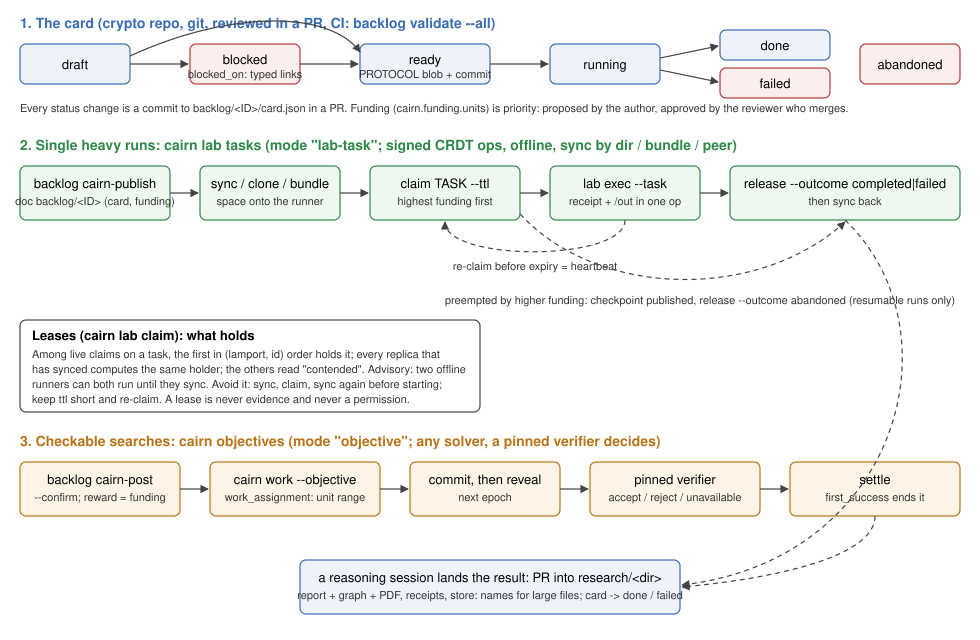

# The experiment backlog

Experiments we would like to run, written down so that someone else (another
agent, or a person on an offline machine) can pick one up, take it, run it
and hand the result back, without the session that thought of it. Reasoning
and execution are separated: a card says what to run and why; cairn holds the
leases and the run receipts; the result comes back to `research/` through a
pull request.

This README is the protocol. The `backlog` binary (`src/bin/backlog.rs`)
checks it; `backlog/schema/card.v1.json` is the machine-readable card format.



*The card lives in git (lane 1). A single heavy run is a cairn lab task
(lane 2); a checkable search is a cairn objective (lane 3). Either way a
reasoning session lands the result in `research/` by a PR. The SVG is
hand-written and is its own source.*

## Layout

```
backlog/
  README.md                 this protocol
  lifecycle.svg             the diagram above
  schema/card.v1.json       the card format (backlog.card/v1)
  XP-<YYYYMMDD>-<slug>/
    card.json               the machine-readable card
    README.md               the narrative: question, why, prerequisites, cost derivation, what "done" means
    PROTOCOL.md             optional; the pre-registration, frozen (committed) before the card is ready
```

## Commands

| command | does |
|:--|:--|
| `backlog list [--status S]...` | one line per card, highest funding first |
| `backlog show <ID> [--shard K]` | the card, its blockers and shard `K`'s resolved command |
| `backlog new <slug> [--title T] [--date D]` | scaffold a draft card |
| `backlog validate [<ID>... \| --all] [--no-git] [--merged-into REF]` | the rules below; exit 1 on any error (CI runs `--all --merged-into origin/main`) |
| `backlog cairn-publish <ID> --lab DIR --identity FILE` | the card into a lab as doc `backlog/<ID>` (fields `card`, `funding`, `status`) and its README/PROTOCOL as lab files; unchanged content is not re-signed; nothing else is created |
| `backlog cairn-status <ID> --lab DIR` | per task: lease state, holder, contended/expired/released counts, run receipts |
| `backlog cairn-found <ID> --lab DIR [--lab-path P --claim C --holder H --identity I --checker-bin B]` | the first-success stop rule. Without `--lab-path`: exit 3 if `found` is set or conflicted (stop), 0 if unset, 2 on any error (a missing lab is an error, never "not found"). With it: fetch the artifact the lab holds at `P`, run the pinned checker `B` on those bytes, and on accept only record `found` in lab doc `backlog/<ID>` |
| `backlog cairn-post <ID> [--confirm --node https://… --identity FILE] [--allow-local-http]` | an objective-mode card as a cairn objective funded with the card's funding; prints the draft and posts nothing without `--confirm` |

`backlog_check_aux2t ARTIFACT.json` is the native checker of the P-192
auxiliary-curve card (exit 0 accept, 1 reject, 2 bad input; one JSON verdict
line). `cargo build --release --bin backlog --bin backlog_check_aux2t`. The cairn commands shell out to
`cairn` (set `CAIRN` to use another path); nothing is reimplemented.

## The card

One directory per experiment, id `XP-<YYYYMMDD>-<slug>` (the date is
`created`; the slug is lowercase letters, digits and single hyphens).
`card.json` fields, all required except `status_note` and `owner_hint`:

| field | what |
|:--|:--|
| `schema` | `backlog.card/v1` |
| `id`, `title`, `created`, `authors` | identity; authors are people, roles or lanes, never email addresses |
| `status`, `status_note` | see the lifecycle |
| `blocked_on` | typed links: `pr:<n>`, `branch:<name>`, `problem:problems/<file>.md`, `xp:<card id>`, `hw:<text>`, `url:https://…`, `note:<text>`; each may carry text after the target |
| `links` | `lead` (encyclopedia section or note), `notes`, `prs` |
| `question` | one sentence |
| `decision_value` | one paragraph: which result changes which decision. Required. A run whose outcome changes nothing is not worth its cost |
| `protocol` | `{path, blob}`: `path` is `PROTOCOL.md` (in the card directory) or null; `blob` its git blob id (`git hash-object PROTOCOL.md`) |
| `code` | `{repo, commit \| branch, build: [argv…]}` |
| `resources` | `{cpus, ram_gb, disk_gb, gpu, est_core_hours, est_wall_hours, notes}`, all integers (or null for the estimates): cairn's values have no floats, so no card carries one; the derivation is in README.md |
| `run` | `{argv, env, timeout_per_shard_s}`: no shell; placeholders `{shard} {seed_lo} {seed_hi} {out} {checkpoint}`, or a key every `shards.params.items[*].vars` defines |
| `shards` | `{count, scheme: seed_range \| list \| single, params, stop: all \| first_success}`. `seed_range`: shard `k` covers `[seed_lo + k·range_size, seed_lo + (k+1)·range_size)`, bounds as decimal strings (exact past `2^64`) |
| `checkpoint` | `{file, resume_flag}`: how a shard resumes; `file` is relative to `{out}` |
| `outputs` | `{result_schema, verify: argv of an independent check of any success claim, land: research/…}` |
| `cairn` | how it executes, and its funding; see below |
| `owner_hint` | who is likely to pick it up (optional) |

### What `backlog validate` enforces

- Every required field, no unknown field (a typo is an error), the id format
  and its match with the directory and `created`.
- `blocked_on` is non-empty when `status = blocked` and empty when the card is
  ready, running or done; every link is typed, `problem:` files and `xp:` cards
  exist.
- **Ready, running and done** need: a `PROTOCOL.md` whose git blob equals
  `protocol.blob`, and (unless `--no-git`) `HEAD:backlog/<ID>/PROTOCOL.md` is
  that same blob, i.e. the frozen protocol is committed on the checked-out
  commit; a full 40-hex `code.commit`; `est_core_hours`; a checkpoint `file`
  and `resume_flag`; a non-empty `outputs.verify`. Editing a frozen protocol
  fails validation until a new blob is recorded, which is visible in review.
  Locally the commit is only checked to be 40-hex; CI runs
  `backlog validate --all --merged-into origin/main`, which also requires it
  to be an ancestor of `main` (a merged commit).
- No floats anywhere (cairn has none); `abandoned` needs a `status_note`.
- Every placeholder in `run.argv` and `outputs.verify` is known and resolves;
  a checker's argv takes only `{artifact}`. A checker this repository knows
  (`KNOWN_CHECKERS` in `src/bin/backlog/card.rs`) must carry its pin flags
  with values (`backlog_check_aux2t --expect-t N`), so a claim is checked
  against the card's parameters, not the artifact's; `--allow-test-prime`
  appears only on draft cards.
- Every placeholder in `run.argv` is known and resolves at the first and last
  shard; `{checkpoint}` needs `checkpoint.file`; a `seed_range` card's bounds
  do not overflow and agree with `seed_hi` when given; a `list` card has one
  item per shard.
- `TODO` anywhere in the card is a warning for a draft and an error otherwise.
- The `cairn` block for its mode (below), and `README.md` exists.

### Lifecycle

| status | means | who moves it |
|:--|:--|:--|
| `draft` | being written; may hold TODOs | the author |
| `blocked` | cannot run yet; `blocked_on` says why | the author, in the PR that finds the blocker |
| `ready` | runnable as written: protocol frozen, commit pinned, verifier named | the author, in a PR; the reviewer checks the protocol |
| `running` | at least one shard or task is held in the lab | the runner's reasoning session, in a PR (or left to `cairn-status`, which is live) |
| `done` / `failed` | the result (or the failure, with its evidence) landed in `research/` | the PR that lands it |
| `abandoned` | will not run; `status_note` says why; the card stays as the record | a PR |

Cards are not deleted. A card that is superseded is `abandoned` with a note
naming its successor.

### Adding a card

1. `backlog new <slug> --title "…"`, fill in `card.json` and `README.md`
   (question, decision value, prerequisites, the cost derivation with every
   input cited and every extrapolation marked, what "done" means).
2. If something blocks it, link the blocker; a major or recurring one gets a
   `problems/` record first (AGENTS.md, "Name the obstruction").
3. Propose a funding level with a one-line rationale relative to the cards
   already here (next section).
4. `backlog validate <ID>`, then open a PR. CI runs `backlog validate --all`.
5. To make it `ready`: write `PROTOCOL.md` (AGENTS.md's pre-registration:
   hypothesis, frozen inputs, success and stop conditions, cost accounting),
   commit it, record `git hash-object PROTOCOL.md` as `protocol.blob`, pin
   `code.commit` to a merged commit, and name the independent check.

## Funding is priority

`cairn.funding = {units, rationale}`. In cairn, funding is the reward and the
priority mechanism: a higher-funded job is preferred and may preempt a
lower-funded one. The backlog uses the same number for both kinds of work.

- **Who sets it.** The card's author proposes `units` and the rationale in
  the PR; the reviewer who approves and merges the PR approves the number.
  Changing it later is a PR too, because funding reorders everyone's work.
- **Units** are relative integers (at most `i64::MAX`). The seed cards span
  131,072 to 1,000,000; propose a new card's level against them. For an
  objective with piecework the validator requires `funding ≥
  piecework.units`; see "Runbook: an objective" for what a unit pays.

### What cairn does with it (read from its source, `aburan28/cairn`)

- **Objectives:** the funding is the objective's `reward` (`spec/objective.schema.json`
  `reward`; `src/records.rs:755` `funded_by` signs it). `GET /goals` and the
  MCP tools rank open angles by open reward per live worker,
  richest first (`src/goals.rs:711–731`, `underserved`). `cairn work`
  itself works the one objective it is given (`src/agent/work.rs:1–40`); an
  operator picks the richest from `/goals`.
- **Lab tasks:** no notion of priority. A lease is first-come in
  `(lamport, id)` order (docs/lab.md, "Leases"); `src/lab/` has no
  reward, stake or priority field.
- **Agent spool jobs:** first in, first out by file mtime
  (`src/agent/cli.rs:759–777`, `oldest_spec`).

So for lab tasks and spool jobs the backlog defines the order itself:

1. **Order.** A runner looking for work takes the free task (no live holder,
   not completed) of the highest-funded card it can run, by the `funding`
   field of doc `backlog/<ID>` in the lab; ties go to the earlier `created`,
   then the lower id. A runner feeding a cairn agent spool submits jobs in that
   order.
2. **Preemption.** A runner holding task `A` (funding `f_A`) may give it up for
   a free task `B` with `f_B > f_A` **only if `A`'s card is resumable**
   (`checkpoint.file` and `checkpoint.resume_flag` set). It stops `A`'s
   command, lets its run publish the latest checkpoint under the card's
   `publish` prefix, and releases with
   `cairn lab release <claim> --outcome abandoned --note "preempted by <B>
   (funding f_B > f_A); checkpoint at runs/<ID>/…; resume with <resume_flag>"`.
   The next holder of `A` checks the checkpoint out as an input
   (`--input runs/<ID>/…`) and runs with the resume flag. A card without a
   checkpoint is never preempted: its run would be lost.
3. **Objectives** preempt by operator choice: `cairn work stop` and start on
   the richer objective. Paid piecework units stay paid; unrevealed progress
   is the solver's own checkpoint.

## Execution: cairn

Execution and leases live in [cairn](https://github.com/aburan28/cairn)'s
lab (a replicated, signed, offline-capable workspace; `cairn lab help`,
cairn `docs/lab.md`), not in this repository. The card's `cairn` block says how:

**`mode: "lab-task"`** (single heavy runs: lead 1, the G1 frozen cells, the
P-224 depth check; and, with the first-success rule, searches such as the
P-192 auxiliary curve):

| field | what |
|:--|:--|
| `space` | the lab space id, or `TBD` until one is chosen |
| `tasks` | the card id (one shard), `<id>/shard-<k>` per shard, or the single entry `<id>/shard-{k}` for every shard (large seed-range cards) |
| `ttl_s` | the lease length; re-claim before it lapses (the heartbeat) |
| `env` | `{name, recipe}`: how to build the environment tree from the pinned commit (usually a Docker image built at `code.commit`, imported with `cairn lab env import NAME --docker IMAGE`) |
| `exec` | `{cpus, memory_mb, timeout_s, sandbox: auto \| none, sandbox_reason, publish: runs/<ID>…}`. `none` runs unconfined and the receipt says so; it is allowed for jobs whose memory exceeds what the host's jail can give, and needs `sandbox_reason` |
| `checker` | required when `shards.stop = first_success`: `{status: available, bin, argv with {artifact}, artifact_schema}`, the native check that decides `found` |
| `funding` | `{units, rationale}` |

**`mode: "objective"`** (checkable searches posted for anyone's solver; the upgrade path of the P-192 auxiliary-curve search):

| field | what |
|:--|:--|
| `kind` | the cairn verifier kind (`certificate` or `workspace`) |
| `goal`, `statement` | what the objective is posted under, and what a stranger reads |
| `checker` | `{status: available \| blocked, bin, argv, artifact_schema, blocked_by}`: the native checker |
| `verifier` | the cairn verifier block exactly as cairn takes it, or `null` until a route exists. A pinned Python script is refused (AGENTS.md, "no Python") |
| `piecework` | `{units, unit}`: how the search divides (one shard = one unit) |
| `stop` | equals `shards.stop` |
| `funding` | `{units, rationale}`: the objective's reward |

**Native checkers and cairn.** cairn's `certificate` verifier runs a pinned
*Python* module (`src/verifiers/mod.rs:57–60`, `:916–1000`;
`src/scaffold.rs:288–296`). This repository's verifiers are native, so no
certificate objective can be posted from here today. The open route is
cairn's `workspace` verifier with a zero-dependency Rust checker crate in the
pinned base tree; it is untested in cairn's jail. Recorded in
[problems/cairn-certificate-checker-python-only.md](../problems/cairn-certificate-checker-python-only.md).
Meanwhile a checkable search runs as **lab tasks with the first-success stop
rule** (next section) and its native checker; the objective is its upgrade
path.

### First success on lab tasks

A lab-task card with `shards.stop = first_success` (a search that ends at the
first verified witness) carries an available native `cairn.checker`. The rule:

1. **Before claiming each shard**, a runner syncs and runs
   `backlog cairn-found <ID> --lab DIR`. Exit 3 means lab doc `backlog/<ID>`
   has `found` set: stop, claim nothing more on this card.
2. **A shard that finds a witness** writes it under its output directory
   (`{out}/found/…`); `cairn lab exec --publish runs/<ID>/shard-<k>` publishes
   it with the run receipt in one op.
3. **The runner records it, before releasing** the lease:
   `backlog cairn-found <ID> --lab DIR --lab-path runs/<ID>/shard-<k>/found/…
   --claim <lease id> --holder <name> --identity <key> --checker-bin <path>`.
   It refuses unless all of these hold:
   - the local card validates, is `ready` or `running`, and equals the card
     published in lab doc `backlog/<ID>` (`card` field);
   - `--lab-path` is strictly below `runs/<ID>/` (no `.`/`..` components);
   - `--claim`/`--holder` are the **live** holder of one of the card's tasks
     in `cairn lab tasks` (after a re-claim the older live lease stays the
     holder until it lapses; use the id `tasks` shows);
   - the checker, run as the card's `cairn.checker.argv` with argv[0]
     replaced by `--checker-bin` (the binary from the card's pinned build),
     exits 0 with verdict `accept` on the bytes `cairn lab cat <lab-path>`
     returns, written to a private temporary file (the local file is not
     what is checked: the lab's copy is);
   - a verdict made with `test_prime: true` is refused unless the card is a
     draft.

   Then it sets `found` = `{artifact, artifact_sha256, verdict, claim,
   holder, task, checker_sha256}`; a reject records nothing and the search
   goes on. The checker binary is identified by its SHA-256 in `found`, so a
   reviewer can compare it with the pinned build.
4. **It releases** the shard `completed` and syncs. `backlog cairn-status`
   prints the `found` record above the task table.

The honest limits:

- An offline runner does not see `found` until it syncs, so it may keep
  searching after the answer exists. That wastes work; it never produces a
  wrong result, because `found` is set only on the checker's accept.
- Two runners that record `found` concurrently create a register conflict on
  that doc field. cairn keeps both values, but `cairn lab doc backlog/<ID>`
  does not show them reliably: 8.0.0 shows one display winner, 9.1.0 omits a
  conflicted field. So `backlog cairn-found` and `cairn-status` read
  `cairn lab conflicts --json` first: a conflicted `found` counts as found
  (exit 3), and both commands print every concurrent value, each of which
  passed the checker when it was written. `cairn lab resolve` (or a later
  `doc set` naming both) settles it.
- **Supported cairn:** 8.0.0 ≤ version < 10.0.0 (tested on 8.0.0 and 9.1.0);
  the cairn commands refuse other versions, because the JSON shapes and
  error texts they rely on are only known inside that range.

### Runbook: a lab task, offline

On a machine that will run the work (any of the three carriers works offline;
a bundle file can travel on a USB stick):

```sh
cairn lab identity --out ~/.cairn/lab.identity.json          # once; an admin admits the key as writer
export ID=~/.cairn/lab.identity.json L=~/lab
cairn lab clone --space <SPACE> --dir /mnt/usb/lab --lab $L  # or --bundle F, or --peer ID@HOST:PORT
cairn lab --lab $L sync --dir /mnt/usb/lab                   # fresh state before choosing
cairn lab --lab $L tasks                                     # who holds what; pick by funding (doc backlog/<ID>)
backlog cairn-found <CARD> --lab $L                          # first_success cards: exit 3 = already found, stop
backlog show <CARD> --shard <K>                              # the exact command and resources
cairn lab --lab $L claim <CARD>/shard-<K> --holder <host-or-person> --ttl 86400 --identity $ID
cairn lab --lab $L sync --dir /mnt/usb/lab                   # publish the claim; re-check `tasks`: held, not contended
cairn lab --lab $L env import <ENV> --docker <IMAGE> --identity $ID   # per the card's cairn.env.recipe
cairn lab --lab $L exec --env <ENV> --identity $ID --task <CARD>/shard-<K> \
    --publish runs/<CARD>/shard-<K> --memory <MB> --cpus <N> --timeout <S> -- <argv from backlog show>
#   (or: cairn agent submit JOB on a registered host; or a taskq task for the same command)
cairn lab --lab $L claim <CARD>/shard-<K> --holder … --ttl 86400 --identity $ID   # before expiry: the heartbeat
cairn lab --lab $L release <CLAIM> --outcome completed|failed --identity $ID [--note …]
cairn lab --lab $L sync --dir /mnt/usb/lab                   # or bundle --out F and carry it back
backlog cairn-status <CARD> --lab $L
```

### Runbook: an objective

```sh
backlog cairn-post <CARD>                                     # the draft, nothing posted
backlog cairn-post <CARD> --confirm --node https://NODE --identity funder.identity.json
cairn work --node https://NODE --objective <OBJECTIVE-ID> --worker <name> -- <solver argv>
```

`cairn work` asks the node for this worker's unit range each round, runs the
solver, and commits and reveals what it prints; the pinned verifier decides
each claim. `--node` must be `https://` (plain http only to
127.0.0.1/localhost with `--allow-local-http`).

What a piecework objective pays, read from cairn's schema: `unit_price =
floor(reward / units)` for **every novel accepted claim**, until the pool is
empty; it never settles as a whole, so it does **not** stop at the first
success, and `reward mod units` is never paid out. With no `key`, the
artifact itself is the unit, so for a witness search one paid unit is one
distinct accepted witness (a curve), not a seed range: a witness checker
cannot tell which seed range a curve came from. `piecework.units` only sizes
the slices `work_assignment` hands out. A card wanting "pay once for the
first witness" needs a non-piecework objective, which settles on its first
accepted claim.

### Guarantees, and what they are not

- **Lab leases are advisory and resolve after sync.** Among live claims on a
  task, every replica that has the same ops computes the same holder; the
  other claims read `contended`. Two runners that claim offline both run until
  they sync, and the loser's work is duplicated, not lost or merged. To avoid
  it: sync, claim, sync again and check `tasks` before starting; keep `ttl_s`
  short and re-claim. A lease is never evidence and never a permission
  (cairn docs/lab.md).
- **Runs are durable and attributable.** `cairn lab exec` writes the receipt
  (environment digest, argv, limits, exit status, wall time) and the outputs in
  one signed op; a sandbox that failed to start is `error`, never a result.
- **Objective claims are graded by the pinned verifier**, not by the
  submitter or the runner; `unavailable` (a node that cannot run the check) is
  never a rejection.
- **Not guaranteed:** that a card's command is correct (the protocol and the
  reviewer are), that a stalled holder stops (an expired lease only lets
  someone else claim), or that an unconfined run (`sandbox: none`) is isolated.

## Results land in `research/`

A run's outputs live in the lab under `runs/<ID>/…`. A reasoning session
(any runtime) reads them, checks them with `outputs.verify`, writes the study
directory under `outputs.land` with its report, graph and PDF (AGENTS.md,
"Research searches must leave visual reports"; `benchmarks/` too for timing
results), pushes large files to the store and cites them by `store:` name,
and opens a PR that also moves the card to `done` or `failed`. A lab receipt
is not a result until that PR merges.

## How it relates to the rest

| | role | relation |
|:--|:--|:--|
| [`problems/`](../problems/README.md) | named blockers | a card's `blocked_on` links them (`problem:`); a card is the experiment, a problem record is the obstruction |
| [`taskq/`](../taskq/README.md) | Redis execution queue for measured runs | still usable as the executor of a claimed lab task: submit with `idempotency_key = <ID>/shard-<k>`; the lab lease says who is responsible, taskq runs it |
| [Conductor](../docs/CONDUCTOR.md) | file reservations for code edits | unchanged: it governs editing this repository (cards included); it does not lease runs |
| [the store](../docs/store/README.md) | content-addressed large files | big outputs go there by digest; the landing PR commits the index entry |
| cairn | leases, runs, objectives | the execution layer; this repository holds only the cards and the results |

## Decisions that are the user's

- **Where the shared lab space lives:** a node or peer address
  (`cairn lab serve`), a shared directory, or bundles carried by hand.
  Every card's `cairn.space` is `TBD` until then.
- **Who is admitted as a writer** (and admin) of that space.
- **Whether and how objectives are funded and posted** in practice: which
  node, which funder identity, and the funding numbers, which the reviewer
  approves card by card.
- **Whether to extend cairn so a `certificate` verifier can pin a native
  executable** (a change in `aburan28/cairn`, not here). It unblocks objective
  mode for this repository's native checkers
  ([problem record](../problems/cairn-certificate-checker-python-only.md));
  until then checkable searches run as first-success lab tasks.

## Seed cards (2026-10-15)

| card | status | funding | blocked on |
|:--|:--|--:|:--|
| [XP-20261015-pkm-m3-n21-m4-n20](XP-20261015-pkm-m3-n21-m4-n20/README.md) | blocked | 1,000,000 | 256/512 GB host or a disk-backed reducer; PR #1893 |
| [XP-20261015-kummer-p224-depth](XP-20261015-kummer-p224-depth/README.md) | draft | 400,000 | — (engine on `claude/f4-generic-field`; protocol not frozen) |
| [XP-20261015-shape-g1-frozen-cells](XP-20261015-shape-g1-frozen-cells/README.md) | blocked | 250,000 | PR #1892; memory |
| [XP-20261015-p192-isogeny-aux-search-t48](XP-20261015-p192-isogeny-aux-search-t48/README.md) | blocked | 131,072 | tower builder and Stage 0 (in progress); PR #1889; gate on lead 1. Lab tasks, first success; objective is the upgrade path |

## What is not built

- A `backlog` command that claims, runs or heartbeats: those are `cairn lab`
  commands, used directly (runbook above).
- A cairn objective for a native checker (problem record above); the
  checker itself is `src/bin/backlog_check_aux2t.rs`.
- Automatic status sync from the lab back to `card.json`: status in git moves
  by PR; `cairn-status` is the live view.
