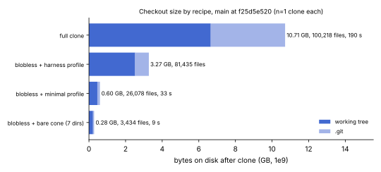

# Checkout size by recipe, 2026-10-16

What a fresh clone of `main` at `f25d5e520` costs under four recipes, measured
once each from github.com through a Claude Code cloud container's HTTPS proxy
(shared network, no isolation). Recipes and how to use them:
[docs/sparse-checkout.md](../../sparse-checkout.md). Values: [data.json](data.json);
graph: [checkout-size.svg](checkout-size.svg) from [plot.py](plot.py); PDF:
[report.pdf](report.pdf).



| recipe | files on disk | working tree (bytes) | `.git` (bytes) | wall time (s) | `cargo check --all-targets` |
|:--|--:|--:|--:|--:|:--|
| `git clone URL` | 100,218 | 6,651,988,041 | 4,061,787,984 | 190 | not run |
| blobless, profile `harness` | 81,435 | 2,521,984,680 | 749,208,026 | 46 after the minimal clone | pass |
| blobless, profile `minimal` | 26,078 | 458,328,475 | 140,696,247 | 33 | pass |
| blobless, bare cone of 7 directories | 3,434 | 220,299,783 | 62,890,969 | 9, then 8 | fail (4 Cargo targets in `experiments/`); `cargo check` passes |

All measured. Sizes are `du -sb`; times are whole seconds of wall clock
around the clone command, including checkout and, for the profiles, computing
the rules. The harness row was measured by applying `--profile harness` to the
minimal clone, so its time is the extra fetch and checkout, not a clone. One
sample per recipe (two for the bare cone), on a shared network: the times show
order of magnitude, not a distribution.

Derived (from `git ls-tree -r -l f25d5e520`): 829 of the 100,218 tracked
files are over 1 MiB and hold 4,823,311,258 of 6,651,988,041 bytes, 72.5%,
which is what a cloud session's `blob_limit_kb: 1024` leaves out.

`cargo check --all-targets` in the minimal clone took 160 s with a cold
target directory and 30.8 s once dependencies were built; it found no
missing file.

Commands, in `$S` a scratch directory:

```sh
git clone -q https://github.com/aburan28/crypto full                                # full
scripts/sparse-checkout.sh clone https://github.com/aburan28/crypto m --profile minimal  # minimal
(cd m && scripts/sparse-checkout.sh apply --profile harness)                         # harness
git clone -q --filter=blob:none --sparse https://github.com/aburan28/crypto c \
  && git -C c sparse-checkout set src docs scripts tools benches examples tests      # bare cone
du -sb --exclude=.git DIR; du -sb DIR/.git; git -C DIR ls-files -t | grep -vc '^S '
CARGO_TARGET_DIR=$S/target cargo check --all-targets
```
