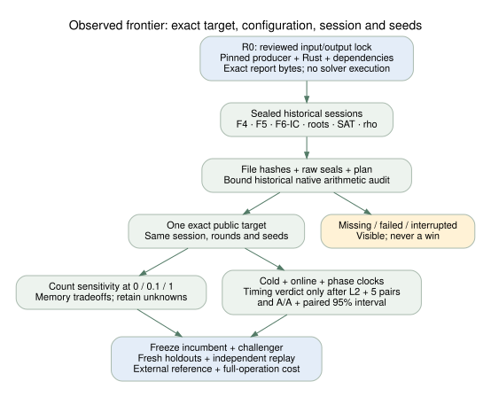

# Backend frontier: initial integration and validation

Date: 2026-10-17. Base: `c6d64436a33359320ad9d5b42c4acebee2968b9a`.

The [interactive report](../../backend-leaderboard/index.html) combines 17
historical sessions into 626 exact-target backend entries and retains 170
planned cells with no measured executions. It includes F4 matrix, inherited F4,
F5 matrix, F6-IC, custom root finding, SAT and reference methods. These counts
are derived by the native report producer from its explicit manifest; no solver
was run or retimed in this work.

The primary incumbent view is the **IC recipe frontier**. A separate
cross-method count frontier retains the distance to reference methods. Both
compare only the same target, session, rounds and seeds, across every weight
0, 0.1 and 1 GAE per native operation. Crossing bands remain unresolved. Raw
native counters, memory, phase clocks, source and binary hashes remain available.
SAT conflict and learned-clause counters from the historical nested format are
exposed with their source pointer, without assigning a new price.

No paired timing winner is admitted in this imported panel. Its wall data do
not meet the report's complete L2 / five-pair / same-target A/A and interval
gates. The report shows descriptive cold solve, online and process clocks with
their actual boundaries. It does not establish a globally fastest backend,
an external-tool win, scaling, or a ledger promotion.

Fields of size 2³, 2⁴, 2⁵, 2⁵¹ and 2⁸³ have no imported measurements. Degree 53
does have observations, with their audit limitations visible. In particular,
the study named `ecbench_m83_rho_20261005` contributes calibration at degrees
53, 59 and 61; its name does not establish degree-83 coverage. Incomplete
degree-31 plans remain failures/gaps, not wins. The exact E₀ degree-83 gate
and complete larger-field backend comparisons remain open.



The [editable diagram](flow.dot), [diagram PDF](flow.pdf),
[report source](REPORT.tex) and [report PDF](REPORT.pdf) accompany this record.
The [agent workflow](../BACKEND_FRONTIER.md) records how to freeze an incumbent,
change one lever, retain failures, use holdouts, compare an external reference
and promote only a verified full-operation improvement.

## Validation and limits

The standalone Rust producer deliberately avoids a root-library dependency.
It directly shares the harness's pricing-band, bootstrap and identity-codec
source and extracts its native-unit vocabulary at build time. Admission needs
raw file/record/plan integrity and a hash-bound historical native arithmetic
audit. This is a historical-evidence projection, not a new arithmetic replay.

- Native tests exercise crossing price bands, unknown costs, exact cohort and
  seed matching, memory tradeoffs, timing/A/A admission, incomplete online
  phases, legacy SAT counters, tampered records, misbound receipts and
  read-only freshness checks. Logs are in [validation/](validation/).
- Clippy with warnings denied and the native freshness check are run on the
  final source. Browser checks exercise 626 rows, backend filters, SAT counters
  and provenance, empty degree-51/83 cells, reset, desktop/mobile layout and
  script-error detection.
- Publication, relative links, metadata, sitemap and idempotent assembly are
  checked separately for the new route. The new workflow checks the native
  report on every PR so extending the manifest cannot leave a source outside
  a static path allowlist.
- Root `cargo build --locked --release --bin ecbench` fails with 25 compiler
  errors; `cargo test --locked --release --lib` fails with 26 before tests run.
  These existing integration files are unchanged by this PR. The exact
  obstruction and exit conditions are [recorded](../../../problems/ecbench-main-build-integration.md).
- The full existing site suite has unrelated failures in the embedded progress
  JSON and cached scoreboard-panel index. Its lab-browser freshness test also
  cannot read an off-disk source through this shallow checkout's batch reader.
  The final full-suite log is retained; an unavailable sparse input is not
  treated as absent repository evidence. These failures are not waived.

No algorithm or benchmark fixture changed. The existing IC leaderboard,
scoreboard and progress graph retain their current figures because this work
introduces no empirical timing measurement, new admitted result or promotion.
Publication of the new route follows the normal PR/CI gates; a local report is
not represented as a deployed page.

## Reproduce

From the repository root, after materializing the manifest's inputs:

```sh
cargo test --locked --manifest-path tools/backend-leaderboard/Cargo.toml
cargo clippy --locked --manifest-path tools/backend-leaderboard/Cargo.toml --all-targets -- -D warnings
cargo run --locked --manifest-path tools/backend-leaderboard/Cargo.toml --
cargo run --locked --manifest-path tools/backend-leaderboard/Cargo.toml -- --check
dot -Tsvg docs/ecbench/backend-frontier-report/flow.dot -o docs/ecbench/backend-frontier-report/flow.svg
dot -Tpdf docs/ecbench/backend-frontier-report/flow.dot -o docs/ecbench/backend-frontier-report/flow.pdf
cd docs/ecbench/backend-frontier-report
pdflatex -halt-on-error -interaction=nonstopmode -output-directory=/tmp REPORT.tex
```

The report JSON records all source-file hashes and the compiled pricing,
calibration, alias and producer inputs. No proprietary/external solver was run;
external comparison remains a prerequisite for a fastest-tool claim.
