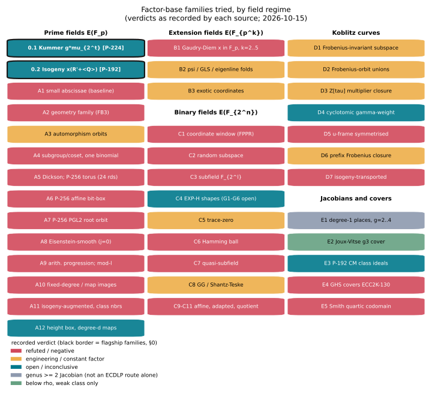
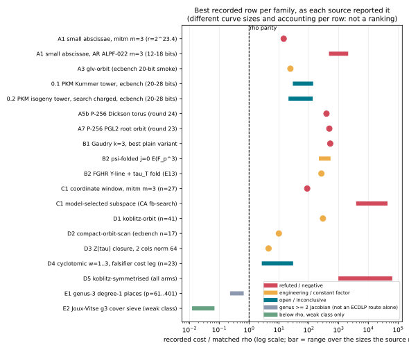
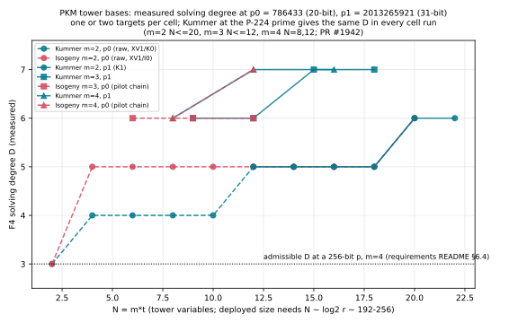

# An encyclopedia of the factor bases we have tried

**Date:** 2026-10-15.
**Scope:** every factor-base construction for elliptic-curve and Jacobian
index calculus that this repository (`aburan28/crypto`, at `a80b15bbc`) or the
research program (`aburan28/crypto-autoresearcher`, at `4446b91c2f`) has
designed, built, measured or closed on paper. The two sibling repositories
`aburan28/cryptanalysis` and `aburan28/ml-cryptanalysis` are included where
they hold a family that is not mirrored here.
**Kind of document:** a search round over code, notes and records (AGENTS.md
"Research searches must leave visual reports"). It compiles results that are
already recorded and runs nothing new. Every number below is quoted from the
file cited next to it. Numbers marked *derived here* are this note's own
arithmetic on quoted numbers, and the working is shown.
**Corrected:** 2026-10-16 (claim audit): §0.1 and §8 lead 1 now cite
`research/ic_next10_20261014/03-pkm-degree` (`D ≥ 8` at `m = 4, N = 20`,
NEGATIVE), and the P-192 `t = 48` card is marked superseded.
**Updated:** 2026-10-15, with the outcomes of the five lead studies that
merged to `main` at `b906df024` (PRs #1887, #1889, #1892, #1893, #1895). They
were chased from §8 of the first version; each verdict below is quoted from
the study's README on `main`, and the earlier text is corrected where a study
superseded it.
**Report PDF:** [`REPORT.pdf`](REPORT.pdf), built from this file.
**Figures:** [`figures/taxonomy.svg`](figures/taxonomy.svg) and
[`figures/cost_vs_rho.svg`](figures/cost_vs_rho.svg) map the families;
[`figures/pkm_solving_degree.svg`](figures/pkm_solving_degree.svg) plots the
two flagship families. The data is in [`figures/data.json`](figures/data.json)
and the drawing code in [`figures/plot.py`](figures/plot.py).

Path conventions:

- a bare path is in `aburan28/crypto`;
- `AR:` marks `aburan28/crypto-autoresearcher`;
- `CA:` marks `aburan28/cryptanalysis`;
- `ML:` marks `aburan28/ml-cryptanalysis`.

`S` is the repository's cost unit: group-addition equivalents divided by
`√r`. Rho's `S` is about 1.25–1.3 without the negation map and 0.886 with it.
"× rho" always means the ratio the cited source recorded against its own
matched rho arm. These ratios come from different curve sizes and different
accounting, so two rows are not comparable unless the text says they are.

---

## 0. The two flagship families, and what was actually run on them

The prime-field factor bases that matter most for deployed curves are Petit,
Kosters and Messeng's *tower* bases (PKC 2016). Their factor base is

```
F = { P ∈ E(F_p) : x(P) ∈ V },   V = L⁻¹(c),   L = L_t ∘ … ∘ L_1,
```

where each `L_j` has low degree and the preimage tree of `L` splits completely
over `F_p`. Then `|V| = 2^t` (for degree-2 steps). Membership of `x` in `V` is
written as `t` low-degree equations in auxiliary variables
`y_0 = x, y_1, …, y_{t−1}`:

```
T_j : y_{j+1} − L_{j+1}(y_j) = 0        (0 ≤ j < t−1)
T_t : L_t(y_{t−1}) − c = 0
```

so no membership equation has degree above 2, even though `V` has `2^t`
elements. This is the prime-field stand-in for the `F_2`-subspace of binary
Weil descent. The repository's design is in
[`RESEARCH_PKM_TOWER_ORACLE.md`](../../../research/notes/index-calculus/RESEARCH_PKM_TOWER_ORACLE.md)
(the *PKM note*), §2.1, lines 205–254, fixed in commit `c2157282` before any
run.

Two of its tower kinds correspond to the two factor-base shapes PKM's slides
attach to NIST curves:

| | **0.1 Kummer: a coset of a smooth subgroup of `F_p^×`** | **0.2 Isogeny: x-coordinates from an isogeny chain on an auxiliary curve** |
|:--|:--|:--|
| NIST curve it fits | **P-224**: `p − 1 = 2^96·(2^128 − 1)`, so `v₂(p − 1) = 96` | **P-192**: `v₂(p − 1) = 1`, so no Kummer tower exists; `v₂(p + 1) = 64` |
| `V` | `g·μ_{2^t}`, the coset of the `2^t`-th roots of unity through `g` | `x(R' + ⟨Q⟩)` for a point `Q` of order `2^t` on an auxiliary curve `E'/F_p` |
| step map | `y ↦ y²`, with `y_0 = x/g` and `y_{t−1}² = 1` | the x-map of a 2-isogeny (Vélu): `y_{j+1}(y_j − ξ_j) = y_j² − ξ_j y_j + τ_j` |
| existence | `2^t \| p − 1` | none on `p`: `E'` is searched for |
| build cost | one exponentiation for `ζ`, then `2^t` multiplications | an auxiliary-curve search, about `2^t` point counts, charged to the factor-base phase |
| implementation | `prime-kummer:t=T[,g=G]` in `src/cryptanalysis/ic_framework/prime_tower.rs` (an `ic.pipeline` plug-in), and `examples/pkm_tower_pilot.rs` | `prime-isogeny:t=T[,seed=S]` in the same file since PR #1889 (`u64`, `t ≤ 20`, search charged), and `examples/pkm_tower_pilot.rs` (lines 497–590) for the solver runs |
| largest instance run | solver: `t = 11` (`N = m·t ≤ 22`) at `p₁ = 2013265921`; deepest 2-adicity `v₂(p − 1) = 30` (PR #1893) | solver: `t = 10` (`N ≤ 20`) at `p₀ = 786433`; ecbench: `t = 8…11` at 20–28 bits, base builds to `t = 14` (PR #1889) |
| run at NIST size? | **No** | **No** |

**Neither family has been run on a NIST prime.** Every tower run used a
generated prime of 20–32 bits. The NIST primes enter only through the 2-adic
valuation table of the PKM note §10.10 (lines 1142–1162), which the note calls
"properties of the primes, not measurements", and through PKM's own slide
remark, quoted in
[`research/pdp_root_finder_requirements_20261012/README.md`](../../../research/pdp_root_finder_requirements_20261012/README.md)
lines 104–119: "NIST P-224 has `p − 1 = 2^{96}·N'`". The code cannot hold a
NIST prime either. `prime_tower.rs` works in `u64`, and
`primitive_two_power_root` refuses `t ≥ 63` (lines 27–36). The pilot counts
points naively in `O(p)`; the `prime-isogeny` plug-in (PR #1889) uses a
baby-step giant-step filter and Mestre counts, still in `u64`. The F4 tower
engines store coefficients in 32-bit words and assert `p < 2³²` (PR #1893).
The autoresearcher ledger has no P-224 coset base and
no P-192 isogeny-chain base. Its only P-192 factor-base object is a class-group
base, entry E3 below.

### 0.1 Kummer tower: `g·μ_{2^t}` (the P-224 shape)

**Definition.** Fix `t` with `2^t | p − 1`, a primitive `2^t`-th root of unity
`ζ`, and `g ∈ F_p^×`. Then `V = g·μ_{2^t} = {g·ζ^k : 0 ≤ k < 2^t}`, and
`F = {P ∈ E(F_p) : x(P) ∈ V}`. About half of `V` lifts to points, and both
signs are kept. The tower is `y_0 = x/g`, `y_{j+1} = y_j²`, and `y_{t−1}² = 1`.

**Algebra** (PKM note §2.4, Lemma 1, lines 296–319). The tower equations are a
Gröbner basis with square-free standard monomials, and the quotient ring is
`R = F_p[y]/(towers) ≅ F_p^{V^m}`. For Kummer, `R` is the group algebra
`F_p[(Z/2^t)^m]`, and `x_i^e = g^e·∏_{j ∈ bits(e)} y_{i,j}`.

**What theory predicted** (§3.2–3.4, lines 336–418).

- A PKM system has the field-equation half of Weil descent, a finite quotient
  with a square-free monomial basis. It lacks the conjugate-equation half,
  which needs a Galois group that `F_p` does not have. So it is a
  *one-generator* system over a `2^N`-point quotient, `N = m·t ≈ log₂ r`.
- Proposition 2: the XL (Macaulay) solving degree is at least `d + δ`, where
  `δ` is generically about `N`.
- Kummer and Dickson towers are degenerate at infinity, with
  Bardet–Faugère–Salvy degree of regularity `N + 1`. Isogeny towers are not.
- §3.7, the linear-algebra floor: the optimum costs about `r^{2/(m+1)}`, so
  `m ≤ 3` can never beat rho. `m = 4` gives `r^{2/5}` and `m = 5` gives
  `r^{1/3}`, so "the decisive Stage A cells are `m ≥ 4`".

**The pre-registered prediction failed in the bounded direction at first.**
F4's solving degree `D` did not grow like `N`. Later rounds showed it is not
bounded either. The `f4_fp_tower` results, all Kummer at `p₁ = 15·2^27 + 1`,
are consolidated from `research/pdp_root_finder_requirements_20261012/README.md`
lines 238–255:

| `m` | `N` | `D` | width (columns) | F4 multiply-adds | peak memory | F4 time |
|--:|--:|--:|--:|--:|--:|--:|
| 2 | 12 | 5 | 1,231 | 6.50e7 | 8 MB | 0.05 s |
| 2 | 16 | 5 | 4,789 | 6.18e9 | 36 MB | 1.1 s |
| 2 | 18 | 5 | 8,644 | 4.60e10 | 91 MB | 6 s |
| 2 | 20 | **6** | 33,446 | 4.84e11 | 473 MB | 57 s |
| 2 | 22 | 6 | 51,909 | — | 2.3 GB | 10 min |
| 3 | 9 | 6 | 1,186 | 1.59e8 | 11 MB | 0.1 s |
| 3 | 12 | 6 | 5,019 | 1.06e10 | 64 MB | 2.0 s |
| 3 | 15 | **7** | 31,397 | 3.19e12 | 1.1 GB | 6.0 min |
| 3 | 18 | 7 | 106,288 | 8.99e13 | 12.7 GB | 176 min |
| 4 | 8 | 6 | 1,049 | 4.84e7 | 9 MB | 0.1 s |
| 4 | 12 | **7** | 9,452 | 8.55e10 | 171 MB | 9.4 s |
| 4 | 16 | 7 | 76,837 | 2.7e13 | 8.1 GB | 55.5 min |
| 4 | 20 | **≥ 8** (msolve) | — | — | 5 GB cap | — |

The `m = 4, N = 20` row is msolve 0.6.5 on the raw presentation, not
`f4_fp_tower`, from [`research/ic_next10_20261014/03-pkm-degree/`](../../../research/ic_next10_20261014/03-pkm-degree/README.md) (2026-10-14; see the
correction under §0.1 *Status*).

The rounds and controls behind that table:

- **Pilot, §10.2** (2026-09-24, `p₀ = 786433 = 3·2^18 + 1`). `m = 2`, `N = 2…18`
  gives `D = 4,4,4,4,4,5,5,5,5`.
  - The `naive` presentation, one dense degree-`2^t` membership polynomial,
    gives exactly `D = 2^t + 2`: 66 against 5 at `N = 12`. The tower
    presentation is what keeps the degree low.
  - A shape-matched **null** tower gives the same `D`, width and steps, so the
    low degree comes from the tower algebra and its monomial support, not from
    the curve.
  - `dickson` gives the same `D`, width and step count as `kummer` at every
    `N`. It is the same F4 computation on different numbers, so it is not an
    independent replication.
- **Round 2, §11** (2026-09-25): `D` rises to 6 at `N = 20, 22` for `m = 2`, in
  the Kummer and the isogeny family and in the null. This refuted the pilot's
  Conjecture 3 (`D ≤ 5` for all `t`).
- **Round 3, §12**: `m = 4`, `N = 16` gives `D = 7` on both targets in 55
  minutes and 8.1 GB. From `N = 12` to `N = 16`, the width grew ×8.1 and the
  multiply-adds ×316.
- **Round 4, §13**: a signature engine (F5/GVW, `sig_fp_tower`) needs rows 1–2
  degrees higher than F4 on 18 of 18 systems, so F4 stays the instrument.
- **Round 6, §15**: an early exit cuts 39% of the multiply-adds at `m = 4`,
  `N = 12`. This is engineering.
- **Round 7, §16** (2026-10-06): `m = 3`, `N = 18` gives `D = 7`, so the `m = 3`
  line reads 6, 6, 7, 7. `N = 21` needs more than this host's 14 GB.
- **IC next-10, item 3** (2026-10-14, [`research/ic_next10_20261014/03-pkm-degree/`](../../../research/ic_next10_20261014/03-pkm-degree/README.md)):
  **NEGATIVE for the `m = 4` plateau.** At `m = 4`, `N = 20`, on both
  targets, msolve completes three productive degree-8 F4 rounds before its
  5 GB cap; it reduces every lower-degree pair first, so **`D ≥ 8`**, and the
  `m = 4` line reads `D = 6, 7, 7, ≥ 8`. `m = 3` stays inconclusive (`D ≥ 7`
  at `N = 18, 21, 24`, stopped by the wall before any degree-8 round).
  Caveat: msolve on the raw presentation; `f4_fp_tower` has not run `N = 20`.

**Pre-registered reading** (rule A1, lines 1506–1513 and 3169–3171):

| cell | `D` sequence | reading |
|:--|:--|:--|
| `m = 2` | 5 5 5 5 6 6 | "H0, at the threshold" |
| `m = 3` | 6 6 7 7 | inconclusive |
| `m = 4` | 6 7 7 | inconclusive |

`log₂(multiply-adds)` grows 1.6, 2.1 and 2.4 bits per tower variable at
`m = 2, 3, 4`, where plain enumeration grows 0.50, 0.67 and 0.75: "F4 grows
three to seven times faster than plain enumeration" (requirements README
lines 260–266).

**What a deployed size would require.** The requirements README §6.4
(lines 420–438) works this out for a 256-bit `p` at `m = 4`: `t = 64`,
`N = 256`, `T_dec ≲ p^{1/4}/32 ≈ 2^59`. "Admissible degree: 3 at `m = 4`,
4–5 at `m = 5`; measured: 7 at `m = 4`, `N ≤ 16`, rising." *Derived here:*
for P-224 at `m = 4`, the same sizing gives `t ≈ 56` (`N ≈ 224`). That is well
inside `v₂(p − 1) = 96`, but 52 levels past the largest `t = 4` measured at
`m = 4`.

**End to end in ecbench**
([`research/pkm_tower_ecbench_20261013/README.md`](../../../research/pkm_tower_ecbench_20261013/README.md)).
The `prime-kummer:t=8…11` base was run on five curves of 20–28 bits with
2-adicity 12, with every group operation charged. 896 runs, all verified.

| bits | `rootfind` ÷ rho (`S`, 95% CI) | tower ÷ plain base of equal size |
|--:|--:|--:|
| 20 | 34.0 [27.9, 42.6] | 1.006 [0.982, 1.032] |
| 22 | 41.9 [34.3, 53.4] | 1.001 [0.996, 1.006] |
| 24 | 29.4 [23.7, 37.3] | 1.012 [0.989, 1.035] |
| 26 | 96.6 [77.8, 124.1] | 1.005 [0.994, 1.020] |
| 28 | 140.6 [113.0, 182.3] | 0.999 [0.994, 1.004] |

"PKM's structure helps an algebraic solver, not a table." The ratio grows
`0.26 ± 0.28` bits per bit of `r`. Class: engineering.

**Related falsifier and root-finding results.**

- **C4 falsifier**
  ([`research/ic_exponent_falsifiers_20261013/README.md`](../../../research/ic_exponent_falsifiers_20261013/README.md)):
  is `e_a + e_b + e_c mod 2^k` biased on the `t = 8` base at `p = 946177`?
  It is not. The largest class share is 0.680, 0.508, 0.393 … against
  0.680, 0.511, 0.396 … for the null, while the positive control reads 1.000.
  "C4's simplest form is falsified on this base."
- **Root-finding oracles on the same cells**
  ([`research/pdp_root_finder_20261012/README.md`](../../../research/pdp_root_finder_20261012/README.md)):
  they were exact on 707 of 707 brute-force checks, with 4.6·10¹¹× less
  counted work than F4 at `m = 3`, `N = 18`. Their slopes sit on the
  pair-table and enumeration floors. Class: engineering.

**Autoresearcher siblings.**

- *Engine sweep* (`AR:src/crypto_autoresearcher/index_calculus/README.md`).
  It uses a high-degree, non-tower `subgroup` base (`x ∈ g·μ_d`, entry A4b)
  and measures exponent 0.97 [0.95, 0.99] at `m = 2`, the same as `small_x`.
- *Twisted group algebra* (`AR:IDEA-20260808-9ef88c`, proposed). Its Stage-0
  analysis predicts solving degree `B − 1` for the binomial membership
  `x^B − c^B`, and a cost `Õ(B^m)`, "still worse than MITM at theta =
  ceil(m/2)".

**Deeper 2-adicity, the torus variant, and the cost of the next cells
(2026-10-15, PR #1893,
[`research/pkm_dickson_torus_20261015/README.md`](../../../research/pkm_dickson_torus_20261015/README.md)).**

- *Deeper 2-adicity* (measured). At `p₂ = 3·2^30 + 1` (`v₂(p − 1) = 30`),
  Kummer `D` and width equal the recorded values at `p₀` (`v₂ = 18`) and `p₁`
  (`v₂ = 27`) in every `(m, N)` cell run (`m = 2`, `N = 2…18`; `m = 3`,
  `N = 6…12`), and so do the steps wherever the recorded targets were also
  random. The study derives why: `ζ` enters only through `V`, which the system
  never contains. `v₂ ≥ 40` was **not** run: both F4 engines hold 32-bit
  coefficients and assert `p < 2³²`, and no prime below `2³²` has
  `v₂(p − 1) > 30`. The run is blocked by the engine's width, not by
  mathematics.
- *The Dickson torus tower* (`2^t | p + 1`) gives the split `D` in all 16
  cells; see 0.2 and A5c.
- *The next cells, derived and not run.* `m = 3, N = 21` projects to about
  130–150 GB peak memory and 2.5–7.4·10¹⁵ multiply-adds; `m = 4, N = 20` to
  about 240–380 GB and 0.85–2·10¹⁶. Each needs a 192–256 GB or a 512 GB host,
  or a disk-backed reducer block. A value at `m = 3, N = 21` could extend the
  `D = 7` plateau to `L = 6` or show a rise; neither gives H1a, which needs
  `N ≥ 27` at `m = 3`.

**Status.** *Correction (2026-10-16 claim audit):* this paragraph first said
"at `m ≥ 4` there is no data past `N = 16`". That missed [`research/ic_next10_20261014/03-pkm-degree/`](../../../research/ic_next10_20261014/03-pkm-degree/README.md),
which measured **`D ≥ 8` at `m = 4, N = 20` (NEGATIVE)**. So the solver
axis is negative at `m = 4`, the only regime §3.7 allows to beat rho's
exponent, and inconclusive at `m = 3`, whose next cell needs a large-memory
host (above). Deeper
2-adicity up to `v₂ = 30` changes nothing. End to end it is engineering: a
tower base costs the same as a plain base in a table oracle. It is not run at
P-224 size.

### 0.2 Isogeny tower: `x(R' + ⟨Q⟩)` on an auxiliary curve (the P-192 shape)

**Definition** (PKM note lines 222, 233–242).

- Search auxiliary curves `E'_0 = E'/F_p` until one has a rational point `Q_0`
  of order `2^t`, and pick `R' ∈ E'(F_p)` with `2R' ∉ ⟨Q⟩`.
- For `j = 0…t−1`, take the kernel point `K_j = 2^{t−1−j}·Q_j`, with
  `ξ_j = x(K_j)` and `τ_j = 3ξ_j² + a'_j`.
- The Vélu step is `x ↦ x + τ_j/(x − ξ_j)`, onto the codomain
  `a'_{j+1} = a'_j − 5τ_j`, `b'_{j+1} = b'_j − 7ξ_jτ_j`.
- With `c = x(Φ(R'))`, the equation `L(x) = c` has exactly the `2^t` rational
  roots `x(R' + ⟨Q⟩)`, and `V` is that set.
- Mixed radix (`degrees=2,2,3`) is a parameter.

**Why it is the generic family.** It places no condition on `p`. So on P-192
(`v₂(p − 1) = 1`) it is the route that remains. A Dickson torus tower
(`2^t | p + 1`, `t ≤ 64`) also exists there. It was first measured as a tower
in PR #1893, at two primes with `v₂(p − 1) = 1` (`T24`, `T31`): it gives the
same `D`, width and steps as the split Dickson tower in all 16 cells, and it is
degenerate at infinity like the split towers (A5c). So on a P-192-shape prime
the torus tower is the split computation on different numbers, and the
isogeny tower stays the only non-degenerate family. The PKM note §4.5 (lines 600–603)
makes this the only family that can support a statement about generic primes:
"Conclusions about generic primes come only from `kind = isogeny`." It is also
the one tower that is not degenerate at infinity (§3.4).

**Measured** (only at `p₀ = 786433`, `t ≤ 10`). The pilot, round 2 and the
A1 table give these values of `D`:

| `m` | `N` | isogeny `D` | width | Kummer `D` at the same `N` |
|--:|:--|:--|:--|:--|
| 2 | 2…18 (pilot, `f4_fp`) | 4,5,5,5,5,5,5,5,5 | 9 … 17,754 | 4,4,4,4,4,5,5,5,5 |
| 2 | 2…20 (round 2, raw presentation) | 3 5 5 5 5 5 5 5 5 6 | 35,158 at `N = 20` | 3 4 4 4 4 5 5 5 5 6 |
| 3 | 6, 9, 12 | 6, 6, 6 | 399; 3,543; 13,249 | 5, 6, 6 |
| 4 | 8, 12 | 6, 7 | 1,897; 21,841 | 6, 7 |

- "It rises at the same level as Kummer's, `t = 10`" (line 1423). The A1
  reading for the isogeny `m = 2` cell is inconclusive (line 1511).
- Generator-count ladder at `N = 12` (instrument power): isogeny `D` = 5, 5, 5,
  5, 4 for `g = 1, 2, 4, 8, 12`. The instrument registers a fall, but the
  isogeny system resists adding generators longer than Kummer does.

**The auxiliary-curve search.** These counts are the `aux_curves_tried` field
of `research/pkm_tower_pilot_20260924/runs/*.jsonl` (naive `O(p)` counting at
`p₀`):

| `t` | 1 | 2 | 3 | 4 | 5 | 6 | 7 | 8 | 9 | 10 |
|:--|--:|--:|--:|--:|--:|--:|--:|--:|--:|--:|
| curves tried | 1 | 3–4 | 1–5 | 8–54 | 88 | 3–142 | 196 | 404 | 584 | 425 |

The `E'` found had order 786,688 at `t = 8` and 787,456 at `t = 10`. The pilot
*reported* this search but did not *charge* it. The design rule (§2.1, §5.4)
lists "charging the auxiliary-curve search as free" as inadmissible, so any
priced run must add it.

*Derived in the first version of this note:* at P-192 size with `m = 4`,
`t ≈ 48`, so the note's own estimate (line 246) is about `2^48` SEA point
counts per factor base. PKM's cheaper alternative builds `E'` by CM through
`x² − Dy² = 4N` (requirements README lines 110–119). It was not implemented.
*Correction (2026-10-16):* `t ≈ 48` is `N / m` with `N ≈ 192`, the size at
which every point decomposes; it is not the cost optimum. The note's own §3.7
puts the optimal base at `|V| ≈ (m!·r·T)^{1/(m+1)} ≈ 2^39` at `m = 4`
(derived), i.e. `t ≈ 39`.

**Charged end to end in ecbench (2026-10-15, PR #1889,
[`research/pkm_isogeny_tower_ecbench_20261015/README.md`](../../../research/pkm_isogeny_tower_ecbench_20261015/README.md)).**
The base is now the `ic.pipeline` plug-in and `ecbench fb` family
`prime-isogeny:t=T[,seed=S]`, with the auxiliary-curve search charged to the
factor-base phase in group-addition equivalents. 1,080 runs on eight curves of
20–28 bits, three of them with `v₂(p − 1) = 1` (the P-192 shape); every run
verified and 720/720 replays identical.

- *Measured.* Index calculus on the isogeny base costs **1.002–1.331× the same
  index calculus on a plain base of equal size** (paired `S` ratios; p24 is
  unresolved at 1.002 [0.979, 1.028]). The excess is the search's share of
  `S`, **0.8% to 25%**, set by how many curves the seed happened to try (3 to
  744), not by curve size; it is 13–25% on the three `v₂(p − 1) = 1` curves.
  Every IC arm stays far above rho (isogeny ÷ rho 21.0–136.5).
- *Measured.* Curves tried ≈ `C·2^t` with pooled `C = 1.05` over 224 builds
  (`t = 8…14`), with a spread of two to three orders of magnitude between
  seeds at fixed `t`.
- *Derived, not measured.* At P-192 size (`t = 48`, `m = 4`) the search costs
  about **`2^74` GAE** with a `2^25`-entry baby-step table (`2^82` at
  `t = 64`), against rho's `√(πr/4) ≈ 2^95.8`. So the search would not
  dominate; the relation and linear-algebra phases, which the solving-degree
  question decides, would.
- *Verdict* (class: accounting). The isogeny tower buys a table oracle nothing
  over a plain base of the same size, as the Kummer tower did not; the price
  of its construction is now inside `S`. No exponent claim.

**Status.** Open on the solver axis, and the solver measured only at a 20-bit
prime. Priced end to end in ecbench at 20–28 bits since PR #1889 (accounting:
no gain over a plain base for a table oracle). Not run at P-192 size: the
plug-in is `u64` (`p < 2^62`) and refuses `t > 20`, and SEA, CM construction
and 2-Sylow halving are not implemented. The P-192 `t = 48` auxiliary search
card (§8) is abandoned as superseded: `t = 48` is not the §3.7 optimum
(`|V| ≈ 2^39` at `m = 4`), and the supersingular `E'` and the Dickson torus
make the search unnecessary. The autoresearcher program cites the construction
(`AR:KN-LIT-025`) but never built it: `AR:H-RELN-96e3ba` calls the PKM arm
"unmaterialised".

---

## 1. How each entry reads

Each entry gives as many of these fields as the record supports:

- **Definition**: the set `V` of abscissae, or the set of points.
- **Existence**: conditions on `p`, `n` or the curve.
- **Build**: how the base is constructed, what it costs, and whether that cost
  is charged.
- **Fold**: the symmetry quotiented out (negation, Frobenius, automorphisms,
  2-torsion).
- **Oracle**: the decomposition oracle or solver paired with the base.
- **Measured**: the results, with the sizes they were measured at.
- **Verdict**: the recorded class or decision (refuted, rejected_scoped,
  weakened, inconclusive, engineering, accounting, open), with the mechanism
  when the source names one.
- **Sources**: where the record lives.

Families are grouped by field regime: §2 prime fields, §3 odd-characteristic
extension fields, §4 binary fields, §5 Koblitz curves, §6 Jacobians and
covers. §7 collects the results that bound every family at once, and §8 lists
the open lines.



---

## 2. Prime fields `E(F_p)`

### A1. Small abscissae / x-interval (Semaev's prime-field base): the baseline

- **Definition.** `F = {P : x(P) < B}`, both signs, one column per abscissa.
  `|F|` is about `#E^{1/3}` for `m = 3`.
  - The membership polynomial `∏(x − x_j)` is dense, of degree `|F|`.
  - Variants: a stride-`s` scan, a centred interval, the high-bit window
    `[p − W, p)` (`AR:H018`), and an offset interval.
- **Build.** One Legendre symbol and one square root per abscissa, charged.
  - Plug-in: `prime-abscissa:size=N[,stride=s]` (`src/cryptanalysis/ic_framework/plugins.rs` L71–133).
  - In the autoresearcher engine: `small_x` (`AR:src/crypto_autoresearcher/index_calculus/factor_base.py`).
- **Oracles.** Semaev `S₃` roots, `subtract`, `mitm` (`m = 2, 3`), `mitm-prime-batch`,
  `rootfind-*`, `S₄` with Cantor–Zassenhaus, Gröbner/msolve, crossbred.
- **Measured.**
  - Boundary ledger §2 (`research/notes/index-calculus/RESEARCH_IC_BOUNDARY_LEDGER.md`),
    eight sizes from `2^9.7` to `2^23.4`. At `r = 2^23.4`, `|F| = 512`:
    `S₃` roots 1,107× rho, subtraction 436×, `mitm m = 2` 59.1×,
    `mitm m = 3` 14.5×. The fitted exponents are 0.905, 0.850, 0.662 and 0.601,
    against rho's 0.274. Yield over ceiling is 0.75–1.25: the base "behaves like
    a random set of its size".
  - Deployed shape (`a = −3`, prime order; `RESEARCH_ECC2K130_IC_FEASIBILITY.md`
    §5): IC/rho is 19× at 16 bits, 114–199× at 20 bits and 233–403× at 24 bits.
  - `AR:EXP-ALPF-022` (`m = 3`): IC/rho is 478.63, 531.07, 1211.60 and 2109.18
    at 12, 14, 16 and 18 bits, with fit
    `log₂(IC/rho) ≈ 0.368·log₂ n + 4.42`. Verdict: NEGATIVE (scoped).
  - `AR:EXP-ALPF-032`: a verified end-to-end solve. The decomposition exponent
    is 0.889, and the linear algebra alone costs `n^{2/m}`, more than `√n` at
    `m = 3`, "even with a free decomposition oracle".
  - AR engine sweep, 12–32 bits:
    - exhaustive IC is about `N^{1.0}`, against rho's 0.50 [0.48, 0.52];
    - MITM `m = 3` gives 0.67 and `m = 7` gives 0.58;
    - at 32 bits, `m = 3` MITM is 34× rho;
    - msolve per target grows as `|F|^{3.80}` (`m = 2`) and `|F|^{4.41}`
      (`m = 3`).
  - ecbench L0 smoke, 20-bit prime, `prime-abscissa:size=32`: `S = 11.329`
    (12.3× the negation rho; "not a performance claim";
    `research/ecbench_factor_bases_20261013/RESULTS.md`).
  - Small-root route (`RESEARCH_PRIME_FIELD_BREAKTHROUGH_PROGRAM.md` §2–3):
    - with `x ≤ p^δ`, a decomposition needs `δ ≥ 1/(2(m−1))`;
    - the Coppersmith reach is `1/(m(m+1)·2^{m−2})`: 1/6, 1/24 and 1/80 for
      `S₃`, `S₄` and `S₅`;
    - `m = 4` needs about `δ ≈ 1/5`, against a reach of 1/80.
- **Verdict.** Refuted as a route past rho.
  - The pair-table family law (§7) is `S = 0.75·r^{1/6}`.
  - `AR:KR-IC-5931ee`: "Naive Semaev index calculus over prime fields cannot
    beat generic methods".
  - This base is the control every other prime-field entry is compared with.

### A2. Geometry family at matched size (`AR:H-FB3-001`, six geometries plus two priors)

- **Definitions** (`AR:experiments/EXP-FB3-001/amendment-001.yaml`).
  - `high_bit_interval`: the top window of `F_p`.
  - `small_height`: the smallest `max(|u|,|v|)` with `x = u/v mod p`.
  - `mixed_two_base`: an interval plus small multiples, with typed
    decompositions.
  - `coset_union`: "Choose the largest divisor `d` of `p − 1` with `d ≤ B`, let
    `H` be the subgroup of order `d` in `F_p^*`, and take the union of cosets
    `g^i·H`", keeping the abscissae of points.
  - `greedy_optimized`: submodular greedy selection from a pool of `4B`.
  - `asymmetric_sizing`: base sizes `B₁ ≥ B₂ ≥ B₃`.
  - The two priors: `H016`, a quadratic-residue base from an r-adding walk, and
    `H017`, small multiples `jG`.
- **Measured.** `N ≈ 2^14, 2^16, 2^18`; 12 prime-order curves; `m = 3`; exact
  counting over every target; 288 of 288 cells.
  - Mean-yield ratio is exactly **1.000000** for every untyped geometry
    (`high_bit_interval`, `small_height`, `coset_union`) at every size.
  - `mixed_two_base`: 0.3726, 0.3700, 0.3749, against a prediction of
    `6/16 = 0.375`.
  - `asymmetric_sizing`: 0.034–0.042.
  - `greedy_optimized` (held out): 0.955–0.981.
  - `coset_union` coverage reached 1.0012, with a CI that includes 1. Its `d`
    was as small as 4, "a union of 59 tiny cosets".
- **Mechanism** (`AR:knowledge/findings/KN-FIND-007.md`, established).
  `Σ_r c_D(r) = C(B+m−1, m)` holds for **every** base of size `B`. "Factor-base
  geometry cannot change mean yield, only redistribute it." Coverage headroom
  is at most `min(1, μ)/(1 − e^{−μ}) ≤ 1.582`. A Bose–Chowla Sidon `B₃` base
  reaches 1.1071.
- **Verdict.** rejected_scoped (`AR:DEC-20260724-007`, `AR:EV-FBG-001`,
  replicated).

### A3. Automorphism-orbit bases (`glv-orbit`, j = 0 / j = 1728)

- **Definition.** The closure of the `size` smallest abscissae under `Aut(E)`.
  - `j = 0`: `x ↦ ζx`, 6 points per column.
  - `j = 1728`: `x ↦ −x`, 4 points per column.
  - Each orbit folds onto one column with eigenvalue weights.
  - Plug-in: `glv-orbit:size,group=auto|negation|j0|j1728` (`plugins.rs` L889–948).
  - Ancestors: `ec_index_calculus_j0.rs` here, and `CA:prime_orbit_index_calculus.rs`.
- **Measured** (`RESEARCH_GLV_INVARIANT_FACTOR_BASES.md` E1 and E12).
  - The column ratio is exactly 3 (`j = 0`) and 2 (`j = 1728`).
  - The full-rank ratio is 2.83–5.48 and 2.22–2.96.
  - E12, a pair table over orbit representatives: the table shrinks ÷2.95 and
    `S` ÷1.18.
  - ecbench prime20 smoke: `S = 22.39`, against 11.33 for `prime-abscissa`.
  - `CA:`: 7–18× below per-target rho, but 0.72–0.89 of the folded batch-rho
    expectation.
  - `AR:H-STR-002`: an early 0.011 cost ratio disappeared once the appended
    rows were removed (`AR:EV-STR-003`).
- **Verdict.** Engineering: "The fold by any finite group of endomorphisms is
  the order of the subgroup of `(Z/rZ)^*` its eigenvalues generate". In other
  words, a constant `|Aut|`.

### A4. Multiplicative subgroup and coset bases, high-degree form (`V = g·μ_d`, one binomial)

This is the same set as the Kummer tower (0.1), written as one binomial instead
of a tower. It is the cleanest controlled test of whether the *set* helps
without the *presentation*.

- **A4a. Sage subgroup base** (`research/ecdlp_autolab/structured_fb_subgroup_result.md`,
  2026-05-27).
  - Cells: `x^m − 1` at 13, 16 and 19 bits, with `|FB ∩ H|` = 10, 16 and 31.
  - Gröbner time per query: 12.5, 17.3 and **74.7 ms**, against 4.7, 18.1 and
    30.8 ms for a generic base. That is 2.4× slower at 19 bits.
  - Mechanism: the Hilbert regularity depends on `deg F = |FB|`, not on
    sparsity. This motivated Proposition 1 (§7).
- **A4b. AR engine `subgroup`.** `x ∈ g·μ_d` with `d | p − 1` chosen near
  `2|F|`; membership is `x^d = g^d`. A prime filter makes the comparison fair.
  - Exponent: 0.97 [0.95, 0.99] at `m = 2` and 1.00 [0.98, 1.01] at `m = 3`;
    "the high-degree subgroup base behaves like a random set of the same size".
  - msolve: the sparse binomial is about 4× faster than dense at `m = 2`
    (`|F| = 258`), but 20× slower at `m = 3` ("134 s against 7 s at `|F| = 25`").
- **A4c. Relation-level excess against matched random.** `AR:EV-PFDR-ad6274`
  and `AR:EV-PFDR-1faf10`, 30–32 bits.
  - `κ_rel` upper bounds are 1.0074–1.0112; the TT4 subgroup reads 1.0633.
  - One unreplicated excursion: z = 4.752.
  - Verdict: weakens.
- **A4d. Character-level.** `AR:H-ECDLP-4e1880` (weakened, strong): coset
  indicators sit at the random Fourier level, e.g. index-3 coset 0.5013 ± 0.0037.
- **A4e. On paper** (`RESEARCH_PRIME_FIELD_BREAKTHROUGH_PROGRAM.md` §4.6).
  Cyclic-norm folding in `O(log B)` products still yields a degree-`2B` output,
  so the per-target cost is `Õ(B)`.
- **Verdict.** Refuted: no exponent change. The tower presentation of the same
  `V` (0.1) is the only open form.

### A5. Dickson bases

- **A5a. Toy.** `x = u + c/u` with `u ∈ g·μ_d`; membership is `D_d(x, c) = λ`
  (`AR:FactorBase.dickson`).
  - Indistinguishable from random: "dickson TT4 kappa 1.0172, upper 1.0886"
    (`AR:EV-PFDR-ad6274`).
  - As a tower (0.1) it is the same F4 computation as Kummer.
- **A5b. The P-256 Dickson-torus campaign** (24 rounds, 2026-10-04 to
  2026-10-06; `research/icv1-fp256-…_round{1..24}_*`; builds on PR #1327).
  This is the only tower-type base built on a real NIST prime.
  - **Definition.** P-256 has `v₂(p + 1) = 96`.
    - The generator: the norm-one element `(1,5)^{p−1}` in `F_p[i]/(i² + 1)`,
      raised to `(p+1)/2^96`, gives an element of exact order `2^96`.
    - The fibre is a depth-18 trace coset with terminal trace 0.
    - The abscissae are the `2^18` traces `w + w^{−1}`, the roots of the
      Dickson chain `z_{j+1} = z_j² − 2`.
    - The base is **131,239 negation-folded columns** (262,478 signed points),
      `FB1h2ea06bef7f7a`. The best inventory found was 131,458 columns
      (`FB1h2f8621cda105`).
  - **The round chain.** Most rounds ran on small-prime analogues (`p = 127`
    or 1151); round 8 transferred to the real P-256 modulus.
    - Rounds 2–4: `D = 4`.
    - Round 5: branching 3–4 levels gives the first fall to **`D = 3`**, in
      1,920 components.
    - Round 6: every extra level of residual depth multiplies the total work ×4.
    - Round 14: at real P-256 size the images reach the generic maximum
      (2, 8, 128, 32768), so there is no compression.
    - Round 18: the charged outer scan costs **`2^272.404`**, 144.4 bits above
      rho.
    - Round 19: a multilevel selector brings it to `2^165.156`, 32.69 bits
      above rho. "The depth-18 chain removes zero global combinations."
    - Round 20: a batched collision gives `2^151.885`, 19.419 bits above rho.
    - Round 21: **zero** FB1 relations in 8,413,312 small multiples and
      5,986,344 Dickson-block sums.
    - Round 24: the selected Dickson base is **394.5× rho**. A K = 1 known-log
      row reaches 0.964×, but that is a lower bound, not an attack.
  - **Verdict.** A degree fall appears only after splitting into components,
    and the branch frontier grows exponentially. End to end it is refuted at
    16–144 bits above rho.
- **A5c. The Dickson torus *tower*** (2026-10-15, PR #1893,
  [`research/pkm_dickson_torus_20261015/README.md`](../../../research/pkm_dickson_torus_20261015/README.md)).
  The A5b rounds built the torus *set*; this is the first run of it as a PKM
  tower, `y_{j+1} = y_j² − 2`, `y_{t−1}² = 2 + c`, with `V` and `c` from
  `F_{p²}` and `2^t | p + 1`. Such a tower exists on P-192 (`t ≤ 64`) and
  P-256 (`t ≤ 96`).
  - *Measured* at `T24 = 7·2^21 − 1` and `T31 = 61·2^25 − 1` (both
    `v₂(p − 1) = 1`): **H_same**. The torus `D` equals the split Dickson `D` in
    all 16 cells (`m = 2`, `N = 2…20`; `m = 3`, `N = 6…15`; `m = 4`,
    `N = 8, 12`), with the same width and step count: it is the same F4
    computation on different numbers. The positive control (isogeny at `p₀`)
    separated, and an exhaustive recount agreed on 127 of 127 rows.
  - *Derived.* The torus equations are the split ones with a different `c`, so
    their top forms are `y_{i,j}²` and the tower is degenerate at infinity
    (BFS degree of regularity `N + 1`).
  - **Verdict.** It inherits every open question of the split tower (0.1). It
    is not evidence that `D` is bounded: the `m = 2` line rises to 6 at
    `N = 20` exactly as Kummer's does.

### A6. P-256 affine bit-box `x = offset + Σ_{i<18} 2^i·b_i`, with `b_i² = b_i`

- **Source.** `src/cryptanalysis/p256_bitbox_factor_base.rs`; round 1.
- **Measured.**
  - `S₃` solving degree is 5 against Dickson's 4 at depths 3–4, and 6 against 4
    at depth 5.
  - The base `FB1ha8fa8dae90f9` has 131,440 columns.
- **Verdict.** Refuted ("reject degree and cost", round 22).

### A7. P-256 PGL₂ root orbit: Möbius images `M(μ_d)` of subgroups of `F_p^×`

- **Definition.** `M ∈ PGL₂(F_p)` is drawn from a hash, and
  `d ∈ {260,270, 272,425}` divides `p − 1`. The base is closed under `u ↦ ωu`.
  There are 16 arms with 2,131,217 columns in total.
- **Measured** (round 23, `root_orbit_fb_round23_20261006/`). **Zero**
  cross-column relations in 34,099,472 images. The best arm,
  `FB1h8fc8b5fd8529`, is 491.494× rho.
- **Verdict.** Refuted: "generator degree two is not solving degree".

### A8. Eisenstein-smooth base (j = 0)

- **Definition.** `x_α = (u + v·ω_p) mod p` for Eisenstein integers
  `α = u + vω` with `N(α) ≤ B²`; needs `p ≡ 1 (mod 3)`
  (`ec_index_calculus_j0.rs` L721–790).
- **Measured.** Exponent `α = 0.825` (`R² = 0.992`), against 0.752 for the
  `j = 0` orbit base and 0.691 for a generic base
  (`research/notes/ecdlp-general/RESEARCH_BENCH_LOG.md`).
- **Verdict.** "Empirically falsified … the speculative direction is dead."

### A9. Arithmetic progression and mod-ℓ partitions

- **Arithmetic progression** (`research/ecdlp_autolab/structured_fb_additive_result.md`).
  Gröbner time is flat at 4.6–14.9 ms. The progression found was `x₀ = 0`,
  `d = 1`, which is just the generic base. Negative, with that methodology
  caveat. `AR:EXP-FB-001` (interval, progression, random and subgroup bases):
  "yields within 1.1x of random … solve time `~d^6` identical across
  structures".
- **mod-ℓ partition** (`research/ecdlp_autolab/phase9_result.md`, `E(F_1009)`).
  `x(P₁ + P₂) mod ℓ` is not a function of `(x₁ mod ℓ, x₂ mod ℓ)` for
  `ℓ ∈ {3, 5, 7, 11}`, over 19,801 pairs each. Structurally negative: the
  chord-tangent inversion does not commute with reduction mod ℓ.

### A10. Fixed-degree and map-image bases (`AR:` ALPF series, 2026-05-30 to 2026-06-01)

- **Over `F_{p²}`: trace-zero, subfield and norm-1 bases** (`AR:EXP-ALPF-009`).
  - The membership degree is fixed and `D_reg` is about 7, where the interval
    base gives 10, 18, 34 and 66 at `L = 4, 8, 16, 32`.
  - But the fraction of relations landing in `E(F_p)` is 0.000 (trace-zero)
    and 0.007 (norm-1): relations land in the wrong subgroup.
  - Verdict: SCOPED_NEGATIVE, "descent blocked".
- **`E(F_p)`-native candidates** (`AR:EXP-ALPF-017`, on `y² = x³ + 10 / F_97`):
  - the CM eigenset is the whole group, because `[56]` is a scalar;
  - the **ℓ-isogeny image** is "BIJECTIVE … image = all of `E₂(F_p)`: no
    filtering";
  - `t² + c` needs a quadratic-residue test of degree 48;
  - `ψ_n` is empty on a prime-order curve.
  - Verdict: NEGATIVE.
- **`ψ_n` torsion base on `n² | #E`** (`AR:EXP-ALPF-024`). "n-torsion DLogs
  are all multiples of `n·L` … Relations carry zero info about `k mod L`."
  Pohlig–Hellman territory. FAILED.
- **Rational-map pullback `φ(T)`** (`AR:EXP-ALPF-007`, `011`). `D_reg` falls
  from 18 to 7, but never both degrees at once. INCONCLUSIVE, because the
  meter was not validated.
- **e-ring and power-sum presentations** (`AR:EXP-ALPF-011/013/021/031`).
  - They fired in 16 of 16 cells.
  - The red team showed the effect is a "shared-factor syzygy living entirely
    in the FB constraints".
  - Verdict: FAILED (a bankable negative).
- **Torus `T₂`, Weil restriction, theta/Kummer chart** (`AR:EXP-ALPF-018/023/025/026`).
  None of them descends, or the solving degree is invariant under restriction.
  FAILED or INCONCLUSIVE.

### A11. Isogeny-related prime-field bases (other than the tower)

- **Augmented `F ∪ φ⁻¹(F)`** for Elkies `ℓ ∈ {3…23}` at 20–28 bits
  (`AR:H-ICI-063e91`, weakened). The augmentation ratio is about `2 − B_frac`,
  the same as a random-bijection null ("`Δ|aug − null| < 0.004`").
- **Isogeny-class neighbours** (`AR:EXP-ALPF-029…031`, `AR:FINDING-PF-IC-001`).
  `top_form(S₃)` is independent of `(a, b)`, and the solving degree does not
  differ.
- **Conductor-gap / fibre-aware bases** (`research/isogeny_conductor_gap_ic_20261010/`,
  `research/drastic_prime_conductor_gap_*_20261012/`). Floor/crater ratios are
  about 1 at gaps up to 2,033,609, with the same F4 degree (about 3) on both.
  Negative.
- **Yield label across isogeny classes** (`ML:experiments/hardness/report.md`,
  106,594 nodes in 254 classes). The yield ratio γ/random has a within-class sd
  of 0.0021, and the best held-out `R²` is 0.021. The only within-class effect
  is mechanical: a factor-base 2-torsion point, worth about 2%.

### A12. Proposals that are closed on paper or still at Stage 0

- **Height box** `F_H = {P : ht(x(P)) ≤ H}` (`AR:H-ECDLP-b97b72`, specified).
  The relation search is pinned at the small-root threshold.
- **Degree-`d` map bases** `V = u_D⁻¹(W)` (`AR:H-ECDLP-30a2a1`,
  `AR:IDEA-20261009-a7733f`). The design audit says "keep proposed and do not
  approve".
  - `AR:KN-OPEN-020` (open) proves a bounded-degree no-go by derivation: by
    Bezout `B ≤ 3d`, at most `B^m` targets are reachable, and descent costs
    `Ω(N/B^m)`.
- **CM-factor-base intakes** (`AR:coordination/intake/cm-factor-base-*`). Five
  diagnostic proposals, unapproved, with no exponent claim.
- **Global lifting** (xedni, small-height points of `E(Q)`), **embedding into
  `E(F_{p^n})`**, **quasi-subfield polynomials at `n = 1`**, and **Weil-descent
  analogues over `F_p`**: all closed on paper.
  - `RESEARCH_INDEX_CALCULUS_FACTOR_BASE.md` §2 calls the last
    "structurally hopeless": the missing ingredient is Galois structure.
- **PKM divisor-set audit** (`research/notes/cm-isogeny/RESEARCH_PKM_CRITERION.md`).
  An audit score, not a base: P-224 and P-192 both score 0.647, and P-521
  scores 0.001. The PKM note §1.3 says it is "neither … PKM's construction".

---

## 3. Odd-characteristic extension fields `E(F_{p^k})`

### B1. Gaudry–Diem subfield base `{P : x(P) ∈ F_p}`

The one textbook positive case: Weil restriction supplies the conjugate
equations that `F_p` lacks.

- **`k = 2`, toy** (`RESEARCH_DIEM_DESCENT.md`): `E/F_25`; 18 of 25 targets
  decompose.
- **`k = 3`** (`RESEARCH_RESIDUAL_WALKS.md` §11; `gaudry_cubic.rs`).
  - MITM with a Weil-restricted `S₃` pair test: 1,057× rho at `2^24.2`, rising
    to 2,240× at `2^33.1`.
  - With Macaulay and engineering, the `S₄` solve constant is
    `C₃ = 0.876·10⁶`. The best plain variant is 528× rho.
  - The double-large-prime exponent is 0.424 ± 0.016, below 1/2, but at
    1,989× rho; parity is extrapolated to lie past `2^230`.
- **`k = 4`** (`gaudry_quartic.rs`). `C₄ = 1.2·10¹²` per `S₅` solve. The
  linear algebra against rho is `r∞ = 0.518 ± 0.031`. Handover is at about
  `2^151`.
- **Joux–Vitse `(k−1)`-point decompositions**
  (`RESEARCH_RHO_PARITY_PROGRAMME.md`, `RESEARCH_K5_TORSION_JOUX_VITSE.md`).
  - `k = 4`: flat at 6,945×.
  - `k = 5`: the Edwards 2-torsion symmetry cuts the solve constant 416×; parity
    is at `2^233`.
- **`ML:` M9b**: 453 curves, `n = 2, 3`; no first fall in 5,592 of 5,592 rows.
  The yield follows the product law.
- **Verdict.** Bounded away from rho at machine size. "On generic curves no
  route closes below `2^200`."

### B2. Symmetry-folded extension bases (`RESEARCH_GLV_INDEX_CALCULUS.md`; `RESEARCH_GLV_INVARIANT_FACTOR_BASES.md` E2–E18)

- **ψ-folded subspace on `j = 0` `E(F_{p³})`.** Every cost falls exactly ÷3.0,
  but the result is still 220–540× rho.
- **GLS ψ-stable line `gls-line`.** `x ∈ u·s·F_p` on the GLS twist over
  `F_{p²}`, 4 points per column; the full-rank ratio is 2.20.
- **Frobenius eigenline (E5).** The column ratio is 3, but relations fall only
  1.2–1.6×, because the π-fixed `E(F_p)` confines the folded rows.
- **FGHR Y-line with the `τ_T` 2-torsion fold (E13).** 12 columns per orbit
  and a degree-16 resultant oracle; the best arm is **267×** rho.
- **E18, `k = 4` ψ fold.** `r∞ = 0.138 ± 0.008`, against 1.232 plain; handover
  at `2^146.0`.
- **`D₄`-symmetrised `S₅` on the `τ_T` line, `k = 4`.** On a curve over
  `F_{p⁴}` with a rational 2-torsion point `T`, FGHR's coordinate `Y` has
  `Y(P + T) = −Y(P)`. With the base `{P : Y(P) ∈ F_p}`, `S₅` is invariant
  under the Weyl group `D₄` (order 192), and the Bézout count falls from
  4,096 to 512.
  - **C8, unweighted** (2026-10-13, PR #1785,
    [`research/gaudry_quartic_d4_20261013/README.md`](../../../research/gaudry_quartic_d4_20261013/README.md)).
    Five unknowns `(σ₁, σ₂, σ₃, σ₄, π)` with `π² = σ₄`, Macaulay degree 14,
    a 13,412 × 11,628 matrix: `C₄ = 2.535–2.552·10¹⁰` at `p = 269`, **48×
    below** the plain form's `1.213·10¹²`, not the ≈ 630× projected. Handover
    `2^135` in C8's own model.
  - **Weighted, four unknowns** (2026-10-15, PR #1895,
    [`research/d4_symmetrised_s5_20261015/README.md`](../../../research/d4_symmetrised_s5_20261015/README.md)).
    `(σ₁, σ₂, σ₃, π)` with weights `(2, 2, 2, 1)`, weighted degree 8, a
    3,979 × 4,200 matrix. *Measured:* about **1.41·10⁹** `F_p`
    multiplications per solve, flat in `p` (medians 1.411, 1.406 and
    1.437·10⁹ at `p = 269`, 1033, 4093); **18× below C8** (paired medians
    17.8–18.5, at least 7.7× on each of 47 paired targets); **≈ 850× below the quoted plain `C₄`**
    (medians 860, 863, 844), so the registered 630× projection is met. The
    lift-back costs at most `2·10⁻⁴` of a solve. 101 of 102 targets closed
    and matched brute force or meet-in-the-middle; the one degenerate target
    (`p = 17`, quotient dimension 514) is unsolved by both arms, reported as
    unsolved rather than wrong, and the verdict carries that caveat.
    *Derived:* the handover in E18's `τ_T` frame moves to **`2^118.9`**, 39
    bits before the plain `S₄` form's `2^157.9` and 17 bits before C8's
    `2^135.6`. No relation collection, linear algebra or rho was run. The
    gap between C8's 48× and the projection was the presentation, not the
    symmetry.
- **Q-curves (E14) and type-C CM endomorphisms (E4).** Base points survive only
  at chance rates, or the base has zero invariant points.
- **Verdict.** Engineering or accounting throughout: a fold divides by the
  group order and nothing more. The weighted `D₄` solve is engineering too: a
  constant of one phase (the per-decomposition solve), with no exponent
  change.

### B3. Exotic coordinates (Möbius frames, 2- and 3-torsion; `RESEARCH_EXOTIC_COORDINATES.md`)

- The `S₄` degrees halve, from `[4,4,4,4]` to `[2,2,2,2,1]`.
- On `F_{31³}` the v-line base (86 points) gives the smallest system measured:
  3 unknowns of degree 2.
- The Vélu and Klein transports are not `F_p`-valued.
- **Verdict.** Constant-factor.

---

## 4. Binary fields `E(F_{2^n})`: subspace shapes

The master inventory is `RESEARCH_FACTOR_BASE_SHAPE_SEARCH.md` §1, table A1–A17,
with the closure sweep in `examples/factor_base_closure_sweep.rs`.

### C1. Coordinate window `V = ⟨1, z, …, z^{l−1}⟩` (FPPR / Petit–Quisquater / Diem)

- **Plug-ins.** `binary-subspace:dimension=l`, alias `koblitz-standard-subspace`.
- **Oracles.** `descent-algebraic`, with 11 engines (F4/F5 variants,
  crossbred, XL, SAT-CDCL, FES, exhaustive), and the pair table.
- **Measured.**
  - Ledger char-2 rows: `mitm m = 3` is 89× rho at `n = 27` (exponent 0.624).
    The `S₄` pairs-and-solve, a relabelling, is 45,471× rho.
  - ECC2K-130 product law: `2^132.58`, i.e. `2^71.77`× rho.
  - `AR:KN-FIND-aa2efc`: even a **free** oracle costs `2^89.25`, `2^68.58`,
    `2^56.40` and `2^48.44` at `m = 2…5`, against rho's `2^60.809`.
  - ecbench L0 smoke, Koblitz `n = 17`: `S = 43.10`, 47.2× rho-frob.
  - `CA:experiments/fb-search/`: a model-predicted selection over 1,850 bases
    has Spearman 0.924 against measured cost. The best base beats prefix
    `l = 5` by 2.8×, but "every measured cell remains 3.9e3–4.4e4 times the rho
    reference".
  - `CA:` PDP-degree heuristics: over 656 bases,
    `D = 2 + [e < −3.5] + [e < −8.5]`, where `e = n − dim V − dim V^{(2)}`.
    Geometric progressions are optimal (`dim V^{(2)} = 2l − 1`).
  - `CA:` linearized-half (Courtois 2016): `3l − 1 ≤ n` makes `S₃` `F₂`-linear;
    on ECC2K-130 it costs `2^91.0` and up, +30 bits over rho.
- **Verdict.** Refuted at deployed size. "No engine here beats exhaustive
  search, and nothing beats rho" (`CA:suite/docs/ic/FRAMEWORK.md` §8).

### C2–C8. Other binary shapes

| entry | definition | measured | verdict |
|:--|:--|:--|:--|
| C2 random subspace | random `F₂`-subspace | `D*` about 4.0 at `2l = n`, rising with `l` (DREG measurement note) | the hard baseline |
| C3 subfield `F_{2^l}` | `V = F_{2^l} ⊂ F_{2^n}` | `D*` about 2.0; unavailable at prime `n`; on `b = 1` the points lie in `E(F_{2^l})` and the yield collapses | structurally empty at prime `n` |
| C4 EXP-H shapes | gp, gpscaled, gpsym, Frobenius progression, mixed, trace-zero variants | "No shape beats the coordinate window on class-0 targets"; at `m = 3` (PR #1892) shape, modulus and Frobenius twist move the refutation degree by exactly zero at `l ≤ 4` | negative; G1, G3, G5 killed; G2 survives at `n ≤ 9`; G4 not built; G6 not run (below) |
| C5 trace-zero | `V ⊂ ker Tr` (`koblitz-trace-zero`) | doubles the yield; class-1 targets have zero decompositions (`AR:H-SEMBIN-83a856`, 79,751 targets) | engineering |
| C6 Hamming ball | `{wt_NB(x) ≤ w}` in a normal basis | MultiSolve calls grow as `\|F_w\|^{1.9–2.5}`; `CA:` N53 weight-3: 3 DLPs, rho/IC 0.256–0.319 | rejected (it saves storage only) |
| C7 quasi-subfield | `X^{2^{n₀}} − λ(X)` | "barren" at `n = 131`; `AR:KN-FIND-617d78`: `β > 1/2` | closed |
| C8 Galbraith–Gebregiyorgis / Shantz–Teske | special subspace; δ shift | GG "buys variables, not degree" (`D* = 4` at `n = 9`, ≥ 5 at `n = 15`); δ lowers `D*` by about 1 | constant factor |
| C9 affine plane at N19 | `12009 + span{257473, 353192}`, 152 points | coverage 99.44% of the best; SAT 1.23× slower (AR admissible-affine study, 2026-09-21) | negative |
| C10 curve-adapted full-density subspaces | subspaces dense in `x(E)` | `CA:` density 0.079–0.994 of random at dimension 5; about dimension 10 at `n = 131`, against the 33 needed | negative |
| C11 orbit-valued quotient | Frobenius-orbit invariants as the base | full degree (`n = 19`: 18); missing entropy at `n = 131` | negative |

**Shape search G1–G6 at `m = 3`** (2026-10-15, PR #1892,
[`research/shape_search_g1_g6_20261015/README.md`](../../../research/shape_search_g1_g6_20261015/README.md)).
A stage diagnostic: refutation degrees of descended Semaev systems on toy
binary fields (`n ≤ 13`), with no `S` and no ratio to rho. The goals are the
ones frozen in `RESEARCH_FACTOR_BASE_SHAPE_SEARCH.md` §7.

- **G1** (shape gap at `m = 3`): **killed on the scaled cells** `(5,2)`,
  `(7,3)`, `(11,4)`: `gp`, `fp` and `coord` sit exactly at random (gap
  0.000). **Untestable on the frozen cells** `(13,5)`, `(17,6)`, `(19,7)`:
  a single `(13,5)` probe did not finish in 60 minutes on the shared host.
- **G2** (τ-twisted chains): **survives at `n ≤ 9`**: rise 0.000 in every arm
  at `(5,2)`, `(7,3)`, `(9,3)`. It survives a kill condition about degree,
  not about shape.
- **G3** (coordinate window across moduli): **killed**, panel spread 0.000.
- **G4** (trace-form, non-subspace Frobenius-stable sets): **not built**.
- **G5** (Möbius pole, `m = 2`): **killed**, the expected null (`β`-spread
  0.06–0.19, under the 0.3 threshold).
- **G6**: **not run**; no survivor of G1 or G3 to carry to `n = 31`.
- The positive control (the subfield `F_8 ⊂ F_{2^9}`) refutes at 5 where
  random reads 6, so the instrument sees a one-degree shape effect.

At these sizes the refutation degree is set by `l` alone: 5 at `l = 2`, 6 at
`l = 3, 4`. The open question is `l ≥ 5`, where the ladder reads `≥ 7` and
could separate shapes; this host could not reach it. The study also found that
the shape-search note's frozen scale-8 `m = 2` run never landed: its evidence
file is missing on `main`.

---

## 5. Koblitz curves `K_a / F_{2^n}`

### D1. Frobenius-invariant subspaces (`koblitz-orbit:divisor=i;j`)

- **Definition.** `V = ker` of a product of linearised factors of `x^n − 1`,
  i.e. a binary cyclic code. Signed Frobenius orbits fold onto one column with
  weights `±λ^k`.
- **Existence.** Dimensions are subset sums of 2-cyclotomic coset sizes. **The
  family is empty at `n = 131` and 163**: only dimensions 0, 1, `n − 1` and
  `n` exist.
- **Measured.**
  - Toys: relation savings 7.86–12.96×, linear-algebra savings 61.7–168×.
  - Ledger: K falls from 438 to 20 at `n = 23`, and `S` 7%. At `n = 41` it is
    300× rho. This is the ledger's one "advance, count" label.
  - ecbench smoke `n = 17`: 18.7× rho-frob.
- **Verdict.** Engineering, and unavailable at deployed `n`. See
  `AR:KN-FIND-b9a41d` (the gain is at most `n`, and the only faithful stable
  dimension at 131 and 163 is `n − 1`).

### D2. Frobenius-orbit unions (`compact-orbit-scan`)

- **Definition.** The first `K` cofactor-projected signed Frobenius orbits from
  a raw-x scan (`docs/ic/COMPACT_ORBIT_PRODUCER.md`, PR #714).
- **Measured.**
  - 5 columns give `S = 1.64` (1.55× rho).
  - Isolated `n = 61` online run: 12.9× and 13.9× faster than rho per target
    *online*, but the cold ratio is 83.4.
  - Every complete-CPU cold cell is above parity (1.314–22.675×).
  - ECC2K-130 total-work verdict: a materialised union bottoms out at
    `2^124.99`, i.e. `2^64.18`× rho.
  - ecbench `n = 17`: 9.985× rho-frob.
- **Verdict.** It wins online after precomputation only.

### D3. `Z[τ]`-multiplier closure (`compact-orbit-scan:norm=N`)

- **Definition.** Orbits of `α(P)` for `α = a + bτ` of norm at most `N`.
- **Measured** (`research/ic_leads_20261010/RESULTS_ROUND2.md` L391–400).
  - 2 columns at norm 64 give **`S ≈ 0.94`, 4.5× the matched signed-Frobenius
    rho**, the best toy row on the ladder.
  - At `n = 41`, `m = 3`, one-target total work falls 9.2×.
- **Verdict.** Engineering, a "precompute trade, not a yield lever"
  (`docs/ic/RESEARCH_TRANSFER_AWARE_IC_20261010.md` §4).

### D4. Cyclotomic γ-weight base (`cyclotomic:w`)

- **Definition.** `C_w = {Σ_{k∈S} γ^k : |S| = w}`, with `γ` a primitive
  `(2n+1)`-th root of unity.
- **Existence.** `2n + 1` prime and `ord(2) = n` (so `n` is one of 11, 23, 83,
  131).
- **Measured.** ecbench `n = 23`, `a = 1`: `S = 3.427`, 9.9× rho. The solver
  cells timed out.
- **The falsifier's yield clause, settled** (2026-10-15, PR #1887,
  [`research/cyclotomic_falsifier_20261015/README.md`](../../../research/cyclotomic_falsifier_20261015/README.md)).
  An exact count over all `r` targets at `n = 23` (`K_1` and `K_0`) of
  `|B+B|`, `|B+B+B|` and additive energy, against 1999 random
  Frobenius-stable bases with the same columns.
  - *Measured.* **Yield-neutral**: all 15 tests (10 coverage, 5 energy) lie
    in the null (smallest two-sided p 0.363 against a critical 0.00333;
    largest deviation 0.65%). The positive control, a λ-progression base, is
    detected on every `n = 23` cell (p = 0.001). The `n = 11` cells cannot
    separate structure from chance and do not count.
  - *Measured, cost (ecbench, operations only, L0).* Against
    compact-orbit-scan at equal columns, cyclotomic is **costlier** by
    **1.022** [1.021, 1.023] (`K_1`, `w = 2`) and **1.122** [1.120, 1.125]
    (`K_0`, `w = 2`), both from the factor-base build phase, and unresolved
    in the other two pairs. Every IC arm is 2.7–30× rho-frob.
  - *Not tested.* The solver clause (a membership system of lower solving
    degree) is untested; the only record, at `n = 11`, went the wrong way
    (F4 degree 4 against 3 for ONB). `n = 83` was not run: the plug-in is
    single-word and no exact cheap cell exists.
- **Verdict.** In yield, `C_w` behaves like a random Frobenius-stable base of
  the same size, and it costs slightly more to build. The lead survives only
  in the narrow sense that its yield is not lower; any value it has must come
  from the untested solver clause.

### D5–D7. Other Koblitz bases

- **D5. u-frame symmetrised base** (`koblitz-symmetrised`,
  `F_u = {P : 1/(x+1) ∈ V}`).
  - `S_sym/S_x` is 0.84 at `n = 17` and 0.76 at `n = 23`, but 4.0 at `n = 31`.
  - Every arm is 990–63,500× rho.
  - Refuted at `n = 31`.
- **D6. Prefix-subspace Frobenius closure** (`koblitz-closure`). Hits per system
  are 1.79× and 2.14×, against predictions of 2 and 3. It costs 50–100× more
  than the pair table.
- **D7. Isogeny-transported and descendant-native bases** (A16, degree 7).
  - The native base costs 4.012× more.
  - Floor-curve twins are level-blind.
  - `CA:` volcano descendants: E0 needs 0.996× the attempts (CI 0.976–1.017).
  - Negative.

---

## 6. Jacobians and covers

- **E1. Degree-1 places on genus 2–4 hyperelliptic Jacobians**
  (Adleman–DeMarrais–Huang / Gaudry; Thériault reduced base with large primes).
  `RESEARCH_HYPERELLIPTIC_IC_RHO.md`:
  - genus 2: IC/rho about 1;
  - genus 3: 0.66, 0.61 and **0.23** at `p = 61`, 101 and 401;
  - genus 4: 0.15 at `p = 61`;
  - "at reachable sizes the lever is the oracle … not the factor base".
  - These curves are not elliptic, so this is not an ECDLP route by itself.
- **E2. Joux–Vitse genus-3 cover base** on `Jac_H(F_{p²})`
  (`RESEARCH_COVER_DECOMPOSITION_LEDGER.md`).
  - `F = {(Q) − ∞ : x(Q) ∈ F_p}`, for the weak class of `E/F_{q³}` with a
    genus-3 GHS cover.
  - The sieve variant gives **0.039–0.069× rho at `p = 1009`** and
    **0.0122× at `p = 1511`**. From a non-weak curve, via an isogeny walk:
    0.0049–0.019×.
  - **This is the only factor base in the inventory below rho, and only on the
    weak class.**
- **E3. P-192 weighted-CM class-relation census**
  (`research/p192-weak-curve-20261006/REPORT.md` L249–380; `AR:H-SCURVE-ec34c4`).
  - The base is prime ideals of `O_D`, `D = t² − 4p`, split
    `ℓ ∈ {13, 23, …, 113}`.
  - 9,948,061 vectors gave 103 relations, all scalar.
  - `INDETERMINATE`. It is the only factor-base object ever built on P-192, and
    it is not an x-coordinate base.
- **E4. GHS / Weil-descent covers of ECC2K-130.** The large horn is at best
  `2^70.19`× rho; the small horn is empty. `CA:` ECC2K-130 G2 gives
  `m = 1` or 131, so zero bits are gained.
- **E5. Smith plane-quartic codomain** (`ML:experiments/smith-codomain/report.md`).
  Diem line relations yield like a generic quartic: `f²/2`, and 10–30× the
  hyperelliptic yield.

---

## 7. Results that bound every family

1. **Yield conservation** (`AR:KN-FIND-007`). Mean decomposition yield
   depends only on `|F|`, so no geometry changes it; coverage headroom is at
   most 1.582. This closes every "cleverer set of the same size" proposal that
   relies on a table oracle.
2. **Sparsity invariance, Proposition 1**
   (`RESEARCH_INDEX_CALCULUS_FACTOR_BASE.md` §1.2). For a fixed set `V`, every
   generating set of `(F_V)` has the same Hilbert function and the same `D*`.
   Re-encoding membership cannot get below the Yokoyama bound
   `Reg ≈ md + d_S − m`. **Its scope excludes towers.** PKM adds auxiliary
   variables (PKM note §1.3), so this is the exact gap the two flagship
   families (§0) live in.
3. **The pair-table family law** (boundary ledger §11.2–11.3).
   `S_family = 0.75·r^{1/6}` on a prime-order curve, which crosses rho only at
   `r ≈ 22`; about 1.58·10⁶× rho at `2^128`. Base size and folds change only
   the constant. This is why A2, A4, the ecbench `prime-kummer` run and every
   table-oracle row read as "behaves like a random set".
4. **Symmetry inventory** (`RESEARCH_IC_LEADS_AND_CONNECTIONS_20261010.md` §6).
   Every fold (negation, Frobenius, automorphisms, 2-torsion, `S_m`, `D₄`) is a
   constant or polynomial in `n`. `S·T² ≳ r/|Aut|` covers every table-lookup
   decomposition.
5. **Bezout bound** (`AR:KN-OPEN-020`). A membership predicate of degree `d`
   holds at most `3d` points, so a base of `B` points needs degree at least
   `B/3`. Only an auxiliary-variable presentation, a tower, escapes this.
6. **Subgroup confinement** (`AR:EXP-ALPF-009/024`, `CA:`/AR subfield rows). A
   base inside a proper subgroup, or in the wrong group after descent, carries
   no information about the target's logarithm.
7. **"Index calculus is priced by the ambient field; rho is priced by the
   subgroup"** (`RESEARCH_ECC2K130_DECOMPOSITION.md` §5.2), and "Prime `p` and
   prime `n` are one obstruction" (leads note §7(d)).





---

## 8. Open lines, by how directly they test the two flagship families

The first version of this note listed five leads. All five were chased on
2026-10-15, and each item below gives its verdict and the merged study. The
parts that are still open stay open.

1. **The `m ≥ 4` PKM solving degree past `N = 16`.** This decides whether
   either tower family is subexponential at all. **Answered at `m = 4`,
   NEGATIVE: `D ≥ 8` at `N = 20`** ([`research/ic_next10_20261014/03-pkm-degree/`](../../../research/ic_next10_20261014/03-pkm-degree/README.md),
   2026-10-14; msolve, raw presentation). *Correction (2026-10-16):* this item
   first read "still open" and did not cite that result. Only the `m = 3`,
   `N = 21` cell remains open (inconclusive at `D ≥ 7`), costed, not run (PR #1893,
   [`research/pkm_dickson_torus_20261015/`](../../../research/pkm_dickson_torus_20261015/README.md)
   §5). *Derived:* `m = 3, N = 21` needs about 130–150 GB peak memory and
   `m = 4, N = 20` about 240–380 GB on the current engine, so a 192–256 GB and
   a 512 GB host, or a disk-backed reducer block that is not built (the
   `m = 4` projection assumed `D` stays at 7 and is moot). This container has
   about 14 GB.
2. **An isogeny-tower plug-in that is charged** — **done at toy size; verdict
   accounting** (PR #1889,
   [`research/pkm_isogeny_tower_ecbench_20261015/`](../../../research/pkm_isogeny_tower_ecbench_20261015/README.md)).
   `prime-isogeny` is in ecbench with the auxiliary search charged: 1.002–1.331×
   a plain base of equal size, search share 0.8–25%, curves tried ≈ 1.05·2^t.
   It buys a table oracle nothing over a plain base. *Derived:* the P-192
   `t = 48` search costs about `2^74` GAE against rho's `2^95.8`; but
   `t = 48` is not the attack-optimal size (§3.7 puts `|V| ≈ 2^39` at
   `m = 4`), and the supersingular `E'` and the Dickson torus remove the
   search at P-192 (see the backlog card below). **Still
   open:** the wide-integer part. The plug-in is `u64` with `t ≤ 20`; no
   P-192-size run exists, and SEA, CM construction of `E'` and 2-Sylow
   halving are not implemented.
3. **The Dickson torus case** (`2^t | p + 1`) — **measured; H_same** (PR #1893,
   [`research/pkm_dickson_torus_20261015/`](../../../research/pkm_dickson_torus_20261015/README.md);
   A5c). The torus tower, which exists on P-192 (`t ≤ 64`) and P-256
   (`t ≤ 96`), gives the same `D`, width and steps as the split Dickson tower
   in all 16 cells at two 24- and 31-bit primes, and is degenerate at
   infinity. It is closed as a separate question and inherits item 1.
4. **A tower at a prime whose `v₂(p − 1)` is P-224-like** — **partly
   measured** (PR #1893). At `v₂(p − 1) = 30` Kummer `D` equals the recorded
   values at `v₂ = 18` and 27 in every cell. **Still open:** `v₂ ≥ 40` and the
   P-224 prime itself, blocked by the F4 engines' 32-bit coefficients
   (`p < 2³²`), not by mathematics. A generic-field F4 engine is in progress
   in another lane (named as the blocker on the backlog card below).
5. **The three smaller leads.**
   - *Binary shape-search G1–G6* — **G1 killed on the scaled cells, G3 and
     G5 killed, G2 survives at `n ≤ 9`, G4 not built, G6 not run** (PR #1892,
     [`research/shape_search_g1_g6_20261015/`](../../../research/shape_search_g1_g6_20261015/README.md);
     §4). G1's frozen cells `(13,5)`, `(17,6)`, `(19,7)` were not testable
     on this host. The refutation degree is set by `l` alone at `l ≤ 4`.
     **Still open:** `l ≥ 5`, the frozen G1 cells, and G4 (trace-form,
     non-subspace Frobenius-stable sets).
   - *The cyclotomic base falsifier* (D4) — **yield-neutral at `n = 23`**
     (PR #1887,
     [`research/cyclotomic_falsifier_20261015/`](../../../research/cyclotomic_falsifier_20261015/README.md)).
     All 15 yield tests sit in the null and the positive control is
     detected; cost against compact-orbit-scan is 1.022× (`K_1`) and 1.122×
     (`K_0`). **Still open:** the solver-degree clause, untested, and
     `n = 83`, not run.
   - *The `D₄`-symmetrised `S₅`* (Bézout count 4096 → 512). **Correction:**
     the first version said "never run". C8 ran it in PR #1785
     ([`research/gaudry_quartic_d4_20261013/`](../../../research/gaudry_quartic_d4_20261013/README.md)),
     unweighted, 48× below the plain form. The **weighted** four-unknown
     solve (PR #1895,
     [`research/d4_symmetrised_s5_20261015/`](../../../research/d4_symmetrised_s5_20261015/README.md);
     B2) costs about 1.41·10⁹ `F_p` multiplications, 18× below C8 and
     ≈ 850× below the quoted plain `C₄`: the 630× projection is met. One
     degenerate target in 102 is unsolved by both arms. *Derived:* handover
     `2^118.9`. Engineering; no `k = 4` run below rho exists.

**The experiment backlog.** [`backlog/README.md`](../../../backlog/README.md)
(PR #1903) holds runnable cards for the heavy runs that are still open. Three
are `blocked`, each on the blocker it names, and one is `abandoned`
(2026-10-16 claim audit):

- [`XP-20261015-pkm-m3-n21-m4-n20`](../../../backlog/XP-20261015-pkm-m3-n21-m4-n20/README.md):
  item 1's `m = 3, N = 21` cell (a large-memory host); rescoped 2026-10-16,
  since the `m = 4, N = 20` cell is answered (`D ≥ 8`);
- [`XP-20261015-kummer-p224-depth`](../../../backlog/XP-20261015-kummer-p224-depth/README.md):
  item 4 at `v₂ = 40` and at the P-224 prime (the generic-field F4 engine);
- [`XP-20261015-shape-g1-frozen-cells`](../../../backlog/XP-20261015-shape-g1-frozen-cells/README.md):
  G1's frozen cells (47–50 GB at `(13,5)`, more beyond);
- [`XP-20261015-p192-isogeny-aux-search-t48`](../../../backlog/XP-20261015-p192-isogeny-aux-search-t48/README.md):
  item 2's P-192 auxiliary-curve search at `t = 48`, **abandoned
  (superseded)**: `t = 48` is not attack-optimal (§3.7: `|V| ≈ 2^39` at
  `m = 4`), its argv's `z2xz2` family contradicted the `z2xz8` estimate, and
  the supersingular `y² = x³ + x` and the Dickson torus give the tower at
  P-192 without a search.

## 9. Method and limits of this note

- **Search.** Three read-only sweeps on 2026-10-15:
  - `crypto`: `research/notes/index-calculus/`, `docs/ic/`, `docs/ecbench/`,
    the `ic_framework` plug-ins, and `research/*` study directories;
  - `crypto-autoresearcher`: `knowledge/`, `ledger/`, `experiments/`,
    `coordination/`;
  - `cryptanalysis` and `ml-cryptanalysis`: the IC suite and the experiment
    reports.
- **Spot checks.** The key figures were checked against their files by hand:
  - the §10.10 2-adic table;
  - the pilot and A1 degree tables;
  - the PKM ecbench ratios;
  - the P-256 round-18 `2^272.404`;
  - the cover sieve's 0.0122;
  - the `Z[τ]` `S ≈ 0.94`;
  - the C4 table;
  - the `EXP-FB3-001` definitions and ratios;
  - `ALPF-022`;
  - the AR engine's subgroup exponents.
- **Update round** (2026-10-15, at `main` `b906df024`). The five lead
  verdicts in §0.1, §0.2, A5c, B2, C4, D4 and §8 were checked number by
  number against the study READMEs on `main` (PRs #1887, #1889, #1892,
  #1893, #1895), against the C8 README (PR #1785), and against the backlog
  cards' `status` and `blocked_on` fields (PR #1903). The figures were
  redrawn: the taxonomy labels for C4 and D4 and two `cost_vs_rho` rows (the
  charged isogeny tower; the cyclotomic falsifier's cost leg) changed.
- **What is not re-derived.** Entries condensed from long notes keep their
  source's status label and are not re-derived here. If a source and this page
  disagree, the source wins.
- **Nothing here is a new measurement**, and nothing here is a statement about
  a deployed curve: no factor base in the inventory has been run at P-192 or
  P-224 size. The P-192 numbers added in the update (`2^74`, `2^95.8`) and the
  `k = 4` handover `2^118.9` are derived by their studies, not measured.
- **Renderer.** Pandoc 3.1.3 converts this file to Typst, and Typst (Python wheel 0.15.0)
  compiles the PDF. The figures are drawn by
  `figures/plot.py` from `figures/data.json`, which holds only quoted values.
- **Conductor.** The control plane was not reachable in the authoring
  container, in the first version and again in the update (`connection
  refused` on `localhost:8080`), so no task was reserved.
