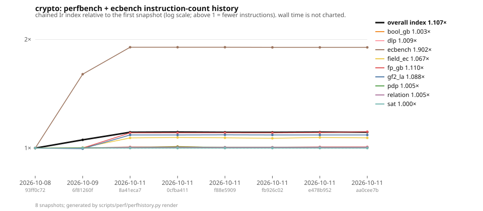

# Performance history

Generated by `scripts/perf/perfhistory.py render` from the snapshots in `docs/perf/history/`; do not edit by hand.  One snapshot per measured commit: callgrind instruction counts (`Ir`) of every quick `perfbench` kernel and of the frozen `ecbench` children in `docs/perf/ecbench-children.json`, with a wall-time reading beside each.  The index chains consecutive `Ir` ratios and takes no credit across a fingerprint change (the kernel computed something else: **re-based**).  Formula: `docs/perf/PERFORMANCE_INDEX.md`; what this does and does not mean: engineering class, `AGENTS.md` §3.  **Noise floor:** two builds of different sources move the `Ir` of untouched kernels by up to a few per cent (the release profile's 16 codegen units are partitioned afresh, and cross-module inlining changes with them), so a single step under about 5 % on one kernel is build noise, not a result; a trend over several snapshots, or an area index, is.



**Latest snapshot:** `fd043d4f8161` (2026-10-16T22:37:13Z) — Merge pull request #2058 from aburan28/claude/curve-traits-binary-points  
**Snapshots:** 69, from `93ff0c72333c` (2026-10-08).  
**Overall chained Ir index since first snapshot:** **1.131×**  

## Areas

| area | kernels | index since first | step from previous |
|---|---:|---:|---:|
| bool_gb | 19 | 1.049× | 1.000× |
| dlp | 12 | 0.997× | 1.000× |
| ecbench | 2 | 1.904× | 1.000× |
| field_ec | 25 | 1.063× | 0.993× |
| fp_gb | 19 | 1.147× | 1.006× |
| gf2_la | 19 | 1.219× | 1.000× |
| pdp | 21 | 1.014× | 0.999× |
| relation | 10 | 1.005× | 0.998× |
| sat | 11 | 1.003× | 1.003× |
| **overall** | 138 | **1.131×** | 1.000× |

## Snapshots

| # | committed | commit | overall | bool_gb | dlp | ecbench | field_ec | fp_gb | gf2_la | pdp | relation | sat | kernels | host |
|---:|---|---|---:|---:|---:|---:|---:|---:|---:|---:|---:|---:|---:|---|
| 1 | 2026-10-08 | `93ff0c72` | 1.000× | 1.000× | 1.000× | 1.000× | 1.000× | 1.000× | 1.000× | 1.000× | 1.000× | 1.000× | 135 | Intel(R) Xeon(R) Processor @… |
| 2 | 2026-10-09 | `6f81260f` | 1.054× | 0.999× | 0.999× | 1.603× | 1.003× | 1.000× | 0.996× | 1.002× | 1.001× | 1.000× | 135 | Intel(R) Xeon(R) Processor @… |
| 3 | 2026-10-11 | `8a41eca7` | 1.106× | 1.003× | 1.007× | 1.904× | 1.067× | 1.102× | 1.088× | 1.005× | 1.004× | 1.000× | 136 | AMD EPYC 7763 64-Core Proces… |
| 4 | 2026-10-11 | `0cfba411` | 1.108× | 1.011× | 1.006× | 1.904× | 1.070× | 1.102× | 1.088× | 1.008× | 1.004× | 1.000× | 136 | AMD EPYC 9V74 80-Core Proces… |
| 5 | 2026-10-11 | `f88e5909` | 1.106× | 1.003× | 1.005× | 1.904× | 1.068× | 1.102× | 1.088× | 1.005× | 1.004× | 1.000× | 136 | AMD EPYC 9V74 80-Core Proces… |
| 6 | 2026-10-11 | `fb926c02` | 1.106× | 1.003× | 1.005× | 1.902× | 1.065× | 1.102× | 1.088× | 1.005× | 1.005× | 1.000× | 136 | AMD EPYC 7763 64-Core Proces… |
| 7 | 2026-10-11 | `e478b952` | 1.107× | 1.004× | 1.007× | 1.902× | 1.070× | 1.104× | 1.088× | 1.005× | 1.005× | 1.000× | 136 | Intel(R) Xeon(R) Platinum 83… |
| 8 | 2026-10-11 | `aa0cee7b` | 1.107× | 1.003× | 1.007× | 1.902× | 1.067× | 1.110× | 1.088× | 1.005× | 1.005× | 1.000× | 136 | AMD EPYC 9V45 96-Core Proces… |
| 9 | 2026-10-11 | `81ca1c78` | 1.107× | 1.004× | 1.007× | 1.905× | 1.067× | 1.105× | 1.088× | 1.006× | 1.006× | 1.000× | 136 | AMD EPYC 7763 64-Core Proces… |
| 10 | 2026-10-11 | `a8194d61` | 1.105× | 1.003× | 1.009× | 1.903× | 1.064× | 1.112× | 1.088× | 1.004× | 1.004× | 0.982× | 136 | AMD EPYC 7763 64-Core Proces… |
| 11 | 2026-10-11 | `5cbe16d5` | 1.107× | 1.004× | 1.007× | 1.903× | 1.067× | 1.103× | 1.089× | 1.006× | 1.005× | 1.000× | 136 | AMD EPYC 9V74 80-Core Proces… |
| 12 | 2026-10-11 | `31088bfc` | 1.124× | 1.026× | 1.003× | 1.904× | 1.067× | 1.104× | 1.219× | 1.015× | 1.005× | 1.000× | 136 | Intel(R) Xeon(R) Platinum 83… |
| 13 | 2026-10-11 | `0d34f782` | 1.122× | 1.026× | 1.007× | 1.903× | 1.064× | 1.109× | 1.218× | 1.013× | 1.005× | 0.982× | 136 | AMD EPYC 7763 64-Core Proces… |
| 14 | 2026-10-11 | `89e3233c` | 1.125× | 1.025× | 1.005× | 1.903× | 1.067× | 1.107× | 1.218× | 1.014× | 1.005× | 1.000× | 136 | AMD EPYC 9V74 80-Core Proces… |
| 15 | 2026-10-11 | `80f5391d` | 1.122× | 1.026× | 1.006× | 1.903× | 1.067× | 1.109× | 1.219× | 1.013× | 1.005× | 0.982× | 136 | AMD EPYC 7763 64-Core Proces… |
| 16 | 2026-10-11 | `c62555b7` | 1.122× | 1.026× | 1.006× | 1.903× | 1.067× | 1.109× | 1.219× | 1.013× | 1.005× | 0.982× | 136 | AMD EPYC 7763 64-Core Proces… |
| 17 | 2026-10-12 | `eb70862e` | 1.107× | 1.004× | 1.007× | 1.903× | 1.067× | 1.103× | 1.089× | 1.006× | 1.005× | 1.000× | 136 | AMD EPYC 9V45 96-Core Proces… |
| 18 | 2026-10-12 | `633d2158` | 1.122× | 1.025× | 1.006× | 1.903× | 1.067× | 1.102× | 1.219× | 1.013× | 1.005× | 0.982× | 136 | AMD EPYC 7763 64-Core Proces… |
| 19 | 2026-10-12 | `ca0d5f86` | 1.127× | 1.053× | 1.001× | 1.907× | 1.064× | 1.100× | 1.224× | 1.016× | 1.005× | 1.000× | 136 | AMD EPYC 9V74 80-Core Proces… |
| 20 | 2026-10-12 | `b5cc6ffc` | 1.127× | 1.050× | 1.002× | 1.904× | 1.064× | 1.101× | 1.218× | 1.016× | 1.005× | 1.000× | 136 | AMD EPYC 9V45 96-Core Proces… |
| 21 | 2026-10-12 | `bf92906b` | 1.127× | 1.050× | 1.002× | 1.904× | 1.064× | 1.101× | 1.218× | 1.016× | 1.005× | 1.000× | 136 | AMD EPYC 7763 64-Core Proces… |
| 22 | 2026-10-12 | `d85756aa` | 1.127× | 1.053× | 1.001× | 1.907× | 1.064× | 1.099× | 1.224× | 1.014× | 1.004× | 1.000× | 136 | AMD EPYC 9V74 80-Core Proces… |
| 23 | 2026-10-12 | `ab28b57b` | 1.127× | 1.054× | 1.001× | 1.905× | 1.064× | 1.109× | 1.220× | 1.013× | 1.004× | 1.000× | 136 | AMD EPYC 7763 64-Core Proces… |
| 24 | 2026-10-13 | `56f66e43` | 1.128× | 1.054× | 1.001× | 1.904× | 1.070× | 1.109× | 1.220× | 1.016× | 1.004× | 1.000× | 136 | AMD EPYC 7763 64-Core Proces… |
| 25 | 2026-10-13 | `28b1daf2` | 1.128× | 1.054× | 1.001× | 1.905× | 1.070× | 1.109× | 1.220× | 1.016× | 1.004× | 1.000× | 136 | AMD EPYC 9V45 96-Core Proces… |
| 26 | 2026-10-13 | `cc962159` | 1.133× | 1.054× | 1.000× | 1.904× | 1.064× | 1.156× | 1.217× | 1.016× | 1.005× | 1.000× | 136 | AMD EPYC 7763 64-Core Proces… |
| 27 | 2026-10-13 | `33816db5` | 1.132× | 1.053× | 1.003× | 1.903× | 1.064× | 1.155× | 1.218× | 1.013× | 1.004× | 1.000× | 136 | AMD EPYC 7763 64-Core Proces… |
| 28 | 2026-10-13 | `191a0739` | 1.134× | 1.062× | 1.003× | 1.904× | 1.065× | 1.155× | 1.218× | 1.014× | 1.006× | 1.000× | 136 | AMD EPYC 7763 64-Core Proces… |
| 29 | 2026-10-13 | `cd226d0c` | 1.134× | 1.062× | 1.003× | 1.904× | 1.065× | 1.155× | 1.218× | 1.014× | 1.006× | 1.000× | 136 | AMD EPYC 9V74 80-Core Proces… |
| 30 | 2026-10-13 | `b2272a44` | 1.133× | 1.054× | 1.003× | 1.904× | 1.071× | 1.155× | 1.217× | 1.013× | 1.006× | 1.000× | 136 | Intel(R) Xeon(R) 6973P-C |
| 31 | 2026-10-14 | `bc82d128` | 1.133× | 1.054× | 1.003× | 1.904× | 1.068× | 1.155× | 1.218× | 1.014× | 1.006× | 1.000× | 136 | AMD EPYC 7763 64-Core Proces… |
| 32 | 2026-10-14 | `912a98ed` | 1.134× | 1.054× | 1.002× | 1.904× | 1.070× | 1.156× | 1.218× | 1.016× | 1.005× | 1.000× | 136 | AMD EPYC 7763 64-Core Proces… |
| 33 | 2026-10-14 | `8d8b1295` | 1.134× | 1.054× | 1.002× | 1.904× | 1.070× | 1.156× | 1.218× | 1.015× | 1.005× | 1.000× | 136 | AMD EPYC 7763 64-Core Proces… |
| 34 | 2026-10-14 | `b339e847` | 1.132× | 1.054× | 1.003× | 1.904× | 1.064× | 1.148× | 1.219× | 1.013× | 1.004× | 1.000× | 136 | AMD EPYC 9V45 96-Core Proces… |
| 35 | 2026-10-14 | `7912faa5` | 1.133× | 1.054× | 1.003× | 1.904× | 1.064× | 1.155× | 1.219× | 1.013× | 1.004× | 1.000× | 136 | AMD EPYC 7763 64-Core Proces… |
| 36 | 2026-10-14 | `3c5d435e` | 1.132× | 1.055× | 1.003× | 1.903× | 1.064× | 1.148× | 1.219× | 1.016× | 1.005× | 1.000× | 136 | AMD EPYC 7763 64-Core Proces… |
| 37 | 2026-10-14 | `f0599bf9` | 1.133× | 1.054× | 1.000× | 1.903× | 1.070× | 1.155× | 1.217× | 1.012× | 1.004× | 1.000× | 136 | AMD EPYC 7763 64-Core Proces… |
| 38 | 2026-10-14 | `3db0ecbc` | 1.133× | 1.054× | 1.002× | 1.903× | 1.067× | 1.156× | 1.218× | 1.015× | 1.006× | 1.000× | 136 | AMD EPYC 7763 64-Core Proces… |
| 39 | 2026-10-15 | `addb6a02` | 1.133× | 1.054× | 0.999× | 1.903× | 1.072× | 1.155× | 1.219× | 1.014× | 1.005× | 1.000× | 136 | AMD EPYC 9V45 96-Core Proces… |
| 40 | 2026-10-15 | `12348e50` | 1.133× | 1.054× | 1.001× | 1.903× | 1.065× | 1.157× | 1.218× | 1.015× | 1.006× | 1.000× | 136 | AMD EPYC 7763 64-Core Proces… |
| 41 | 2026-10-15 | `b906df02` | 1.133× | 1.054× | 1.001× | 1.904× | 1.067× | 1.156× | 1.218× | 1.015× | 1.006× | 1.000× | 136 | Intel(R) Xeon(R) Platinum 83… |
| 42 | 2026-10-15 | `cf274521` | 1.134× | 1.053× | 1.002× | 1.903× | 1.068× | 1.155× | 1.217× | 1.016× | 1.009× | 1.000× | 136 | AMD EPYC 7763 64-Core Proces… |
| 43 | 2026-10-15 | `1b874fcc` | 1.130× | 1.054× | 1.001× | 1.904× | 1.067× | 1.155× | 1.217× | 1.012× | 1.005× | 0.982× | 136 | AMD EPYC 7763 64-Core Proces… |
| 44 | 2026-10-15 | `700f7d31` | 1.132× | 1.053× | 0.998× | 1.902× | 1.067× | 1.155× | 1.218× | 1.015× | 1.006× | 1.000× | 136 | AMD EPYC 7763 64-Core Proces… |
| 45 | 2026-10-15 | `289bb5fb` | 1.133× | 1.054× | 1.001× | 1.903× | 1.067× | 1.155× | 1.218× | 1.014× | 1.005× | 1.000× | 136 | AMD EPYC 9V74 80-Core Proces… |
| 46 | 2026-10-15 | `92246530` | 1.133× | 1.054× | 1.001× | 1.905× | 1.070× | 1.148× | 1.218× | 1.016× | 1.006× | 1.000× | 136 | AMD EPYC 9V74 80-Core Proces… |
| 47 | 2026-10-15 | `3a4a5cec` | 1.132× | 1.053× | 1.001× | 1.904× | 1.064× | 1.148× | 1.218× | 1.016× | 1.006× | 1.000× | 136 | AMD EPYC 7763 64-Core Proces… |
| 48 | 2026-10-15 | `333c08c0` | 1.131× | 1.056× | 1.001× | 1.904× | 1.064× | 1.157× | 1.224× | 1.013× | 1.005× | 0.982× | 136 | AMD EPYC 9V74 80-Core Proces… |
| 49 | 2026-10-15 | `4cfcb94e` | 1.131× | 1.056× | 1.001× | 1.904× | 1.064× | 1.157× | 1.224× | 1.013× | 1.005× | 0.982× | 136 | AMD EPYC 7763 64-Core Proces… |
| 50 | 2026-10-15 | `ca0310ff` | 1.132× | 1.056× | 1.002× | 1.904× | 1.068× | 1.157× | 1.225× | 1.016× | 1.005× | 0.982× | 136 | AMD EPYC 7763 64-Core Proces… |
| 51 | 2026-10-15 | `de0c9391` | 1.132× | 1.056× | 1.002× | 1.904× | 1.068× | 1.157× | 1.225× | 1.016× | 1.005× | 0.982× | 136 | AMD EPYC 9V74 80-Core Proces… |
| 52 | 2026-10-16 | `7051f4e2` | 1.133× | 1.054× | 1.002× | 1.904× | 1.067× | 1.156× | 1.218× | 1.013× | 1.005× | 1.000× | 136 | AMD EPYC 9V74 80-Core Proces… |
| 53 | 2026-10-16 | `082d5507` | 1.133× | 1.054× | 1.002× | 1.904× | 1.068× | 1.156× | 1.217× | 1.016× | 1.006× | 1.000× | 136 | Intel(R) Xeon(R) 6973P-C |
| 54 | 2026-10-16 | `2f02e32c` | 1.132× | 1.053× | 1.002× | 1.904× | 1.064× | 1.155× | 1.217× | 1.012× | 1.005× | 1.000× | 136 | AMD EPYC 7763 64-Core Proces… |
| 55 | 2026-10-16 | `6d437f0c` | 1.132× | 1.053× | 1.002× | 1.904× | 1.064× | 1.155× | 1.217× | 1.012× | 1.005× | 1.000× | 136 | AMD EPYC 9V45 96-Core Proces… |
| 56 | 2026-10-16 | `6bf2bcf0` | 1.133× | 1.053× | 0.999× | 1.904× | 1.070× | 1.155× | 1.217× | 1.015× | 1.006× | 1.000× | 136 | AMD EPYC 7763 64-Core Proces… |
| 57 | 2026-10-16 | `f8300065` | 1.133× | 1.053× | 1.001× | 1.904× | 1.064× | 1.155× | 1.218× | 1.015× | 1.006× | 1.000× | 136 | AMD EPYC 9V74 80-Core Proces… |
| 58 | 2026-10-16 | `ccf43056` | 1.133× | 1.053× | 1.001× | 1.904× | 1.064× | 1.155× | 1.218× | 1.015× | 1.006× | 1.000× | 136 | AMD EPYC 7763 64-Core Proces… |
| 59 | 2026-10-16 | `57b028d8` | 1.132× | 1.053× | 0.998× | 1.904× | 1.064× | 1.156× | 1.219× | 1.013× | 1.005× | 1.000× | 138 | AMD EPYC 7763 64-Core Proces… |
| 60 | 2026-10-16 | `f25d5e52` | 1.133× | 1.053× | 1.001× | 1.904× | 1.070× | 1.148× | 1.217× | 1.015× | 1.006× | 1.000× | 138 | AMD EPYC 9V45 96-Core Proces… |
| 61 | 2026-10-16 | `213e7a80` | 1.133× | 1.054× | 1.001× | 1.904× | 1.068× | 1.157× | 1.217× | 1.016× | 1.005× | 1.000× | 138 | AMD EPYC 7763 64-Core Proces… |
| 62 | 2026-10-16 | `78adfda4` | 1.133× | 1.054× | 0.998× | 1.904× | 1.070× | 1.155× | 1.219× | 1.015× | 1.006× | 1.000× | 138 | Intel(R) Xeon(R) 6973P-C |
| 63 | 2026-10-16 | `b1bf5b89` | 1.135× | 1.054× | 1.000× | 1.904× | 1.078× | 1.146× | 1.218× | 1.023× | 1.016× | 1.000× | 138 | AMD EPYC 7763 64-Core Proces… |
| 64 | 2026-10-16 | `40bcf690` | 1.135× | 1.054× | 1.000× | 1.904× | 1.078× | 1.146× | 1.217× | 1.023× | 1.016× | 1.000× | 138 | Intel(R) Xeon(R) 6973P-C |
| 65 | 2026-10-16 | `8efd4e48` | 1.131× | 1.053× | 0.999× | 1.904× | 1.067× | 1.147× | 1.217× | 1.012× | 1.005× | 1.000× | 138 | INTEL(R) XEON(R) PLATINUM 85… |
| 66 | 2026-10-16 | `89036527` | 1.132× | 1.054× | 1.002× | 1.904× | 1.068× | 1.147× | 1.217× | 1.016× | 1.006× | 1.000× | 138 | AMD EPYC 7763 64-Core Proces… |
| 67 | 2026-10-16 | `a90646f1` | 1.132× | 1.062× | 1.000× | 1.904× | 1.064× | 1.140× | 1.217× | 1.014× | 1.005× | 1.000× | 138 | AMD EPYC 7763 64-Core Proces… |
| 68 | 2026-10-16 | `b59187e5` | 1.131× | 1.049× | 0.997× | 1.904× | 1.071× | 1.141× | 1.218× | 1.014× | 1.007× | 1.000× | 138 | AMD EPYC 7763 64-Core Proces… |
| 69 | 2026-10-16 | `fd043d4f` | 1.131× | 1.049× | 0.997× | 1.904× | 1.063× | 1.147× | 1.219× | 1.014× | 1.005× | 1.003× | 138 | AMD EPYC 7763 64-Core Proces… |

## Movers in the latest step

Kernels whose `Ir` changed by more than 5 % against the previous snapshot with the same fingerprint (the build-noise floor is a few per cent, see above).

Fewer instructions:

| kernel | previous Ir | latest Ir | step |
|---|---:|---:|---:|
| `fp_gb/sig_tower_kummer_m3_n9` | 1,583,098,669 | 1,486,042,721 | 1.065× |
| `fp_gb/sig_tower_kummer_m2_n12` | 1,107,534,371 | 1,051,882,430 | 1.053× |

More instructions:

| kernel | previous Ir | latest Ir | step |
|---|---:|---:|---:|
| `field_ec/ct_scalar_mul_p256_x16` | 96,110,539 | 103,430,123 | 0.929× |
| `field_ec/ct_scalar_mul_secp256k1_x16` | 65,943,979 | 70,449,611 | 0.936× |

## Kernels at the latest snapshot

`Δ prev` is the latest step's change in `Ir` (negative = fewer instructions); `index` is the chained index since the first snapshot that has the kernel; `wall` is one native median on the recording host and is informational only.

### bool_gb

| kernel | Ir | wall | Δ prev | index | note |
|---|---:|---:|---:|---:|---|
| `bool_gb/crossbred_m2_n23` | 686,842,135 | 78.944ms | +0.0 % | 0.994× |  |
| `bool_gb/f4_basis_m2_n17` | 1,540,866,997 | 132.876ms | -0.0 % | 0.974× |  |
| `bool_gb/f4_basis_random_n18` | 1,611,007,092 | 129.849ms | -0.0 % | 0.975× |  |
| `bool_gb/fes_gray_m2_n23` | 321,420,764 | 22.959ms | +0.0 % | 1.000× |  |
| `bool_gb/fes_gray_random_n28` | 2,567,071,323 | 182.218ms | +0.0 % | 1.000× |  |
| `bool_gb/fes_moebius_random_n22` | 165,638,306 | 15.798ms | +0.0 % | 0.975× |  |
| `bool_gb/fes_monica_random_n25` | 501,558,438 | 137.560ms | -0.0 % | 0.951× |  |
| `bool_gb/fes_wide_random_n30` | 2,051,511,120 | 462.145ms | +0.0 % | 1.000× |  |
| `bool_gb/matrix_f4_deg3_m3_n23` | 214,621,515 | 24.964ms | +0.0 % | 1.338× |  |
| `bool_gb/matrix_f4_deg4_m2_n23` | 679,549,955 | 90.548ms | +0.0 % | 1.266× |  |
| `bool_gb/matrix_f4_deg4_m3_n15` | 776,090,957 | 96.856ms | +0.0 % | 1.227× |  |
| `bool_gb/matrix_f5_deg4_m2_n23` | 654,621,012 | 92.367ms | +0.0 % | 1.172× |  |
| `bool_gb/solve_inherited_m2_n23` | 1,560,485,225 | 160.944ms | +0.0 % | 0.989× |  |
| `bool_gb/solve_inherited_m3_n15` | 385,261,859 | 46.166ms | +0.0 % | 1.018× |  |
| `bool_gb/solve_matrixf4_m2_n17` | 1,790,182,702 | 175.761ms | +0.2 % | 1.079× |  |
| `bool_gb/solve_matrixf5_m2_n17` | 1,809,892,450 | 178.537ms | +0.1 % | 1.079× |  |
| `bool_gb/wide_found_m5_n15` | 1,977,437,173 | 244.132ms | +0.2 % | 1.000× |  |
| `bool_gb/wide_mixed_m4_n15` | 2,384,279,485 | 290.147ms | +0.2 % | 0.999× |  |
| `bool_gb/wide_refute_m3_n31` | 874,380,619 | 95.703ms | +0.0 % | 0.994× |  |

### dlp

| kernel | Ir | wall | Δ prev | index | note |
|---|---:|---:|---:|---:|---|
| `dlp/aut_folded_rho_j0_p25` | 40,451,225 | 5.108ms | +0.0 % | 0.999× |  |
| `dlp/bsgs_fast_toy40_w1_x4` | 660,001,839 | 168.852ms | +0.0 % | 0.993× |  |
| `dlp/bsgs_fast_toy40_w4_interval38_x8` | 958,121,459 | 197.630ms | +0.0 % | 0.998× |  |
| `dlp/collab_walkers_demo32_x8` | 113,238,940 | 11.912ms | +0.0 % | 0.993× |  |
| `dlp/ecc2k130_certify_m131_len12` | 25,723,897 | 2.368ms | +1.9 % | 0.981× |  |
| `dlp/gaudry_schost_negation_demo32` | 133,936,255 | 16.428ms | -0.2 % | 0.995× |  |
| `dlp/koblitz_signed_rho_k0_n41` | 233,354,105 | 46.809ms | -1.8 % | 0.980× |  |
| `dlp/pohlig_hellman_smooth47` | 1,721,826 | 0.188ms | +0.2 % | 0.995× |  |
| `dlp/rho_dp_zp_multi_q34_x3` | 35,730,177 | 3.120ms | +0.1 % | 1.018× |  |
| `dlp/rho_dp_zp_wide_q30` | 203,048,093 | 17.959ms | +0.0 % | 0.999× |  |
| `dlp/rho_floyd_zp_q36` | 108,820,866 | 9.260ms | +0.0 % | 1.012× |  |
| `dlp/rho_floyd_zp_wide_q30` | 340,337,099 | 29.186ms | -0.0 % | 1.000× |  |

### ecbench

| kernel | Ir | wall | Δ prev | index | note |
|---|---:|---:|---:|---:|---|
| `ecbench/rho_negation_prime26_p42652151` | 1,381,153 | 31.828ms | -0.0 % | 3.514× |  |
| `ecbench/rho_signed_frobenius_k0n41` | 127,694,258 | 60.896ms | -0.0 % | 1.032× |  |

### field_ec

| kernel | Ir | wall | Δ prev | index | note |
|---|---:|---:|---:|---:|---|
| `field_ec/binary_scalar_mul_sect163k1_x8` | 172,496,975 | 15.402ms | +0.4 % | 1.009× |  |
| `field_ec/binary_scalar_mul_sect233k1_x4` | 181,172,390 | 13.541ms | +1.2 % | 0.995× |  |
| `field_ec/ct_scalar_mul_p256_x16` | 103,430,123 | 11.125ms | +7.6 % | 1.000× |  |
| `field_ec/ct_scalar_mul_secp256k1_x16` | 70,449,611 | 7.436ms | +6.8 % | 1.000× |  |
| `field_ec/ecdsa_verify_p256_x4` | 548,705,347 | 45.989ms | +0.0 % | 0.995× |  |
| `field_ec/ecdsa_verify_secp256k1_x4` | 543,213,102 | 47.891ms | +0.0 % | 0.994× |  |
| `field_ec/f2m_inv_m163_2k` | 190,210,111 | 16.892ms | +0.4 % | 1.008× |  |
| `field_ec/f2m_mul_sqr_m131_64k` | 92,134,869 | 8.203ms | +0.3 % | 1.021× |  |
| `field_ec/f2m_mul_sqr_m163_64k` | 96,582,545 | 9.189ms | +0.3 % | 1.017× |  |
| `field_ec/f2m_mul_sqr_m233_64k` | 115,687,891 | 9.291ms | +0.9 % | 1.006× |  |
| `field_ec/fastfield_p61_inv` | 32,546,917 | 6.261ms | +0.0 % | 1.000× |  |
| `field_ec/frobenius_canon_n53_bulk_256k` | 88,234,260 | 8.344ms | +0.0 % | 1.043× |  |
| `field_ec/frobenius_canon_n53_shift_256k` | 68,209,388 | 7.373ms | +0.0 % | 1.015× |  |
| `field_ec/gf2_n53_batch_inv_4x64k` | 23,875,540 | 4.450ms | +0.0 % | 1.049× |  |
| `field_ec/gf2_n53_inv_16k` | 12,369,962 | 4.414ms | +0.0 % | 0.999× |  |
| `field_ec/gf2_n53_mul_sqr_1m` | 53,634,918 | 6.317ms | +0.0 % | 0.922× |  |
| `field_ec/gf3m_mul_m97` | 54,240,322 | 4.395ms | +0.0 % | 4.299× |  |
| `field_ec/hyperelliptic_g2_scalar_mul_x4` | 668,007,665 | 47.774ms | +0.0 % | 0.987× |  |
| `field_ec/isogeny_field_p256_mul_sqr_pow` | 327,059,289 | 36.345ms | +0.0 % | 1.000× |  |
| `field_ec/koblitz_curve_mul_n53_1k` | 11,415,267 | 2.225ms | +0.2 % | 0.999× |  |
| `field_ec/koblitz_n53_add_many_lazy_64x2k` | 34,167,536 | 6.328ms | +0.8 % | 1.021× |  |
| `field_ec/koblitz_n53_fast_mul_2k` | 26,605,481 | 5.723ms | +0.0 % | 0.999× |  |
| `field_ec/point_scalar_mul_ct_secp256k1_x1` | 779,674,405 | 71.442ms | +0.0 % | 1.003× |  |
| `field_ec/point_scalar_mul_p256_x8` | 165,962,014 | 13.910ms | +0.0 % | 0.995× |  |
| `field_ec/point_scalar_mul_secp256k1_x8` | 160,104,012 | 13.994ms | +0.0 % | 0.995× |  |

### fp_gb

| kernel | Ir | wall | Δ prev | index | note |
|---|---:|---:|---:|---:|---|
| `fp_gb/buchberger_katsura3_p32003` | 469,020,612 | 41.477ms | +0.0 % | 1.009× |  |
| `fp_gb/f4_autoreduce_pkm_m2_t4_x2` | 516,849,619 | 53.737ms | +0.0 % | 1.005× |  |
| `fp_gb/f4_cubic_n4_p31` | 15,310,156 | 1.965ms | +0.1 % | 1.392× |  |
| `fp_gb/f4_cyclic5_p65521` | 5,630,011 | 1.346ms | +0.1 % | 1.236× |  |
| `fp_gb/f4_katsura6_p65521` | 27,186,523 | 3.439ms | +0.1 % | 1.288× |  |
| `fp_gb/f4_pkm_kummer_m2_t5` | 246,077,181 | 29.280ms | +0.0 % | 1.096× |  |
| `fp_gb/f4_pkm_kummer_m3_t2` | 29,271,762 | 4.001ms | +0.0 % | 1.169× |  |
| `fp_gb/f4_quad_n7_p65521` | 87,957,177 | 10.227ms | +0.1 % | 1.552× |  |
| `fp_gb/f4_solve_cubic_n3_p29` | 28,695,975 | 7.354ms | +0.0 % | 1.153× |  |
| `fp_gb/f4_solve_quad_n4_p31` | 32,221,038 | 7.596ms | +0.0 % | 1.115× |  |
| `fp_gb/f4_solve_quart_n3_p31` | 91,693,294 | 20.746ms | +0.0 % | 1.213× |  |
| `fp_gb/gaudry_quartic_generic_d3_p269` | 59,801,125 | 13.928ms | +0.5 % | 2.123× |  |
| `fp_gb/gaudry_s4_macaulay_p1039` | 389,668,128 | 30.547ms | +0.1 % | 1.007× |  |
| `fp_gb/sig_tower_kummer_m2_n12` | 1,051,882,430 | 105.637ms | -5.0 % | 0.981× |  |
| `fp_gb/sig_tower_kummer_m3_n9` | 1,486,042,721 | 148.554ms | -6.1 % | 0.978× |  |
| `fp_gb/tower_f4_kummer_m2_n12` | 834,892,059 | 81.239ms | +0.0 % | 0.987× |  |
| `fp_gb/tower_f4_kummer_m2_n12_planted` | 977,850,624 | 96.799ms | +0.0 % | 0.987× |  |
| `fp_gb/tower_f4_kummer_m3_n9` | 1,465,405,958 | 142.873ms | +0.0 % | 0.988× |  |
| `fp_gb/tower_f4_kummer_m4_n8` | 536,390,838 | 55.739ms | +0.0 % | 0.988× |  |

### gf2_la

| kernel | Ir | wall | Δ prev | index | note |
|---|---:|---:|---:|---:|---|
| `gf2_la/echelon_macaulay_k23m2d4` | 325,668,707 | 34.426ms | +0.1 % | 1.064× |  |
| `gf2_la/echelon_macaulay_k5m3d5` | 220,760,942 | 21.713ms | +0.1 % | 0.985× |  |
| `gf2_la/f5_criterion_k23m2d6` | 1,076,748,113 | 154.701ms | -0.4 % | 3.045× |  |
| `gf2_la/f5_criterion_k5m3d7` | 88,899,940 | 12.254ms | -0.3 % | 3.494× |  |
| `gf2_la/legacy_echelon_macaulay_k23m2d3_x16` | 119,387,116 | 8.504ms | +0.2 % | 0.974× |  |
| `gf2_la/legacy_rref_macaulay_k23m3d3` | 107,652,304 | 10.280ms | +0.0 % | 1.000× |  |
| `gf2_la/legacy_rref_macaulay_k5m3d5` | 1,295,405,768 | 105.319ms | -1.2 % | 0.936× |  |
| `gf2_la/rank_refute_anf_s4_n6l3d4` | 1,320,032,020 | 194.499ms | +0.0 % | 1.000× |  |
| `gf2_la/rref_macaulay_k15m3d4` | 608,697,853 | 71.051ms | +0.0 % | 1.089× |  |
| `gf2_la/rref_macaulay_k17m2d5` | 878,202,922 | 108.799ms | +0.0 % | 1.089× |  |
| `gf2_la/rref_macaulay_k23m2d3_x16` | 123,595,854 | 8.906ms | +0.2 % | 0.983× |  |
| `gf2_la/rref_macaulay_k23m2d4` | 468,983,977 | 57.887ms | +0.0 % | 1.109× |  |
| `gf2_la/rref_macaulay_k5m3d5` | 275,474,595 | 31.145ms | +0.1 % | 1.001× |  |
| `gf2_la/rref_random_2048` | 77,043,759 | 7.587ms | +0.1 % | 1.042× |  |
| `gf2_la/rref_random_4940x8357` | 629,840,006 | 92.320ms | +0.0 % | 1.374× |  |
| `gf2_la/rref_random_4940x8357_w17` | 540,745,729 | 75.574ms | +0.0 % | 1.304× |  |
| `gf2_la/sparse_finish_macaulay_k7m3d5` | 158,341,321 | 19.110ms | +0.1 % | 1.744× |  |
| `gf2_la/sparse_high_macaulay_k5m3d5` | 231,684,670 | 29.248ms | +0.0 % | 1.000× |  |
| `gf2_la/sparse_rank_refute_macaulay_k5m3d5` | 393,451,396 | 78.137ms | +0.0 % | 1.001× |  |

### pdp

| kernel | Ir | wall | Δ prev | index | note |
|---|---:|---:|---:|---:|---|
| `pdp/build_system_m2_n23` | 2,519,846 | 0.317ms | +0.0 % | 1.009× |  |
| `pdp/build_system_m3_n15` | 13,839,152 | 1.429ms | +0.0 % | 1.011× |  |
| `pdp/descend_s3_n31_np20` | 66,543,592 | 9.468ms | -0.3 % | 0.986× |  |
| `pdp/descend_s4_n23_np6` | 45,350,705 | 7.271ms | -0.6 % | 1.000× |  |
| `pdp/enumerate_m2_n23` | 16,404,405 | 3.265ms | +1.2 % | 0.992× |  |
| `pdp/enumerate_m3_n15` | 9,432,928 | 2.249ms | +2.4 % | 0.968× |  |
| `pdp/groebner_m2_n17` | 176,891,681 | 19.205ms | +0.1 % | 1.002× |  |
| `pdp/groebner_m3_n9` | 138,658,189 | 17.304ms | +0.0 % | 1.082× |  |
| `pdp/instantiate_m2_n23` | 30,291,921 | 5.613ms | +0.0 % | 1.001× |  |
| `pdp/instantiate_m3_n15` | 23,612,591 | 4.893ms | +0.0 % | 1.001× |  |
| `pdp/mitm_m3_n31` | 215,154,478 | 29.075ms | -0.1 % | 1.024× |  |
| `pdp/mitm_m4_n31` | 72,945,623 | 10.831ms | +0.1 % | 1.023× |  |
| `pdp/pair_table_build_n31_l10` | 367,018,340 | 53.657ms | +0.0 % | 1.025× |  |
| `pdp/relation_solver_u1024` | 188,107,062 | 21.541ms | +0.0 % | 0.980× |  |
| `pdp/sat_m2_n17` | 258,481,130 | 36.493ms | -0.8 % | 1.016× |  |
| `pdp/sat_m6_n7` | 101,842,268 | 11.989ms | -0.9 % | 0.994× |  |
| `pdp/semaev_s5_symbolic` | 61,950,247 | 8.005ms | -0.0 % | 1.000× |  |
| `pdp/subspace_oracle_n20_l7` | 140,416,429 | 18.421ms | +0.0 % | 1.017× |  |
| `pdp/symmetrised_groebner_m2_n17` | 1,390,516,295 | 135.063ms | +0.2 % | 1.076× |  |
| `pdp/symmetrised_groebner_m3_n15` | 681,069,909 | 84.341ms | +0.0 % | 1.083× |  |
| `pdp/weil_descend_s4_sym_n17_l4` | 20,355,161 | 2.580ms | +0.1 % | 1.005× |  |

### relation

| kernel | Ir | wall | Δ prev | index | note |
|---|---:|---:|---:|---:|---|
| `relation/block_wiedemann_r45_n768_w13` | 487,478,786 | 43.783ms | +0.0 % | 0.965× |  |
| `relation/koblitz_collect_k0n41_w164_u4096` | 335,173,552 | 31.748ms | +0.4 % | 1.038× |  |
| `relation/koblitz_collect_k0n53_w477_u1024` | 243,787,289 | 22.257ms | +0.4 % | 1.038× |  |
| `relation/koblitz_descent_k0n53_m2_x4` | 426,738,597 | 41.319ms | +0.4 % | 1.028× |  |
| `relation/koblitz_pair_table_k0n41_folded` | 110,458,886 | 11.341ms | +0.3 % | 1.033× |  |
| `relation/koblitz_rung_k0n31` | 176,067,082 | 17.755ms | +0.4 % | 0.969× |  |
| `relation/pq_sparse_solve_m127_c640` | 273,757,780 | 25.109ms | +0.0 % | 0.987× |  |
| `relation/pq_wiedemann_m127_c160` | 435,653,908 | 32.227ms | -0.0 % | 0.999× |  |
| `relation/residual_walk_lmw_b22_x3` | 233,436,192 | 40.525ms | -0.0 % | 1.004× |  |
| `relation/sparse_solve_r45_c4800_w3` | 565,048,921 | 58.080ms | -0.0 % | 0.989× |  |

### sat

| kernel | Ir | wall | Δ prev | index | note |
|---|---:|---:|---:|---:|---|
| `sat/koblitz_bool_cnf_m3_n15_b1500_x2` | 826,328,659 | 130.872ms | +0.0 % | 1.017× |  |
| `sat/koblitz_bool_native_m2_n19_x2` | 978,229,734 | 124.146ms | -0.3 % | 0.998× |  |
| `sat/koblitz_bool_native_m3_n15_x3` | 451,867,546 | 53.920ms | -0.2 % | 0.991× |  |
| `sat/random3sat_n150_r426_x12` | 747,779,562 | 143.387ms | +0.0 % | 1.015× |  |
| `sat/random3sat_n200_r426_x5` | 716,997,465 | 136.784ms | +0.0 % | 1.016× |  |
| `sat/semaev_s4_encode_n19l6_x4` | 60,521,207 | 6.486ms | +0.0 % | 1.012× |  |
| `sat/semaev_s4_n15l5_cnf_x2` | 281,916,299 | 53.099ms | +0.0 % | 1.019× |  |
| `sat/semaev_s4_n15l5_sat_x4` | 879,540,445 | 109.245ms | -0.5 % | 0.998× |  |
| `sat/semaev_s4_n15l5_unsat_x1` | 1,266,062,455 | 158.885ms | -0.5 % | 0.998× |  |
| `sat/semaev_s4_n17l6_sat_x1` | 1,283,196,323 | 149.900ms | -0.4 % | 0.997× |  |
| `sat/xor_planted_n120_x6` | 967,246,704 | 138.687ms | -1.3 % | 0.972× |  |

## How to add a point

```bash
cargo build --release --example perfbench --bin ecbench
python3 scripts/perf/perfhistory.py record --binary target/release/examples/perfbench \
    --ecbench target/release/ecbench --out docs/perf/history
python3 scripts/perf/perfhistory.py render --history docs/perf/history \
    --md docs/perf/HISTORY.md --svg docs/perf/history.svg --json docs/perf/history.json
```

`.github/workflows/perf-history.yml` does this for every push to `main` and checks each pull request against the latest snapshot.

## Separate F4/F5 history

[Matrix-step and solver history, allocation groups, graphs and PDFs](groebner/REPORT.md).
