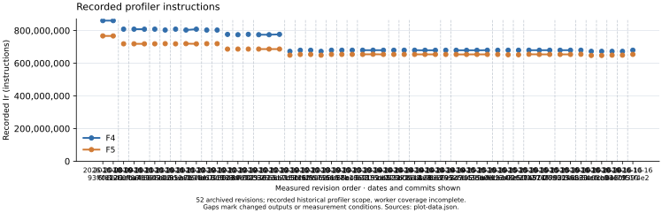
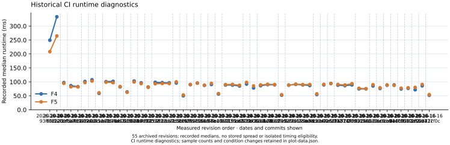
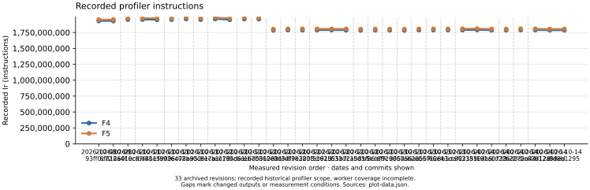
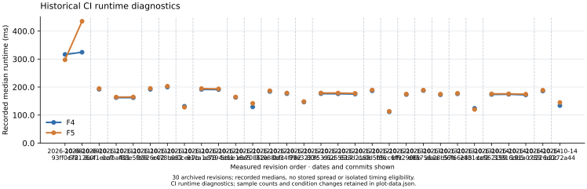
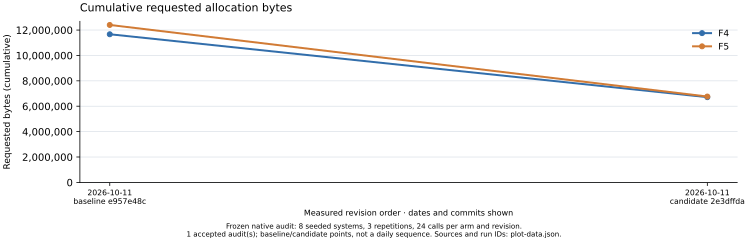
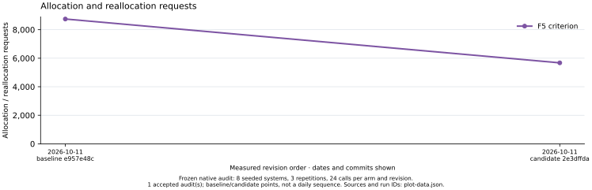

# Separate F4/F5 performance history

Frozen rendering of **63 recorded main revisions**, plus the native allocation baseline/candidate audit. No new performance run or speedup claim.

Plots retain each algorithm as its own series. CI runtime is diagnostic; incomplete historical profiler coverage is retained as recorded. Connecting lines stop when fingerprints or measurement conditions change. X spacing is revision order, not elapsed time.

[Combined PDF](report.pdf) · [Editable source](report.typ) · [Native plot data and provenance](plot-data.json)

## Boolean matrix step: F4 and F5

One shared K_1 / 2^23 m=2 system, 22 Boolean variables, maximum degree 4. Matrix construction, reduction and readback; F5 includes its criterion.

[Group PDF](boolean-matrix.pdf) · [Editable source](boolean-matrix.typ)

| UTC date / revision | F4 Ir | F5 Ir | F4 ms | F5 ms |
| --- | --- | --- | --- | --- |
| 2026-10-08 / 93ff0c72 | 860,633,889 | 766,940,469 | 249.241 | 208.250 |
| 2026-10-09 / 6f81260f | 860,555,567 | 766,776,087 | 333.279 | 264.687 |
| 2026-10-11 / 8a41eca7 | 808,263,705 | 718,576,235 | 97.380 | 94.658 |
| 2026-10-11 / 0cfba411 | 808,263,705 | 718,578,523 | 86.390 | 82.214 |
| 2026-10-11 / f88e5909 | 807,989,935 | 718,391,055 | 82.597 | 81.948 |
| 2026-10-11 / fb926c02 | 808,263,705 | 718,576,189 | 101.379 | 97.323 |
| 2026-10-11 / e478b952 | 803,017,657 | 719,516,063 | 107.585 | 102.927 |
| 2026-10-11 / aa0cee7b | 808,281,869 | 718,492,761 | 58.723 | 60.673 |
| 2026-10-12 / 81ca1c78 | 803,015,877 | 719,509,003 | 100.762 | 98.775 |
| 2026-10-12 / a8194d61 | 808,072,539 | 718,282,030 | 101.827 | 96.904 |
| 2026-10-12 / 5cbe16d5 | 802,824,065 | 719,316,911 | 81.784 | 83.144 |
| 2026-10-12 / eb70862e | 802,824,065 | 719,316,876 | 63.944 | 62.505 |
| 2026-10-12 / 31088bfc | 776,242,363 | 686,315,894 | 102.929 | 99.489 |
| 2026-10-12 / 0d34f782 | 774,379,185 | 686,521,131 | 96.521 | 93.790 |
| 2026-10-12 / 89e3233c | 776,490,367 | 686,543,371 | 81.628 | 80.581 |
| 2026-10-12 / 80f5391d | 774,379,185 | 686,519,896 | 98.501 | 93.239 |
| 2026-10-12 / c62555b7 | 774,379,185 | 686,519,896 | 97.360 | 94.117 |
| 2026-10-12 / 633d2158 | 776,467,358 | 686,512,000 | 96.637 | 94.008 |
| 2026-10-12 / ca0d5f86 | 672,500,776 | 649,174,334 | 95.848 | 99.895 |
| 2026-10-12 / b5cc6ffc | 679,242,389 | 653,622,849 | 49.965 | 52.882 |
| 2026-10-13 / bf92906b | 679,242,389 | 653,622,849 | 90.163 | 90.201 |
| 2026-10-13 / d85756aa | 672,486,486 | 649,160,075 | 95.497 | 95.480 |
| 2026-10-13 / ab28b57b | 679,449,939 | 653,823,121 | 87.697 | 87.878 |
| 2026-10-13 / 56f66e43 | 679,449,939 | 653,828,331 | 90.448 | 94.715 |
| 2026-10-13 / 28b1daf2 | 679,449,939 | 653,828,331 | 56.215 | 57.961 |
| 2026-10-14 / cc962159 | 679,449,939 | 653,831,656 | 88.546 | 90.149 |
| 2026-10-14 / 33816db5 | 679,549,997 | 654,627,509 | 88.344 | 90.874 |
| 2026-10-14 / 191a0739 | 679,240,609 | 653,664,759 | 85.135 | 87.917 |
| 2026-10-14 / cd226d0c | 679,240,609 | 653,664,759 | 92.059 | 98.073 |
| 2026-10-14 / b2272a44 | 679,449,939 | 653,873,401 | 78.007 | 85.621 |
| 2026-10-14 / bc82d128 | 679,449,939 | 653,873,401 | 86.126 | 89.102 |
| 2026-10-14 / 912a98ed | 679,098,623 | 653,830,968 | 89.995 | 91.125 |
| 2026-10-14 / 8d8b1295 | 679,098,623 | 653,830,968 | 89.395 | 90.230 |
| 2026-10-14 / b339e847 | 679,240,608 | 653,621,583 | 52.150 | 53.839 |
| 2026-10-15 / 7912faa5 | 679,226,318 | 653,606,027 | 88.406 | 88.091 |
| 2026-10-15 / 3c5d435e | 678,905,208 | 653,631,022 | 90.855 | 91.956 |
| 2026-10-15 / f0599bf9 | 679,098,622 | 653,825,706 | 89.060 | 90.253 |
| 2026-10-15 / 3db0ecbc | 679,449,938 | 653,830,913 | 86.813 | 90.492 |
| 2026-10-15 / addb6a02 | 679,256,525 | 653,632,330 | 54.248 | 56.951 |
| 2026-10-15 / 12348e50 | 679,449,939 | 651,714,930 | 89.150 | 90.941 |
| 2026-10-15 / b906df02 | 679,449,939 | 651,714,179 | 94.066 | 94.227 |
| 2026-10-15 / cf274521 | 679,549,984 | 654,627,503 | 88.061 | 90.795 |
| 2026-10-15 / 1b874fcc | 679,449,939 | 653,830,975 | 86.246 | 88.831 |
| 2026-10-15 / 700f7d31 | 679,444,579 | 653,824,679 | 89.023 | 93.545 |
| 2026-10-15 / 289bb5fb | 679,264,149 | 653,687,604 | 74.802 | 77.102 |
| 2026-10-16 / 92246530 | 679,449,938 | 653,829,966 | 75.128 | 75.009 |
| 2026-10-16 / 3a4a5cec | 679,549,995 | 654,621,347 | 85.229 | 89.944 |
| 2026-10-16 / 333c08c0 | 672,605,656 | 647,427,799 | 76.341 | 78.831 |
| 2026-10-16 / 4cfcb94e | 672,605,656 | 647,427,799 | 87.944 | 88.781 |
| 2026-10-16 / ca0310ff | 672,486,486 | 649,202,105 | 89.012 | 87.501 |
| 2026-10-16 / de0c9391 | 672,500,776 | 649,216,408 | 74.498 | 77.487 |
| 2026-10-16 / 7051f4e2 | 679,449,938 | 653,873,407 | 76.675 | 78.834 |
| 2026-10-16 / 082d5507 | 679,445,034 | 653,868,507 | 71.580 | 80.148 |
| 2026-10-16 / 2f02e32c | 679,549,984 | 654,627,503 | 85.711 | 90.622 |
| 2026-10-16 / 6d437f0c | 679,549,984 | 654,627,503 | 51.852 | 54.190 |
| 2026-10-16 / 6bf2bcf0 | 679,549,997 | 654,621,861 | 90.619 | 91.074 |
| 2026-10-16 / f8300065 | 679,549,997 | 654,669,949 | 75.064 | 77.431 |
| 2026-10-16 / ccf43056 | 679,549,997 | 654,669,949 | 86.686 | 90.254 |
| 2026-10-16 / 57b028d8 | 679,350,531 | 654,421,882 | 84.863 | 88.297 |
| 2026-10-16 / f25d5e52 | 679,549,984 | 654,669,936 | 51.138 | 52.369 |
| 2026-10-16 / 213e7a80 | 679,449,939 | 653,830,971 | 85.272 | 87.253 |
| 2026-10-16 / 78adfda4 | 679,240,609 | 653,621,067 | 76.846 | 91.802 |
| 2026-10-17 / b1bf5b89 | 679,449,939 | 653,825,765 | 84.571 | 88.476 |

- Historical Python-orchestrated perf.history/v1 snapshots; no new performance run or speedup claim.
- Runtime: one recorded median per kernel and revision; sample counts retained per point, no stored spread, no isolated timing eligibility. Runtime is diagnostic.
- Profiler Ir is the recorded historical scope. Worker-thread coverage is incomplete for these kernels; it is not a complete solver operation count.
- Lines stop at missing values, changed output fingerprints, or changed host/compiler/harness/profiler. Different algorithm fingerprints are expected and are not equated.
- X positions are measured revision order, labelled with UTC commit date and revision; spacing is not elapsed time.

## Boolean solver calls: F4 and F5

Shared K_1 / 2^17 m=2 workload, 16 Boolean variables, four planted and four random targets, maximum degree 3. The solve_boolean_system entry point, including root readback.

[Group PDF](boolean-solver.pdf) · [Editable source](boolean-solver.typ)

| UTC date / revision | F4 Ir | F5 Ir | F4 ms | F5 ms |
| --- | --- | --- | --- | --- |
| 2026-10-08 / 93ff0c72 | 1,930,989,200 | 1,953,108,992 | 316.570 | 297.297 |
| 2026-10-09 / 6f81260f | 1,929,374,570 | 1,952,598,745 | 324.403 | 435.004 |
| 2026-10-11 / 8a41eca7 | 1,953,021,023 | 1,974,789,730 | 192.203 | 194.561 |
| 2026-10-11 / 0cfba411 | 1,953,020,766 | 1,975,267,516 | 162.266 | 164.161 |
| 2026-10-11 / f88e5909 | 1,949,981,977 | 1,973,219,339 | 161.982 | 164.584 |
| 2026-10-11 / fb926c02 | 1,953,020,766 | 1,974,789,781 | 191.988 | 195.374 |
| 2026-10-11 / e478b952 | 1,962,376,386 | 1,985,422,672 | 200.058 | 202.996 |
| 2026-10-11 / aa0cee7b | 1,952,402,641 | 1,975,976,609 | 131.376 | 127.933 |
| 2026-10-12 / 81ca1c78 | 1,962,376,386 | 1,985,933,163 | 191.630 | 194.567 |
| 2026-10-12 / a8194d61 | 1,949,694,281 | 1,972,772,104 | 190.899 | 193.455 |
| 2026-10-12 / 5cbe16d5 | 1,961,124,313 | 1,981,687,200 | 163.135 | 164.619 |
| 2026-10-12 / eb70862e | 1,961,124,313 | 1,981,686,883 | 129.169 | 141.847 |
| 2026-10-12 / 31088bfc | 1,783,643,232 | 1,803,568,510 | 184.204 | 186.912 |
| 2026-10-12 / 0d34f782 | 1,787,314,371 | 1,807,797,314 | 176.437 | 178.824 |
| 2026-10-12 / 89e3233c | 1,786,351,448 | 1,806,842,750 | 146.640 | 148.159 |
| 2026-10-12 / 80f5391d | 1,787,314,371 | 1,807,244,283 | 176.353 | 178.878 |
| 2026-10-12 / c62555b7 | 1,787,314,371 | 1,807,244,283 | 175.899 | 178.689 |
| 2026-10-12 / 633d2158 | 1,786,234,678 | 1,806,168,901 | 174.990 | 177.494 |
| 2026-10-12 / ca0d5f86 | 1,783,289,117 | 1,802,994,551 | 186.580 | 189.492 |
| 2026-10-12 / b5cc6ffc | 1,785,257,434 | 1,804,956,249 | 111.497 | 113.333 |
| 2026-10-13 / bf92906b | 1,785,257,434 | 1,804,956,249 | 173.194 | 174.965 |
| 2026-10-13 / d85756aa | 1,783,003,746 | 1,802,715,389 | 187.409 | 189.039 |
| 2026-10-13 / ab28b57b | 1,787,965,641 | 1,807,670,514 | 172.579 | 174.785 |
| 2026-10-13 / 56f66e43 | 1,787,969,850 | 1,807,674,723 | 175.850 | 177.627 |
| 2026-10-13 / 28b1daf2 | 1,787,969,850 | 1,807,674,723 | 123.983 | 119.998 |
| 2026-10-14 / cc962159 | 1,787,965,641 | 1,808,168,023 | 173.510 | 175.690 |
| 2026-10-14 / 33816db5 | 1,790,194,799 | 1,810,456,555 | 174.166 | 175.821 |
| 2026-10-14 / 191a0739 | 1,785,256,826 | 1,805,459,208 | 172.076 | 174.475 |
| 2026-10-14 / cd226d0c | 1,785,256,826 | 1,805,459,208 | 185.930 | 188.735 |
| 2026-10-14 / b2272a44 | 1,787,965,186 | 1,808,230,025 | 133.809 | 144.964 |
| 2026-10-14 / bc82d128 | 1,787,965,186 | 1,808,230,025 | 173.338 | 176.053 |
| 2026-10-14 / 912a98ed | 1,784,912,427 | 1,805,177,722 | 174.838 | 177.121 |
| 2026-10-14 / 8d8b1295 | 1,784,912,427 | 1,805,177,722 | 175.021 | 177.613 |
| 2026-10-14 / b339e847 | 1,785,255,750 | 1,805,524,217 | 116.412 | 114.358 |
| 2026-10-15 / 7912faa5 | 1,784,970,955 | 1,804,687,873 | 172.752 | 174.937 |
| 2026-10-15 / 3c5d435e | 1,782,202,991 | 1,801,914,239 | 172.763 | 175.551 |
| 2026-10-15 / f0599bf9 | 1,784,990,781 | 1,805,255,060 | 172.667 | 175.531 |
| 2026-10-15 / 3db0ecbc | 1,787,964,110 | 1,808,232,577 | 173.668 | 175.897 |
| 2026-10-15 / addb6a02 | 1,785,268,499 | 1,805,533,338 | 125.807 | 124.378 |
| 2026-10-15 / 12348e50 | 1,788,056,225 | 1,808,318,933 | 173.678 | 176.547 |
| 2026-10-15 / b906df02 | 1,788,056,225 | 1,807,750,349 | 181.927 | 186.574 |
| 2026-10-15 / cf274521 | 1,790,285,878 | 1,810,547,645 | 173.613 | 176.055 |
| 2026-10-15 / 1b874fcc | 1,787,976,859 | 1,808,241,709 | 172.732 | 175.034 |
| 2026-10-15 / 700f7d31 | 1,787,976,859 | 1,807,671,995 | 172.808 | 175.713 |
| 2026-10-15 / 289bb5fb | 1,785,371,563 | 1,805,638,717 | 144.794 | 146.086 |
| 2026-10-16 / 92246530 | 1,788,058,429 | 1,807,748,501 | 144.989 | 146.889 |
| 2026-10-16 / 3a4a5cec | 1,790,297,890 | 1,809,989,439 | 172.711 | 175.194 |
| 2026-10-16 / 333c08c0 | 1,785,727,004 | 1,805,891,517 | 146.016 | 147.750 |
| 2026-10-16 / 4cfcb94e | 1,785,727,004 | 1,805,891,517 | 173.541 | 175.495 |
| 2026-10-16 / ca0310ff | 1,783,097,959 | 1,802,805,840 | 171.952 | 174.458 |
| 2026-10-16 / de0c9391 | 1,783,382,754 | 1,803,084,509 | 145.240 | 146.698 |
| 2026-10-16 / 7051f4e2 | 1,788,058,429 | 1,808,325,583 | 145.816 | 148.406 |
| 2026-10-16 / 082d5507 | 1,788,058,429 | 1,808,325,583 | 135.905 | 137.873 |
| 2026-10-16 / 2f02e32c | 1,790,289,796 | 1,810,551,563 | 173.111 | 176.139 |
| 2026-10-16 / 6d437f0c | 1,790,289,796 | 1,810,551,563 | 113.741 | 115.682 |
| 2026-10-16 / 6bf2bcf0 | 1,790,220,548 | 1,809,884,826 | 172.852 | 174.962 |
| 2026-10-16 / f8300065 | 1,790,220,548 | 1,810,482,315 | 145.826 | 147.493 |
| 2026-10-16 / ccf43056 | 1,790,220,548 | 1,810,482,315 | 173.926 | 175.928 |
| 2026-10-16 / 57b028d8 | 1,787,512,707 | 1,807,204,760 | 173.993 | 176.851 |
| 2026-10-16 / f25d5e52 | 1,790,210,949 | 1,810,472,716 | 110.513 | 111.595 |
| 2026-10-16 / 213e7a80 | 1,787,980,594 | 1,808,241,908 | 173.897 | 175.384 |
| 2026-10-16 / 78adfda4 | 1,785,272,234 | 1,804,971,060 | 152.949 | 154.518 |
| 2026-10-17 / b1bf5b89 | 1,788,059,441 | 1,808,326,595 | 175.225 | 176.824 |

- Historical Python-orchestrated perf.history/v1 snapshots; no new performance run or speedup claim.
- Runtime: one recorded median per kernel and revision; sample counts retained per point, no stored spread, no isolated timing eligibility. Runtime is diagnostic.
- Profiler Ir is the recorded historical scope. Worker-thread coverage is incomplete for these kernels; it is not a complete solver operation count.
- Lines stop at missing values, changed output fingerprints, or changed host/compiler/harness/profiler. Different algorithm fingerprints are expected and are not equated.
- X positions are measured revision order, labelled with UTC commit date and revision; spacing is not elapsed time.

## Complete Boolean calls: allocation history

Matching frozen Boolean allocation suite: 8 seeded systems, 3 repetitions, 24 calls per arm and revision. Polynomial dimensions, degrees and seeds are retained in the source audit protocol.

[Group PDF](complete-allocations.pdf) · [Editable source](complete-allocations.typ)

| UTC date / revision | F4 bytes | F5 bytes | F4 requests | F5 requests |
| --- | --- | --- | --- | --- |
| 2026-10-11 / e957e48c | 11,667,696 | 12,400,920 | 48,414 | 42,801 |
| 2026-10-11 / 2e3dffda | 6,712,608 | 6,762,696 | 48,294 | 39,507 |

- Native allocation audit. Original baseline/candidate rows, accepted comparison, exact outputs and accounting, shared inputs and all totals revalidated by the Rust plot-data tool.
- One baseline and one candidate point per accepted audit, not a daily sequence. A/A and replication pairs are controls, not additional algorithm revisions.
- Bytes are cumulative requested traffic, not peak memory. No timing is measured by this allocation series.
- Criterion construction is a separate part of F5 and is never compared as a complete solver.
- Audit revisions come from their frozen records. They are not inserted as measurements of historical CI workloads; the workloads and metrics remain separate.

## F5 criterion: allocation history

Matching frozen Boolean allocation suite: 8 seeded systems, 3 repetitions, 24 calls per arm and revision. Polynomial dimensions, degrees and seeds are retained in the source audit protocol.

[Group PDF](criterion-allocations.pdf) · [Editable source](criterion-allocations.typ)

| UTC date / revision | F5 criterion bytes | F5 criterion requests |
| --- | --- | --- |
| 2026-10-11 / e957e48c | 1,329,024 | 8,748 |
| 2026-10-11 / 2e3dffda | 660,480 | 5,676 |

- Native allocation audit. Original baseline/candidate rows, accepted comparison, exact outputs and accounting, shared inputs and all totals revalidated by the Rust plot-data tool.
- One baseline and one candidate point per accepted audit, not a daily sequence. A/A and replication pairs are controls, not additional algorithm revisions.
- Bytes are cumulative requested traffic, not peak memory. No timing is measured by this allocation series.
- Criterion construction is a separate part of F5 and is never compared as a complete solver.
- Audit revisions come from their frozen records. They are not inserted as measurements of historical CI workloads; the workloads and metrics remain separate.

## Historical provenance

Raw snapshots: `docs/perf/history/` on the `perf-history` branch; frozen copies: `research/f4_f5_history_20261012/records/history/` on the implementation branch. Every SHA-256 below was calculated natively from the original file bytes.

| Snapshot | SHA-256 | Recorded samples |
| --- | --- | --- |
| `20261008T150820Z-93ff0c72333c.json` | `161c9799f49c7c11059a869e0e09ede2d494980a23a32a7b59e4b28e25b3a65e` | 5 |
| `20261009T163719Z-6f81260f6ab5.json` | `325262d8694be901bf434abdf120933f9bcd071e26b63cbdfb9d602c72a4de03` | 5 |
| `20261011T173144Z-8a41eca79320.json` | `48b949e3d6db2930f266b8095297297e870b02abfedb2b4315b411953048062b` | 5 |
| `20261011T181908Z-0cfba41136ff.json` | `e2128df08370e31a34c66a783b16ed10ae7537f22ac396b259a7384441cbf340` | 5 |
| `20261011T204041Z-f88e5909f6cd.json` | `5a5e9ca300950b03163b9dbf71539e05a258e7120d7141c276ed52472ac1e8e4` | 5 |
| `20261011T220542Z-fb926c0206ab.json` | `f3ffddab49ee073b0ffda6ecd2e6513e5292a82035532020c0fb19e027ca9df5` | 5 |
| `20261011T222036Z-e478b952a890.json` | `d3195a2144c1e534f53d41a791c31a48462076a405bf2e4ae6c84a6a5f6967a9` | 5 |
| `20261011T235155Z-aa0cee7bd176.json` | `b9d970e259c97fb5868fd17228cc85bf4c535919e5996d041e5ff0b09baf9859` | 5 |
| `20261012T001856Z-81ca1c78df0a.json` | `3664215805eab84b3bb31f1088c8e404c0bf0d217bafaac661d9ae32e7c1d44a` | 5 |
| `20261012T003523Z-a8194d616ed8.json` | `c0418532025d47b30fffdcac3b9891f5ca8fdd147d4c7f26a047756ebf1eba10` | 5 |
| `20261012T025918Z-5cbe16d515f8.json` | `be4270af1b7d7d5a2c869367e9e438395d3c3ddd2e85e5644d3be14108d93872` | 5 |
| `20261012T040712Z-eb70862e4c69.json` | `fc4d98246f15b49e00dd99e995a019d93ae8de9eec50a95784faad01cc611325` | 5 |
| `20261012T042724Z-31088bfce9d9.json` | `ab40418dc93ef669658769c6b0a9b68615d2b92c344a7ff05c82e62cc15196b2` | 5 |
| `20261012T043519Z-0d34f782ec21.json` | `7807facf6ec02fb9768b0500adab861a905d54aef28ae934ccfb2b12787218ec` | 5 |
| `20261012T044326Z-89e3233c0647.json` | `89b8ab077974d3645755c273a2007ac97dc54a5f8482ea7f9da25cf38a4c4df3` | 5 |
| `20261012T052003Z-80f5391d4f70.json` | `213694afc2098d82e95a9afd842c65dd83155cd9db71d0bc0795435d435dc585` | 5 |
| `20261012T064600Z-c62555b7a174.json` | `cf047b1b18c9416520a5ac40cf653b4b282c00341cbeb345060fcf7a3ed67355` | 5 |
| `20261012T163202Z-633d21586f84.json` | `8a167f3ae0e1ea9138fec9b985b2ea68ef48075ebd9f269d8d08e9188e3cf4ae` | 5 |
| `20261012T212202Z-ca0d5f86a961.json` | `1493b96bc4ef8ebc06b94883fcde241d0b1b4851cefd708dee9ae20110eff871` | 5 |
| `20261012T232716Z-b5cc6ffcf00e.json` | `9acbdab678c5c82b5cdd05a13744c9a850ca8eb3aa0db043dc9cc577f2537026` | 5 |
| `20261013T012852Z-bf92906bd1eb.json` | `f798b7013474b8f89d4f8776c90a8f9accf441d8547a1cafdd75f90d8bf7fb07` | 5 |
| `20261013T043447Z-d85756aad150.json` | `b23716be7c6a6a9acf0f2142fafce6a8aceff5414ad6edf1b8512447e3f1afa6` | 5 |
| `20261013T044006Z-ab28b57b6584.json` | `c734900c7379153c867c9bb96782c313636993efa08e6ec6ceecd34645bd828d` | 5 |
| `20261013T103505Z-56f66e433d16.json` | `612e46d0bfe94b0266759a9454d20af576fcf3486cf114b9b1b76ffdaed86739` | 5 |
| `20261013T172625Z-28b1daf2b2f4.json` | `efbd712118a9b5ef341cab4107f33c6ef271642442b5f01639bcf3ba86a124d4` | 5 |
| `20261014T001920Z-cc9621595386.json` | `f7dbbad2540f887a05ebc89a2a80e2edbc148dcbb363398015ba224f94d50e2d` | 5 |
| `20261014T005941Z-33816db56b1b.json` | `6b12d55efa90fca83045599cd578c2057f8e041ff6afa6310dfc564a1b5133c8` | 5 |
| `20261014T014048Z-191a07392b37.json` | `045e85396166a47664bc3350c89988e09b209e07249e4673a5ae887871d8d67c` | 5 |
| `20261014T050330Z-cd226d0ceabf.json` | `563ecf5a69a72eb30207e14d948a5af6d0b1322459977a91b522c646634e5c02` | 5 |
| `20261014T050335Z-b2272a4462e1.json` | `23c5652feec6ac6b289b3e3bc1a9a230e8cabdadb5777b253aec62d73d0e0897` | 5 |
| `20261014T075813Z-bc82d128f990.json` | `e4c07d1ec5960fd1bdcf325abe8101095a2b088993d0f220e4e05d9c5f2b239e` | 5 |
| `20261014T083645Z-912a98edc744.json` | `4dd1e93448fb403bcb315e6b010b6fcb5b407656ca1ce56845bbbe81d3eb02f1` | 5 |
| `20261014T154215Z-8d8b1295c744.json` | `9398e49404cac3cd02ff3ee1dd26f47d84dbb89c75dce6dbc652cd19dc99f668` | 5 |
| `20261014T192244Z-b339e84754c2.json` | `7170b3c15a899aa06c7fc0b6c225d95cc273884caa6ac0248835d09ed1304723` | 5 |
| `20261015T001733Z-7912faa51f19.json` | `f8a1b34d1eb9ddb3f15a3305bd95f8dfbf66e9f3c8d08d09af46783efcf177d4` | 5 |
| `20261015T014217Z-3c5d435eea21.json` | `e2aeca2bd9e3c7a35a0e5dc27b0f1367490878280557038eea9d6d16e84f401e` | 5 |
| `20261015T021308Z-f0599bf9055e.json` | `1edf22152694523a620d19760755c83fe32065b76f94104e731510aecb6a786d` | 5 |
| `20261015T033132Z-3db0ecbc4b93.json` | `ef9626f48669035df0da86efdfac7f2012789a51788494d25c1d5c7895e95e63` | 5 |
| `20261015T172121Z-addb6a021282.json` | `ded151df325ff5b1eb6cb7642e5dfb07320ea407818c59e5606fd7e04d5d3cbc` | 5 |
| `20261015T173701Z-12348e5010c9.json` | `30631ce539b5fed92988da9d11fe03926ec5bf0d9da4fb5a6cc580a0bdb67f42` | 5 |
| `20261015T174920Z-b906df0247bb.json` | `07dc68f6f1531bf8213e23727302c6ae111fabab4463af5e2383ef577da85e68` | 5 |
| `20261015T185938Z-cf2745214d83.json` | `6c96f01502be0d0f6580bb01255b97d3cd8b71aa2bd3ce39c1ec39c495d30971` | 5 |
| `20261015T220700Z-1b874fccb87f.json` | `f36d85465ddaed0cab3a11ace14ee5a2ed29aa00c09ff57c3556c2fe923548ad` | 5 |
| `20261015T225129Z-700f7d311f05.json` | `6637494c974b15d940b619ac6d666f7b6de4486a8f92bb88db36374cb1f0af44` | 5 |
| `20261015T232744Z-289bb5fb9bf1.json` | `30cf375adf9bbff1407d399534d7aa9d2245e31f04a54b4dadee906628807866` | 5 |
| `20261016T010230Z-92246530c4f3.json` | `e0e78b6acb92e53cdf763a924296a2553a0cd7c885ffe679cdc5770ab27ae379` | 5 |
| `20261016T020453Z-3a4a5cec8d1e.json` | `9ac4a33900abc78e4903a1a1021b69bbcdcf0b04cbf4d1ce8e36a155a4eaa3b5` | 5 |
| `20261016T022048Z-333c08c09796.json` | `3078b194871c910ab5267c4e13caf55599dbc54d7a6c0ae5c8e0ce0844444a92` | 5 |
| `20261016T023626Z-4cfcb94ecfde.json` | `ef88d014c3d5b599202874e395c75d35b65b754f2e4c9c855bdff85bc91c5e8e` | 5 |
| `20261016T040552Z-ca0310ff800a.json` | `dbbd6b0eb261ccaa0c762353434089aef8e22b6dd5e92cb51c501f9206d0492d` | 5 |
| `20261016T065214Z-de0c93914801.json` | `bebd70b2f98b8c13b79a44870c009d42f564b386fd7623849685fc5c631dccfc` | 5 |
| `20261016T153646Z-7051f4e2d8d3.json` | `aa3b6c2106cc18a260f04a4bc89624287978f9b9f982a6a2cef85ae0f4d94f52` | 5 |
| `20261016T162634Z-082d55078598.json` | `e8353ab2c208059a149b87ecfde4a7f994199773a1ffd6b8dada7f0cec901695` | 5 |
| `20261016T193438Z-2f02e32c37a4.json` | `e5b01d8bbf97250c80f8b75b73981349030e9502972c8362a6a914ba6854f920` | 5 |
| `20261016T193540Z-6d437f0c28ea.json` | `77fd980ef5bba0e83f15d3e62c88e48bd3134d4531ad1588cbfd9af5fac0a3bf` | 5 |
| `20261016T200806Z-6bf2bcf0e0d5.json` | `566c6407f750cbe482f738f339cad9689370384e7c757c40cb659f451aca627a` | 5 |
| `20261016T202514Z-f8300065804c.json` | `50f36c5b9e18e86ec6611ba46e28fc5f4411f17da8906e90d384f10a2a34ee55` | 5 |
| `20261016T210252Z-ccf43056549f.json` | `5356c3d9a9a2c4d49bdeae79a6998c3fe7eb461955d2476acde702be52484bda` | 5 |
| `20261016T210340Z-57b028d8d305.json` | `555348bd5d65f1d50fc4133b308b42e0a944524e34d35e1758c3ecdcb8d6d255` | 5 |
| `20261016T221936Z-f25d5e520098.json` | `4e880c5ef5fcb47f34a14c8d2d5f44be8d99e994b92b253f52bfa4ee8b7040aa` | 5 |
| `20261016T231414Z-213e7a80f663.json` | `52081083d4aedd787e88bac1db51987b6f77e12be6d3a747a0af2fb80ae73b4e` | 5 |
| `20261016T233304Z-78adfda4c4be.json` | `bdae7b4d2e8ee8f54480ce9c3eeacf71a7f75f7f24c9730b212f40c8032f0115` | 5 |
| `20261017T005428Z-b1bf5b8935f6.json` | `6ddf7067d99e4ab82f70e680e8780a9de41d4874c267927ba8a9ff3c21f5b97e` | 5 |

Allocation provenance and hashes are in `plot-data.json`. Millisecond labels are the native conversion `wall_ns / 1,000,000`; no ratios, uncertainty estimates or fitted trends are calculated by the renderer.

Future history regeneration: native `tools/groebner-history`, followed by render-only `scripts/perf/render_groebner_history.py`; the workflow saves SVGs, PDFs, sources and JSON together.
