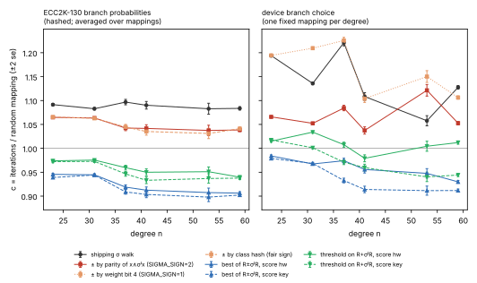
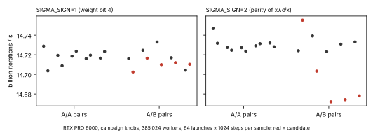

# Signed σ steps: R ± σʲ(R)

Question: the σ walk steps `R ← R + σʲ(R)`.  The two points `R + σʲ(R)` and
`R − σʲ(R)` share the slope's denominator `x + x(σʲR)`, so either costs the
same inversion.  Can a choice between them cut the iterations a solve needs
at a rate the campaign kernel keeps?

Answer: **yes, by about 3–4% per solve, with the sign read from the class
(`SIGMA_SIGN=2`).**  The sign is the parity of `popcount(x ∧ σʲ(x))` in normal
coordinates.  It costs one masked XOR of `x(σʲR)` into the numerator, five
ANDs and five popcounts, and no field products.  On one RTX PRO 6000 with the
campaign's knobs (`aws/build.sh`, 385,024 workers) the rate is **0.35% lower**
(A/B median 0.9965 against 0.10% A/A drift).  The walk needs **3.3–4.2% fewer
iterations** on the device's own reference walk at n = 41, and 4.1–4.9% fewer
in the emulation at n = 37–59.  Correctness gates all pass: 300/300 device
reports replay, 64/64 planted `GF(2^41)` logs are recovered, and the client
integration and arithmetic suites pass.

It is a different walk.  Its distinguished points never collide with the
current σ corpus, so switching starts a new corpus.  That decision belongs to
the campaign owner.  Nothing in `aws/` names it yet.

## 1. The walk and what it buys

`R ↦ (1 + λʲ)R` is a bijection on the class set for each branch, so the σ walk
pays the injective penalty `1/√(1 − Σp²)`, which is 1.070 at n = 131
([WALK-CONSTANT.md](WALK-CONSTANT.md) §3).  A sign taken from the class gives
sixteen branches, `(1 ± λʲ)`, still one bijection each, so the penalty falls
with `Σp²`:

| sign rule | Σp² at n = 131 (16 branches) | first-order model | vs σ (1.070) |
|---|---:|---:|---:|
| none (σ walk) | 0.12655 (8 branches) | 1.0700 | — |
| bit 4 of the weight (`SIGMA_SIGN=1`) | 0.09857; minus 33.9% of steps | 1.0533 | 1.016 |
| any function of the weight | ≥ 0.0986 (the weight has about a dozen likely values) | ≥ 1.053 | ≤ 1.016 |
| parity of `popcount(x ∧ σʲx)` (`SIGMA_SIGN=2`), ≈ fair and independent | 0.06327 | 1.0332 | 1.036 |

The exact binomial gives these values.  `x ∧ σʲx` is class-invariant: σ
permutes the normal coordinates of both terms, and negation leaves `x`
alone.  The 16-branch rewalk multiplier is `∏(1 + sʲ)^{n_j}(1 − sʲ)^{m_j}`.

Choosing *between* the two candidates by a score of the image (`sigma2`, and
`sigma2t` with a threshold) cuts iterations further.  It concentrates the
walk's image, the in-degree effect of the generic lead
(the prime-field study `research/rho_walk_leads_20261014`, PR #1829).
But it needs the second candidate's slope.  In this kernel's prefix-chain
inversion that is two more products per update, a squaring, and the second
candidate's basis conversion and weight: about +38% carry-less work against a
15–20% iteration gain.  Not built; derived from [ITERATION-FUNCTION.md](ITERATION-FUNCTION.md) §1.

## 2. Iterations

**Emulation** (`examples/ecc2k130_walk_constant.rs`, `--walk sigma|sigmapm|sigma2|sigma2t`,
W = 16, 10k–200k trials per cell, 108 cells on Modal): [`benchmarks/best-of-two/emulation-v{1,2,3}.jsonl`](benchmarks/best-of-two/).



With ECC2K-130's branch probabilities (hashed, averaged over mappings), at n = 59:

| walk | c | iterations vs σ |
|---|---:|---:|
| σ (shipping) | 1.0836 ± 0.0018 | — |
| ± by class hash (fair sign) | 1.0411 ± 0.0017 | 0.961 |
| ± by `x ∧ σʲx` parity (`SIGMA_SIGN=2`) | 1.0384 ± 0.0017 | 0.958 |
| threshold on `R + σʲR` (weight score) | 0.9396 ± 0.0016 | 0.867 |
| best of `R ± σʲR` (weight score) | 0.9063 ± 0.0015 | 0.836 |

Under the device's own branch choice, every degree is *one* mapping, and c
moves by several percent from mapping to mapping: the σ walk itself reads
1.06–1.22 across n = 23–59.  `SIGMA_SIGN=2` is lower than σ at five of six
degrees and 6% higher at n = 53.  What the campaign pays is its own n = 131
mapping, so the per-solve gain is about 4% on average, give or take that
mapping's luck.

**Device reference walk** (`src/walkconstant.cpp` built with
`-DECC_SIGMA_SIGN=0/1/2`: `Ref::step` on the type-II normal basis, exact class
collisions): [`device-wc-v1.jsonl`](benchmarks/best-of-two/device-wc/) (native
rows), [`device-wc-v2.jsonl`](benchmarks/best-of-two/device-wc/) (hashed rows).

| n | branches | trials | σ | `SIGMA_SIGN=1` | `SIGMA_SIGN=2` | ratio 2/σ |
|---:|---|---:|---:|---:|---:|---:|
| 23 | device | 200k | 1.1685 ± 0.0013 | 1.1986 | 1.1602 ± 0.0014 | 0.993 |
| 41 | device | 4k | 1.1261 ± 0.0092 | 1.1295 | 1.0792 ± 0.0091 | 0.958 |
| 23 | ECC2K-130 probabilities | 200k | 1.0992 ± 0.0013 | 1.0680 | 1.0628 ± 0.0012 | 0.967 |
| 41 | ECC2K-130 probabilities | 4k | 1.0864 ± 0.0091 | 1.0736 | 1.0501 ± 0.0086 | 0.967 |

`device-wc-v1.jsonl`'s hashed rows ran before `walkconstant.cpp` applied the
sign under hashed branches.  They are the unsigned walk three times, and
`-v2` replaces them.

**Short self-returns.** A walk returning to one of its own last 16 classes
was counted in every emulated cell.  The returns occur only at n ≤ 37, the
shipping σ walk has them at n = 23 and 31 too, and none of them is a formal
identity `∏(1 ± τʲ) = ±τᵏ` in `Z[τ]` (checked for each).  They are
coincidences of a small group.  At n ≥ 41 no walk shows any.

## 3. Rate and correctness on the RTX PRO 6000

`benchmarks/best-of-two/gpujob.sh` (`modal_job.py`, CUDA 13.3, sm_120): the
campaign knob set with `SIGMA_SIGN=0` against `1` (run 1) and `2` (run 2).

| gate | run 1 (`=1`) | run 2 (`=2`) |
|---|---|---|
| packed arithmetic, client integration (replay, restart, resume), host self-test | pass | pass |
| 300 device reports re-walked by the reference | 300/300 both | 300/300 both |
| planted `GF(2^41)` logs, 16 instances × 4 run ids, host build | 64/64 both | 64/64 both |
| registers / spills | 104 / 0 both | 104 / 0 both |
| A/A max drift | 0.17% | 0.10% |
| A/B median rate ratio | 0.99945 | **0.99652** |
| rates (B it/s) | 14.717 → 14.710 | 14.731 → 14.678 |



The planted solves' mean iterations (control 2,903, `=1` 3,095, `=2` 3,186
per walk, 64 each) carry a one-sigma error of about 6–7% each, so they
neither confirm nor contradict a 4% change.  They are correctness evidence
only.

## 4. Cost per solve

Iterations × (1 / rate): `0.958–0.967 × 1/0.9965` = **0.961–0.970** of the σ
walk's GPU time per solve, from the device-walk rows at n = 41 (iterations 0.958–0.967) and the
emulation at n = 37–59 (0.951–0.959).  The first-order model at n = 131 gives 0.966 for
iterations (1.036).  The campaign's own mapping can sit a few percent either
side.

## 5. What it takes to run it

- Build: `make gpu ... SIGMA_SIGN=2` with the campaign knobs; `WITNESS=1` is
  refused (the device witness has eight counters, the walk needs sixteen).
  Only the campaign's forward pass is wired (`SIGMA_FUSED=0`,
  `PACKED_SIGMA_TABLE=0`, `PACKED_WEIGHTED_PREFIX=2`); other paths refuse the
  knob at compile time.
- Host: the reference step, the rewalk's sixteen-kind multiplier and the
  self-tests follow the knob; the client and replay must be built with the
  same value.
- Campaign: a new walk name in `aws/protocol.py`, a new corpus, and a
  rollout.  Not done here.

## Reproduce

```sh
cargo build --release --example ecc2k130_walk_constant
cd ecc2k130/benchmarks/best-of-two
modal run modal_emulate.py --out emulation-v1.jsonl            # WALKS=v2 / v3 for the other walks
modal run modal_device_wc.py --out device-wc/device-wc-v2.jsonl # binaries: see the file's header
cd ../.. && modal run --detach modal_job.py --job benchmarks/best-of-two/gpujob.sh --env CANDIDATE_SIGN=2 --out <dir>
python benchmarks/best-of-two/plot.py
```

The distinguished-point corpora and result archives of the GPU runs are not
committed.  Their hashes are in `gpu-run{1,2}/uncommitted-artifacts.sha256`.
