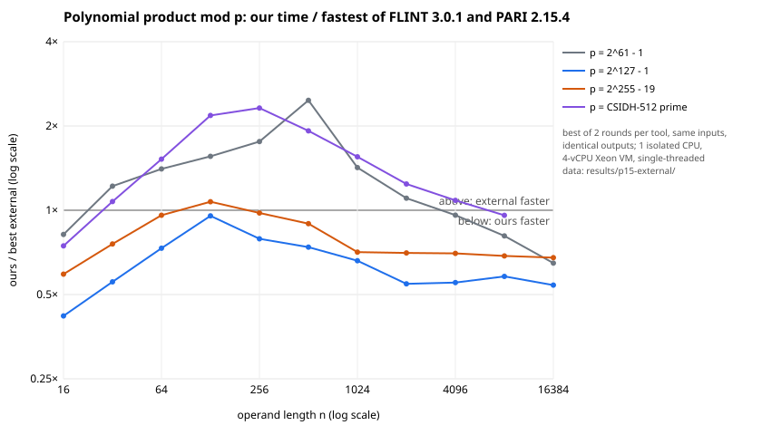
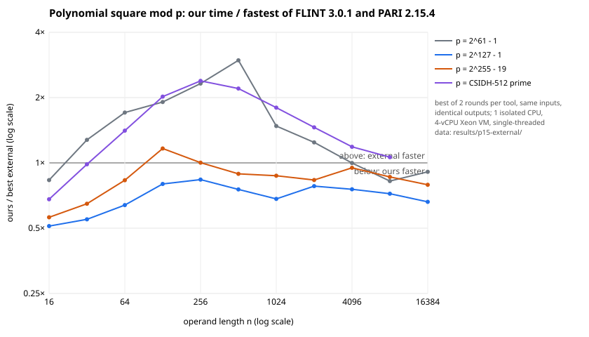
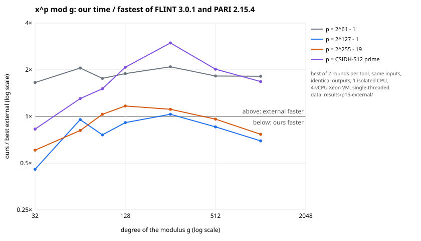

**Question.** How does `isogeny_algos` compare with the fastest external tools for the same
computations, as AGENTS.md §15 requires? This report covers FLINT 3.0.1 and PARI/GP 2.15.4
(with and without its `seadata` package), run against the round-5 code (PR #2002, head
dad68121d).

**Status.**

- *Measured*: every run used one isolated CPU (`tools/isolated_bench.py`); 121 runs, none
  marked contended. Each case ran in two rounds, with the order of the three tools reversed
  in the second round, and the faster of the two is reported.
- *Verified*: every tool produced the same output for every case. That covers products,
  squares and x^p mod g compared by their value at a fixed point, Φ_ℓ by its value at a fixed
  (j, Y), and SEA by the group order. Mismatches: 0.

Not covered here:

- Magma was not run (no licence in this environment), and nor were NTL and Sage.
- All runs are single-threaded, on one host: a 4-vCPU Xeon VM (`results/p15-external/host.txt`).

## Setup

- **Same inputs everywhere.** Each of the three programs builds the same inputs from one
  formula: full-size residues aᵢ = G^(i+16), bᵢ = G^(i+1000003) mod p, where G is the 64-bit
  golden-ratio constant; the modulus g has coefficients G^(i+2000003). The curves for SEA are
  y² = x³ + (k+3)x + (7k+11).
- **The programs:**
  - ours: `examples/ext_compare.rs`;
  - FLINT: `external/flint_bench.c`, using `nmod_poly` for the 61-bit prime and
    `fmpz_mod_poly` otherwise. Its x^p mod g time includes the pre-inverse of g, as ours
    includes building the reducer;
  - PARI: `external/pari_bench.gp`, timing CPU time in blocks long enough for its 1 ms timer.
- **Driver:** `external/run.sh`. Summary: `examples/ext_summary.rs` →
  `results/p15-external/SUMMARY.md`.
- **A first run was discarded.** Its inputs (i + c)^7 were below 2^98, so at 127 bits and
  above they were much smaller than full-size residues. GMP-based tools (FLINT, PARI) work on
  the actual size of each number, so they ran 5–37× faster on those inputs than on real
  residues. Its records remain in `isolation.jsonl`, without the "(full-size inputs)" label.

## Results

Ratio = our time / external time (below 1: ours faster). The full per-length tables are in
`results/p15-external/SUMMARY.md`.

| workload | ours vs the fastest external tool |
|:--|:--|
| Products, p = 2^127 − 1 | **faster at every length 16–16384:** 0.42–0.95× FLINT, 0.28–0.67× PARI |
| Products, p = 2^255 − 19 | **faster** except n = 128 (1.07× FLINT); 0.59–0.98× elsewhere |
| Products, 61-bit | FLINT `nmod_poly` faster for n = 32–2048 (1.1–2.5×); ours faster from n = 4096 (0.65–0.96×); faster than PARI at all n except 512 |
| Products, 511-bit (CSIDH-512 prime) | FLINT faster for n = 64–2048 (1.2–2.3×); level at n ≥ 4096 (0.93–0.96×) |
| Squares | the same pattern as products. 127-bit: 0.51–0.84× FLINT. 255-bit: faster except n = 128 (1.17×). 61-bit: FLINT faster for n = 32–2048 (up to 3.0×). 511-bit: FLINT faster for n = 64–4096 (up to 2.4×) |
| x^p mod g, 127-bit | 0.46–1.03× FLINT; faster at every degree except 256 |
| x^p mod g, 255-bit | 0.57–1.17×: faster at degrees 32–64 and 512–1024, slower at 90–256 |
| x^p mod g, 61-bit | **FLINT 1.65–2.1× faster** at every degree |
| x^p mod g, 511-bit | **FLINT 1.3–3.0× faster** from degree 64 |
| Φ_ℓ mod p, all ℓ ≤ 89, p = 2^127 − 1 | **ours 2.24 s** against PARI 11.4 s for Φ_ℓ(j, Y) at one j, and 11.9 s for the full Φ_ℓ over ℤ reduced mod p: **5.1–5.3× faster**. Ours is the full polynomial mod p, reusable for every j |
| SEA, 20 curves over 2^61 − 1 | **ours 41 ms** against PARI 91 ms (seadata) and 3029 ms (no seadata), plus our one-time Φ_ℓ precomputation, 216 ms |
| SEA, 10 curves over 2^127 − 1 | ours 1254 ms against **PARI 1062 ms (seadata, 1.18× faster than ours)** and 6412 ms without seadata, plus our one-time Φ_ℓ precomputation, 2293 ms. PARI reads its modular polynomials from disk |

## Losses, as targets for the next round

1. **Word-size products, n = 32–2048.** FLINT's `nmod_poly` is up to 2.5× faster. It packs
   coefficients into machine words (Kronecker substitution) and uses specialised
   word-size arithmetic. Our 1-limb `FpM` uses Montgomery products with a Karatsuba leaf of
   32.
2. **511-bit products, n = 64–2048, and x^p mod g from degree 64.** FLINT is 1.2–3.0×
   faster. Our 8-limb leaf products are full Montgomery products, and our NTT threshold is
   256. Candidate fixes are Kronecker substitution onto a fast big-integer product and a
   lower NTT threshold paired with fewer primes.
3. **SEA over 2^127 − 1.** PARI with `seadata` is 1.18× faster per curve, and it needs no
   precomputation because its modular polynomials ship as data. Two steps would close this:
   an inversion-free eigenvalue search (about 10 % per curve, by the round-5 profile), and
   shipping or caching Φ_ℓ mod p so the 2.3 s is paid once rather than per field.
4. **x^p mod g at 255 bits, degrees 90–256** (1.03–1.17×). The table/Barrett cut-off and the
   squaring threshold for 4 limbs should be retuned against FLINT.

Not yet compared: Magma (needs a licence), NTL, Sutherland's `classpoly`/`modpoly` for Φ_ℓ,
and Sage, which mostly calls FLINT and PARI.
