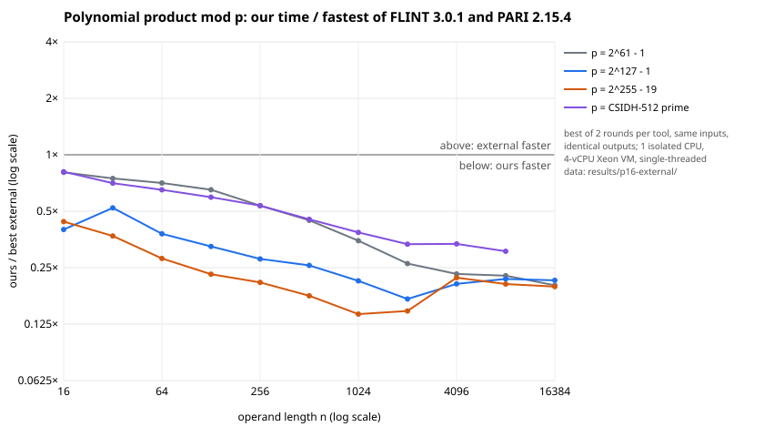
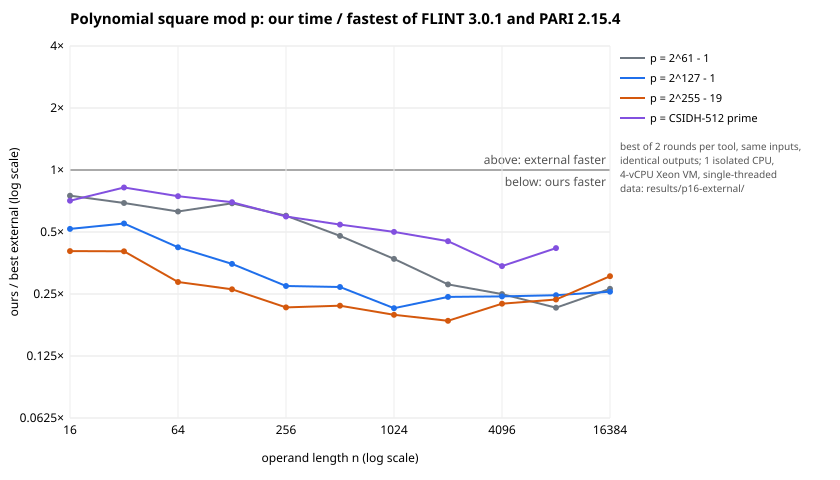
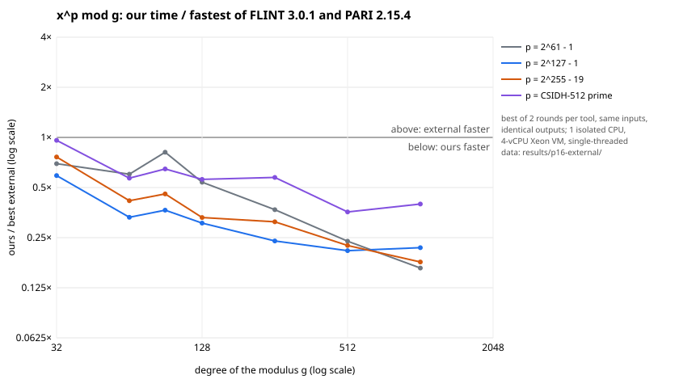

**Question.** The external comparison of 2026-10-16 (`docs/external-20261016/REPORT.md`)
found FLINT 3.0.1 faster than `isogeny_algos` in 49 cases:

- polynomial products and squares over 2^61 − 1 (n = 32–4096) and over the CSIDH-512 prime
  (n = 32–8192);
- three cases over 2^255 − 19 (n = 128–256);
- x^p mod g over 2^61 − 1 and the CSIDH-512 prime at every degree, and at some degrees over
  2^127 − 1 and 2^255 − 19.

It also found PARI/GP 2.15.4 with its precomputed `seadata` faster at SEA over 2^127 − 1.

AGENTS.md §15 makes each loss a target. This round removes all of them (SEA: change 8).

**Status of each statement.**

- *Measured*: the final comparison reruns all three tools on the same inputs. As before,
  each tool has two rounds, the order of the tools is reversed in the second, and every
  timed command runs on one isolated CPU (`tools/isolated_bench.py`): 64 runs, none
  contended. The code is at head 04f75a816. The records are in `results/p16-external/`
  and the summary in `results/p16-external/SUMMARY.md`.
- *Verified*:
  - every tool gives the same output in every case: 114 polynomial cases, Φ_ℓ for 23
    levels, and 30 SEA group orders. Mismatches: 0;
  - 154 tests pass, both with the AVX-512 IFMA path on and with it off
    (`ISOGENY_NO_SIMD=1`).
- *Host*: a 4-vCPU Xeon VM with AVX-512 IFMA, single-threaded. The first comparison ran on a
  2.80 GHz host and this one on a 2.10 GHz host, where FLINT itself was faster (by 12–27 %
  on the middle half of the cases).
  Ratios within one run are comparable; absolute times across the two runs are not.
- Magma, NTL and Sage were still not run.

## Result

Ours / FLINT is below 1 in every product, square and x^p mod g case. The largest ratio is
0.96 (CSIDH-512 prime, x^p mod g at degree 32); the median is about 0.35. Against the faster
of FLINT and PARI, every case is below 1 as well.

**The former losses**, ours / FLINT in each run (each run's own FLINT time):

| workload | 2026-10-16 | this run |
|:--|--:|--:|
| products, 2^61 − 1, n = 32–2048 | 1.10–2.47 | 0.26–0.75 |
| squares, 2^61 − 1, n = 32–4096 | 1.00–2.97 | 0.25–0.69 |
| products, CSIDH-512, n = 32–2048 | 1.07–2.32 | 0.33–0.71 |
| squares, CSIDH-512, n = 64–8192 | 1.06–2.39 | 0.30–0.75 |
| products and squares, 2^255 − 19, n = 128–256 | 1.00–1.17 | 0.22–0.26 |
| x^p mod g, 2^61 − 1, degree 32–1024 | 1.65–2.09 | 0.16–0.81 |
| x^p mod g, CSIDH-512, degree 64–1024 | 1.30–2.98 | 0.36–0.65 |
| x^p mod g, 2^255 − 19, degree 90–256 | 1.03–1.17 | 0.31–0.46 |
| x^p mod g, 2^127 − 1, degree 256 | 1.03 | 0.24 |

**SEA and Φ_ℓ against PARI** (`results/p17-sea/`, head 1c823fd98, after change 8: 16
isolated runs, none contended; every group order and Φ_ℓ value agrees):

| workload | ours | PARI with `seadata` | PARI without | ours / PARI |
|:--|--:|--:|--:|--:|
| SEA over 2^127 − 1, 10 curves | 545 ms | 647 ms | 5052 ms | 0.84 |
| SEA over 2^61 − 1, 20 curves | 18 ms | 79 ms | 2242 ms | 0.23 |
| Φ_ℓ mod 2^127 − 1, all primes ℓ ≤ 89 | 1.31 s | 9.1 s (one j) | 9.5 s (over Z) | 0.14 |

- Before change 8, the run on head 04f75a816 (`results/p16-external/`) had SEA over 2^127 − 1
  at 878 ms against 708 ms: 1.24× slower than PARI.
- One curve of the ten (k = 7) is still slower than PARI on its own (82 ms against 63 ms).
- PARI with `seadata` reads its modular polynomials from disk. Ours computes Φ_ℓ once per
  field (1.3 s for ℓ ≤ 89), and that time is not included in the SEA totals.

## Changes

1. **Explicit CRT instead of Garner** (`src/ntt.rs`, `FpM::fold`).
   - Each coefficient is rebuilt as V = Σ u_i (M / m_i) − q M. The factor (M / m_i)^{-1}
     rides on the pointwise scale, so u_i comes straight out of the inverse transform, and
     q is read off a floating-point sum. The primes keep a spare bit, so V < M / 2 and q is
     exact.
   - The fold mod p uses constants cached per (p, prime family, t) that carry an extra
     2^64, so the Montgomery correction product disappears.
   - At 8 limbs (17 primes) this replaces about 136 modular products per coefficient with
     17.
2. **Lazy input reduction.** An N-limb residue is reduced mod each NTT prime with one u128
   accumulation and one division-free reduction per four limbs, instead of a modular
   product per limb: 2× faster at 8 limbs.
3. **AVX-512 IFMA transforms** (`ntt::ifma`).
   - *Primes:* 50-bit, of the form c·2^26 + 1. Eight lanes run on `vpmadd52luq` /
     `vpmadd52huq`, with Harvey's lazy butterflies and 52-bit Shoup twiddles stored per
     layer.
   - *Last three layers:* done in registers with `vpermt2q`.
   - *Input load:* the operands are converted once to radix-2^52 digits, shared by every
     prime. They are then reduced eight coefficients at a time by digit-serial Montgomery
     steps; the 2^(−52 D) factor goes into the pointwise constant.
   - *Pointwise products:* a radix-2^52 Montgomery product followed by a Shoup product.
   - *Dispatch:* the CPU features are detected at run time, and the portable path remains.
     `ntt::SIMD` switches the vector path off per thread (tests), `ISOGENY_NO_SIMD` for the
     whole process.
   - *Effect:* above the crossover, products are up to 15× faster than Karatsuba (2 limbs,
     n = 1024, `examples/profile_ntt.rs`).
4. **Products just past a power of two.**
   - The transform runs at the smaller power L, giving the product mod x^L − 1.
   - The wrapped top coefficients come from the product of the operands' high ends.
   - This removes the step in cost at every power of two (n = 160 used to cost as much as
     n = 256).
5. **Faster Barrett reduction** (`PolyModulus`).
   - Since a − q·m has degree below n, q·m is only needed mod x^L − 1 (half-size
     transforms). The inverse series and the modulus are transformed once, in
     `PolyModulus::new` (`Field::prepare` / `conv_prepared`).
   - Below the Karatsuba threshold, both products are truncated to the coefficients needed.
   - A linear base (x, x + c) multiplies in by a shift, as the table reducer already did.
6. **One-limb kernels** (`src/field.rs`).
   - *Products and squares:* lazy convolutions and squares run four output coefficients at
     a time, sharing the loads, with a one-multiplication fold (`Red128::fold`) between
     blocks. Squares form each cross product once (also for `Zp`).
   - *Table reducer and composer:* both use a four-row matrix-vector kernel.
7. **Retuned thresholds**, measured with `examples/profile_ntt.rs`, `profile_sqr.rs` and
   `profile_powmod.rs`; each depends on whether the IFMA path is active:
   - the NTT threshold for 1/2/4/8 limbs: 72/56/32/24 with IFMA, 384/112/64/40 without;
   - multi-limb squares go to the NTT from the same thresholds;
   - the one-limb Karatsuba threshold is 72;
   - the table-vs-Barrett limit is now a `Field` method: 44/60/52/40 with IFMA, and
     160/140/110/85 without.

8. **SEA stops on the cost of an Atkin-aware search** (`find/sea.rs`, `search_plan`).
   - The final search over t = t0 + k m now enumerates the residues of k modulo a product
     M_A of Atkin primes that their candidate sets allow. It uses one shared baby-step table
     and one giant-step walk per residue, so the Atkin primes cut the search instead of only
     filtering its hits.
   - `search_plan` picks the Atkin primes greedily and estimates the search in point
     additions. SEA stops adding primes once that estimate is below the next prime's cost
     (about 3 ℓ² additions) or 4096, whichever is larger.
   - Over 2^127 − 1 this skips the last one or two primes (ℓ ≈ 61–71, 10–17 ms each). The
     final search itself costs 1–5 ms.
   - `tests/sea.rs` pins four group orders over 2^127 − 1 to PARI's `ellcard`, and checks
     that the Atkin-residue search ran.

## Evidence

- **Records:**
  - `results/p16-external/`: round1 and round2 per tool and case, `isolation.jsonl`,
    `host.txt` and `SUMMARY.md`;
  - `results/p17-sea/`: the Φ_ℓ and SEA rerun after change 8
    (`OUT=results/p17-sea OPS=sea external/run.sh`);
  - the first comparison is unchanged in `results/p15-external/`.
- **Driver:** `OUT=results/p16-external external/run.sh`; summary and chart data from
  `examples/ext_summary.rs` (`--dat` → `ratios.dat`); charts from `chart.awk`.
- **Tests:**
  - `tests/ntt.rs`: NTT equals Karatsuba for every limb count, in both transform families,
    including wrapped lengths;
  - `tests/sqr.rs`: squares equal products, `Zp` included;
  - `tests/powmod.rs`: Barrett and the table against division, with IFMA on and off, plus
    8 limbs;
  - `tests/dot.rs`: the word kernels against schoolbook, and the row kernel against single
    dot products;
  - `ntt` unit tests: the explicit CRT against exact big-integer convolutions, cyclic and
    all-ones cases.
