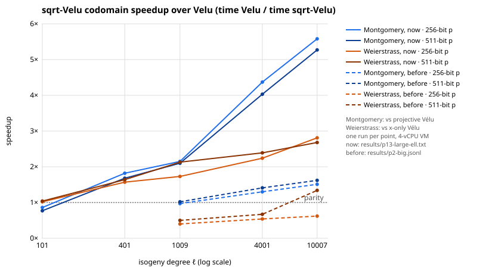

**Question.** Make isogenies of large prime degree ℓ faster in `isogeny_algos`. That covers
kernel → codomain and point images for Montgomery and short Weierstrass curves at
ℓ = 101 … 250007 over 256- and 511-bit primes.

**Status of each statement.** Speedups are *measured* (one run per setting on a shared
4-vCPU VM; expect ±10–20 % noise). Correctness is *verified* by exact equality with Vélu in
the crate's tests (110/110 pass; 130/130 after merging current `main`). The algebraic
identities are *derived* below and checked by those tests. No claim here concerns ECDLP.

## Method

√élu splits the kernel half S = (I ± J) ∪ K (Bernstein–De Feo–Leroux–Smith 2020). For a pair
(i, j), the x-coordinates x± = x(P_i ± P_j) are the roots of a biquadratic
F0 T² + F1 T + F2 in x_i, x_j.

1. **Montgomery codomain, pair by pair.** The codomain needs h_S(1) and h_S(−1), up to a
   common factor. At α = ±1 each factor c2 Z² + c1 Z + c0 of E_J has c0 = c2, so
   `E_J(Z) = Z^b ∏_j (c2_j W + c1_j)` with `W = Z + 1/Z`. Hence h_S(±1) is a product over
   pairs of `(c2_j w_i + c1_j)` with `w_i = x_i + 1/x_i`. With `s_j = c1_j / c2_j` (one batch
   inversion) that is `(∏ c2_j)^b' · ∏_{i,j} (w_i + s_j)`: **one multiplication per pair**, about ℓ/2 for
   the codomain, against about 8 per kernel point for projective Vélu.
2. **Montgomery images.** For each pair, q_j(x_i) and its reverse share c1·x_i: five
   multiplications per pair, so 2.5 per kernel point against 4 for Vélu. The
   projective-input variant homogenises in (X, Z) and needs no inversion.
3. **Weierstrass.** Each pair gives
   x₊ + x₋ = 2((x_i x_j + A)(x_i + x_j) + 2B)/(x_i − x_j)² and
   x₊x₋ = ((x_i x_j − A)² − 4B(x_i + x_j))/(x_i − x_j)², with one batch inversion for all
   pairs. From these come the power sums p₁, p₂, p₃ (codomain), and for images the sums
   Σ 1/(α − x)^k, k = 1, 2, 3.
4. **Õ(√ℓ) path kept, opt-in.** It uses a Bernstein scaled remainder tree (`poly::EvalTree`)
   and the W-product. It is 2.1–2.8× faster than the previous tree code, but slower than
   pair-by-pair products at every measured size up to ℓ = 250007. The cause is the lazy
   multiply-accumulate under the polynomial products, which costs 0.85–1.1 field
   multiplications per term.
5. **x-only Vélu.** Differential addition specialised to the affine base point, small
   multiples computed by additions, and cheaper image sums: 15–25 % faster.

## Results

| ℓ | Montgomery codomain 256 / 511 bits | one image 256 / 511 bits | Weierstrass codomain 256 / 511 bits | image 256 / 511 bits |
|--:|:--|:--|:--|:--|
| 101 | 0.86× / 0.77× | 1.16× / 1.19× | 1.02× / 1.04× | 1.32× / 1.33× |
| 401 | 1.82× / 1.68× | 1.36× / 1.36× | 1.57× / 1.64× | 1.60× / 1.56× |
| 1009 | 2.15× / 2.10× | 1.49× / 1.43× | 1.73× / 2.13× | 1.60× / 1.65× |
| 4001 | 4.37× / 4.03× | 1.48× / 1.49× | 2.24× / 2.39× | 1.74× / 1.65× |
| 10007 | 5.58× / 5.27× | 1.51× / 1.27× | 2.81× / 2.68× | 1.97× / 1.88× |

The comparators are projective Vélu for Montgomery curves and x-only Vélu for Weierstrass
curves. The Weierstrass comparator is itself 15–25 % faster than before this change.

Before this change, the recorded run `results/p2-big.jsonl` gives:

- **Montgomery √élu codomain:** 1.51× (256 bits) and 1.62× (511 bits) at ℓ = 10007, slower
  than Vélu below ℓ ≈ 1000.
- **Weierstrass √élu:** slower than x-only Vélu at 256 bits at every ℓ measured. At 256 bits,
  ℓ = 10007, √élu went from 5.13 ms to 1.16 ms.

**Negative results.**

- **Pair-by-pair vs remainder tree (Montgomery codomain).** The tree path takes 1.7–2.8× as
  long as the pair-by-pair products for ℓ = 10007 … 250007.
- **Images.** The tree path also takes 1.07–1.7× as long as pair by pair at those sizes.
- **Product-scanning multiply-accumulate.** It cost 1.1–1.9 field multiplications per term,
  so it was dropped.
- **CSIDH-512 with √élu leaves.** Using √élu from ℓ = 151 or 263 gave no change outside the
  noise: 31–32 ms in alternating runs over 12 keys, with identical outputs. The option
  `Csidh::sqrt_velu_min` is therefore off by default.

## Evidence

- Raw output: `isogeny_algos/results/p13-large-ell.txt`. It is produced by the examples
  `profile_large_ell`, `profile_weier`, `profile_tree_vs_direct` and `profile_csidh`.
- Tests:
  - `tests/sqrt_velu_mont.rs`: both paths, `new_proj` and `eval_xz` against Vélu on all 74
    CSIDH-512 degrees and on ℓ = 1009 and 10007;
  - `tests/polyfast.rs`: `EvalTree` against Horner;
  - `tests/kernel2.rs` and `tests/bigfield.rs`: Weierstrass Îlu codomain and images against
    x-only Vélu.
