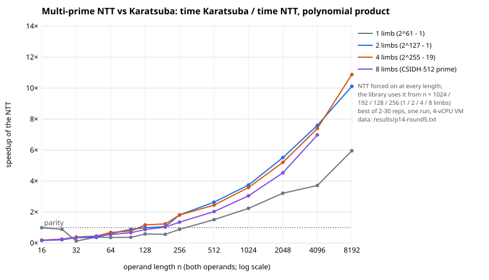

**Question.** Make `isogeny_algos` faster. This round I profiled the heaviest end-to-end
workload, SEA point counting over 2^127 − 1, together with the Φ_ℓ precomputation it needs,
and fixed what the profile showed. I then compared the whole benchmark suite before and
after the changes.

**Status of each statement.**

- *Measured*: every speedup below, on a shared 4-vCPU VM. Single runs vary by 10–20 %
  (more for runs under 1 ms), so the suite comparison takes the minimum of two runs per
  binary, run in alternating order.
- *Verified*: every changed routine gives exactly the same output as the path it
  replaces. 148 tests pass, including three new ones; every benchmark record on the new
  binary reports `verified: true`.
- No claim here concerns ECDLP.

## Changes

1. **Multi-prime NTT for long products** (`src/ntt.rs`, `FpM::conv_long`).
   - *Method.* The Montgomery residues are convolved as integers modulo 62-bit primes
     c·2²⁶ + 1. The transforms use Harvey's lazy butterflies with Shoup twiddles (values
     kept below 4p, twiddles cached per prime), and a squaring is transformed only once.
     Each coefficient is rebuilt by Garner's mixed-radix CRT, then passed through the
     existing wide Montgomery reduction. The output is therefore bit-identical to the
     lazy schoolbook / Karatsuba product.
   - *Thresholds.* The NTT is used from shorter-operand length 1024 / 192 / 128 / 256 for
     1 / 2 / 4 / 8 limbs, about 1.2–1.5× past the measured crossover.
   - *Hook.* `Field::conv_long`, called from `poly::mul_raw`; other field types keep
     Karatsuba.
2. **Φ_ℓ for several ℓ** (`Phi::compute_many`). The q-expansion S(q) = q·j(q) is computed
   once at the largest length and shared; it used to be recomputed for every ℓ.
3. **Squarings.**
   - `FpM::conv_sq` forms each cross product once, with lazy accumulation.
   - `poly::sqr_raw` applies Karatsuba to squares, with its own leaf threshold
     (`Field::sqr_threshold`: 96 for 2–4 limbs, 64 for 8). `mul_raw(a, a)` now goes there.
4. **Sliding-window polynomial powers.** Non-linear bases use 4-bit windows with both
   reducers. The exponent (q − 1)/2 = 2¹²⁶ − 1 is all ones, so binary powering paid one
   full product per bit.
5. **Table reducer up to 160 coefficients** (previously 64). `powmod` and the `Composer`
   (the Frobenius matrix behind the Atkin degree) use the table of x^k mod m up to that
   size.
6. **BMSS linear algebra.** The products Ṽ·V^i that fill the d_i columns do not depend on
   the row, but were recomputed for every one of the 2ℓ − 1 rows. They are now formed once.

## Results

**Before/after across the suite.** `main` at d5382a530 against this branch. Each figure is
the minimum of two runs per binary (four for `bmss` on `main`); all records are in
`results/p14-bench/`.

| workload | main | this branch | speedup |
|:--|--:|--:|--:|
| Φ_ℓ for all ℓ ≤ 89 over 2^127 − 1 (`sea_phi_precompute`) | 9.36–9.57 s | 2.26–2.28 s | 4.1–4.2× |
| Φ₆₁ / Φ₄₃ over 2^127 − 1 (Hecke) | 471 / 146 ms | 137 / 43 ms | 3.4× |
| SEA point count over 2^127 − 1, 24 records (sum) | 2.12 s | 1.81 s | 1.14× (geomean; 0.82–1.42) |
| BMSS linear algebra ℓ = 101, 40 / 256 / 511-bit p | 0.72 / 10.9 / 28.5 s | 18 / 172 / 544 ms | 40 / 64 / 52× |
| Kohel from kernel polynomial ℓ = 1009, 256 / 511-bit | 10.2 / 24.9 ms | 4.2 / 12.4 ms | 2.4 / 2.0× |

**Inside SEA over 2^127 − 1** (`results/p14-round5.txt`):

- Y^q mod Φ_ℓ(j, Y): 22 ms → 8 ms at ℓ = 67, which is now handled by the table reducer.
  Summed over ℓ ≤ 89 it went from 141–169 ms to 90–117 ms.
- f^((q−1)/2) mod h: 1.5× faster. X^q mod h: 1.15–1.2× faster (squaring only).
- Atkin-degree phase, summed over ℓ ≤ 89: 38–71 ms → 26–50 ms.

**Building blocks.**

- *Squares vs general products* (`profile_sqr`): 1.3–1.6× faster at every length. For
  example, 2 limbs at n = 64 takes 13.3 µs instead of 21.2 µs, and 8 limbs at n = 128
  takes 364 µs instead of 586 µs.
- *Table vs Barrett reducer* (`profile_powmod`): the table is 1.3–1.5× faster up to
  degree 100–160, for 1-, 2- and 4-limb fields.

**Unchanged** (each within ±5 % on its geometric mean):

- CSIDH-512, the `kernel` and `find` groups, and Sutherland's Φ_ℓ;
- SEA over 40- and 61-bit fields;
- the Õ(√ℓ) remainder-tree path of √élu. Its polynomials, of length 50–158, mostly fall
  below the NTT thresholds, so pair-by-pair products remain the default; last round's
  conclusion stands.

**One discrepancy.** Before change 6, BMSS linear algebra at ℓ = 101 over 40 bits
measured 0.80–0.92× of `main` inside the full benchmark process (four runs per binary).
Run in isolation with the order of binaries alternated, the difference was 2–3 %. I did not
explain the in-process gap. Change 6 removes that cost entirely.

**Not done.** Two further speedups remain:

- an inversion-free eigenvalue scan in SEA (division polynomials or baby-step giant-step),
  about 10 % per curve;
- the Newton step of Φ_ℓ by accumulating in NTT space, about 25 % more on Φ_ℓ.

## Evidence

- **Profiles:** `isogeny_algos/results/p14-round5.txt`, produced by the examples
  `profile_ntt`, `profile_sqr`, `profile_powmod`, `profile_eig` and `profile_sea`.
- **Benchmark records:** `results/p14-bench/*.jsonl`. Arms: `main`, `round5-pre-bmss`
  (this branch before change 6) and `round5` (`bmss` and `big` after change 6). Compare them
  with `cargo run --release --example bench_compare -- results/p14-bench main round5-pre-bmss <groups>`.
- **Tests:**
  - `tests/ntt.rs`: NTT equals Karatsuba for 1, 2, 4 and 8 limbs, including operands
    equal to p − 1, unbalanced lengths and squarings;
  - `tests/sqr.rs`: squaring equals the general product;
  - `tests/powmod.rs`: windowed powers equal plain square-and-multiply, with both reducers;
  - the existing suite covers Φ_ℓ, SEA, BMSS and the rest of the crate (148 tests in all).
