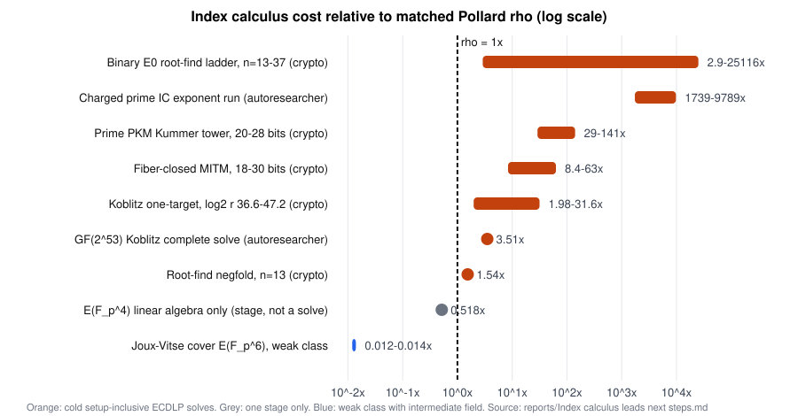

# Index calculus trails rho; three degree questions remain

Across the four repositories (aburan28/crypto, cryptanalysis, crypto-autoresearcher and ml-cryptanalysis), **no index-calculus (IC) variant beats matched Pollard rho on any cold, one-target, setup-inclusive ECDLP solve**. The measured gap is 1.5x to 25,116x on binary and Koblitz curves, 29x to 141x on prime curves, and it widens with size at roughly #E^{1/6} for every linear-scan oracle. Every advertised IC "win" is one of three things: an online ratio that excludes about 600 s of setup, a stage-level speedup (root finding 10^2 to 10^5 times faster than F4), or a regime with intermediate fields (Joux–Vitse covers on E(F_{p^6}) at 0.012x rho; linear algebra alone on E(F_{p^4}) at 0.518x rho). The program has turned most of the map into rigorous, scoped barriers: generic-oracle bounds, an exact lattice LP, cyclotomic-coset and GHS classifications, transport-conservation and mixed-volume theorems. What remains open at the exponent level is narrow: whether the PKM tower's solving degree stays bounded on prime fields (stalled by memory at N ≥ 21), whether the m = 4 Weil-descent degree levels off for prime-degree binary fields (the "106-bit spread" for ECC2K-130), and whether any oracle that is not an elimination of the descended system exists (spectral, multi-polynomial lattice, or quasi-subfield bases). All ten next steps ranked below are unexecuted according to the notes, and the first one, an end-to-end E(F_{p^4}) ladder in ecbench, has been gated open since 2026-10-13 without being run. Before any new claim, the program also has integrity debt to pay down: an unaudited `s4_expr` harness bug, a failed 48-row replay audit, a benchmarks index with 16 rows covering about 50 directories (most IC negatives unindexed), and open-problem registers that contradict proved results.

## Rho wins every cold solve the four repositories have measured

The strongest established fact is empirical and consistent across repositories. The crypto frontier synthesis of 2026-10-13 states that "the cold, one-target, setup-inclusive frontier is still generic rho", and none of the 46 sealed bounds puts an IC method on any frontier. The three `ic.pipeline` bounds are inadmissible because **48 of 96 runs did not verify** and only two sizes were measured ([evidence note](<../research_notes/Index calculus leads next steps/crypto_autolab_ecbench_evidence.md>), citing `docs/bounds/FRONTIER.md` and `research/ecbench_frontier_20261013/README.md`). The other repositories report the same pattern independently. The cryptanalysis papers say phase-aware Koblitz IC is "1.3–300x the matched rho" at every degree up to n = 83, and the N53 root-index runs show IC about 3–4x slower in wall time ([cryptanalysis note](<../research_notes/Index calculus leads next steps/cryptanalysis_repo_ic.md>), citing `papers/frobenius-orbits/sec-abstract.tex` and `experiments/hamming-ic-e2e-20260929/N53_W3_ROOT.md`). The autoresearcher's best complete solve, on a GF(2^53) Koblitz curve, ran at a paired wall ratio of **3.511x rho**. Its capacity-doubling and early-stop variants stayed at 3.56x and 4.15x ([autoresearcher experiments note](<../research_notes/Index calculus leads next steps/autoresearcher_experiments.md>), citing `research/cold_single_ic_20260921/REPORT.md`).

| Setting (repository) | Cold IC / matched rho | Trend | Source note |
|---|---|---|---|
| Binary E_0 root-find ladder, n = 13–37 (crypto) | 2.9x, 15x, 61x, 3,053x, 25,116x | widening; the n = 31 jump is mostly the 1,492 cofactor | evidence |
| Prime PKM Kummer tower, 20–28 bits (crypto) | 29–141x | +0.26 ± 0.28 bits per bit, against 0.17 predicted | evidence, prime |
| Fiber-closed MITM, 18–30 bits (crypto) | 8.4x to 37x (h = 4); 13.4x to 63x (h = 72) | slope 0.177 ≈ #E^{1/6} | evidence |
| Koblitz one-target, log₂ r 36.6–47.2 (crypto) | 1.98–31.6x (setup is 98.5–99.7% of S) | — | evidence |
| Root-find negfold, n = 13 (crypto, 2026-10-14) | 1.54x (S 21.8 against 14.1) | — | evidence |
| GF(2^53) Koblitz complete solve (autoresearcher) | 3.51x wall | — | autoresearcher experiments |
| Charged prime IC exponent run (autoresearcher) | 1,739–9,789x | exponent 0.62, CI [0.11, 2.32], about 9% power | autoresearcher ideas |
| Prime 23.4-bit, binary 24.4-bit, Koblitz 39-bit (cryptanalysis paper) | 14.5x, 89x, 300x | every fitted exponent above one half | cryptanalysis |

The only places where an IC number falls below rho are worth stating precisely, because each carries a qualifier that matters. The **online** Koblitz results are large: 13.9x [9.8, 19.1] at n = 61 over 64 unseen targets, and **54.1x [17.18, 58.90]** at N83 on 5 fresh points. Both exclude a setup of 580–640 s and about 13.9 GiB peak RSS ([evidence note](<../research_notes/Index calculus leads next steps/crypto_autolab_ecbench_evidence.md>), citing `research/n83_tier1_final_results_20261014/RESULT.md`). The step-back note calculates that preprocessing rho with the same advice would need **3,000–6,000x fewer online operations** than IC at every rung, so these wins are precomputation trades, not attacks ([binary note](<../research_notes/Index calculus leads next steps/crypto_binary_koblitz_transfer_ic.md>), citing `RESEARCH_IC_LEADS_AND_CONNECTIONS_20261010.md:127-141`). The autolab's toy panel shows IC at 0.721x rho in cold instruction counts, but cold native time is a statistical tie (rho/IC 0.968 [0.915, 1.027]) on an 8-column base at r ≈ 2^18, so instruction counts and time disagree at this scale (evidence note, citing `research/ic_candidate_tournament_20260915/goal_20260924/improvement/round3/README.md`). The C library's (Z/pZ)^* linear sieve does cross rho near 56 bits, but that is a finite-field DLP, not ECDLP ([cryptanalysis note](<../research_notes/Index calculus leads next steps/cryptanalysis_repo_ic.md>), citing `papers/ecdlp-constant/sec-indexcalc.tex`).

The two genuinely sub-rho ECDLP regimes both rely on intermediate fields. The Joux–Vitse cover-decomposition on E(F_{p^6}) has S/rho falling as p^{−1.92 ± 0.12} and reaches **0.012–0.014x rho at ℓ = 2^{61.4}** with sieving ([prime note](<../research_notes/Index calculus leads next steps/crypto_prime_field_ic_docs.md>), citing `research/notes/index-calculus/RESEARCH_COVER_DECOMPOSITION_LEDGER.md`). This is a weak class and not a generic curve. On E(F_{p^4}), linear algebra alone runs at **r∞ = 0.518 ± 0.031 of rho** on eight verified curves. The D₄ = (Z/2)³ ⋊ S₄ symmetry cut the per-solve cost C₄ by **47.5–48.4x** (1.21·10^12 to 2.54·10^10 F_p multiplications) and moved the modelled crossover from 2^150 to about 2^135 (prime note, citing `research/notes/index-calculus/RESEARCH_RESIDUAL_WALKS.md` §11.19 and `research/gaudry_quartic_d4_20261013/README.md`). The step-back note draws the synthesis: every measured exponent gain lives on a field with a proper intermediate subfield, so prime p and prime n are one obstruction (prime note, citing `RESEARCH_IC_LEADS_AND_CONNECTIONS_20261010.md` §7(d)).

One structural point in this regime is easy to miss and changes how the k = 4 lead should be read. A factor base of about q/2 abscissae over F_q gives a sparse q x q relation matrix, so plain linear algebra costs about q², while rho on E(F_{q^4}) also costs about q². The measured r∞ ≈ 0.518 is therefore **a constant, not an exponent**. The plain k = 4 route ties rho asymptotically, wins only by that constant, and its crossover is set by the relation phase, roughly 24·C₄·q against 0.48·q². That is why "every 10x off C₄ moves the crossover down by about 2^13" (evidence note, citing `research/ic_speed_and_rho_scope_20261013/README.md`). Only the double-large-prime variant reaches the proven Õ(q^{2−2/n}) = q^{1.5} of Gaudry and Diem ([Diem, Math. Comp. 2011](https://www.ams.org/mcom/2011-80-273/S0025-5718-2010-02281-1/)). The k = 3 data agree: linear algebra grows as n^{0.68} plain and n^{0.424} with double large primes (prime note, citing RESIDUAL_WALKS §11.15). This is my inference from the cited numbers, but it explains why the negation-walk reference (r∞ 0.733) and any stronger rho (for example a ψ-fold walk on j = 0) can push the plain route toward having no crossover at all.

## Theorems close most of the map, but each closure has a scope

The program has produced an unusual number of exact or proved results. Some are external theorems the repositories rely on, and some are internal.

**Generic-oracle bounds (theorem; scoped).** Corrigan-Gibbs–Kogan S·T² ≳ n and Shoup T ≳ √n cover rho, BSGS, kangaroo, and every IC whose decomposition oracle enumerates or table-looks-up factor-base elements: IC-2 has S·T² = p²/(4B) ≥ p/4, and IC-3 with a pair table has S·T² ≥ 0.56p. The step-back note stresses that this is "a theorem, not a heuristic", but only for oracles built from group operations and membership tests. It "explicitly does not cover an S₄ solve with an algebraic restriction on the unknowns" ([prime note](<../research_notes/Index calculus leads next steps/crypto_prime_field_ic_docs.md>) and [binary note](<../research_notes/Index calculus leads next steps/crypto_binary_koblitz_transfer_ic.md>), citing `RESEARCH_PRIME_FIELD_BREAKTHROUGH_PROGRAM.md` §1 and `RESEARCH_IC_LEADS_AND_CONNECTIONS_20261010.md:79-89`). The measured Koblitz pair-table rungs sit **2^25–2^27 above the generic line**. The W3 mapping of the newer structured-GGM bound (ePrint 2026/384) onto decomposition oracles is "interpretation, not a theorem of the paper" (prime note, citing `research/lit2026_w3_ggm_audit_20261011/README.md`).

**Exact structural classifications.** At n = 131 the Frobenius-stable F₂-subspaces are cyclic codes with dimensions in {0, 1, 130, 131}, so GGMP-style invariant bases are "empty exactly at the sizes that matter". The GHS genus over F_{2^131} is 1, 2^130 − 1 or 2^130. Couveignes–Lercier elliptic periods fail for every n ≥ 7 by the Hasse bound. The ECC2K-130 product law fixes the required oracle speedup at 2^−(70.19 + log₂ m) over search ([binary note](<../research_notes/Index calculus leads next steps/crypto_binary_koblitz_transfer_ic.md>), citing `RESEARCH_KOBLITZ_INDEX_CALCULUS.md:244-267, 892-906`, `research/notes/ecc2k130/RESEARCH_ECC2K130_HYPERELLIPTIC.md:15-31` and `RESEARCH_ECC2K130_DECOMPOSITION.md:478-520`). The cryptanalysis repository adds that the whole ECC2K-130 isogeny class (E0 plus 262 floor curves) costs 2^60.81 and that IC gives "0 bits" ([cryptanalysis note](<../research_notes/Index calculus leads next steps/cryptanalysis_repo_ic.md>), citing `experiments/ecc2k130-isogeny-class/REPORT.md`).

**Proved lemmas on symmetry and transfer.** The transport-conservation lemma says a homomorphic transfer cannot change decomposition counts beyond |κ|^{m−1}, and the summation polynomial of an isogenous curve pulls back to a product of kernel-twisted ones (Thm 4.2). Folding by any finite endomorphism group is bounded by the order of the eigenvalue subgroup of (Z/rZ)^*, which is 12, 4 or 3 on the useful families, while isogeny-loop endomorphisms have eigenvalue order near r and cannot fold (prime note, citing `docs/ic/RESEARCH_TRANSFER_AWARE_IC_20261010.md` §1, `RESEARCH_ISOGENY_FIBERS_ECDLP.md` §0 and `research/notes/index-calculus/RESEARCH_GLV_INVARIANT_FACTOR_BASES.md`). The autoresearcher ledger proved further barriers ([autoresearcher ideas note](<../research_notes/Index calculus leads next steps/autoresearcher_ideas_claims.md>), citing `ledger/DEC-20260722-003..006.yaml` and `knowledge/findings/KN-FIND-a8990a.md`, `KN-FIND-007.md`):

| Proved result | Content |
|---|---|
| Mixed volume | MV_m = (m−1)!·2^{(m−1)(m−2)} equals box Bézout for all m, so BKK sparse elimination gains nothing |
| Jet simulation | Shoup's bound lifts to dual-number jets |
| Chord ceiling | B = p^α with α < 1/3 implies no 3-term relations, with high probability |
| Path algebra | Noncommutative path-algebra relations collapse to commutative subset-sum |
| Monodromy | The Semaev cover's monodromy is (Z/2)^{m−2}, with a totally split factor-base locus |
| Yield conservation | Factor-base geometry cannot change mean decomposition yield |

**Exact lattice limit (rigorous for one family).** The W10 LP/min-cut optimiser over full-rank triangular single-polynomial lattices gives asymptotic reach δ* = 1/6, 1/24, 1/80 for S₃, S₄, S₅, with a family-wide ceiling of 1/(m·d). The m = 4 oracle needs about 1/5, so "the Coppersmith route to the m = 4 oracle is closed" for that family (prime note, citing `research/lit2026_w10_s5_coppersmith_20261011/README.md` §2, §6).

**Exact negative on lifting.** EXP-XEDN-002 computed the function-field lift probability exactly as 2p³·P_lift = 1 − 2/p + p^{−3}, so the limiting exponent is α = 3, far from the < 1/2 needed. Together with Jacobson–Koblitz–Silverman–Stein–Teske's height obstruction ([JKSST 2000](https://pages.cpsc.ucalgary.ca/~jacobs/PDF/xedni.pdf)), this makes lifting the most firmly closed direction ([autoresearcher experiments note](<../research_notes/Index calculus leads next steps/autoresearcher_experiments.md>); [literature note](<../research_notes/Index calculus leads next steps/literature_frontier.md>)).

**What is dead, and the kind of evidence behind each kill.**

| Lead | Status | Kill type | Primary repo path (via note) |
|---|---|---|---|
| Enumeration and pair-table oracles at any arity (prime and Koblitz) | dead for exponent | theorem (CGK/Shoup) | `RESEARCH_IC_LEADS_AND_CONNECTIONS_20261010.md` §1 |
| GGMP Frobenius-stable bases at n = 131 | dead | exact classification | `RESEARCH_KOBLITZ_INDEX_CALCULUS.md:244-267` |
| GHS / JV covers for ECC2K-130 | dead | exact (genus 2^130) | `research/notes/ecc2k130/RESEARCH_ECC2K130_ROUTES.md:193-200` |
| xedni and lifting | dead | theorem plus exact α = 3 | JKSST; `AR/experiments/EXP-XEDN-002` |
| Isogeny transport and class choice | constant at most (prime fields) | proved lemma, measured 0.996x | `RESEARCH_ISOGENY_FIBERS_ECDLP.md` §17; cryptanalysis `README.md` |
| BKK, jets, chord incidence, path algebra | dead | proved (autoresearcher) | `AR/ledger/DEC-20260722-003..006` |
| Single-polynomial Coppersmith for S₅ | dead for that family | exact LP | `research/lit2026_w10_s5_coppersmith_20261011` |
| Record-and-replay of the C₄ solve | 2–7% only | measured | `research/gaudry_quartic_replay_20261013` |
| k = 4 Joux–Vitse 3-point; k = 5 4-point | "never" / parity 2^233 | measured plus extrapolation | `RESEARCH_RHO_PARITY_PROGRAMME.md`; `RESEARCH_K5_TORSION_JOUX_VITSE.md` |
| m = 2 arity on prime fields | never beats √p | cost model (heuristic) | `RESEARCH_PRIME_FIELD_BREAKTHROUGH_PROGRAM.md` §2.4 |
| Curve-level ML hardness prediction | null | measured (M7/M9, permutation nulls) | ml-cryptanalysis `experiments/hardness/report.md` |
| Zero-minor guess-and-determine | 260–6,715x rho | measured | `research/lit2026_w12_flagged_claims_20261011` |

## Six heuristic kills deserve a second look

The kills that rest on models rather than theorems are where the remaining exponent leverage sits. The notes identify six that are worth reopening.

**The m = 4 Weil-descent degree for prime-degree binary fields** is the biggest. The repository measured refutation degrees of 5–7 for m = 3 at ℓ ≤ 5 (n ≤ 15), and 5, 6, ≥ 7 for m = 4 at ℓ = 1, 2, 3 (n ≤ 10). Every n = 131 price extrapolates across 100 to 350 more unknowns. Under "D = 6 constant" m = 4 costs **+15.5 bits over rho**; under the ℓ + 4 fit it costs **+112 bits**. The step-back note calls that spread "the security question" ([binary note](<../research_notes/Index calculus leads next steps/crypto_binary_koblitz_transfer_ic.md>), citing `research/notes/ecc2k130/RESEARCH_ECC2K130_DESCENT_DEGREE.md:77-91, 145-167, 298-316` and `RESEARCH_IC_LEADS_AND_CONNECTIONS_20261010.md:262-266`). The units are also unconverted: the oracle is priced in monomial-column touches and rho in group operations, and K (touches per group operation) "is not measured". On the optimistic D = 2 row, which sits only +2.07 bits from rho, the conversion alone could decide the sign. That row is not what was measured, though. The first-fall-degree assumption, by contrast, is not a kill to revisit: it is the optimistic side, and the repository's data contradict it, since the first fall degree is flat at 3 while D_reg − D_ff widens from 2 to 4. This matches Huang–Kosters–Yeo's doubts ([ePrint 2015/573](https://eprint.iacr.org/2015/573)).

**The PKM tower plateau on prime fields** is the second. The pre-registered H0 was linear growth of the solving degree in N = m·t. The measurements read D = 6, 6, 7, 7 over N = 9–18 at m = 3, and D = 7 at m = 4, N = 16 (55 min, 8.1 GB), with the m = 3, N = 18 run at 96% of a 14 GB cap. The note's own lower bound expects an XL degree of at least d + δ with δ ≈ N, and **the measured plateau at 7 contradicts that naive expectation without explanation**. If H1 (bounded degree) held, "prime-field index calculus becomes subexponential under a measured heuristic" ([prime note](<../research_notes/Index calculus leads next steps/crypto_prime_field_ic_docs.md>), citing `research/notes/index-calculus/RESEARCH_PKM_TOWER_ORACLE.md` §0, §3.3, §16). Against that, F4 per-target cost grows 1.6–2.4 bits per tower variable, against 0.33–0.75 for enumeration (`research/pdp_root_finder_requirements_20261012/README.md` §0). A bounded degree can still lose on constants. That is exactly why the degree needs measuring, not modelling.

**The Coppersmith closure excludes its most interesting neighbours.** W10 §7 explicitly leaves open non-full-rank and sublattice strategies (Boneh–Durfee, Herrmann–May), Gröbner-optimal shifts, more than one polynomial (adding curve equations, sharing unknowns across targets), unequal bounds, and finite-p effects (prime note). The autoresearcher's B3 "Coppersmith windowed relations" scored 22 in its round-2 ranking and was deferred, never staffed ([autoresearcher ideas note](<../research_notes/Index calculus leads next steps/autoresearcher_ideas_claims.md>), citing `research_directions_20260718.md` §5 and `research_goals_20260723.md` §4).

**The algebraic factor-base argument (§2.3) is an argument, not a measurement.** It says any size-B subset has a degree-B membership polynomial, and it names its own falsifier: the solution count of {S_{m+1} = 0, L(x_i) = 0} over F̄_p, where a count of at least B^{m−1} kills the base. The program has named this falsifier twice and never run it (prime note, citing `RESEARCH_PRIME_FIELD_BREAKTHROUGH_PROGRAM.md` §2.3, §4 item 2 and `RESEARCH_IC_LEADS_AND_CONNECTIONS_20261010.md` §8 item 2). The autoresearcher's KN-OPEN-020 "universal algebraic-factor-base no-go" is likewise still open.

**The linear-algebra-aware arity kill** assumes Θ(m·B²) sparse linear algebra and a (2B)^m/m! yield model ("nothing sub-quadratic is known for these random-sparse systems"). The m = 2 and m = 3 "never" verdicts inherit both assumptions (prime note, citing `RESEARCH_PRIME_FIELD_BREAKTHROUGH_PROGRAM.md` §2.4). They are probably right, but the autoresearcher's review notes that "the relation matrix has never been measured as an object" ([autoresearcher ideas note](<../research_notes/Index calculus leads next steps/autoresearcher_ideas_claims.md>), citing `REVIEW-UNADDRESSED-20260807.md` §4.1 #6).

**The ECC2K-130 "A is not a Jacobian" rarity argument** rests on a Torelli codimension of 8,128, which the note calls a heuristic needing the class number of a degree-260 CM field. If the 130-dimensional abelian variety A were isogenous to an evaluable Jacobian of genus 130–300, IC would cost **2^37.17, 23.64 bits below rho**. The toy ladder stopped after finding genus-3 carriers at n = 3 and none at genus 4 or hyperelliptic genus 5 at n = 5. Non-hyperelliptic genus 5 and genus ≥ 6 were never enumerated ([binary note](<../research_notes/Index calculus leads next steps/crypto_binary_koblitz_transfer_ic.md>), citing `research/notes/ecc2k130/RESEARCH_ECC2K130_HYPERELLIPTIC.md:300-417` and `RESEARCH_ECC2K130_CURVE_CONSTRUCTION.md:117-136`).

Two quantitative heuristics should also be retired or recalibrated. The C ≈ D^{3.1} symmetry-gain rule projected about 630x for D₄ against a measured 48x, **overstating symmetry gains about 13x**. Any projected Faugère–Svartz or ψ-grading gain derived from the same rule should be discounted (prime note). The 4-sum constant has a structural prediction of C = 0.25 against a fit of 1.2–1.5, a "5x gap … unexplained" that has to be reconciled before any n = 131 extrapolation (binary note, citing `RESEARCH_ECC2K130_IC_FEASIBILITY.md:49-57`).

## The repositories contradict each other in at least nine places

The disagreements below were found by comparing the notes. Each needs a single owner to resolve it, because several feed directly into the ranking further down.

The first concerns **the status of G2 (Frobenius-equivariant F4)**. The crypto lead ladder lists "equivariant F4 over gauge-fixing (L7/G2)" as "not an opportunity, measured". It cites a §2 prediction that §3 of the G2 scope note had already refuted, with measured rank-time ratios of **23–41x, 39x, 105x, 105x and 128x at n = 11, 13, 17, 19 and 23**. The step-back note calls G2 "the one symmetry lead with measured upside and no measured ceiling" ([binary note](<../research_notes/Index calculus leads next steps/crypto_binary_koblitz_transfer_ic.md>), citing `docs/ic/LEAD_LADDER_METHODOLOGY_20261010.md:306-328, 474-477` and `RESEARCH_G2_EQUIVARIANT_F4_SCOPE.md:96-198`). The ladder entry is stale.

The second is **A2 cyclotomic-sparse bases**, which are "measured or derived to the generic line" in the step-back note but still a lever "where the next rung comes from" in the transfer-aware note. No measurement file resolves the question (binary note).

The third is **"measured 1/80"**. The 10-10 leads note calls the S₅ Coppersmith reach measured. W10 says it is a derived Jochemsz–May limit and that only S₃ was ever measured (prime note).

The fourth is **the k = 4 rho reference**. §11.19's r∞ = 0.518 is against `rho4` without the negation map. Against the negation walk it reads 0.733, and the D₄ crossover of 2^135 used the earlier derived band (0.085–0.158 per summand-normalised term) rather than the measured φ = 0.897. **Both corrections raise the crossover**, so the 2^135 figure is optimistic (prime note, citing RESIDUAL_WALKS §11.19 and `research/gaudry_quartic_d4_20261013/README.md`).

The fifth is **torsion symmetry at k = 5**. crypto measured an Edwards 2-torsion cut of **416x** on the Joux–Vitse four-point C″ (3.0·10^10 to 7.3·10^7). The autoresearcher's EcGFp5 n = 5 "2-torsion ⋊ S₅" arm turned out to be "a norm with the same support and F4 traces as the S₅ arm (20,349 = 20,349)", giving no extra quotient ([prime note](<../research_notes/Index calculus leads next steps/crypto_prime_field_ic_docs.md>), citing `research/notes/index-calculus/RESEARCH_K5_TORSION_JOUX_VITSE.md`; [autoresearcher experiments note](<../research_notes/Index calculus leads next steps/autoresearcher_experiments.md>), citing `AR/experiments/EXP-GFPN-05ff43/analysis.md`). The likeliest reading is that the autoresearcher's construction did not realise the quotient, not that the symmetry is absent. Nobody has cross-checked this.

The sixth is **the size of the ECC2K-130 gap**. crypto's degree-priced table puts m = 4 between +2.07 bits (D = 2) and +112 bits (ℓ + 4 fit). cryptanalysis's `pdp-scaling` extrapolates measured decomposition costs to gaps of **+35 to +51 bits**. The autoresearcher's dreg-linear-law puts crypto-scale binary Gröbner at **2^1194–2^1415 against rho's 2^80.5** under a semi-regular model applied to a structured system that measured a higher d_reg than its null ([binary note](<../research_notes/Index calculus leads next steps/crypto_binary_koblitz_transfer_ic.md>); [cryptanalysis note](<../research_notes/Index calculus leads next steps/cryptanalysis_repo_ic.md>), citing `experiments/pdp-scaling/README.md`; [autoresearcher experiments note](<../research_notes/Index calculus leads next steps/autoresearcher_experiments.md>), citing `AR/research/dreg-linear-law/FINDING_v2.md`). All three are model-dependent, and their spread of more than a thousand bits shows that nobody has measured the quantity. A further coincidence needs a five-minute check. crypto says a genus-130 Jacobian carrying A would be "2^23.64 cheaper than rho". cryptanalysis says the "closest non-generic model [is] 23.6 bits slower". These may be unrelated models, or one may be a sign error in transcription.

The seventh is **prime-field m = 2 behaviour inside the autoresearcher itself**. FINDING-PF-IC-001 records a membership-constrained total exponent of **ℓ^{2.05} [1.86, 2.29]**. KN-FIND-f8c290 claims "exp(c·√(log N log log N)) is ACHIEVABLE at toy scale" from a single p = 1009 solve. The C(p) exponents of 0.055 and 0.079 conflict, and two "BKK speedup" findings (2a8b7e, c7d31e) concern a half-factor-base trick unrelated to the proved MV = Bézout saturation ([autoresearcher ideas note](<../research_notes/Index calculus leads next steps/autoresearcher_ideas_claims.md>)). The positive-sounding entries should not be cited.

The eighth is **the tensor-train record**. KN-OPEN-007 says bond ranks are "near full" and calls the result a "SCOPED NEGATIVE". The committed evidence certifies the exact law **χ = 3, 6, 15, 45 at d = 2, 4, 8, 16**, which the review calls "DRAMATICALLY low-rank" (autoresearcher ideas note, citing `REVIEW-UNADDRESSED-20260807.md` §4.1 #3 and `ledger/DEC-20260722-002.yaml`).

The ninth is **the baseline itself**. cryptanalysis showed that normal-basis canonicalisation makes signed-Frobenius rho 4.1x cheaper, "which reverses an apparent index-calculus win" ([cryptanalysis note](<../research_notes/Index calculus leads next steps/cryptanalysis_repo_ic.md>), citing `papers/frobenius-orbits/sec-abstract.tex`). The notes do not establish whether crypto's frontier rho uses that canonicalisation. Meanwhile crypto's step-back note says preprocessing rho at equal advice would erase every online IC win, and that control has never been run. Two of the program's headline numbers, the online ratios and the cold Koblitz ratios, therefore depend on rho baselines that may be weaker than the best the program itself has built.

## Integrity debt: a harness bug, a failed replay audit and stale registers

Several defects undermine specific recorded results, and they should be fixed before any of the experiments below is reported.

**The `s4_expr` harness bug.** KN-OPEN-5b3a08 records "harness/semaev.py's confirmed s4_expr bug, or build_factor_base's whole-curve (not target-subgroup) sampling". No audit has checked whether EXP-MTIC-001 or EXP-FIB-001 were affected, and `s4_expr` is still present at `harness/semaev.py:52` ([autoresearcher ideas note](<../research_notes/Index calculus leads next steps/autoresearcher_ideas_claims.md>), citing `AR/knowledge/open-problems/KN-OPEN-5b3a08.md`). EXP-MTIC-001 is one of the autoresearcher's headline multi-target negatives: every descent hit the 60 s cap at 16, 20 and 24 bits, with frontier ratios around 10^16. A wrong S₄ expression would explain capped descents as easily as hardness would. Whole-curve sampling would also distort any yield measured against the target subgroup. Related autoresearcher records carry their own defects ([autoresearcher experiments note](<../research_notes/Index calculus leads next steps/autoresearcher_experiments.md>)). EXP-FCP-001 ran without a frozen spec and every run is marked `dirty: true`. EXP-GFPN-05ff43's implementation "was never committed before the runs", and the recorded memory cap (12 GB) was not the one enforced (11 GiB). EXP-DREG-004, the decisive n = 21 cell, lost checkpoints in two exFAT deletions and stopped at 24.67% of columns. EXP-IC-001 interprets a falling T_desc/√N as support for its hypothesis, while admitting that every Gröbner call returned a trivial ideal.

**Replay-audit mismatches.** In the crypto frontier session, the current-binary root-finder replay-all matched **120 of 168** rows. **All 48 inherited-F4 rows differ in solver word-XOR counts across hosts**, a failed audit that was preserved but not diagnosed ([evidence note](<../research_notes/Index calculus leads next steps/crypto_autolab_ecbench_evidence.md>), citing `research/ecbench_frontier_20261013/README.md`; [code map note](<../research_notes/Index calculus leads next steps/crypto_ic_code_map.md>)). Inherited F4 is the default Gröbner engine (`inherited_f4.rs`), so its counted cost is not currently reproducible across hosts. The root-finding-lanes benchmark also records that field operations are missing from sealed records, so its costs are lower bounds.

**Missing benchmarks index rows.** `benchmarks/README.md` has **16 rows**, but `benchmarks/` holds about 50 directories. The un-indexed ones include most IC negatives: `20261011-fiber-ic-scaling`, `20261005-ic-semiregular-law` (verdict "neither"), the lit2026 W4, W5, W8 and W12 directories, `20261011-pdp-split-hybrid` (22.8x strong rho), `20261011-conductor-gap-round3` (234–529x) and several F4/F5 engineering directories (evidence note, citing `benchmarks/README.md`). CLAUDE.md requires a row for every performance result, so the index currently overstates the share of positive results.

**Stale registers and governance state.** crypto-autoresearcher's KN-OPEN-004 to 010 still read `status: open`, although the ledger proved the BKK, jet and NC results and resolved the monodromy group. All 13 IDEA-20260807 proposals from the August review are still `proposed`. GOAL-SDEG-001 has been on HOLD since 2026-08-18. GOAL-MONO-001 is still `active` under unresolved J2–J4 dissents, and EXP-ICEX-146ff5 sits in a three-decision routing deadlock. The review also flags that every banded statistic is calibrated on one curve instance per cell, "THE SINGLE LARGEST HOLE", which silently scopes several negatives ([autoresearcher ideas note](<../research_notes/Index calculus leads next steps/autoresearcher_ideas_claims.md>)). In crypto, `research/lit2026_speedup_program/workstreams.json` marks W4, W8 and W10–W12 "PR open" although benchmark directories exist for W4, W5, W8 and W12, and lists W1, W2, W6, W7 and W9 as "not started". The six PDP protocols D-1 to E-3 have been PENDING since 2026-10-07 with instruments "not built" (evidence note). The ECC2K-130 feasibility note contains merge-duplicated paragraphs with different numbers (C fitted at 0.33–1.51 against a measured 0.27). P-256 rounds 20 and 22 were invalidated for a 138,031-row double count and √K scaling (binary and prime notes).

**Code and documentation drift.** cryptanalysis was ported from `crypto@54e977ab` and the two have diverged in both directions. crypto's `koblitz_index_calculus.rs` is 21,321 lines against 14,243 in cryptanalysis. cryptanalysis holds the fast Boolean `f4_gf2.rs`, `f4_gpu.rs` (5.7 s against 426 s for a 168,363 x 188,203 elimination on an RTX 5090) and the C prime IC, none of which exist in crypto under those names ([cryptanalysis note](<../research_notes/Index calculus leads next steps/cryptanalysis_repo_ic.md>)). Four known defects in cryptanalysis's `icx` remain unfixed, including "`fes-f2` returns 1 solution for an empty system" and a `pack_point` key collision at n = 63. In crypto, `large_prime_filter.rs` and `recursive_descent.rs` are orphan modules, `sparse_macaulay.rs` has zero tests, and the strongest sparse linear algebra (`koblitz_sparse_la.rs`: block Wiedemann at `:2377`, block Lanczos at `:2730`) cannot be reached from ecbench `ic.pipeline` ([code map note](<../research_notes/Index calculus leads next steps/crypto_ic_code_map.md>), citing `ic_framework/linalg.rs:250-275`). The false negation-map claim in `examples/eccp79_rho.rs` is still listed as unfixed (prime note, citing `RESEARCH_PRIME_FAST_ECDLP.md` §7). No GPU IC kernel in crypto has ever run on a GPU. Work in the uncommitted worktrees (G1 trace replay, G2 equivariant F4 in `ict-g2-equivariant-20261012`, G3 Wiedemann) is invisible to every survey.

## Where the program stands and what to do overall

Taken together, the notes describe a program that has mapped the prime-field and prime-degree binary landscape thoroughly and honestly. The constant-factor channels are exhausted: the autoresearcher counts "761 negative rows", and crypto's own scope note labels every S₃/S₄ constant-factor result "engineering". The remaining exponent-level questions are few, specific and mostly blocked by memory, unbuilt instruments or governance holds rather than by a lack of ideas. Before anything else, the overall next steps are to pay down the integrity debt above. That means auditing `s4_expr`, root-causing the 48 inherited-F4 mismatches, adding the missing benchmark rows, and refreshing KN-OPEN, workstreams.json and the lead ladder. Second, stop all further generic engineering aimed at ECC2K-130 (k-sum tables, 6-sum S₄ trees, higher rungs n = 85 and 89), because the CGK line and the product law bound it. Third, put the program's compute into the ten unexecuted experiments below. They are ranked by exponent leverage first and cost second, and the cheap falsifiers are placed so they can kill expensive items early.

| Rank | Idea | Regime | Kind | Rough cost |
|---|---|---|---|---|
| 1 | E(F_{p^4}) end-to-end ecbench ladder with the D₄ solver and a double-large-prime arm | extension field k = 4 | exponent (proven regime) plus constant | 2–3 weeks; a few hundred CPU-hours |
| 2 | Solution-count census for algebraic (PKM, Dickson, subgroup) factor bases | prime field | cheap falsifier for an exponent route | 2–4 days |
| 3 | PKM tower solving degree at N = 21–27 with msolve and Hilbert-series checks | prime field | exponent | 1–2 weeks; 128–256 GB host |
| 4 | Full Fourier spectrum of decompositions on the Kummer tower (C2 plus weighted forms) | prime field | cheap falsifier for an exponent route | 2–3 days |
| 5 | Multi-polynomial and shared-target Coppersmith LP for S₃–S₅ | prime field | exponent (zero-compute first) | 1–2 weeks |
| 6 | Equivariant F4 to full F4, then the m = 4 degree cells (4,4)–(4,6) and (15,5) | prime-degree binary | exponent | 3–5 weeks; 128 GB host |
| 7 | Cubic GHS to genus-3 Diem IC, priced end to end against rho | weak class E(F_{q^3}) | exponent (transfer) | 2–4 weeks |
| 8 | Quasi-subfield polynomial search at prime n, plugged into the binary pipeline | prime-degree binary | exponent | 1 week |
| 9 | Equal-advice audit of the online wins: preprocessing rho plus free-relation census | Koblitz n = 61–83 | cheap falsifier (integrity) | 1–3 days |
| 10 | Torelli toy ladder: genus-5 and genus-6 curves over F₂ carrying the n = 5 and n = 7 analogues of A | ECC2K-130 transfer | cheap falsifier for an exponent route | 3–7 days |

The costs in this table and below are my estimates from the sizes and timings the notes report. They are not measured. Unless a sentence says otherwise, the claim that an item is unexecuted rests on the four repository surveys finding no run record. Those surveys searched by keyword and could not see open PRs, uncommitted worktrees or the autoresearcher's `ledger/DEC-*` and `harness/` contents in full. Each item should therefore begin with a five-minute check of those places.

### 1. Run the E(F_{p^4}) ladder end to end in ecbench, with D₄ and a double-large-prime arm

**Idea.** Port the Gaudry k = 4 pipeline (factor base x ∈ F_p, S₅ decomposition with the D₄-symmetrised solver, folded columns, relation linear algebra, descent) into ecbench as a registered method with two arms. The plain arm uses full relations. The double-large-prime arm uses `large_primes = 2` through `ic_framework/large_prime.rs`. Measure both against matched rho and against rho with the negation map in the same counted unit.

**Why it is unexplored.** "No end-to-end k = 4 run below rho exists" (`research/notes/index-calculus/RESEARCH_GLV_INVARIANT_FACTOR_BASES.md` §9.3–9.4). The scope programme's step 3 (E(F_{p^4}) in ecbench) and step 5 (the k = 4 ladder, gated on a ≥ 10x cut in C₄) have no evidence of being done, although the D₄ README's decision rule says the 48x cut opens the gate. The ecbench frontier lists "no ecbench IC on E(F_{p^4})" among its missing arms ([prime note](<../research_notes/Index calculus leads next steps/crypto_prime_field_ic_docs.md>); [evidence note](<../research_notes/Index calculus leads next steps/crypto_autolab_ecbench_evidence.md>)). No note records a double-large-prime run at k = 4. The k = 3 double-large-prime run (n^{0.424}) is the only one recorded.

**Mechanism.** This is the only regime where a theorem guarantees a better exponent than rho: Diem's rigorous Õ(q^{2−2/n}) gives q^{1.5} against rho's q² on E(F_{q^4}) ([Diem 2011](https://www.ams.org/mcom/2011-80-273/S0025-5718-2010-02281-1/)). As argued above, the plain route ties rho's exponent and wins only by the linear-algebra constant. The ladder therefore separates two claims the repository has blended: a constant-factor crossover near 2^135 (plain) and an asymptotic slope win (double large primes). It would also give the program its first harness-verified, admissible IC bound (four or more sizes, all runs verified), which no IC method has today.

**First experiment.** Four sizes, log₂ #E ≈ 28, 32, 36 and 40 (p ≈ 2^7 to 2^10), with three curves each and cofactor h ≤ 2. Each cell runs the plain arm, the double-large-prime arm, rho and rho-negation. With C₄ at about 5 s per D₄ solve and about 10^3–10^4 solves per curve, a cell costs roughly 1.5–15 CPU-hours (my estimate). Before the ladder, spend one day on a Sage census of whether j = 0 (ψ, order 3) and rational 2-torsion (needed by D₄) can coexist over F_{p^4} with p ≡ 1 mod 3, and what cofactor that forces. No document quantifies this (prime note, §Q4 gaps). A day on the degenerate D₄ target (quotient dimension 517, 1 in 20) is also worth it, since it inflates C₄ on an unknown fraction of targets.

**Kill criterion.** For the plain arm, the predicted S_IC/S_rho should fall roughly as #E^{−1/4} until it reaches the linear-algebra floor. Kill the constant-factor lead if the measured slope is shallower than −0.12, or if the harness's in-unit linear-algebra constant against rho-negation exceeds 0.9 (no crossover at any size). Kill the asymptotic lead if the double-large-prime arm's fitted cost exponent in #E is ≥ 0.45 (theory predicts 0.375, and rho is 0.5).

**Cost.** About two weeks of integration work plus a few hundred CPU-hours. The block-Wiedemann batch adapter (`koblitz_sparse_la.rs:2377` behind a deferred-solve wrapper in `ic_framework/linalg.rs`) is needed at the upper rungs.

**Builds on.** `gaudry_quartic.rs`, `gaudry_quartic_d4.rs` (541 lines), `fghr_line.rs`, `glv_gaudry.rs`, `ic_framework/large_prime.rs`, `src/cryptanalysis/ecbench/methods.rs:297-410`, `research/gaudry_quartic_d4_20261013/`, and `research/notes/index-calculus/RESEARCH_RESIDUAL_WALKS.md` §11.17–11.19 ([code map note](<../research_notes/Index calculus leads next steps/crypto_ic_code_map.md>)).

### 2. Count solutions for algebraic factor bases before spending on them

**Idea.** Run the falsifier that `RESEARCH_PRIME_FIELD_BREAKTHROUGH_PROGRAM.md` §2.3 states for every structured prime-field factor base defined by a membership map L (PKM Kummer towers, Dickson-torus bases, multiplicative-subgroup and small-x bases). Compute the F̄_p solution count (the ideal degree) of {S_{m+1} = 0, L(x_i) = 0} and compare it with B^{m−1}, the count at which an algebraic solver cannot beat enumeration.

**Why it is unexplored.** The program names it as an un-run falsifier twice: §4 item 2 of the program note and §8 item 2 of the 10-10 leads note. "No run of this census was found in `research/`" ([prime note](<../research_notes/Index calculus leads next steps/crypto_prime_field_ic_docs.md>)). On the autoresearcher side, KN-OPEN-020 (a universal algebraic-factor-base no-go) is open, and H-ICEX-c273c2 (decomposition probability as an exact count) has no evidence ([autoresearcher ideas note](<../research_notes/Index calculus leads next steps/autoresearcher_ideas_claims.md>)).

**Mechanism.** Gröbner-type oracles pay at least for the solutions they enumerate over the algebraic closure. If a structured base's system has fewer than B^{m−1} solutions over F̄_p, an algebraic oracle could beat the generic table bound. That is the escape hatch the CGK theorem explicitly leaves open. If the count reaches B^{m−1}, the base is dead by the program's own criterion, whatever the solver.

**First experiment.** Use m = 2 and 3, tower depth t = 2–5 (B = 2^t·c up to about 2^10), and p from 2^20 to 2^28 with three curves per size. Compute the ideal degree with msolve (already bridged in `groebner_compare/`) on 20 random targets per cell, for PKM towers, Dickson depth ≤ 6, subgroup x^B = 1 and random-membership controls (an interpolated L of the same degree).

**Kill criterion.** If every structured family's count is within a factor of 2 of B^{m−1}, or of the random-membership control, close all algebraic bases on prime fields and drop item 3. A family whose count is below B^{m−1}/16 at two consecutive t is a live lead.

**Cost.** Two to four days, CPU only.

**Builds on.** `f4_fp_tower.rs`, `p256_dickson_factor_base.rs`, `sage/factor_base_dor.sage`, the ecbench `prime-kummer` base (`methods.rs:1803-1827`), and `research/notes/index-calculus/RESEARCH_PKM_TOWER_ORACLE.md`.

### 3. Push the PKM tower's solving degree past the memory wall

**Idea.** Measure the PKM tower's solving degree at N = m·t = 21, 24 and 27 for m = 3, and at N > 16 for m = 4. Use msolve (12–24x faster than the in-house `f4_fp` on square systems) on a 128–256 GB host, alongside a Hilbert-series test that predicts the degree from the ideal's graded structure without a full Gröbner basis.

**Why it is unexplored.** The PKM note's §16 says "N = 21 needs a bigger machine", and m = 4 beyond N = 16 is "still open". The lit2026 W1 workstream ("solving-degree diagnostics, Hilbert test") is "not started". The exponent-falsifiers note says the "solving-degree census with symmetries" was "Not run yet" ([prime note](<../research_notes/Index calculus leads next steps/crypto_prime_field_ic_docs.md>); [evidence note](<../research_notes/Index calculus leads next steps/crypto_autolab_ecbench_evidence.md>), citing `research/lit2026_speedup_program/workstreams.json`). The autoresearcher has no prime-field degree series for m ≥ 3 with a real F4 or msolve solver. Its G30-006 first-fall census never ran and GOAL-SDEG-001 is on HOLD. The review says "arity m ≥ 4 has zero measured cost cells anywhere" ([autoresearcher experiments note](<../research_notes/Index calculus leads next steps/autoresearcher_experiments.md>); [autoresearcher ideas note](<../research_notes/Index calculus leads next steps/autoresearcher_ideas_claims.md>), citing `REVIEW-UNADDRESSED-20260807.md` §4.1 #7).

**Mechanism.** Petit–Kosters–Messeng say their asymptotic analysis is "limited by our understanding of Gröbner basis algorithms" ([PKM16](https://christophe.petit.web.ulb.be/files/16PKC_primeECDLP.pdf)). A degree that stays at 7 while N grows would make prime-field IC subexponential under a measured heuristic. That is the only exponent question for generic prime-field curves that the program has not closed. The unexplained conflict with the XL lower bound d + δ (δ ≈ N) is itself evidence that something structural is happening.

**First experiment.** Take m = 3 at N = 21 and 24, three systems each, at p ≈ 2^24 (the size at which the plateau was measured). Record the msolve degree, the maximum F4 step degree and peak memory. In parallel, compute the Hilbert series of the homogenised system at N = 15–24 and check that it predicts the measured D at N ≤ 18 before trusting it beyond. Add the m = 4 system at N = 20.

**Kill criterion.** If D ≥ 8 at N = 21 and ≥ 9 at N = 24 (growth resumes at about one degree per three tower variables), close the PKM route. If D = 7 holds at N = 24, publish the plateau and proceed to cost per target in ecbench. In that case item 2 must also have passed for the tower base.

**Cost.** One to two weeks. The host is the main expense: the m = 3, N = 18 run already used 96% of 14 GB.

**Builds on.** `research/notes/index-calculus/RESEARCH_PKM_TOWER_ORACLE.md` §10–16, `f4_fp_tower.rs` (3,227 lines), `groebner_compare/` (msolve bridge, `m5gb_bridge.cpp`), and `research/pkm_tower_ecbench_20261013/`. A `SystemSolver` plug-in for msolve in `ic_framework/solvers.rs` would let the result enter ecbench directly ([code map note](<../research_notes/Index calculus leads next steps/crypto_ic_code_map.md>)).

### 4. Take the full Fourier spectrum of decompositions on the Kummer tower

**Idea.** Generalise the C4 representation test, which checked only the plain sum Σe_i of Kummer exponents, into a full spectral test. Collect the exponent tuples (e_1, …, e_m) of every decomposition on the tower base, compute all Fourier coefficients of their empirical distribution over the exponent group, and compare against a random-base null and a planted positive control. This is the requirements document's C2 ("sparse-spectrum zero finding on the Kummer group algebra") together with the untested "weighted linear forms Σc_i e_i".

**Why it is unexplored.** The exponent-falsifiers README says "C2 … Not run yet" and that weighted forms are untested. Only the plain sum was run, and it was falsified at k = 1..6 with the positive control reading 1.000. The requirements document calls C2 "the only entry whose success would move β" ([prime note](<../research_notes/Index calculus leads next steps/crypto_prime_field_ic_docs.md>), citing `research/ic_exponent_falsifiers_20261013/README.md` and `research/pdp_root_finder_requirements_20261012/README.md` §8).

**Mechanism.** If the indicator of "decomposes" restricted to the tower base has a sparse spectrum, decompositions can be found by sparse Fourier methods in time polynomial in the sparsity rather than B^{m−1}. That would be a non-generic oracle outside the CGK bound. Each weighted linear form is one Fourier character, so the C4 falsification killed one coefficient of the spectrum and left all the others untested. A flat spectrum closes the whole family at once.

**First experiment.** Use p ≈ 2^20, 2^22 and 2^24 with `prime-kummer:t = 2, 3, 4`, m = 2 and 3, five curves per size, and enumeration of all decompositions for 10^4–10^5 targets. Compute the full DFT of the decomposition multiset, and the top-k mass for k = 1, 10 and 100, against 200 permutation nulls. The positive control is a planted bias in one character.

**Kill criterion.** No character's normalised coefficient above the null's 99.9th percentile in any cell, and top-100 mass within the null band, closes C2 and with it the requirements list's only β-moving mechanism.

**Cost.** Two to three days of CPU.

**Builds on.** `research/ic_exponent_falsifiers_20261013/`, the ecbench `prime-kummer` base, `prime_fast.rs`, `ic_framework/rootfind.rs` (fast enumeration), and the ml-cryptanalysis `csd/symdisc.py` character-law search with permutation nulls as the null-band engine ([ml note](<../research_notes/Index calculus leads next steps/ml_cryptanalysis_ic.md>)).

### 5. Extend the exact lattice LP to several polynomials and shared targets

**Idea.** Rerun W10's exact LP/min-cut optimiser on lattice families W10 excluded. One family has several polynomials: S_{m+1} together with the curve equations, or S₃ links in an S₄/S₅ chain sharing intermediate unknowns. Another has shared-target lattices, with k targets sharing one small summand: S₃(x₁, x₂, x_{R₁}) = 0 and S₃(x₁, x₃, x_{R₂}) = 0. Also include Herrmann–May unravelled-linearisation sublattices.

**Why it is unexplored.** W10 §7 lists exactly these routes as not closed. "I could not confirm whether any run tested the multi-polynomial Coppersmith variant. Nothing was found under `research/`" ([prime note](<../research_notes/Index calculus leads next steps/crypto_prime_field_ic_docs.md>), citing `research/lit2026_w10_s5_coppersmith_20261011/README.md` §7). The autoresearcher's B3 windowed-relations candidate was deferred and never staffed ([autoresearcher ideas note](<../research_notes/Index calculus leads next steps/autoresearcher_ideas_claims.md>)).

**Mechanism.** Simultaneous small-root problems often have larger reach than single-polynomial ones, because shared unknowns raise the lattice dimension faster than the determinant. The prime-field m = 4 oracle needs δ ≈ 1/5 against a single-polynomial reach of 1/80 and a family ceiling of 1/32. Only a different lattice family can close a 6–16x gap, and an LP decides that without lattice reductions.

**First experiment.** The zero-compute LP comes first: compute the asymptotic δ* for S₃ two-target and S₃ plus curve-equation families, then S₄ and S₅. If any family beats its single-polynomial δ* by ≥ 1.5x, validate on S₃ at 40 and 56 bits with levels 1–3, as Probe B did (Howgrave-Graham held to δ = 0.10 there).

**Kill criterion.** An LP δ* for S₅ below 1/32 in every new family (it does not even beat the old ceiling) closes the lattice route to m = 4. Reaching ≥ 1/10 justifies the measured probe.

**Cost.** One to two weeks, mostly mathematics, plus a day of lattice runs.

**Builds on.** `research/lit2026_w10_s5_coppersmith_20261011/` (LP optimiser), `RESEARCH_PRIME_FIELD_BREAKTHROUGH_PROGRAM.md` §2.2 and §3.2–3.3 (Probe B and C lattices, including the 3–10x cheaper symmetric (e₁, e₂) lattice), and `semaev_higher.rs` for S₃–S₆.

### 6. Finish equivariant F4 and measure the m = 4 Weil-descent degree cells

**Idea.** Complete G2: inverse transform of the reduced character blocks, a `reduce_system` engine with full-F4 agreement checks, and wall-clock timing against `macaulay_profile` at n = 31, dimension 16, where 10–100x is predicted. Then use it, combined with FGHR 2-torsion symmetrisation, to measure the refutation degree at (m, ℓ) = (4, 4), (4, 5) and (4, 6), and at the m = 3 discriminating cell (15, 5) at degree 7. Measure K, the column touches per GF(2^131) group operation, in the same session so the n = 131 table can be priced in one unit.

**Why it is unexplored.** The step-back note's items 3 and 4 (degree cells; G2 to full F4) show no evidence of execution. G2 exists only as rank-only measurements at n ≤ 23 plus WIP in an uncommitted worktree. The (15,5) degree-7 cell needs about 110–120 GB and was never run. K "is not measured". The autoresearcher's n = 21 cell (EXP-DREG-004) stopped at 24.67% after data loss ([binary note](<../research_notes/Index calculus leads next steps/crypto_binary_koblitz_transfer_ic.md>), citing `RESEARCH_IC_LEADS_AND_CONNECTIONS_20261010.md:409-412`, `RESEARCH_G2_EQUIVARIANT_F4_SCOPE.md:160-214` and `research/notes/index-calculus/RESEARCH_DREG_MEASUREMENT.md:812-841`; [autoresearcher experiments note](<../research_notes/Index calculus leads next steps/autoresearcher_experiments.md>)). No file measures how much FGHR symmetrisation lowers the refutation degree on the m = 4 Koblitz chain.

**Mechanism.** These cells decide the 106-bit spread. Under the "levelled at 7" model m = 4 sits about 15 bits above rho at n = 131, and the measured trend of 31x to 128x for G2 (n = 11 to 23, still rising) is the one symmetry lever with no measured ceiling. Under ℓ + 4 the route is dead by about 112 bits. Galbraith–Gaudry's consensus that prime-degree binary curves are safe ([ePrint 2015/1022](https://eprint.iacr.org/2015/1022)) rests on the same unproven degree behaviour, so a measurement at ℓ = 4–6 is publishable either way.

**First experiment.** First reproduce G2's block decomposition and run full F4 agreement at n = 17–23. Then run (4, 4) at n = 11 and 13 with four draws each, measuring the refutation degree with and without FGHR. The (15, 5) degree-7 run follows on a 128 GB host at 1.7–5.6 days per draw. cryptanalysis's GPU echelon (`f4_gpu.rs`, `suite/cuda/f4_gf2_echelon.cuh`) is an option for intermediate degrees, but the 3.1M x 2.8M dense block will not fit a 32 GB card.

**Kill criterion.** A refutation degree ≥ 8 at (4, 4) together with ≥ 8 at (15, 5) confirms growth and closes ECC2K-130 IC by elimination at about 100 bits. A degree ≤ 7 at both (4, 4) and (4, 5) reopens the D = 6 row (+15.5 bits), after which the K conversion and G2's constant decide.

**Cost.** Three to five weeks, including one to two weeks for G2 completion. The 128 GB host is needed for the decisive cells.

**Builds on.** `RESEARCH_G2_EQUIVARIANT_F4_SCOPE.md`, `koblitz_groebner.rs` (9,432 lines), `inherited_f4.rs`, `fghr_full.rs`, `sparse_macaulay.rs` (add tests first), `research/notes/ecc2k130/RESEARCH_ECC2K130_DESCENT_DEGREE.md`, and cryptanalysis `f4_gf2.rs` (10x faster Boolean F4 inside complete degree-23 DLPs) ([cryptanalysis note](<../research_notes/Index calculus leads next steps/cryptanalysis_repo_ic.md>)).

### 7. Price the cubic-GHS to genus-3 transfer end to end against rho

**Idea.** For E/F_{q^3} with #E ≡ 0 mod 4, the census shows the minimal GHS genus is 3. Transfer the ℓ-part to the genus-3 Jacobian and solve it with Diem's plane-quartic IC, Õ(q), on the non-hyperelliptic branch, and with hyperelliptic IC using double large primes, Õ(q^{4/3}), on the hyperelliptic m = 3, r = 5 branch. Compare against rho on E(F_{q^3}), which costs about q^{1.5}, in one counted unit.

**Why it is unexplored.** Plane-quartic IC ran 90/90 correct on toys at q ∈ {5, 7, 11}, but "the rho arm records step counts only, so no IC-vs-rho ratio exists". The dense factor-base-only line IC "does not reach the ℓ-part", and degree-3 Pic canonical forms are not unique. The GHS → Smith → Diem pipeline is blocked in characteristics 2 and 3 ([binary note](<../research_notes/Index calculus leads next steps/crypto_binary_koblitz_transfer_ic.md>), citing `research/ghs_cubic_quartic_ic_20261012/README.md:9-28`, `problems/plane-quartic-jacobian-class-arithmetic-missing.md:15-33` and `problems/ghs-to-smith-pipeline-characteristic-mismatch.md`). The only measured below-rho transfer is the Joux–Vitse cover on E(F_{p^6}).

**Mechanism.** This is a second exponent-moving transfer (q against q^{1.5}) on a structured odd-characteristic class, in a different family from the Joux–Vitse cover. The hyperelliptic genus-3 map is already built and checked (4,800/4,800 homomorphism checks, kernel of order 2 or 4). ml-cryptanalysis measured Diem line-relation yield at f²/2, matching a random quartic and 10–30x the hyperelliptic yield, so the relation supply is not the obstacle ([ml note](<../research_notes/Index calculus leads next steps/ml_cryptanalysis_ic.md>), citing `experiments/smith-codomain/report.md`).

**First experiment.** Fix rho pricing first: counted group operations in ecbench's unit. Then run both branches end to end on the ℓ-part at q ≈ 2^8, 2^9, 2^10 and 2^11, with three curves each, double large primes and full verification. Fit the IC exponent in q.

**Kill criterion.** A fitted exponent ≥ 1.35 in q on both branches (not separated from rho's 1.5), or an ℓ-part that line relations with large primes cannot reach at q ≥ 2^9, closes the route.

**Cost.** Two to four weeks. Pic canonical forms and ℓ-part generation are the main engineering.

**Builds on.** `research/ghs_cubic_cover_census_20261012/`, `research/ghs_cubic_hyperelliptic_genus3_20261013/`, `hyperelliptic_index_calculus.rs` (2,801 lines, 22 tests), `cd_attack/` genus-2 Cantor and Richelot arithmetic, ml-cryptanalysis `csd/smith_codomain.py`, and the `ecdlp-surfaces` tooling.

### 8. Search for quasi-subfield polynomials at prime extension degree

**Idea.** For prime n, search for polynomials x^{2^k} − λ(x) with small deg λ that split completely over F_{2^n}. Measure the (k, deg λ) frontier against the Huang–Kosters–Petit–Yeo–Yun speed-up condition. Plug any family found into the binary pipeline as a factor base, and test root finding by gcd(q, x^{2^k} − λ(x) mod q).

**Why it is unexplored.** The literature names the existence of good quasi-subfield polynomials as open. Euler–Petit found new families and a restriction theorem, but no speed-up ([HKPYY 2020](https://birmingham.elsevierpure.com/files/97895891/Huang_et_al_Quasi_subfield_polynomials_Journal_of_Mathematical_Cryptology_2020.pdf); [Euler–Petit 2021](https://research.birmingham.ac.uk/en/publications/new-results-on-quasi-subfield-polynomials/); [literature note](<../research_notes/Index calculus leads next steps/literature_frontier.md>)). None of the repository surveys mention quasi-subfield polynomials. The factor-base modules are subspace, Frobenius-orbit, cyclotomic, Dickson and bit-box bases ([code map note](<../research_notes/Index calculus leads next steps/crypto_ic_code_map.md>)). This is absence of evidence from keyword surveys, so check first.

**Mechanism.** Every ECC2K-130 kill reduces to "2 is primitive mod 131, so no Frobenius-stable subspace exists". Quasi-subfield polynomials are the literature's candidate for subspace-like factor bases that do not need Frobenius stability or an intermediate field. They would let the summation system keep low degree at prime n, which is precisely the structure the cyclotomic-coset theorem rules out for linear subspaces.

**First experiment.** Exhaustive search over λ with deg λ ≤ 2^{k/2}, for k up to 12 and prime n ∈ {17, 19, …, 47}, recording all completely split instances. Then measure relation yield and refutation degree at n ≤ 31, m = 3, against a same-size `binary-subspace` base.

**Kill criterion.** If no family at any prime n ≤ 47 has log₂(deg λ)/k below the HKPYY threshold, the Euler–Petit restriction is confirmed computationally and the route closes. A family that passes but whose refutation degree is no lower than a random base of equal size also kills it.

**Cost.** About one week of CPU and engineering.

**Builds on.** `koblitz_factor_base_search.rs`, the `binary-subspace` plug-in in `ic_framework/plugins.rs`, `semaev_decomp.rs` (linearised root finding), and `research/notes/ecc2k130/RESEARCH_ECC2K130_DESCENT_DEGREE.md`.

### 9. Audit the online wins at equal advice and harvest free relations

**Idea.** Run two preregistered controls on the same tables in one session. The first is a Bernstein–Lange preprocessing-rho arm with the same byte budget as the IC table (about 14 GiB at N83 K3240), using identical walk maps online and offline, on the n = 61, 73 and 83 rungs and the same fresh points. The second is the E-3 free-relation census: sort the existing K = 600 pair-root tables for self-collisions and verify the relations.

**Why it is unexplored.** The step-back note says the preprocessing-rho control "has not yet been run" and "should be run before any further rung is landed". BOUNDARY_TARGETS still lists the Bernstein–Lange reference arm as next. E-3 is PENDING with no instrument built ([binary note](<../research_notes/Index calculus leads next steps/crypto_binary_koblitz_transfer_ic.md>), citing `RESEARCH_IC_LEADS_AND_CONNECTIONS_20261010.md:143-195` and `research/pdp_preregistrations_20261007/PROTOCOL-E3-index-self-collisions.md`). The autoresearcher independently flags "the program has no measured Pollard-rho baseline" (H-ICEX-835c4f) ([autoresearcher ideas note](<../research_notes/Index calculus leads next steps/autoresearcher_ideas_claims.md>)).

**Mechanism.** This does not move an exponent. It decides whether the program's most-cited numbers (13.9x, 18.5x and 54.1x online) survive a fair baseline. The calculation predicts preprocessing rho at about 490, 2,500, 9,600 and 2,600 online steps at n = 61, 71, 73 and 83. The free-relation census is predicted to give ≥ 500 verified relations at n = 61 and 83, which would cut the charged precomputation honestly.

**First experiment.** Run preprocessing rho at n = 61 and 83 with 64 and 5 targets respectively, matching the IC sessions' points. Prime-curve Probe A already showed that the online and precomputation walks "must be identical maps" or the result sits 2–7x above the line. Sort the existing n = 61 and n = 83 K = 600 tables for self-collisions, then run rank checks.

**Kill criterion.** If preprocessing-rho online steps are below IC's online cost at equal bytes on every rung, retire the online-win rows from `docs/ic/LEADERBOARD.md` and stop landing new rungs. If fewer than 100 verified free relations appear at n = 61, close the free-relation lever.

**Cost.** One to three days on existing tables.

**Builds on.** `research/n83_tier1_final_results_20261014/`, `docs/ic/BOUNDARY_TARGETS.md`, `research/pdp_preregistrations_20261007/`, the Probe A preprocessing-rho code (`RESEARCH_PRIME_FIELD_BREAKTHROUGH_PROGRAM.md` §3.1), and `gpu/ecc2k`'s pair table ([prime note](<../research_notes/Index calculus leads next steps/crypto_prime_field_ic_docs.md>)).

### 10. Test the Torelli rarity heuristic on the n = 5 and n = 7 toy ladder

**Idea.** Enumerate non-hyperelliptic genus-5 curves over F₂ (canonical models as intersections of three quadrics in P⁴, plus the trigonal locus) and genus-6 curves. Compute their L-polynomials from point counts over F_{2^1} through F_{2^g}, and record which Jacobians contain the n = 5 analogue of A. Repeat at n = 7 (dimension 6) for genus 6–8 with sampled rather than exhaustive enumeration.

**Why it is unexplored.** The toy ladder stopped at "nothing at genus 4 and nothing hyperelliptic at genus 5. Non-hyperelliptic genus 5 and genus ≥ 6 are not enumerated". The rarity argument is "a heuristic" ([binary note](<../research_notes/Index calculus leads next steps/crypto_binary_koblitz_transfer_ic.md>), citing `research/notes/ecc2k130/RESEARCH_ECC2K130_CURVE_CONSTRUCTION.md:117-136` and `RESEARCH_ECC2K130_HYPERELLIPTIC.md:390-417`).

**Mechanism.** ECC2K-130 is IC-safe only because A is believed not to be (evaluably) isogenous to a Jacobian of genus 130–300. If carrying curves at the toy sizes appear at genus close to dim A, as they did at n = 3, the codimension heuristic underestimates them. That would justify a constructive search at n = 11 and 13, with a 23.64-bit prize at n = 131. If they appear only at genus ≥ 2·dim A, or not at all, the last non-generic route to ECC2K-130 closes with data rather than a dimension count.

**First experiment.** Run the full genus-5 non-hyperelliptic enumeration over F₂ modulo PGL₅(F₂); the orbit count is small enough for exhaustive search by my estimate. Run genus-6 plane-quintic and general genus-6 samples. Record the carrying frequency against the codimension prediction.

**Kill criterion.** Zero carriers through genus 6 at n = 5 and through genus 8 at n = 7 confirms rarity. More than one carrier at genus ≤ dim A + 2 reopens the route.

**Cost.** Three to seven days.

**Builds on.** `research/notes/ecc2k130/RESEARCH_ECC2K130_CURVE_CONSTRUCTION.md`, the `ecdlp-surfaces` `frobenius_filter` and `jacobian-certificate` tools, `cd_attack/` genus-2/3 arithmetic, and `binary_surface_check`.

## Honourable mentions and things not to bother with

Several cheaper or enabling items did not make the top ten but are worth doing alongside it. Wiring `koblitz_sparse_la`'s filter and block Wiedemann into `ic_framework` as a deferred-solve linear-algebra plug-in, and msolve as an F_p `SystemSolver`, is mostly glue around tested code. It is a prerequisite for items 1 and 3 at scale ([code map note](<../research_notes/Index calculus leads next steps/crypto_ic_code_map.md>)). The registered Magma F4 comparison (`research/magma_f4_comparison_20261013/`) already has its bundles and needs only the Magma side. Running ml-cryptanalysis's ready `fpn_decomposable` config takes about 10 CPU-minutes and would make "decomposability is not predictable from cheap target features" a citable negative with proper nulls. Its nullspace learner could recover the n = 3 degeneracy hypersurface (rate about 1/p) exactly, and the same tool should be aimed at the unexplained degenerate D₄ target ([ml note](<../research_notes/Index calculus leads next steps/ml_cryptanalysis_ic.md>)). Costing the certified tensor-train law χ(m) as an algorithm (H-TTN-806b84) is a one-day desk check. My reading is that a middle-cut rank ≥ 3 makes the zero test an orthogonal-vectors search rather than a hash match, so it will not beat the pair table, but the autoresearcher's review calls it the strongest uncosted structural positive. The last fall degree (Huang–Kosters–Yang–Yeo) is an order-independent instrument that could be cheaper than full Macaulay refutation in item 6 ([arXiv 1505.02532](https://arxiv.org/abs/1505.02532)). Learned F4 monomial and variable orderings (HATSolver-style, [ePrint 2025/2219](https://eprint.iacr.org/2025/2219)) on Semaev and PKM systems are an open literature gap but a constant-factor lever. SAT/XOR solving of PKM rational-map systems has likewise never been tried on prime fields ([literature note](<../research_notes/Index calculus leads next steps/literature_frontier.md>)). Re-porting crypto's newer Koblitz core (about 7k lines) into cryptanalysis, and its `f4_gf2` back into crypto, would end the code divergence.

A long list of directions should be dropped. Further pair-table, k-sum or 6-sum S₄-tree engineering for ECC2K-130, and new rungs at n = 85 and 89, sit on the CGK line 2^25 or more above the generic bound. xedni and lifting are closed by the height obstruction and the exact α = 3. A p-adic variant does not obviously help either: by my reasoning (not a repository result), the formal-group logarithm linearises only the kernel of reduction, which is why it breaks anomalous curves and nothing else. Curve-level hardness prediction by ML, and isogeny-class or volcano curve choice (0.996x), are measured nulls. Further monodromy censuses are settled by the (Z/2)^{m−2} theorem. BKK and Newton-polytope elimination are settled by MV = Bézout. GGMP bases, Couveignes–Lercier periods and GHS at n = 131 are exact negatives. Record-and-replay of C₄ is capped at 2–7%. First-fall-degree measurements are flat at 3 and do not bound D. Sympy-Buchberger timing ladders measure overhead, not algebra. GPU kernels should wait until someone has a device. The autoresearcher's "source-lift" idea family has been rejected hundreds of times by exact no-go boundaries. Split-Jacobian "projected smoothness" (IDEA-002, G30-015) is only worth staffing if it explains how it escapes KN-FIND-61347e, which says a cross-genus Poincaré-factor embedding cannot beat rho on the embedded elliptic factor ([ml note](<../research_notes/Index calculus leads next steps/ml_cryptanalysis_ic.md>); [autoresearcher ideas note](<../research_notes/Index calculus leads next steps/autoresearcher_ideas_claims.md>)).

## Conclusion

The four repositories have moved the question from "can index calculus beat rho on ordinary curves?" to "do two specific solving degrees stay bounded, and does any non-elimination oracle exist?" On prime fields the generic theorem, the Coppersmith LP and the mixed-volume and monodromy results leave only the PKM degree plateau, the algebraic-base solution count, the Kummer spectrum and multi-polynomial lattices standing. Items 2 and 4 can kill all of these within a week, before items 3 and 5 spend real money. For prime-degree binary fields everything reduces to the m = 4 degree and the Torelli heuristic. The only regime where IC demonstrably wins in exponent, extension fields with intermediate subfields, has never been run end to end in the program's own harness. That makes item 1 the cheapest way to produce the first admissible IC bound.

The second lesson concerns method. The program's largest errors were not in the mathematics but in baselines and bookkeeping: rho references that shifted a crossover by more than 20 bits, a 13x-optimistic symmetry heuristic, a construction that silently failed to realise a torsion quotient, a harness bug never audited, and registers that contradict proved theorems. Until the equal-advice control, the replay mismatch and the `s4_expr` audit are closed, the program cannot tell apart a positive result in any of the ten experiments and an accounting artefact. That makes them prerequisites for all ten experiments, not cleanup.
