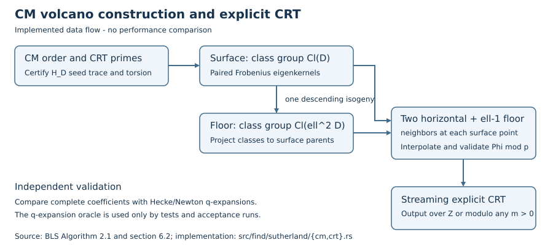
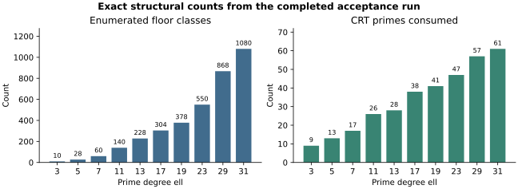

# CM volcano modular polynomials and explicit CRT

Date: 2026-10-16. Repository base: `086dfd7934952ae1ff38c4f54230993f6c3a5db6`.
Branch: `codex/cm-volcano-modpoly-crt`. This report accompanies the implementation,
its exact-equality acceptance run, and its regression records. No speedup or
large-degree complexity result is claimed.

## Request and scope

The user requested implementation of the algorithm in `ecc13talk.pdf`, a pull
request, and a fully functional result. The delivered path implements CM order
selection, norm-equation primes, certified Hilbert-polynomial seeds, paired ideal
class actions on surface and floor, the floor-to-surface projection, interpolation,
and explicit CRT. It exposes a Rust API and CLI for integer coefficients,
arbitrary positive moduli, and prime-field evaluation/root extraction.

The functional contract covers odd prime degrees 3 through 31, with the explicit
resource limits in `isogeny_algos/docs/USAGE.md`. This is a bounded reference
implementation. The paper's optimized large-degree parameter selection,
polycyclic presentations and Enge evaluation remain unimplemented. No claim is
made that the implementation attains the paper's asymptotic bounds.

## Algorithm and independent reference

The implementation is based on Bröker, Lauter and Sutherland,
[Computing modular polynomials with the Chinese Remainder Theorem](https://arxiv.org/abs/1001.0402),
Algorithm 2.1 and sections 5.3, 6.1 and 6.2. The user-provided talk's example is
ell=5, D=-151, p=4451; the norm equation gives t=52 and v=2. Its surface and floor
class numbers are 7 and 28.

| Algorithm part | Implementation | Runtime checks |
|---|---|---|
| CM setup and primes | `CmPlan::new`, `with_discriminant`, `crt_primes` | Fundamental D, split ell, class numbers, norm equation, bound on CRT product |
| Surface seed | Native `cm::hilbert_class_poly`, then finite-field certification | Exact trace, full ell-torsion, full 2-torsion when v=2 |
| Class actions | Paired quadratic forms, Frobenius eigenkernel gcds, Kohel codomains | Consistent class-group projection, kernel degree, smoothness |
| Floor matching | One descent, then the floor class-group orbit | Distinct j-invariants, disjoint levels, ell-1 children per surface class |
| Interpolation | Two horizontal neighbors and all descendants | Hilbert roots, all interpolation values, symmetry and leading coefficients |
| Explicit CRT | `ExplicitCrt` | Distinct primes, canonical input, complete stream, M>4B, integer rounding |
| User interface | `api` and `modpoly --method cm` | Error results for invalid inputs, composite targets supported, prime-only root extraction |

The numerical Hilbert polynomial is only a source of candidates. Trace and torsion
checks establish the required maximal endomorphism ring in the chosen family;
acceptance does not depend on a floating-point rounding heuristic. Auxiliary
isogenies are computed from division-polynomial Frobenius eigenkernels. No modular
polynomial table or q-expansion routine is used by the CM algorithm.

The independent oracle is the pre-existing Hecke/Newton q-expansion implementation
in `find/modpoly.rs`. The full integer acceptance run compares every coefficient,
not just evaluations at sample points. The tests also exercise negative CRT
coefficients, exact bound endpoints, large and composite targets, targets sharing
CRT factors, invalid input, retry after rejected pushes, noncyclic class groups,
and both v=1 and v=2.

## Validation status

All ten supported prime degrees passed the complete integer coefficient comparison
against the independent oracle. The commands, logs and failed attempts are retained under `records/`.
`validate.rs` is the native Rust acceptance harness. It prints structural counts
and exact-equality results only. Log build/test durations are operational output,
not benchmark measurements. Log content is preserved, with terminal blank lines
normalized for `git diff --check`.

| Requirement | Status | Evidence |
|---|---|---|
| CM surface/floor construction and explicit CRT | Verified for every supported degree | `records/acceptance.jsonl`: all coefficients equal over the integers for ell = 3, 5, 7, 11, 13, 17, 19, 23, 29, 31; seed 20743 |
| Talk example, noncyclic groups, v=1/v=2, error paths | Verified | Library CM/CRT tests, including ell=5, D=-151, p=4451 and D=-231 |
| Rust API and CLI | Verified | `records/integration-tests.log`: 8 API/CLI tests and 2 legacy Sutherland regression tests passed |
| Arbitrary target modulus and signed reconstruction | Verified on stated cases | Exact integers across all ten degrees; modulus 1, 2, 120, large targets, CRT factors, signs and bound endpoints in unit/API tests |
| Library regression and lint | Verified; final repository gate recorded separately | Library tests: 27 passed, one pre-existing ignored test; Clippy without warnings |
| Separate root-crate library gate | Pending at PR preparation; no pass claimed | Third attempt is still compiling after the standalone crate checks completed. See `records/root-library-tests.log` and the PR follow-up. Merge remains blocked on unresolved required checks. |
| Optimized large-degree BLS implementation | Not implemented | Explicit reference limits; no asymptotic performance claim |

Recorded structural counts (not timings) from the full integer run:

Counts are copied from `records/acceptance.jsonl`, one completed run per degree,
seed 20743. These are exact integers, not statistical estimates; there are no
uncertainty intervals or runtime/speedup measurements. Editable plotting source:
`plot_counts.py`.

| Degree ell | Surface / floor classes | CRT primes / largest prime |
|---|---|---|
| 3 | 5 / 10 | 9 / 89227 |
| 5 | 7 / 28 | 13 / 4187891 |
| 7 | 10 / 60 | 17 / 6756611 |
| 11 | 14 / 140 | 26 / 74986979 |
| 13 | 19 / 228 | 28 / 335601683 |
| 17 | 19 / 304 | 38 / 709793351 |
| 19 | 21 / 378 | 41 / 897996887 |
| 23 | 25 / 550 | 47 / 2609828447 |
| 29 | 31 / 868 | 57 / 10121367083 |
| 31 | 36 / 1080 | 61 / 6754802723 |

## Failure history and limits

- Initial compilation found two type mismatches (the kernel helper returns a pair,
  and `Int` has no `From<u128>`). Both were corrected before the first test run.
- The first CM test run had 5 passes and one failure: the initial 22-bit prime cap
  did not provide enough CRT primes. A 32-bit cap still failed at the highest
  advertised degrees. The final cap is 40 bits, and primes above the exact-counting
  threshold use exact point-order/Hasse trace certificates. Failed logs remain.
- The first Clippy run identified nine style warnings; all were corrected.
- The first root-crate build could not discover OpenSSL without `pkg-config`.
  The installed headers and libraries were selected explicitly for subsequent runs.
  A later build was interrupted by an execution transport disconnection; it has
  no completed result and is not counted as a passing check.
  The third attempt uses one Cargo build job and is still compiling at this
  report's snapshot. The root crate is unchanged by this PR; its pending result
  is separate from the completed standalone-crate acceptance results.
- Conductor and its control plane were unavailable. `docs/CONDUCTOR.md` documents
  warning-only behavior in this condition. Changes stayed within `isogeny_algos`
  and this report directory; no reservation was claimed.

Full matrix size and work grow with ell. Auxiliary primes are bounded by 43,
`|ell^2 D|` by 16000000, and each class group by 4096 classes. Fixed v in {1,2},
restricted fundamental orders, and bounded sampling may reject custom choices.
Errors are explicit; there is no fallback to the q-expansion oracle. Root
extraction uses the existing prime-field implementation up to 640 bits. Arbitrary
positive target moduli for coefficient reduction have no 640-bit restriction.

## Reproduction and graph scope

Run `records/commands.sh` from the repository root after installing Rust and the
root crate's native prerequisites. `records/source-sha256.txt` identifies the
implementation and tests used for the final run. `render_report.py` only lays out
this recorded evidence; it performs no algorithm or correctness computation.

Canonical graph families checked for relevance: `docs/index-calculus-scoreboard.html`,
`docs/ic/progress-timeline.json`, `docs/curves/`, `docs/performance-gains/`, and
`figures/`. This change adds modular-polynomial functionality, with no IC/rho ratio,
new curve transport result, benchmark result or scoreboard claim. Those graph
families and historical sampler performance records are unchanged. The diagram
above records the new implementation flow and is embedded in `REPORT.pdf`.
