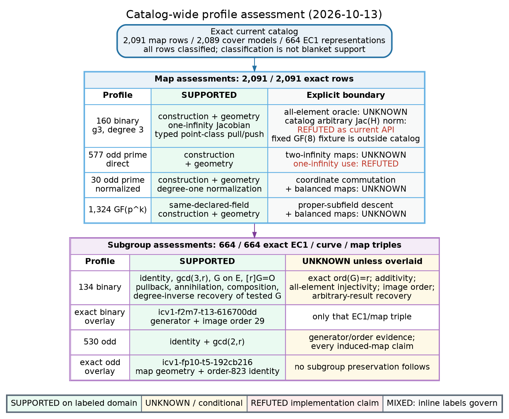
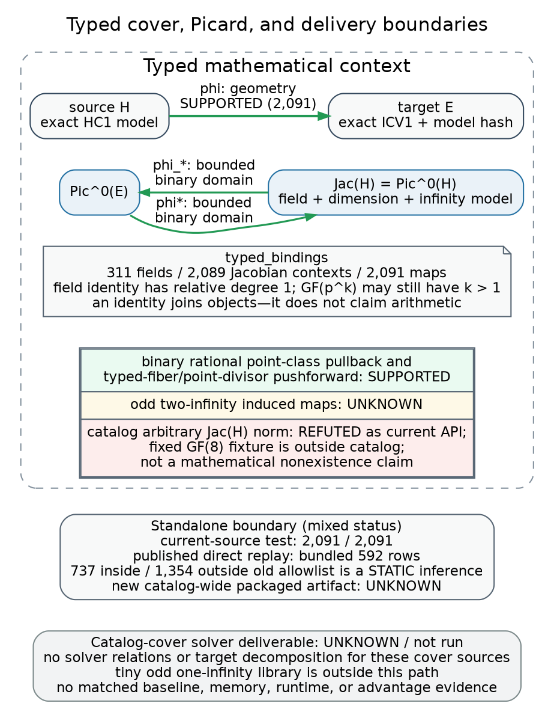

<!-- cover-transfer-assessments/v2; catalog_maps=2091; unique_cover_models=2089; geometry_verified_maps=2091; ec1_representations=664; assessed_maps=2091; unassessed_maps=0; assessed_subgroups=664; unassessed_subgroups=0 -->

# Outcome

Every current cover map and every linked EC1 representation now has an
explicit v2 assessment. Classification is complete; implementation support is
not. In particular, the complete inventory must not be read as a complete
Jacobian-transfer pipeline.

The main results are:

- all 2,091 explicit cover formulas replay over their declared fields, subject
  to the field-validity assumptions stated below;
- all 160 binary maps have the implemented one-infinity genus-three Jacobian
  arithmetic and bounded rational-point-class transfer;
- all 134 binary EC1 bindings pass typed native tests for generator membership,
  `[r]G=O`, pullback validity, `[r]phi^*(G)=0`, composition, and
  degree-inverse recovery;
- those generator-level tests do **not** prove pullback additivity,
  all-element composition, injectivity, or image-order equality on the full
  generated subgroup; only the retained order-29 overlay has the stronger
  narrow exact-order and image-order certificate;
- all 1,931 odd-characteristic covers have verified genus-two geometry, but
  their even sextics have two rational infinity points and are outside the
  current one-infinity odd-characteristic Jacobian implementation;
- arbitrary-class Jacobian pushforward remains unsupported for all 160
  catalog binary maps; a separate exact fixed-`GF(8)` fixture now implements
  the full 486-class operation, but it is not a catalog row and has no
  independent divisor-map oracle; the odd-characteristic induced maps remain
  unimplemented and unknown; and
- no complete Jacobian relation solver, measured transfer advantage, or key
  recovery result is part of this assessment.

The canonical machine record is
[`cover-transfer-assessments.json`](../../docs/curves/cover-transfer-assessments.json),
generated by
[`build_cover_transfer_assessments.mjs`](../../scripts/build_cover_transfer_assessments.mjs)
and validated against
[`cover-transfer-assessment.schema.json`](../../docs/curves/cover-transfer-assessment.schema.json).
It uses only `supported`, `refuted`, `unknown`, and `not_applicable`.
`Refuted` always refers to a concrete implementation or evidence claim; it
never turns a missing implementation or failed bounded search into a theorem
of nonexistence.

## 2026-10-14 bounded fixed-GF(8) addendum

The library now accepts every valid reduced class for one exact synthetic
fixture: `GF(8)` in the polynomial basis `z^3+z+1`, target coefficients
`a=1`, `b=3`, and cover parameter `d=7`. Exhaustive native tests cover all
486 classes and all 236,196 ordered pairs, including nonsplit, shared-support,
exceptional, and malformed cases. A separately implemented point-count replay
certifies only the source-Jacobian cardinality `486`; it is not an independent
divisor-arithmetic or norm-map oracle.

This fixture is a mechanics and homomorphism test, not an injective full-group
ECDLP transfer. The target has order 6, the six norm fibers each contain 81
Jacobian classes, and `gcd(3,6)=3`; the generic degree-coprime subgroup
criterion therefore does not certify injectivity on the full target group.

The standalone `construct`/`verify` receipt labels this exact model as a
library build that contains the fixed-fixture capability, but that invocation
replays only the geometry certificate. It does not initialize or execute the
486-class norm and is not a per-invocation transfer proof. The standalone CLI
still exposes no transfer subcommand; the exhaustive norm evidence is the
native Rust test receipt described below.

None of the 160 catalog binary rows is over `GF(8)`, so their generated
arbitrary-pushforward status remains `refuted` as an implementation claim.
This addendum narrows the report's earlier universal wording; it does not
promote a catalog row, subgroup-transfer claim, solver, or advantage result.

The existing `CoverTransfer.lean` package proves only the conditional abstract
group lemma described below. It does not formalize this fixture's finite-field
or curve model, the checked `N1`–`N3` counts and zeta-to-Jacobian-order bridge,
the 486-class divisor presentation, or the norm homomorphism. Those are
concrete open formalization obligations; no Lean proof receipt is claimed for
the fixed-`GF(8)` order or all-class transfer results.

# Original requirements and evidence status

| Requested item | Status | Evidence boundary |
|---|---|---|
| Primary theorem and exact hypotheses | verified | Xarles v1, Corollary 3; same base field, characteristic not 2 or 3, higher genus at most 5, two independent maps |
| Audit crypto PR #1389 and cryptanalysis PR #290 | verified historical audit | pinned heads and matching `quartic-ic` source hashes below; this is a non-hyperelliptic norm-projection experiment |
| Separate supported input models | implemented with explicit boundaries | binary and odd-characteristic constructors are separate; unsupported infinity configurations return a structured result |
| Constructive covers | supported for the two fixed catalog families | all 2,091 formulas are explicit and replayed; this is not a theorem-complete Xarles constructor |
| Genuine Jacobian arithmetic | partial | binary one-infinity sources are supported; all 1,931 odd two-infinity catalog sources remain outside the current backend |
| Pullback, pushforward, and subgroup transfer | partial | bounded binary point-class domains and 134 generator checks; exhaustive arbitrary-class pushforward exists only for the non-catalog exact fixed-`GF(8)` fixture; catalog-general binary norm and all odd induced maps remain open |
| EC1/ICV1 catalog evidence | partial | exact memberships, typed object bindings, hashes, statuses, and four narrow overlays cover the 2,091 catalog geometry rows; the positive fixed-GF(8) source/target/Jacobian/map fixture is non-catalog and has no EC1/ICV1/HC1/CV1 export or transfer-certificate binding |
| Standalone executable | source verified; packaged scope incomplete | current-source tests cover 2,091 inputs; the published artifact was replayed on its bundled 592-row registry, not on all current inputs |
| Validation and shipping | partial | deterministic checks and native tests exist; independent divisor-class replay, local Lean kernel receipt, fresh package, and final CI gates remain open |
| Full Jacobian index-calculus solver | separate and not delivered | no cover-integrated or catalog-supported solver/run for these binary and even-sextic sources; the existing tiny odd-prime one-infinity relation/linear-algebra/recovery library is outside this assessment and is not a general solver |

# Population and profile coverage

The v2 ledger assigns every exact map UID to one map profile and every exact
`[EC1, curve UID, map UID]` triple to one subgroup profile. Sorted memberships
and domain-separated membership hashes make the coverage checkable rather
than count-only.

| Map profile | Maps | Source / map | What is established |
|---|---:|---|---|
| Binary cubic, same field | 160 | genus 3, degree 3 | geometry, one-infinity arithmetic, bounded typed transfer |
| Direct odd prime field | 577 | genus 2, degree 2 | cover geometry only |
| Normalized odd prime field | 30 | genus 2, degree 2 plus degree-one target normalization | cover and normalization geometry only |
| Odd extension field | 1,324 | genus 2, degree 2 over the declared `GF(p^k)` | cover geometry over that field only |
| **Total** | **2,091** | **2,089 unique HC1 cover models** | **every map classified** |

The two repeated cover objects are intentional shared models, not duplicate
assessment rows. The 1,931 odd-characteristic rows comprise 607 prime-field
rows and 1,324 extension-field rows.

| Subgroup profile | EC1 bindings | Established catalog-wide facts | Still open |
|---|---:|---|---|
| Binary degree 3 | 134 | exact identity joins, `gcd(3,r)=1`, typed generator-level transfer checks | additivity and all-element composition; injectivity and image order; proof-grade numeric exact order except order 29; arbitrary-result norm/recovery |
| Odd degree 2 | 530 | exact identity joins and `gcd(2,r)=1` | generator/order certificates and every induced-map claim |
| **Total** | **664** | **every binding classified** | **unknowns remain explicit** |

These are 664 EC1 representations on 659 curve models; five models have two
distinct representations. The semantic verifier computes the effective
`supported`, `unknown`, `refuted`, and `not_applicable` assignment totals from
the generated ledger. Those are claim assignments, not counts of distinct
maps, and no count of classified claims implies that the claims are supported.

## Typed identity bindings are contexts, not capability claims

The ledger's explicit `typed_bindings` materialize 311 content-addressed
declared-field records, 2,089 Jacobian contexts, and 2,091 typed curve-map
bindings. A map binding joins the exact target ICV1 slug and model hash to its
source-cover UID, source-Jacobian UID, and declared-field relationship. A
Jacobian context records `Picard_degree_zero`, its dimension, its cover and
field UIDs, and whether the source has one or two rational infinity points.

These records prevent accidental mixing of fields, source curves, infinity
models, or maps. Their word `identity` is deliberately narrow:
`same_declared_field_identity` says that the source-to-target field
relationship is the identity, of relative degree one. The declared field
itself may still be `GF(p^k)` with absolute extension degree greater than one,
which the field binding retains. The identity does **not** assert that
Jacobian arithmetic exists, that an induced pullback or pushforward is
implemented, or that either is a homomorphism. Likewise, merely naming a
Jacobian context does not promote its arithmetic. Capability status comes only
from the applicable profile claim, result template, and any exact overlay.

# Construction and geometry

## Binary characteristic

For an ordinary binary target over its exact polynomial-basis field,

\[
 E: y^2+xy=x^3+a x^2+b, \qquad b\ne0,
\]

put \(d=\sqrt b\) and construct

\[
 H: v^2+u^2v=u^7+a u^4+d u,
 \qquad \phi(u,v)=(u^3,uv+d).
\]

The native checker verifies \(d^2=b\), the defining-equation identity,
affine smoothness, the infinity chart, genus three, degree three, and
separability. The binary field polynomial is checked by the exact Rabin
criterion. The details and proof are in
[`COVERS.md`](../../docs/curves/COVERS.md) and the implementation is in
[`checker.rs`](../../src/bin/curve_cover_check/checker.rs).

## Odd characteristic

After any recorded degree-one Montgomery or Edwards normalization, write the
short target as

\[
 E: y^2=F(x)=x^3+a x+b.
\]

Choose the first \(c\in\{0,1,2,3\}\) with \(F(c)\ne0\), and construct

\[
 H: v^2=F(u^2+c),
 \qquad \phi(u,v)=(u^2+c,v).
\]

The checker verifies the equation identity, the monic squarefree sextic,
genus two, two rational points at infinity, degree two, separability, and the
recorded target-model identities. This construction works over the same
declared prime field or polynomial-basis extension field; it is not a descent
to a proper subfield.

For odd characteristic, `p` passes a fixed 20-base probable-prime screen but
is retained as a registry input assumption, not a primality proof. Extension
moduli pass the exact Rabin irreducibility criterion *conditional on that
prime-field assumption*. Thus “verified over the declared field” has this
explicit boundary. The catalog checker does not certify group orders,
generators, or EC1 subgroup parameters.

The independent semantic replay in
[`verify_assessment.mjs`](verify_assessment.mjs) checks every content join,
profile predicate, membership hash, and all 2,091 finite-field map formulas.
It does not independently prove odd `p` primality, extension-modulus
irreducibility without that assumption, EC1 subgroup orders, or computational
advantage.

# Original theorem audit

The broader source is Xavier Xarles, *Hyperelliptic curves covering an
elliptic curve twice*,
[arXiv:1303.4220v1](https://arxiv.org/abs/1303.4220v1), Corollary 3. Its
statement applies to an elliptic curve over an arbitrary field \(K\) of
characteristic different from 2 and 3. It gives a hyperelliptic curve
\(H/K\) of genus at most five with two independent \(K\)-defined maps to the
elliptic curve; it does not require first extending the base field.

“Independent maps” is the paper's algebraic independence condition on those
two maps. It does not mean independent software implementations, independent
computational routes, subgroup preservation, or an ECDLP speedup.

For \(j\ne0,1728\), the paper displays a genus-five construction with two
degree-three maps. Degree three together with characteristic different from
three makes those displayed generic maps separable. Separability is not a
separately stated hypothesis or conclusion of Corollary 3, however, and the
exceptional `j` cases invoke earlier genus-two results whose maps were not
separately audited here for separability. The corollary is therefore an
existence theorem with explicit generic formulas, not a single uniform
executable constructor and certificate for every input model. Its
exceptional-case citations must not be silently upgraded into the repository's
implementation evidence.

“Hyperelliptic” here means the higher-genus setting, genus at least two. The
tautological genus-one reading in which an elliptic curve covers itself is not
the content being used. The repository's two fixed families above are
separate constructive results: they give one explicit map per supported
catalog model and do not claim Xarles's pair of independent maps.

# Existing `quartic-ic` experiment audit

Crypto PR [#1389](https://github.com/aburan28/crypto/pull/1389) and
cryptanalysis PR
[#290](https://github.com/aburan28/cryptanalysis/pull/290) were audited at
these immutable revisions:

- crypto PR #1389 head:
  `6c6247bde5e585642773ed5b6b933b4ec4c6fd4f`
- crypto PR #1389 merge:
  `7ea1db7a6b4b6962f3fa38d70ac65300d25ceb4b`
- cryptanalysis PR #290 head:
  `3b14ec30de6c79fbc9dd72f4ed3eb8ea19d5a642`
- cryptanalysis PR #290 merge:
  `54cbf1dc27879b9bd441df7b64e2c629e9d9d9ea`

At both heads, the quartic kernel, CLI, and retained receipt were byte-identical
with these SHA-256 values:

```text
kernel   54ef65c7325a7c850741a8def84ee2b2ceddcc3689a0879afd2796eb7cb01e52
CLI      0f71936014b3ff54dacc9dc6b642c88bea60b70a658f6e42c467aab73f11a069
receipt  d3de82409e6fe82a59e74425916ed820ac5f8912e74046f41468cef56c01a967
```

The immutable October 6
[audit](../hyperelliptic_cover_infrastructure_20261006/README.md) records the
retrieval and replay details.

The experiment uses the smooth plane quartic

\[
 C:v^4=x^3+ax+b, \qquad \pi(x,v)=(x,v^2),
\]

over bounded small prime fields. A smooth plane quartic has genus three and is
**non-hyperelliptic**. `quartic-ic` certifies complete line sections, then forms
its linear system after elliptic norm projection. Its fixture's passing tests
support that bounded projected experiment; they do not construct a
hyperelliptic cover, implement divisor-class arithmetic in the full quartic
Jacobian, or establish a Jacobian index-calculus solver. Deck-conjugate
divisors may share an elliptic norm while retaining different Prym components,
so elliptic projected relations cannot be relabeled as full-Jacobian
relations.

# Jacobians and transfer maps

## Binary supported domain

[`hyperelliptic.rs`](../../src/binary_ecc/hyperelliptic.rs) implements checked
canonical reduced Mumford divisors for the binary one-infinity source family:
validity, reduction, equality, negation, addition, and scalar multiplication.
Its tests include identity, exceptional divisors, shared support, inverses,
and exhaustive small-field fixtures.

[`cover_transfer.rs`](../../src/binary_ecc/cover_transfer.rs) implements:

- pullback of rational elliptic point classes `[P]-[O]`, including infinity
  and the exceptional ramified fiber;
- pushforward of rational source-point divisors and the implementation's own
  typed pullback witnesses; and
- `phi_* phi^* = [3]` on that typed point-class domain.

For the exact fixed-`GF(8)` fixture described in the addendum, the library now
implements arbitrary-class pushforward and exhaustively checks its group-law
behavior. For every catalog binary profile, the same entry point still returns
`Unsupported(ArbitraryJacobianPushforward)`. That refutes a catalog-support
claim, not the mathematical existence of a norm. This boundary is tracked in
[`binary-cover-arbitrary-jacobian-norm-missing.md`](../../problems/binary-cover-arbitrary-jacobian-norm-missing.md).

## The 134 binary subgroup checks

For every exact linked binary EC1 triple, the native batch test decodes the
catalog generator and verifies:

1. the generator lies on the exact target and is nonidentity;
2. `[r]G=O` for the catalog integer `r`;
3. `phi^*(G)` is a valid nonidentity reduced divisor;
4. `[r]phi^*(G)=0`;
5. the typed composition gives `phi_*phi^*(G)=[3]G`; and
6. multiplication by the inverse of 3 modulo `r` recovers `G` on this typed
   route.

Because `[r]G=O`, the actual order of `G` divides `r`, and the checked modular
inverse calculation recovers this one tested generator from its typed
composition result. That is not enough to prove a homomorphism or injectivity
on all of `<G>`: the batch test does not establish pullback additivity or the
composition identity for every subgroup element through an independent map
oracle. Catalog-wide kernel intersection and actual image/source-order
equality therefore remain `unknown` and conditional. It also does **not**
prove `ord(G)=r`. Proof-grade numeric equality with the catalog order remains
`unknown` for 133 of the 134 binary bindings; the retained
\(\mathbf F_{2^7}\) order-29 overlay is the one narrow exception.

The elementary group-theoretic core is formalized in
[`CoverTransfer.lean`](lean/CoverTransfer.lean): if a finite subgroup has
exact cardinality `r`, `push(pull(x))=d*x` on that subgroup, and
`Nat.Coprime d r`, then the restricted pullback is injective. The written
proof is immediate: equal pullbacks give equal `d`-multiples after applying
pushforward, while multiplication by `d` is bijective on a finite group whose
cardinality is coprime to `d`.

That Lean theorem assumes exact cardinality and the composition identity; it
constructs neither map and does not promote the 134 catalog rows by itself.
The additional bridge from `[r]G=O` to
`ord(G) | r`, and hence coprimality with the actual generated-subgroup order,
is used in the native certificate but is not a separately formalized Lean
corollary here; additivity and all-element composition are still missing.
The sources pin Lean 4.34.1 and Mathlib revision
`d13f23b723b8a846827a245b89c10fc7d3f11612`. Local kernel replay remains
blocked: `lake exe cache get` stopped at 2,536 of 8,908 files when the sandbox
ran out of space, so `lake build` and the axiom audit have not been executed
locally. Until CI completes those commands, the source is a formalization
candidate, not a kernel-verified proof receipt. The exact boundary is recorded
in the [Lean README](lean/README.md).

## Odd-characteristic boundary

Every odd-characteristic source is a degree-six genus-two curve with two
rational infinity points. The current
[`prime_hyperelliptic`](../../src/prime_hyperelliptic/curve.rs) backend
requires a monic polynomial of degree `2g+1` and one rational infinity.
Consequently:

- the claim that the current backend supports these 1,931 sources is
  `refuted`;
- balanced/two-infinity divisor arithmetic, pullback, pushforward, and
  `phi_*phi^*=[2]` remain `unknown`; and
- for the 530 linked odd EC1 records, the exact identity join and numerical
  `gcd(2,r)=1` are supported, but generator, order, kernel, image-order, and
  recovery certificates remain unknown.

This implementation gap does not refute the mathematical Jacobian or its
induced Picard-group maps. It is tracked in
[`prime-cover-balanced-jacobian-and-induced-maps-missing.md`](../../problems/prime-cover-balanced-jacobian-and-induced-maps-missing.md).
The remaining proof-grade subgroup obligations are tracked separately in
[`catalog-cover-subgroup-certificates-incomplete.md`](../../problems/catalog-cover-subgroup-certificates-incomplete.md).

# Exact overlays retained from the prior audit

The v2 ledger keeps four narrow overlays rather than extrapolating them:

| Overlay | Added evidence | Boundary |
|---|---|---|
| `icv1-f2m7-t13-616700dd` degree-three map | detailed geometry replay | does not widen the typed transfer domain |
| `icv1-f2m7-t13-616700dd` order-29 subgroup | exact source and image order | only that one EC1/map triple |
| `icv1-fp10-t5-192cb216` degree-two map | detailed geometry replay | no induced odd Jacobian map |
| `icv1-fp10-t5-192cb216` order-823 identity | exact catalog identity retained | no preservation claim follows |

The prior October 6 evidence remains immutable in
[`evidence.json`](../hyperelliptic_cover_infrastructure_20261006/evidence.json).
The v2 generator reuses it only for these exact overlays. The stale
[`jacobian-transfers.json`](../../docs/curves/jacobian-transfers.json) formula
screen is not imported as a map, order, or recovery certificate.

# Source, packaged binary, and browser boundary

The current source allowlist now accepts all four catalog input profiles. The
catalog-wide constructor test reaches the standalone `construct` path for all
2,091 current models. This is source-level evidence at the current revision,
not a published-artifact claim.

The independently replayed published binary
[`v0.1.0-main.1371`](https://github.com/aburan28/crypto/releases/tag/v0.1.0-main.1371)
predates that allowlist repair. Direct replay establishes that it runs against
its own bundled 592-row registry. Separately, static comparison of its pinned
source allowlist with the current model partition places 737 forms inside its
syntactic domain and 1,354 outside: the latter are 1,324 extension-field rows
and 30 normalized Montgomery/Edwards rows. No exact batch receipt ran all
2,091 current inputs against that archived executable. The artifact is
therefore **not** evidence of a catalog-wide current binary. Exact asset hashes,
directly executed commands, and the static-classification boundary are
preserved in
[`release_replay.txt`](release_replay.txt).

The generated curve browser remains deliberately unchanged. Its 2,091 cards
use this geometry status:

```text
verified_over_declared_field
```

They retain `subgroup_transfer: not_tested` and keep DLP advantage null. The
v2 sidecar does not silently turn those geometry cards into transfer badges.

The retained offline cryptanalysis parity rerun reported
`hyperelliptic mirror manifest and crypto source: verified` for exactly seven
manifest records at its pinned snapshot. Its `cover_transfer.rs` digest is
`67b94112…`, which predates the current `6e801f14…` source containing the exact
fixed-`GF(8)` arbitrary-class norm. The receipt also excludes the standalone
CLI, Cargo configuration, catalogs, schema, assessment ledger, workflows, and
package artifacts, and it does not check the manifest's recorded commit against
the checkout's actual `HEAD`. It therefore establishes historical parity for
those seven bindings, not a current cryptanalysis mirror or integration of the
new norm or CLI changes.

# Validation controls

| Control | Status | Scope and limit |
|---|---|---|
| Exact identity joins | `supported` | all 2,091 map UIDs and 664 EC1/curve/map triples; identity alone claims no arithmetic |
| Cover geometry | `supported` | all 2,091 fixed-family rows; equations, smoothness, genus, degree, separability, and infinity behavior, conditional on the declared odd base-prime assumptions described above |
| Internal Jacobian arithmetic | `supported` on stated models | binary and separate odd-prime one-infinity fixtures; not the 1,931 odd two-infinity cover sources |
| Independent arithmetic/map oracle | `unknown` | no separate CAS or independently implemented divisor-class replay across the catalog |
| Binary catalog generators | `supported` on tested generators | all 134 triples pass the listed membership, annihilation, pullback, composition, and inverse-degree checks; no subgroup-wide promotion |
| Odd cover/backend compatibility | `refuted` as a current implementation claim | the one-infinity backend cannot accept the 1,931 even-sextic sources; mathematical induced maps remain `unknown` |
| Published artifact on all current inputs | `refuted` as evidence claim | only its bundled 592 rows were directly replayed; 737/1,354 is a static allowlist classification, not a 2,091-command receipt |
| Historical cross-repository core parity | `supported` on the pinned receipt snapshot | offline rerun verified exactly seven bindings; CLI, Cargo, catalogs, schema, ledger, workflows, packages, and actual-HEAD binding are excluded |
| Current fixed-F8 norm mirror | `unknown` | retained parity binds old `cover_transfer.rs` digest `67b94112…`, not current `6e801f14…`; no current-tip cryptanalysis mirror receipt is attached |
| Coordinate commutation and proper-subfield descent | `unknown` | normalization geometry is checked, but induced-divisor commutation and descent are not |
| Paired performance | `not_applicable` | no performance or speedup experiment was conducted |

# Cost and solver boundary

No performance experiment was conducted. Every measured-value field below is
therefore null; correctness-test elapsed time is not an algorithmic cost.

| Phase | Status | Value | Why |
|---|---|---:|---|
| Construction and failed searches | `unknown` | null | fixed constructors have no calibrated search ledger |
| Duplicate candidates | `unknown` | null | no candidate-deduplication accounting |
| Geometry verification | `unknown` | null | replayable but uncalibrated |
| Jacobian arithmetic | `unknown` | null | correctness tests only |
| Pullback, pushforward, recovery | `unknown` | null | bounded binary path; no complete measured conversion |
| Reusable preprocessing | `unknown` | null | no amortization boundary |
| Peak memory and total runtime | `unknown` | null | not measured end to end |
| Matched generic baseline | `unknown` | null | not run |
| End-to-end speedup | `unknown` | null | numerator and denominator absent |
| Relations, linear algebra, target decomposition | `not_applicable` | null | no solver was integrated with or run on the assessed covers; the separate tiny odd-prime one-infinity library is outside this cost record |

The full Jacobian index-calculus solver remains a separate deliverable. Its
acceptance gate must require genuine Jacobian relations, verified linear
algebra and target decomposition, independently checked outputs, explicit
parameter limits, and complete accounting for preprocessing, failed searches,
duplicates, memory, and total runtime. Elliptic norm projection is not that
solver. The repository does contain a bounded odd-prime, one-infinity
relation/linear-algebra/recovery library for tiny enumerable domains; it does
not consume the assessed binary or even-sextic catalog covers and does not
satisfy this full-solver acceptance gate.

# Visual summary



*Figure 1: Catalog-wide map and subgroup classification. Green denotes
supported claims on the labeled domain, orange unknown obligations, red
refuted current implementation claims, and neutral cells contain explicitly
mixed statuses governed by their inline labels.*

Editable source:
[`typed_correspondence.dot`](typed_correspondence.dot). Vector rendering:
[`typed_correspondence.svg`](typed_correspondence.svg).



*Figure 2: Typed curve/Picard context and delivery boundaries. Green arrows
exist only on the bounded domains printed beside them. An identity binding
does not claim arithmetic, a transfer implementation, or a solver result.*

Editable source:
[`typed_transfer_context.dot`](typed_transfer_context.dot). Vector rendering:
[`typed_transfer_context.svg`](typed_transfer_context.svg). No edge in either
figure denotes an unlisted solver result.

# Reproduction

Generate and verify the exact catalog-wide ledger:

```sh
node scripts/build_cover_transfer_assessments.mjs --check
python -m jsonschema \
  -i docs/curves/cover-transfer-assessments.json \
  docs/curves/cover-transfer-assessment.schema.json
node research/cover_transfer_assessment_20261013/verify_assessment.mjs
```

Replay the native geometry, arithmetic, and subgroup checks:

```sh
cargo test --release --locked --bin curve_cover_check
cargo test --release --locked --lib hyperelliptic
cargo test --release --locked --lib binary_ecc::cover_transfer::tests
cargo test --release --locked --bin hyperelliptic-cover -- \
  --test-threads=1
cargo test --release --locked --bin hyperelliptic-cover \
  every_current_catalog_model_reaches_the_standalone_constructor
cargo test --release --locked --bin hyperelliptic-cover \
  every_binary_ec1_generator_has_checked_typed_transfer_hypotheses
```

The complete standalone-binary suite was run in the pinned Rust 1.90.0
container and reported 13 passed, 0 failed. Rebuild and audit the Lean package
when sufficient cache space is available:

```sh
cd research/cover_transfer_assessment_20261013/lean
lake exe cache get
lake build
lake env lean AxiomAudit.lean
```

Regenerate the visual and PDF after any reported count, status, or conclusion
changes:

```sh
cd research/cover_transfer_assessment_20261013
dot -Tsvg typed_correspondence.dot -o typed_correspondence.svg
dot -Tpng -Gdpi=150 typed_correspondence.dot -o typed_correspondence.png
dot -Tsvg typed_transfer_context.dot -o typed_transfer_context.svg
dot -Tpng -Gdpi=150 typed_transfer_context.dot \
  -o typed_transfer_context.png
pandoc README.md \
  --from=markdown+tex_math_single_backslash \
  --pdf-engine=pdflatex \
  -o cover_transfer_assessment_20261013.pdf
pdfinfo cover_transfer_assessment_20261013.pdf
```

# Open obligations

These obligations feed WS1 and WS2 of the proposed
[comprehensive elliptic-curve private-key recovery audit](../notes/ecdlp-general/RESEARCH_COMPREHENSIVE_ECDLP_AUDIT_PLAN.md).
That program link does not change any status below and does not turn the cover
assessment into a solver or advantage result.

1. Generalize arbitrary-class binary pushforward beyond the exact fixed-`GF(8)`
   fixture to the catalog-supported field/model population and verify it with
   an independent divisor-class oracle.
2. Implement balanced/two-infinity odd-characteristic Jacobian arithmetic and
   induced maps over both prime and declared extension fields.
3. Add proof-grade exact-order evidence and map-bound certificates wherever a
   numeric EC1 order or image-order claim is desired.
4. Replay map additivity and composition through an independent divisor-class
   implementation.
5. Add coordinate-isomorphism commutation and proper-subfield descent controls.
6. Publish and replay a standalone artifact that accepts all 2,091 current
   model forms.
7. Refresh the legacy formula inventory without promoting modeled routes to
   certificates.
8. Keep the full solver and every cost claim behind its separate acceptance
   gates.

# Exploration boundary

This work assessed supplied public catalog constructions. It did not search
production targets, recover a private key, run a discrete-logarithm campaign,
prove minimal genus or degree, exhaust all cover families, or infer security
from an unsupported path. A failed construction outside the supported
families remains a structured unsupported result, never proof that no cover
exists.
