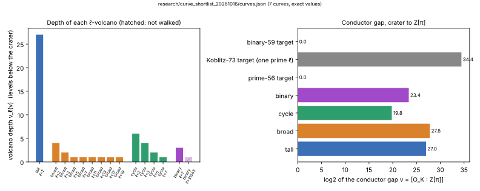

# Curve shortlist: 46 to 59-bit ECDLP targets and deep isogeny-volcano curves (2026-10-16)

## Question and scope

The owner asked for two sets of curves:

1. One binary, one Koblitz and one prime-field curve whose prime subgroup is
   at least 46 bits, ideally in the 50s.
2. Curves with unusually deep isogeny-volcano structure: many levels, a large
   conductor gap between the crater (End = O_K) and Z[π], and several
   volcanoes at once.

This is a **curve search and exact construction**. It contains no ECDLP
measurement, no speedup claim and no change to any scoreboard. Every number
below is exact output of PARI/GP. Each statement is labelled **derived**
(exact computation in `shortlist.gp`), **native cross-check** (agrees with the
repository's Rust `curve_traits` engine) or **proposed** (a use the curves are
offered for, not tested).

## Method

- `shortlist.gp` (PARI/GP 2.15.4, `gp -q research/curve_shortlist_20261016/shortlist.gp`,
  about 20 s) builds every curve, writes `curves.json` (one record per curve,
  which the registry builder harvests) and `searches.jsonl` (all search rows,
  negatives included). Everything is deterministic. Seeds are SHA-256 strings
  hashed with the shell's `sha256sum`. Each generator is the cofactor times
  the point with the least x-coordinate (integer encoding), using the first
  ordinate PARI returns.
- The first pass ran the same PARI 2.17 library through Python bindings in a
  scratch directory. That pass is not committed, as the "no Python" rule
  requires (AGENTS.md). Running `shortlist.gp` under GP 2.15 reproduces the
  same curves, with the same coefficients for all six models that did not
  change field.
- **Volcano walks.** The script starts at the crater, a root of the Hilbert
  class polynomial `polclass(D_K)` or j = 0, and walks the modular polynomial
  `polmodular(ℓ)` without backtracking. A vertex's height above the floor is
  the length of the shortest non-backtracking walk to a degree-1 vertex. The
  descent takes one neighbour whose height is one less, then continues
  without backtracking.
- **Moduli** follow `docs/curves/ICV1.md`: the least sparse irreducible
  polynomial (`find_irreducible_sparse`) for GF(2^59), GF(2^61) and GF(2^73).
- **Registry.** All seven curves are registered (`docs/curves/registry.json`)
  with their EC1 representation (generator and subgroup). `traits.json`,
  `jacobian-transfers.json`, `covers.json` and the lab browser were
  regenerated from the new registry.

## Part 1: three general targets (derived)

| Curve | ICV1 slug | Field and model | #E | Prime subgroup n | log2 n |
|:--|:--|:--|:--|:--|--:|
| binary | `icv1-f2m59-tm247403969-f6f9b926` | GF(2^59), `x^59+x^7+x^4+x^2+1`; y²+xy = x³+x²+b | 2·n | 288230376275413729 | 58.00 |
| Koblitz (a = 0) | `icv1-f2m73-tm184271214331-9d25cc67` | GF(2^73), `x^73+x^4+x^3+x^2+1`; y²+xy = x³+1 | 4·27449·n | 86020738150056119 | 56.26 |
| prime | `icv1-fp56-tm252854635-0150ced1` | p = 2^56 − 5; y² = x³ − 3x + b | n (prime order) | 72057594290782567 | 56.00 |

- binary: b = `0x284697d4c7aba14` = SHA-256("binary59-15") mod 2^59. Seed
  index 15 is the first that gives #E = 2·prime.
- prime: b = 51345021292123855 = SHA-256("prime56-126") mod 2^56 mod p. Seed
  index 126 is the first that gives a prime #E. The twist order is
  131 · 157 · 3503553935191.
- All three are ordinary. Every embedding degree is at least 2^49
  (`embedding_degree` in `curves.json`), which rules out MOV/FR transfer. None is anomalous. The field degrees 59 and 73
  are prime, so there is no subfield for Weil descent.
- **Koblitz negative search (derived, `searches.jsonl`):** for prime m in
  46–70 the largest prime subgroup of any Koblitz curve is 48 bits (m = 61,
  a = 0). m = 73 is the first prime degree with a 50-to-59-bit prime factor.
  The Frobenius τ gives the usual √73 rho speedup on top of negation, so the
  Koblitz target is weaker than its 56 bits suggest.

## Part 2: deep isogeny-volcano curves (derived)

For an ordinary curve over F_q with trace t, t² − 4q = v²·D_K. The ℓ-volcano
has depth v_ℓ(v), and v is the conductor gap between O_K and Z[π]. The three
targets above have v = 1, v = 1 and, for the Koblitz curve, the prime
v = 23369856751: one huge single-level gap.

| Curve | ICV1 slug | q | D_K (h_K) | v | Levels per ℓ (depth + 1) | #E | log2 n |
|:--|:--|:--|:--|:--|:--|:--|--:|
| tall | `icv1-fp56-tm300120038-865aea25` | p ≈ 2^55.0 | −3 (1) | 2^27 | ℓ=2: 28 | 16·n | 51.00 |
| broad | `icv1-fp57-t354478198-afcea726` | p ≈ 2^56.0 | −3 (1) | 2^4·3^2·5·7·11·13·17·19 | ℓ=2: 5, ℓ=3: 3, ℓ=5…19: 2 each | 4·n | 54.00 |
| crater cycles | `icv1-fp56-t379549678-9040a9fd` | p ≈ 2^55.0 | −71 (7) | 2^6·3^4·5^2·7 | ℓ=2: 7, ℓ=3: 5, ℓ=5: 3, ℓ=7: 2 | 4·n | 53.00 |
| binary | `icv1-f2m61-tm1864788689-c4a45971` | 2^61, `x^61+x^5+x^2+x+1` | −49087 (122) | 7^3·31543 | ℓ=7: 4; ℓ=31543: 2 (not walked) | 2·13·n | 56.30 |

Where each curve sits, from the walk records in `curves.json`:

- **tall, broad, crater cycles: on the floor of every volcano.** The walk
  measured height 0 for every ℓ | v. So End(E) = Z[π].
  - tall: one 2-volcano with 28 levels. It has 2^27 vertices, and its floor
    level alone has 2^26 j-invariants. The crater is j = 0.
  - broad: eight volcanoes at once. ℓ = 3 is ramified in Q(√−3); ℓ = 7, 13
    and 19 split; ℓ = 2, 5, 11 and 17 are inert. The walk took 12 descent
    steps.
  - crater cycles: h(−71) = 7. The craters for ℓ = 2, 3 and 5 are 7-cycles:
    the script walked each one back to its start, with 2 crater neighbours at
    each vertex. ℓ = 7 is inert. There are no extra automorphisms (units ±1).
    The crater is j = 21548212274226116.
- **binary: on the ℓ = 7 floor but at the ℓ = 31543 crater.** Φ_31543 is out
  of reach, so the 31543-volcano was not walked. Hence End(E) = Z + 7³·O_K,
  which strictly contains Z[π]. A binary CM curve over a prime-degree field
  is rigid: m must divide h(D_K), and v is then fixed by D_K. This curve has
  the largest small-ℓ depth among the 96 entries with n ≥ 50 bits. Those come
  from a scan of 584 distinct (m, D_K, t) entries: 292 (m, D_K) pairs with
  m ∈ {53, 59, 61}, |D_K| < 400000 and m | h(D_K).
- **Native cross-check.** `curve_traits show <slug>` independently derives,
  for all four curves, the same D_K, the same v (status `proved`), the same
  split/inert/ramified pattern and the same ℓ-volcano depths. That tool bounds
  End(E) between Z[π] and O_K. The exact level placement above comes from the
  GP walks.
- **Why the orders are even.** Depth at ℓ = 2 forces t to be even, and with q
  odd that makes #E even. This is why tall, broad and crater cycles have
  2-power cofactors. For odd ℓ | v, ℓ | #E only when t ≡ 2 (mod ℓ), and none of
  the chosen orders hits that.

*Left: depth of each ℓ-volcano for the four deep curves (hatched = not
walked). Right: log2 of v for all seven curves. Source: `curves.json`; the
population is these seven curves, and every value is exact (no sampling
uncertainty).*

Generators, coefficients, order factorizations, crater j-invariants,
per-ℓ heights at the crater and the floor, and descent step counts are all in
`curves.json`.

## Caveats and open checks

- **Hardness: proposed, not measured.** Each deep-volcano curve is joined to
  its crater by an explicit chain of small-prime-degree isogenies, so its
  ECDLP is no harder than the crater curve's. The crater of tall and broad is
  j = 0. Its order-6 automorphisms give rho an extra √3 on top of negation,
  so any cross-method comparison on these two must price rho with that speedup
  (AGENTS.md §5a). crater cycles and binary have only ±1 as automorphisms.
- **Height probe at j = 0.** At j = 0 the probe for ℓ = 3 on broad reads 1
  where the depth is 2 (`height_at_crater`). Multiple edges at j = 0 cause
  this. The ℓ = 3 descent started from a non-special vertex, took 2 steps and
  ended at height 0, so the floor placement stands.
- **Not done:**
  - no Lean formalization: these are exact computations, not theorems;
  - no point-count certificate beyond PARI's `ellcard`, cross-checked by the
    native traits engine's order and trace;
  - the ℓ = 31543 placement of the binary curve;
  - no ecbench or IC measurement on any of these curves.

## Files

| file | what |
|:--|:--|
| `shortlist.gp` | the whole search and construction; regenerates `curves.json` and `searches.jsonl` |
| `curves.json` | the seven curve records (registry input) |
| `searches.jsonl` | the Koblitz order table (m = 44–89) and every binary CM scan row |
| `plot.py` | lays out `curves.json` as `volcano_depths.svg` (plotting only) |
| `REPORT.typ`, `REPORT.pdf` | this report with the graph, as a PDF |
