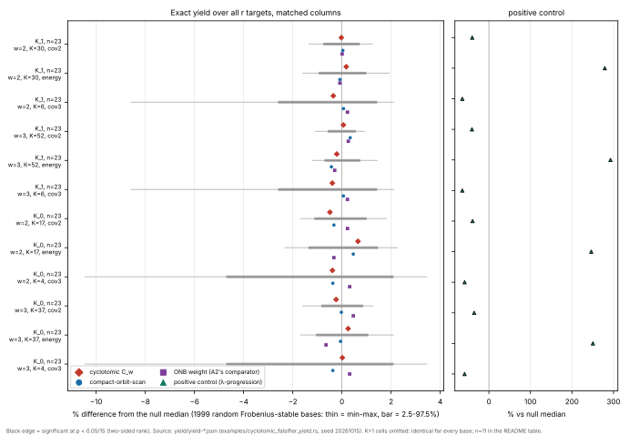
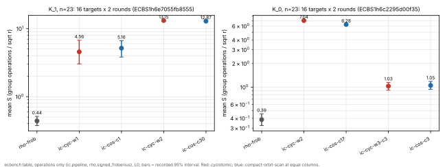

# The cyclotomic γ-weight base's falsifier (encyclopedia §8, D4; lead A2)

**Date:** 2026-10-15. **Protocol:** [`PROTOCOL.md`](PROTOCOL.md), frozen at
commit `9972ea0e8` before any measured cell; amendments A1 (dry-run disclosure,
commit `2984c8ca5`) and A2 (operations-only cost specs, `3512a53db`).
**PDF:** [`REPORT.pdf`](REPORT.pdf). **Run report:**
[`reports/run-20261015T0728Z/report.pdf`](reports/run-20261015T0728Z/report.pdf).

## Verdict (by the pre-registered rule)

- **Yield clause of A2: SURVIVES (not lower), sub-label *yield-neutral*.**
  On all 10 `n = 23` coverage tests and all 5 energy tests, the cyclotomic
  base `C_w` lies inside the distribution of 1999 random Frobenius-stable
  bases with the same number of columns. The smallest two-sided p is 0.363
  against a critical value of 0.00333. The largest deviation from the null
  median is 0.65%. The positive control is detected on every `n = 23` cell
  (p = 0.001, the floor; −35% to −64% coverage, +246% to +293% energy).
- **D4 overall: survives**, but only in the narrow sense the rule defines:
  its yield is not lower. It is not higher either. In yield, `C_w` behaves
  like a random Frobenius-stable base of the same size. Any value the lead
  has must therefore come from the **solver clause** (an algebraic membership
  test of lower solving degree). This study did not test that clause. The
  only record of it is at `n = 11`, where it went the wrong way (§5).
- **Cost (ecbench, operations only, L0):** cyclotomic against
  compact-orbit-scan at equal columns is *costlier* in 2 of the 4 pairs
  (+2.2% and +12.2%, both from the factor-base build phase) and
  *unresolved* in the other 2.

## 1. Question

A2 (`docs/ic/RESEARCH_IC_NOVEL_DIRECTIONS_20261007.md` L187–221) says:
"Fail if the cyclotomic system's solving degree is not lower, or its yield
per column is lower." The encyclopedia lists D4 as "an open engineering lead;
the falsifier is not established". This study establishes the yield clause
exactly at `n = 23`. It also prices the base end to end against the incumbent
Koblitz base, compact-orbit-scan (D2).

## 2. Method (summary; details in PROTOCOL.md)

- **Instrument:** [`examples/cyclotomic_falsifier_yield.rs`](../../examples/cyclotomic_falsifier_yield.rs)
  (Rust). It builds a full `[k]G` table, takes the exact log of every
  projected base point, and computes three numbers over **all `r` targets**:
  `cov2 = |B+B|`, `cov3 = |B+B+B|` and the additive energy. The cyclotomic and
  compact-orbit-scan bases come from the `ic_framework` plug-ins themselves
  (`ecbench::methods::dump_factor_base`, with `fb_id`s recorded). Self-checks
  passed on every base: `log φ(P) = λ log P`, and `log = coef·log(rep)` for
  every dumped point.
- **Identity** (derived): the mean number of ordered `m`-decompositions per
  target is `|B|^m / r` for every base. At matched columns, yield can
  therefore differ only through sum collisions, and that is what the three
  numbers measure. Every one-column base is a unit multiple of `{±λ^j}`, so
  all `K = 1` bases have identical metrics (amendment A1). Consequence:
  `C_1` at `K_1, n = 23` is yield-identical to every other one-column base,
  the prior ecbench smoke's compact base included.
- **Null:** 1999 random Frobenius-stable bases per rung, built from uniform
  abscissae with the same lifting, cofactor projection, fold and column count
  (seed 20261015).
- **Positive control:** the λ-progression base (column logs 1, 2, 3, …).
- **Comparators:** compact-orbit-scan, and A2's own comparator, the matched
  ONB Hamming-weight base.
- **Cells:** `K` at the transition size `K_m = round((m!·r·ln2)^{1/m}/2n)`,
  capped at the base's size. This is where coverage can differ at all.

## 3. Results — yield (measured, exact)

Two-sided rank p over N = 1999 null draws. Effect = value / null median − 1.
Critical p = 0.05/15 = 0.00333.

| rung | w | K | metric | C_w | null median [2.5%, 97.5%] | effect | p | compact (effect, p) | ONB (effect, p) | positive control (effect, p) |
|:--|--:|--:|:--|--:|:--|--:|--:|:--|:--|:--|
| K_1, n=23 (r = 4196903) | 2 | 30 | cov2 | 848793 | 848977 [842537, 855187] | −0.022% | 0.951 | +0.038%, 0.914 | +0.011%, 0.984 | −40.1%, 0.001 |
| | 2 | 30 | energy | 6614340 | 6602748 [6540372, 6668436] | +0.176% | 0.704 | −0.084%, 0.885 | −0.084%, 0.885 | +279.0%, 0.001 |
| | 2 | 6 | cov3 | 2271802 | 2279806 [2220604, 2312558] | −0.351% | 0.728 | +0.065%, 0.942 | +0.226%, 0.797 | −64.0%, 0.001 |
| | 3 | 52 | cov2 | 2072623 | 2071381 [2059467, 2083111] | +0.060% | 0.842 | +0.338%, 0.261 | +0.260%, 0.374 | −40.8%, 0.001 |
| | 3 | 52 | energy | 24943224 | 24995664 [24818472, 25182240] | −0.210% | 0.553 | −0.428%, 0.241 | −0.294%, 0.426 | +292.7%, 0.001 |
| | 3 | 6 | cov3 | 2270928 | 2279806 [2220604, 2312558] | −0.389% | 0.700 | +0.065%, 0.942 | +0.226%, 0.797 | −64.0%, 0.001 |
| | 1 | 1 | all | 921 / 10534 / 7314 | identical for all 1999 | 0 | 1 | identical | identical | identical |
| K_0, n=23 (r = 2095853) | 2 | 17 | cov2 | 281291 | 282671 [279497, 285523] | −0.488% | 0.392 | −0.325%, 0.562 | +0.228%, 0.662 | −39.3%, 0.001 |
| | 2 | 17 | energy | 2040882 | 2027634 [2000034, 2057442] | +0.653% | 0.363 | +0.463%, 0.521 | −0.327%, 0.668 | +246.4%, 0.001 |
| | 2 | 4 | cov3 | 757896 | 760840 [725052, 776848] | −0.387% | 0.828 | −0.369%, 0.833 | +0.314%, 0.850 | −58.5%, 0.001 |
| | 3 | 37 | cov2 | 1041303 | 1043787 [1035047, 1052803] | −0.238% | 0.582 | −0.022%, 0.970 | +0.463%, 0.301 | −35.5%, 0.001 |
| | 3 | 37 | energy | 12747474 | 12715458 [12581322, 12852354] | +0.252% | 0.644 | −0.056%, 0.921 | −0.647%, 0.231 | +250.4%, 0.001 |
| | 3 | 4 | cov3 | 760978 | 760840 [725052, 776848] | +0.018% | 0.996 | −0.369%, 0.833 | +0.314%, 0.850 | −58.5%, 0.001 |
| | 1 | – | – | no base: no γ-weight-1 abscissa carries a subgroup point | | | | | | |
| K_1, n=11 (r = 991), secondary | 2 | 2 | cov2 | 551 | 617 [485, 705] | −10.7% | 0.445 | −14.3%, 0.273 | −21.4%, 0.094 | −14.3%, 0.273 |
| | 2 | 2 | energy | 9900 | 9108 [7788, 12012] | +8.7% | 0.705 | +14.5%, 0.531 | +31.9%, 0.094 | +26.1%, 0.188 |
| | 3 | 2 | cov2 | 661 | 617 [485, 705] | +7.1% | 0.643 | −14.3%, 0.273 | −21.4%, 0.094 | −14.3%, 0.273 |
| | 3 | 2 | energy | 8316 | 9108 [7788, 12012] | −8.7% | 0.361 | +14.5%, 0.531 | +31.9%, 0.094 | +26.1%, 0.188 |

At `n = 11` the positive control is **not** detected: at `K = 2` the
λ-progression base is no different from a random base. So the `n = 11`
cells cannot separate structure from chance. They are reported, and they do
not count. Raw data: `yield/yield-a*-n*.json` (every null draw's three
numbers; `tests` holds the ranks). Logs: `yield/log-*.txt`.

**What the literal A2 comparison would have said.** On single draws, `C_w`
sits slightly below the matched ONB base in some cells (for example `cov2`
848793 vs 849069 at `K_1, w = 2`) and above it in others. Both values lie
well inside a null spread of about ±0.8%. Read without a null, "yield per
column lower" would have failed or passed the lead on noise. The prior census
(32 targets, witness cap 256) could not resolve this either.

## 4. Results — cost (measured, ecbench, operations only)

Sessions `ECBS1h6e7055fb8555` (K_1, n=23) and `ECBS1h6c2295d00f35` (K_0, n=23).
Each has 16 public targets × 2 rounds and 240/240 records verified.
`verify --replay-all` reproduced 160/160 measured runs on both sessions
(receipts: sha256 `62cb9d9c…cbf0` and `b7590fbe…0e4f`). Methods: `ic.pipeline`
with `mitm-frobenius-counted:m=2` and `stride-renew` targets, and
`rho.signed_frobenius`. Every IC `S` is a **lower bound**: abscissa
enumeration and point lifts are unpriced. Results are L0, and wall time is
descriptive only.

| curve | pair (cyclotomic / compact, equal columns) | ratio of S [95%] | cost verdict | cyclotomic / rho-frob | compact / rho-frob |
|:--|:--|:--|:--|:--|:--|
| K_1, n=23 | `cyclotomic:w=1` / `columns=1` | 0.884 [0.544, 1.413] | unresolved | 10.40 [6.76, 16.22] | 11.76 [8.26, 15.97] |
| K_1, n=23 | `cyclotomic:w=2` (30 cols) / `columns=30` | 1.022 [1.021, 1.023] | cyclotomic costlier | 29.98 [25.68, 35.04] | 29.34 [25.14, 34.30] |
| K_0, n=23 | `cyclotomic:w=2` (17 cols) / `columns=17` | 1.122 [1.120, 1.125] | cyclotomic costlier | 18.29 [15.45, 21.78] | 16.30 [13.77, 19.40] |
| K_0, n=23 | `cyclotomic:w=3,columns=3` / `columns=3` | 0.977 [0.818, 1.161] | unresolved | 2.67 [2.16, 3.29] | 2.73 [2.27, 3.27] |

The two "costlier" verdicts come from the factor-base build phase. In one
record each (workload `Wa25e22e71eab` / `W5bb695f1b263`, round 0), the
factor-base phase costs 2247 vs 1661 GAE (K_1) and 2186 vs 1079 GAE (K_0).
The oracle setup is identical in both (24331 and 7678 GAE), because the pair
table depends only on the columns. The relations phase varies by target
(353 vs 338, and 319 vs 372). Cyclotomic projects every lifted point by the
cofactor (1380 projections at K_1), and the projected points then collapse
to the same columns. *Derived:* this is build-phase engineering, not a
yield effect, which agrees with §3. Every IC arm is 2.7–30× rho-frob in `S`.

## 5. What this does not show

- **The solver clause is untested here.** A2's other test compares the
  solving degree of the cyclotomic membership system against the ONB system.
  The only record is `a2_summary_n11.md` (2026-10-12, not re-run): at
  `n = 11, w = 1, m = 2` the cyclotomic system's F4 max degree was 4 against
  3 for ONB, F4 took 754.6 ms against 7.3 ms, and Macaulay resolved 0/16
  targets against 3/16. That is the opposite direction from what A2 needs,
  but at `n = 11`, not the `n = 23` A2 specifies. The `n = 23` solver cells
  timed out before.
- **`n = 83` was not run.** No honest cheap cell exists: the plug-in and
  `CyclotomicField` are single-word, and an exact table would need
  `r ≈ 2^81` entries.
- **Coverage is not the whole relation economy.** The metrics cover
  `m ≤ 3` decompositions in the projected-subgroup model the plug-in uses.
  They do not cover raw-point (unprojected) bases, `m ≥ 4`, or sizes other
  than the transition and full sizes. In saturated cells every base has
  coverage 1, which is not a distinction.
- **No security or asymptotic claim.** Results are at `n = 23` only.

## 6. Files

- `PROTOCOL.md`: the frozen protocol and amendments A1 and A2.
- `yield/`: raw yield records and logs. `run_yield.sh` produced them.
- `specs/`, `make_specs.sh`, `run_cost.sh`: the cost leg. `audits/`:
  replay-all audits. `tables/`: `ecbench table` and `compare` outputs.
- `sessions/a1-n23/`, `sessions/a0-n23/`: the complete ecbench session
  directories, committed live like `research/pkm_tower_ecbench_20261013/sessions/`
  so CI re-audits them (`ecbench verify --dir sessions/a1-n23 --replay-all`).
- `session-archives/void-a1-n23-full-unpriced.tar.gz`: the errored first
  attempt (amendment A2), kept archived so it is not audited as a live
  session. Its spec is in `specs/void/`.
- `figures/plot.py`: lays out recorded values only. Outputs:
  `yield-vs-null.svg|png`, `cost-s-by-arm.svg|png`.
- `REPORT.typ` → `REPORT.pdf`; `reports/run-20261015T0728Z/`: the run report.

**Reproduce:** build `--example cyclotomic_falsifier_yield --bin ecbench`,
then run `bash run_yield.sh` and `bash run_cost.sh` (with `BIN`/`ECB` pointing
at the binaries).
Binaries used: yield sha256 `be6c9ea3…311c`, ecbench `4d8bd56d…27f6`, built
from commit `2984c8ca5`'s tree; the library is origin/main `e15e29dbd`
unchanged (the example was then reformatted with rustfmt, whitespace only).

**Conductor:** the control plane in this container refused connections, so
there was no task card.
