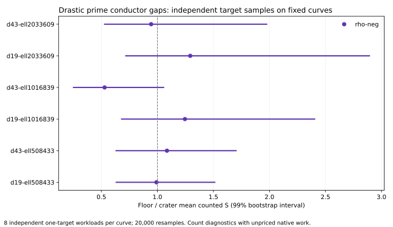

# Drastic prime conductor gaps, ECDLP measured on both ends

Measured on public synthetic prime-field curves, 2026-10-12 UTC. Classification: boundary control and counted-work accounting.

Six fresh certified CM pairs, two class-number-one discriminants (D = -19 and D = -43) at single-prime conductor gaps ell in {508433, 1016839, 2033609} (19 to 21 bits): 4 to 16 times the largest gap measured before (131101). Each curve has eight independent one-target workloads. The target law hashes the curve model: cross-curve samples are independent and no target was transported.

All numeric comparisons below concern counted S = group-addition equivalents / sqrt(r). The harness records unpriced work. A quotient of two lower bounds is a diagnostic, not a bound on complete attack cost. No wall-clock speedup, general hardness, or ECC2K-130 conclusion follows.

| pair | rho floor/crater | 95% interval | 99% interval | permutation p | IC floor/crater (99%) |
|---|---:|---|---|---:|---|
| d19-ell508433 | 0.991543 | 0.706627 to 1.37946 | 0.632536 to 1.51219 | 0.961402 | not run at this size |
| d43-ell508433 | 1.08528 | 0.727314 to 1.53242 | 0.631525 to 1.70210 | 0.685266 | not run at this size |
| d19-ell1016839 | 1.24531 | 0.798482 to 2.01156 | 0.680403 to 2.40308 | 0.349583 | not run at this size |
| d43-ell1016839 | 0.528596 | 0.305619 to 0.873890 | 0.250815 to 1.05522 | 0.0381481 | not run at this size |
| d19-ell2033609 | 1.29292 | 0.814235 to 2.32220 | 0.717915 to 2.89204 | 0.354732 | not run at this size |
| d43-ell2033609 | 0.943962 | 0.600553 to 1.66275 | 0.528732 to 1.97511 | 0.829809 | not run at this size |

The repeated-lead rule is applied exactly as frozen in the [protocol](PROTOCOL.md). This is not an equivalence proof.



Eight targets on a fixed curve are eight workloads on one curve, not eight curves. The floors were found by the prior round's method: random curve scan, one scalar multiplication per candidate, with the sample count recorded per pair.

## Recorded execution and replay

- **d19-ell508433**, session ECBS1h1d243eb3f9d3: 96 records, 48 measured; 13 measured failures. Audit OK: true; verified records: 72; exact measured replays: 35. A/A pairs: 16; mismatches: 0. [Run report](reports/d19-ell508433/README.md), [audit](sessions/d19-ell508433.audit.json), [sealed session](sessions/d19-ell508433/session.json).
- **d43-ell508433**, session ECBS1hf8f01c6caea3: 96 records, 48 measured; 16 measured failures. Audit OK: true; verified records: 65; exact measured replays: 32. A/A pairs: 16; mismatches: 0. [Run report](reports/d43-ell508433/README.md), [audit](sessions/d43-ell508433.audit.json), [sealed session](sessions/d43-ell508433/session.json).
- **d19-ell1016839**, session ECBS1h23b4d0c26999: 64 records, 32 measured; 0 measured failures. Audit OK: true; verified records: 64; exact measured replays: 32. A/A pairs: 16; mismatches: 0. [Run report](reports/d19-ell1016839/README.md), [audit](sessions/d19-ell1016839.audit.json), [sealed session](sessions/d19-ell1016839/session.json).
- **d43-ell1016839**, session ECBS1h9062d47a6d6f: 64 records, 32 measured; 0 measured failures. Audit OK: true; verified records: 64; exact measured replays: 32. A/A pairs: 16; mismatches: 0. [Run report](reports/d43-ell1016839/README.md), [audit](sessions/d43-ell1016839.audit.json), [sealed session](sessions/d43-ell1016839/session.json).
- **d19-ell2033609**, session ECBS1he7d4f6419a3a: 64 records, 32 measured; 0 measured failures. Audit OK: true; verified records: 64; exact measured replays: 32. A/A pairs: 16; mismatches: 0. [Run report](reports/d19-ell2033609/README.md), [audit](sessions/d19-ell2033609.audit.json), [sealed session](sessions/d19-ell2033609/session.json).
- **d43-ell2033609**, session ECBS1ha6b77e51c13e: 64 records, 32 measured; 0 measured failures. Audit OK: true; verified records: 64; exact measured replays: 32. A/A pairs: 16; mismatches: 0. [Run report](reports/d43-ell2033609/README.md), [audit](sessions/d43-ell2033609.audit.json), [sealed session](sessions/d43-ell2033609/session.json).

## The pairs

```json
[
 {
  "d": 19,
  "k": 19,
  "ell": 508433,
  "t": -9,
  "p": "1227894548593",
  "N": "1227894548603",
  "floor_trials": 1696752,
  "j_crater": "1227893663857",
  "j_floor": "36753177624"
 },
 {
  "d": 19,
  "k": 20,
  "ell": 1016839,
  "t": 355,
  "p": "4911317403131",
  "N": "4911317402777",
  "floor_trials": 2184174,
  "j_crater": "4911316518395",
  "j_floor": "1081910743656"
 },
 {
  "d": 19,
  "k": 21,
  "ell": 2033609,
  "t": -403,
  "p": "19643936473787",
  "N": "19643936474191",
  "floor_trials": 3600137,
  "j_crater": "19643935589051",
  "j_floor": "2578896676995"
 },
 {
  "d": 43,
  "k": 19,
  "ell": 508433,
  "t": 39,
  "p": "2778919241887",
  "N": "2778919241849",
  "floor_trials": 2495941,
  "j_crater": "2778034505887",
  "j_floor": "745425051090"
 },
 {
  "d": 43,
  "k": 20,
  "ell": 1016839,
  "t": -159,
  "p": "11115086689471",
  "N": "11115086689631",
  "floor_trials": 4921723,
  "j_crater": "11114201953471",
  "j_floor": "8834785015828"
 },
 {
  "d": 43,
  "k": 21,
  "ell": 2033609,
  "t": -667,
  "p": "44457329933693",
  "N": "44457329934361",
  "floor_trials": 6166734,
  "j_crater": "44456445197693",
  "j_floor": "34739863040311"
 }
]
```

Certification per pair: t^2-4q = -D*ell^2 with D fundamental class-number one fixes f_pi = ell; j = j(O_K) gives End = O_K (crater); j != j(O_K) with f_E | ell, f_E != 1 gives f_E = ell (floor). Orders verified by 64 random [N]P = O scalar multiplications per model before any session ran; every generator independently re-verified off-harness. Failures (wrong-trace twists, exhausted windows) are kept in [pairs/pairs.json](pairs/pairs.json).

## Reproduce

Build ecbench and the native examples from the pinned source. `drastic_prime_gap_pairs --out pairs/pairs.json`, then `drastic_gap_specs --pairs pairs/pairs.json --out specs`, then `run_sessions.sh` into fresh session directories; existing directories are never replaced. Run `drastic_gap_analyze --sessions research/drastic_prime_conductor_gap_20261012/sessions --out research/drastic_prime_conductor_gap_20261012/analysis`. The frozen statistical seed is 20261012; 20,000 independent-workload bootstrap resamples and label permutations.

## Requirement status

| requirement | status | evidence or remaining gap |
|---|---|---|
| Find drastic prime conductor gaps | measured | six certified pairs, ell up to 2033609, two discriminants; failures recorded |
| Measure ECDLP on both curves | measured for rho on all six pairs | counted one-target S with A/A controls and exact replays |
| Algebraic method coverage | ic-mitm on the two smallest-ell pairs | large-gap algebraic F4/SAT and MITM at the largest gaps remain open |
| Reproducible counts | audited on this host | external-host replay remains open |
| Endomorphism certification | class-number-one argument, no Sage | exact orders verified by scalar multiplication |
| Isogeny transport and its cost | not attempted | no explicit degree-ell maps; not assigned zero cost |
| Intrinsic or cryptographic-scale hardness | unresolved | six fixed pairs, two configurations; more independent classes required |

## Local validation

See [VALIDATION.md](VALIDATION.md).

## Evidence and visual scope

[Protocol](PROTOCOL.md), [native tables](analysis.md), [machine-readable analysis](analysis.json), [pair search output](pairs/pairs.json), [report PDF](report.pdf). Preregistration is this directory's PROTOCOL.md, committed before the search ran. The scoreboard receives a separate bounded-count panel for this measurement; previous fiber-round figures remain historical. No frontier, full-cost leaderboard or hypothesis status is promoted.
