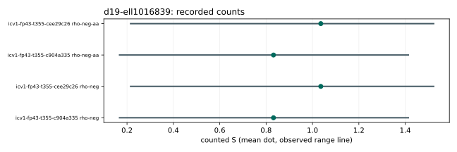

# Run report: d19-ell1016839

Session: ECBS1h23b4d0c26999. Spec: ../../specs/d19-ell1016839.json. Exact launch/audit commands: ../../run_sessions.sh.

Host: Apple M4 Pro, aarch64, environment ECBENV2h59034d4cd61b. Binary SHA-256: 9f6a05e86f49711383557ca4a449e6e41773bad2b2672ed08e297f26513b55c3. Recorded revision: be456ef517aa255f98c02c3fe94b33670517a9e0; dirty: false.

64 records: 32 measured, the rest retained warm-ups. Measured failures: 0. Eight independent one-target workloads on each fixed curve; one measured round, one warm-up. All runs are cold. A/A matches: 16 pairs, 0 mismatches.

Audit OK: true; 64 verified records; 32 exact measured replays. This is same-host replay, not independent-host validation.

| curve | role | arm | mean counted S | observed range | lower bound | isolation levels |
|---|---|---|---:|---|---|---|
| icv1-fp43-t355-c904a335 | crater | rho-neg | 0.831797 | 0.167743 to 1.41358 | true | {"L0":8} |
| icv1-fp43-t355-cee29c26 | floor | rho-neg | 1.03585 | 0.215421 to 1.52273 | true | {"L0":8} |
| icv1-fp43-t355-c904a335 | crater | rho-neg-aa | 0.831797 | 0.167743 to 1.41358 | true | {"L0":8} |
| icv1-fp43-t355-cee29c26 | floor | rho-neg-aa | 1.03585 | 0.215421 to 1.52273 | true | {"L0":8} |

Dots are native-analyzer means; lines are observed ranges, not confidence intervals. No wall figure is interpreted. Raw records: ../../sessions/d19-ell1016839/records.jsonl; their SHA-256: 963dca080ecfa6a0930e80a4223f3135c74260c96331d792d0acc1d74bf49f4e. All exact run IDs and phase means are in ../../analysis.json. No session file was edited.

## Exact representation identities

- crater: EC1P43Ccmcraterh890b505a8b9b; urn:ec-record:1:sha256:890b505a8b9bc4ee6d40d2ac8e724af0507d4ab3c2dcbfe727d63aaef6bc73b3. Full hash preimage and subgroup/generator are in ../../analysis.json. Metadata identity is not an additional mathematical certificate.
- floor: EC1P43Ccmfloorh0293a2629dd4; urn:ec-record:1:sha256:0293a2629dd43aed22e90bd08dd9f5b93e18fdc6ece76b969bb267b990ba350d. Full hash preimage and subgroup/generator are in ../../analysis.json. Metadata identity is not an additional mathematical certificate.

Unpriced native work, memory and model-dependent primitive prices remain explicit in each record. Counted S and IC/rho quotients do not establish complete-cost advantages. No isogeny was computed or priced; no structural hardness or transport inference is made.
