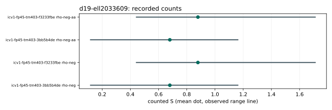

# Run report: d19-ell2033609

Session: ECBS1he7d4f6419a3a. Spec: ../../specs/d19-ell2033609.json. Exact launch/audit commands: ../../run_sessions.sh.

Host: Apple M4 Pro, aarch64, environment ECBENV2h59034d4cd61b. Binary SHA-256: 9f6a05e86f49711383557ca4a449e6e41773bad2b2672ed08e297f26513b55c3. Recorded revision: be456ef517aa255f98c02c3fe94b33670517a9e0; dirty: false.

64 records: 32 measured, the rest retained warm-ups. Measured failures: 0. Eight independent one-target workloads on each fixed curve; one measured round, one warm-up. All runs are cold. A/A matches: 16 pairs, 0 mismatches.

Audit OK: true; 64 verified records; 32 exact measured replays. This is same-host replay, not independent-host validation.

| curve | role | arm | mean counted S | observed range | lower bound | isolation levels |
|---|---|---|---:|---|---|---|
| icv1-fp45-tm403-3bb5b4de | crater | rho-neg | 0.679715 | 0.117480 to 1.16210 | true | {"L0":8} |
| icv1-fp45-tm403-f3233fbe | floor | rho-neg | 0.878820 | 0.442843 to 1.71068 | true | {"L0":8} |
| icv1-fp45-tm403-3bb5b4de | crater | rho-neg-aa | 0.679715 | 0.117480 to 1.16210 | true | {"L0":8} |
| icv1-fp45-tm403-f3233fbe | floor | rho-neg-aa | 0.878820 | 0.442843 to 1.71068 | true | {"L0":8} |

Dots are native-analyzer means; lines are observed ranges, not confidence intervals. No wall figure is interpreted. Raw records: ../../sessions/d19-ell2033609/records.jsonl; their SHA-256: 8d43300a608aed0f3cd52f28455ab614a80f7ae2a669c3bd8733123b307d5303. All exact run IDs and phase means are in ../../analysis.json. No session file was edited.

## Exact representation identities

- crater: EC1P45Ccmcraterh12ee359bffe3; urn:ec-record:1:sha256:12ee359bffe339dc35977c891138a53c5f5905a03f62f46825b529ce541455a3. Full hash preimage and subgroup/generator are in ../../analysis.json. Metadata identity is not an additional mathematical certificate.
- floor: EC1P45Ccmfloorh76adc98afda1; urn:ec-record:1:sha256:76adc98afda12ceebcd7a03aa3a0548f2f835ed56d020b6501dfa8bd44ab9ceb. Full hash preimage and subgroup/generator are in ../../analysis.json. Metadata identity is not an additional mathematical certificate.

Unpriced native work, memory and model-dependent primitive prices remain explicit in each record. Counted S and IC/rho quotients do not establish complete-cost advantages. No isogeny was computed or priced; no structural hardness or transport inference is made.
