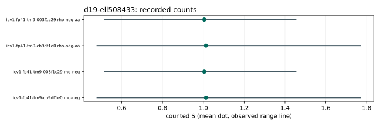

# Run report: d19-ell508433

Session: ECBS1h1d243eb3f9d3. Spec: ../../specs/d19-ell508433.json. Exact launch/audit commands: ../../run_sessions.sh.

Host: Apple M4 Pro, aarch64, environment ECBENV2h59034d4cd61b. Binary SHA-256: 9f6a05e86f49711383557ca4a449e6e41773bad2b2672ed08e297f26513b55c3. Recorded revision: be456ef517aa255f98c02c3fe94b33670517a9e0; dirty: false.

96 records: 48 measured, the rest retained warm-ups. Measured failures: 13. Eight independent one-target workloads on each fixed curve; one measured round, one warm-up. All runs are cold. A/A matches: 16 pairs, 0 mismatches.

Audit OK: true; 72 verified records; 35 exact measured replays. This is same-host replay, not independent-host validation.

| curve | role | arm | mean counted S | observed range | lower bound | isolation levels |
|---|---|---|---:|---|---|---|
| icv1-fp41-tm9-cb9df1e0 | crater | rho-neg | 1.01308 | 0.479641 to 1.76999 | true | {"L0":8} |
| icv1-fp41-tm9-003f1c29 | floor | rho-neg | 1.00451 | 0.517684 to 1.45288 | true | {"L0":8} |
| icv1-fp41-tm9-cb9df1e0 | crater | rho-neg-aa | 1.01308 | 0.479641 to 1.76999 | true | {"L0":8} |
| icv1-fp41-tm9-003f1c29 | floor | rho-neg-aa | 1.00451 | 0.517684 to 1.45288 | true | {"L0":8} |
| icv1-fp41-tm9-cb9df1e0 | crater | ic-mitm | missing | 69.3488 to 69.3488 | true | {"L0":8} |
| icv1-fp41-tm9-003f1c29 | floor | ic-mitm | missing | 80.5553 to 80.8674 | true | {"L0":8} |

Dots are native-analyzer means; lines are observed ranges, not confidence intervals. No wall figure is interpreted. Raw records: ../../sessions/d19-ell508433/records.jsonl; their SHA-256: c34572d6d1daf81d46f0cfdd42907a53049ec6030d73a30e78dfa0a7797b64b6. All exact run IDs and phase means are in ../../analysis.json. No session file was edited.

## Exact representation identities

- crater: EC1P41Ccmcraterh9b8747272cb5; urn:ec-record:1:sha256:9b8747272cb52dea1009424d26171c77ad275c193d6df32485d1cd30ebe09dbf. Full hash preimage and subgroup/generator are in ../../analysis.json. Metadata identity is not an additional mathematical certificate.
- floor: EC1P41Ccmfloorh3e240fead1ac; urn:ec-record:1:sha256:3e240fead1ac8bf447f3862100ca500915efe32d065f045b742ca7f499680b09. Full hash preimage and subgroup/generator are in ../../analysis.json. Metadata identity is not an additional mathematical certificate.

Unpriced native work, memory and model-dependent primitive prices remain explicit in each record. Counted S and IC/rho quotients do not establish complete-cost advantages. No isogeny was computed or priced; no structural hardness or transport inference is made.
