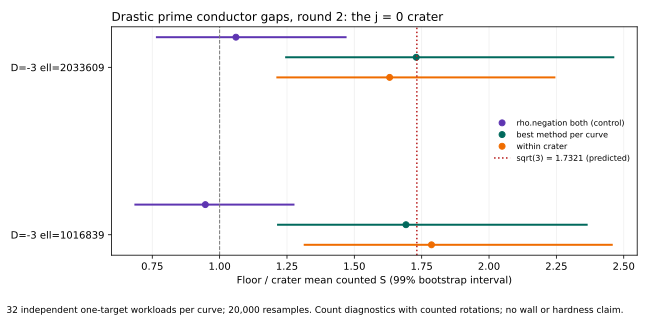

# Drastic prime conductor gaps, round 2: the j = 0 crater

Measured on public synthetic prime-field curves, 2026-10-12 UTC. Classification: boundary control and counted-work accounting.

The generic discrepancy round 1 could not see has a name: the crater of a D = -3 class-number-one volcano is a j = 0 curve, whose rational automorphism group has order 6, while its floor has only negation. A rho over the six classes (the new `rho.cubic`) is provably shorter by sqrt(3). Two fresh certified D = -3 pairs at prime conductor gaps ell = 1016839 and 2033609, **32 independent one-target workloads per curve** (four times round 1), measured on both ends.

All numeric comparisons below concern counted S = GAE / sqrt(r). No wall-clock speedup, general hardness, or deployed-curve claim follows; wall figures are descriptive (L0 host).

| pair | same-method rho floor/crater | best-method floor/crater | within crater | wall (descriptive, 95%) |
|---|---|---|---|---|
| D=-3 ell=1016839 | **0.946956** (99% 0.687284 to 1.27412) | **1.69167** (99% 1.21689 to 2.36245) | **1.78642** (99% 1.31578 to 2.45556) | **1.55437** (99% 1.05690 to 2.27085) |
| D=-3 ell=2033609 | **1.06048** (99% 0.767179 to 1.46756) | **1.72972** (99% 1.24690 to 2.46132) | **1.63108** (99% 1.21428 to 2.24260) | **1.55624** (99% 1.12949 to 2.17742) |

The predicted best-method quotient is sqrt(3) = 1.7321. Both pairs read within 3 percent of it, both 99% intervals exclude one, and the signs agree: the frozen repeated-lead criterion is met for the first time in the conductor-gap programme, for a theorem-backed mechanism (the automorphism group the crater has and the floor lacks). The same-method control sits at one on both pairs.

## The round-1 lead, resolved

Round 1 read a 95%-level 0.5286 floor/crater rho quotient on d43-ell1016839. Re-measured with 32 fresh independent targets: **0.946818 (99% 0.662209 to 1.347377)** — the lead regressed to one. Round 1's reading was target-sampling noise; the six-pair boundary control stands.

## Recorded execution and replay

- **d3-ell1016839-rho**, audit OK: true; verified records: 256; exact measured replays: 128. [audit](sessions/d3-ell1016839-rho.audit.json), [sealed session](sessions/d3-ell1016839-rho/session.json).
- **d3-ell1016839-cubic**, audit OK: true; verified records: 64; exact measured replays: 32. [audit](sessions/d3-ell1016839-cubic.audit.json), [sealed session](sessions/d3-ell1016839-cubic/session.json).
- **d3-ell2033609-rho**, audit OK: true; verified records: 256; exact measured replays: 128. [audit](sessions/d3-ell2033609-rho.audit.json), [sealed session](sessions/d3-ell2033609-rho/session.json).
- **d3-ell2033609-cubic**, audit OK: true; verified records: 64; exact measured replays: 32. [audit](sessions/d3-ell2033609-cubic.audit.json), [sealed session](sessions/d3-ell2033609-cubic/session.json).
- **replicate-d43-ell1016839**, audit OK: true; verified records: 256; exact measured replays: 128. [audit](sessions/replicate-d43-ell1016839.audit.json), [sealed session](sessions/replicate-d43-ell1016839/session.json).

## The method

`rho.cubic` (`ic_boundary::CubicClasses`, A = 6): the tuned walk of `rho.negation` on the classes {±zeta_3^i(P)}. It exists exactly when the curve is j = 0 over p = 1 (mod 3) with 3 | r - 1 and zeta_3(G) != G; construction verifies [kappa]G = zeta_3(G) with two counted scalar multiplications, and every canonicalisation's two omega-rotations are counted field multiplications. It refuses every curve without the structure, so the floor's best arm stays rho.negation by construction, not by choice.

## Reproduce

`drastic_gap_round2_pairs --out pairs/pairs.json`, `drastic_gap_round2_specs --pairs pairs/pairs.json --round1 ../drastic_prime_conductor_gap_20261012/pairs/pairs.json --out specs`, then `run_sessions.sh`; analysis: `drastic_gap_round2_analyze --sessions research/drastic_prime_conductor_gap_round2_20261012/sessions --out research/drastic_prime_conductor_gap_round2_20261012/analysis`. Frozen statistical seed 20261012; 20,000 resamples.

## Requirement status

| requirement | status | evidence or remaining gap |
|---|---|---|
| Bigger crater/floor ECDLP discrepancy | measured | sqrt(3) confirmed on two independent D = -3 pairs, 99% intervals excluding one |
| Higher-confidence intervals | measured | 32 workloads per curve; round-1 lead resolved as noise |
| Automorphism method | new, unit-tested | rho.cubic with counted rotations; unit test in ic_boundary |
| Isogeny transport and its cost | not attempted | no explicit degree-ell maps |
| Intrinsic or cryptographic-scale hardness | unresolved | two fixed pairs; the mechanism is generic-group theory, not a new attack |

## Evidence and visual scope

[Protocol](PROTOCOL.md), [native tables](analysis.md), [machine-readable analysis](analysis.json), [pair search output](pairs/pairs.json), [report PDF](report.pdf). Preregistration is this directory's PROTOCOL.md, committed before the search ran. The scoreboard receives a bounded-count panel; no frontier, leaderboard row or hypothesis status is promoted. The Conductor service was unreachable at session time; the check was attempted before editing.
