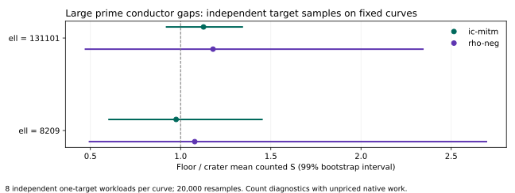

# Large-prime conductor-gap IC follow-up

Measured on public synthetic prime-field curves, 2026-10-12 UTC. Classification: boundary control and counted-work accounting.

This extends IC measurements to the archived ell = 131101 CM pair (37-bit field), with a fresh-target replication at ell = 8209 (29-bit field). Each curve has eight independent one-target workloads. The target law hashes the curve model: cross-curve samples are independent and no targets were transported.

All numeric comparisons below concern counted S = group-addition equivalents / sqrt(r). The harness records unpriced work. A quotient of two lower bounds is a diagnostic, not a bound on complete attack cost. No wall-clock speedup, general hardness, or ECC2K-130 conclusion follows.

| ell | IC floor/crater | 95% interval | 99% interval | permutation p | rho floor/crater (99%) |
|---:|---:|---|---|---:|---|
| 8209 | 0.975242 | 0.683854 to 1.32427 | 0.603463 to 1.45093 | 0.893955 | 1.07835 (0.495005 to 2.69487) |
| 131101 | 1.12713 | 0.970801 to 1.29084 | 0.922471 to 1.34169 | 0.144943 | 1.17974 (0.472798 to 2.34284) |

Both 99% intervals include one; the frozen repeated-lead criterion is not met. Coverage is MITM-based IC and negation rho. Large-gap algebraic F4/SAT comparisons remain open. This is not an equivalence proof.

The 99% intervals implement the frozen two-pair lead rule. Including one is not an equivalence proof. Eight targets per fixed curve do not provide eight independent curves or isogeny classes. The prior Sage certificates are copied as historical evidence; Sage was unavailable in this environment.

## Recorded execution and replay

- **ell8209-q29**, session ECBS1h2686905ba61d: 96 records, 48 measured; 0 measured failures. Audit OK: true; verified records: 96; exact measured replays: 48. A/A pairs: 16; mismatches: 0. [Run report](reports/ell8209-q29/README.md), [audit](sessions/ell8209-q29.audit.json), [sealed session](sessions/ell8209-q29/session.json).
- **ell131101-q37**, session ECBS1h8dc7fcf4f74b: 96 records, 48 measured; 0 measured failures. Audit OK: true; verified records: 96; exact measured replays: 48. A/A pairs: 16; mismatches: 0. [Run report](reports/ell131101-q37/README.md), [audit](sessions/ell131101-q37.audit.json), [sealed session](sessions/ell131101-q37/session.json).

## Reproduce

Build ecbench and the native example from the pinned source. Run `run_sessions.sh` into fresh session directories; existing directories are never replaced. Run `conductor_gap_analyze --sessions research/ecbench_conductor_gap_20261012/sessions --out research/ecbench_conductor_gap_20261012/analysis`. The frozen statistical seed is 20261012; 20,000 independent-workload bootstrap resamples and label permutations.

## Requirement status

| requirement | status | evidence or remaining gap |
|---|---|---|
| Resume existing large-gap work | measured in the bounded follow-up | two archived exact CM pairs and fresh targets |
| Extend IC to ell = 131101 | measured; validity in audits above | sealed native session and full deterministic measured replay |
| Reproducible counts | audited on this host | external-host replay remains open |
| Endomorphism certification | historical evidence reused | exact D = -19 class-number-one argument and prior Sage certificates; no new Sage run |
| Exact curve and workload identity | recorded | full field/model/subgroup/generator manifests and raw workload hashes |
| Isogeny transport and its cost | not attempted | no explicit degree-ell maps; not assigned zero cost |
| Intrinsic or cryptographic-scale hardness | unresolved | two fixed pairs, one configuration; representation controls and more independent classes required |

## Local validation

The experiment audits and analyzer controls pass. One existing N83 sampling assertion remains failing on unchanged library code; [validation record](VALIDATION.md) gives the full-suite result and all retries.

## Evidence and visual scope

[Protocol](PROTOCOL.md), [native tables](analysis.md), [machine-readable analysis](analysis.json), [input provenance](inputs/provenance.json), [binary hashes](binaries.sha256), [report PDF](report.pdf). Historical inputs and preregistration are preserved. The initial source hash in inputs.sha256 is bound to preregistration commit a7951c9785ee612c1f0c3524fcfe12f66aeb26b2; a later metadata-only manifest export adds no change to the statistical procedure.

Canonical conductor/isogeny diagrams were checked conceptually against this scope: no new curve, map, edge, or conductor is constructed, so their topology is unchanged. The scoreboard receives a separate bounded-count panel for this measurement; previous fiber-round figures remain historical. No frontier, full-cost leaderboard or hypothesis status is promoted.

The Conductor CLI and workflow file were unavailable; check was attempted before editing. The library test build's missing-fixture start is retained, and restored-fixture retry results are recorded separately.
