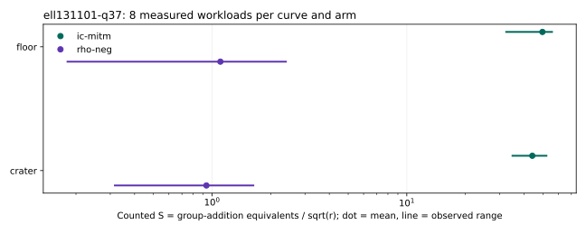

# Run report: ell131101-q37

Session: ECBS1h8dc7fcf4f74b. Spec: ../../specs/ell131101-q37.json. Exact launch/audit commands: ../../run_sessions.sh.

Host: INTEL(R) XEON(R) PLATINUM 8573C, x86_64, environment ECBENV2h64104171e621. Binary SHA-256: 429de171c022b71427759b47d411d8f8d6dd52e9f2daa819de23f4a67536194a. Recorded revision: 7df956fd7f97dad09c96dab12772b2b4cb24146f; dirty: false.

96 records: 48 measured, the rest retained warm-ups. Measured failures: 0. Eight independent one-target workloads on each fixed curve; one measured round, one warm-up. All runs are cold. A/A matches: 16 pairs, 0 mismatches.

Audit OK: true; 96 verified records; 48 exact measured replays. This is same-host replay, not independent-host validation.

| curve | role | arm | mean counted S | observed range | lower bound | isolation levels |
|---|---|---|---:|---|---|---|
| icv1-fp37-t277-91fd6e29 | crater | rho-neg | 0.935090 | 0.316784 to 1.62846 | true | {"L0":8} |
| icv1-fp37-t277-090dc414 | floor | rho-neg | 1.10317 | 0.180920 to 2.39371 | true | {"L0":8} |
| icv1-fp37-t277-91fd6e29 | crater | rho-neg-aa | 0.935090 | 0.316784 to 1.62846 | true | {"L0":8} |
| icv1-fp37-t277-090dc414 | floor | rho-neg-aa | 1.10317 | 0.180920 to 2.39371 | true | {"L0":8} |
| icv1-fp37-t277-91fd6e29 | crater | ic-mitm | 44.1241 | 34.9101 to 52.1463 | true | {"L0":8} |
| icv1-fp37-t277-090dc414 | floor | ic-mitm | 49.7337 | 32.4051 to 55.6938 | true | {"L0":8} |

Dots are native-analyzer means; lines are observed ranges, not confidence intervals. No wall figure is interpreted. Raw records: ../../sessions/ell131101-q37/records.jsonl; their SHA-256: c46193b81034cc3252b353544b0729efb0f860a790c481d7dd161e70c3a83cc1. All exact run IDs and phase means are in ../../analysis.json. No session file was edited.

## Exact representation identities

- crater: EC1P37Ccmcraterh28d36d6728fd; urn:ec-record:1:sha256:28d36d6728fd54cba045cf9814801b0aa24cd146a585e1ac95227c99aa4b7729. Full hash preimage and subgroup/generator are in ../../analysis.json. Metadata identity is not an additional mathematical certificate.
- floor: EC1P37Ccmfloorh892cd9d9b053; urn:ec-record:1:sha256:892cd9d9b0539e2071254e19931cc6b9249c0bbbaa70ddfc9ba22d55a0bfd7e2. Full hash preimage and subgroup/generator are in ../../analysis.json. Metadata identity is not an additional mathematical certificate.

Unpriced native work, memory and model-dependent primitive prices remain explicit in each record. Counted S and IC/rho quotients do not establish complete-cost advantages. No isogeny was computed or priced; no structural hardness or transport inference is made.
