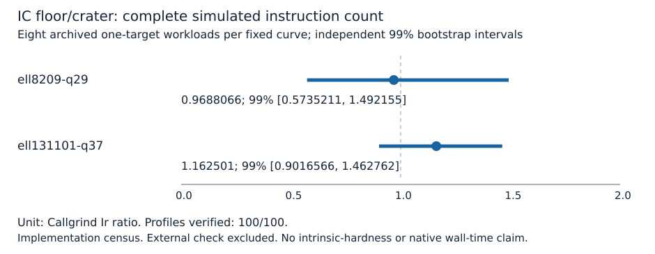

# Conductor-gap complete instruction census

Measured on public synthetic prime-field workloads, 2026-10-14 UTC. Classification: accounting and boundary control. Follow-up to [PR #1724](https://github.com/aburan28/crypto/pull/1724).

The existing MITM IC and matched negation-rho implementations are measured in Callgrind simulated user-space instructions over the complete methods::solve call. The interval includes cold setup inside the adapter, queries, relation handling, elimination, recovery and internal verification. It excludes input loading, method resolution, known-answer target construction, process launch, kernel instructions and the external independent point check. These exclusions remain unmeasured; they are not charged zero. No native wall-time speedup is claimed.

Profiles verified against the archived scalars, points and deterministic phase counters: **100/100**. The 32 archived workloads remain separate one-target solves. No setup or target transport is shared. The original eight samples per fixed curve are reused; this is accounting on those same points, not a fresh-target replication.

| Gap | IC floor/crater Ir | 99% interval |
|---|---:|---|
| ell8209-q29 | 0.9688066 | 0.5735211 to 1.492155 |
| ell131101-q37 | 1.162501 | 0.9016566 to 1.462762 |

Frozen repeated instruction-lead criterion: **not met**. A/A within the frozen 2% gate: **true**. Maximum absolute relative deviation: 0.00002237726 (fraction). Intervals including one are not equivalence proofs. The estimates are implementation observations on two fixed pairs and cannot establish a conductor effect across isogeny classes.

Comparison status: **admissible_implementation_diagnostic**. A failed A/A gate makes the instruction comparisons exploratory; failed or missing profiles make inference inadmissible.

| ICV1 model | IC / matched rho Ir | Paired 99% interval |
|---|---:|---|
| icv1-fp29-t47-14392892 | 28.15254 | 14.01229 to 74.39444 |
| icv1-fp29-t47-1f934956 | 25.27633 | 13.30118 to 48.24704 |
| icv1-fp37-t277-91fd6e29 | 47.77148 | 34.84198 to 79.65082 |
| icv1-fp37-t277-090dc414 | 47.07830 | 29.44940 to 104.8381 |

These ratios compare the same one-target workloads within the frozen instruction interval; excluded work and native wall time remain unmeasured.

See [native per-curve and per-target tables](analysis.md), [machine-readable analysis](analysis.json), [frozen protocol](PROTOCOL.md), [amended protocol](PROTOCOL-v2.md), [frozen jobs and original records](jobs.json), [lossless raw evidence](raw-callgrind.tar.xz), [execution commands](COMMANDS.md), [validation](VALIDATION.md) and [PDF](report.pdf). The prior study's exact EC1/UID representation manifests and Sage evidence remain at [the archived input study](../ecbench_conductor_gap_20261012/README.md). No map is constructed and no transfer cost is assumed.

## Run reports

- [ell8209-q29 run report](reports/ell8209-q29/README.md), [PDF](reports/ell8209-q29/report.pdf).
- [ell131101-q37 run report](reports/ell131101-q37/README.md), [PDF](reports/ell131101-q37/report.pdf).

## Requirements and unresolved work

| Requirement | Status and evidence |
|---|---|
| Continue the large-gap experiment | Whole-solve instruction census on all archived one-target workloads |
| Previously unpriced user-space implementation work | Included in the Ir interval; kernel/hardware work remains outside it |
| Scalar correctness and deterministic phase replay | Native validation in analysis.json; another-host replay remains open |
| Prime-field F4/SAT comparison | Not implemented in the native prime pipeline; remains open |
| Explicit isogeny and transport costs | Not attempted; remains open |
| Representation controls and more independent classes | Not attempted; two fixed pairs cannot establish a structural effect |
| Intrinsic or cryptographic-scale hardness | Unresolved; this census supplies no general security conclusion |

Interrupted attempts: [launch before preregistration](attempt-unpreregistered/README.md) and [phase-dump volume obstruction](attempt-phase-dumps/README.md). Both retain all raw files and supply no primary estimate. The [profiling obstruction](../../problems/conductor-gap-callgrind-phase-dump-volume.md) and [missing prime-field algebraic oracle](../../problems/prime-field-conductor-gap-algebraic-oracle.md) track their exact obligations.

## Canonical visual scope

The scoreboard receives a separate instruction-unit panel. The earlier GAE panel and figures remain historical. No new curve, map or conductor is constructed, so conductor/isogeny graph topology is unchanged. No generic GAE floor, scaling exponent, native wall-time leaderboard, or hypothesis state is promoted.
