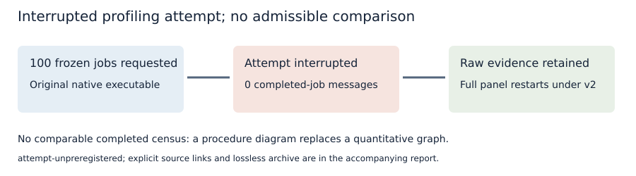

# Interrupted run: attempt-unpreregistered

Requested: the full 100-job frozen census. Completed-job messages: zero. Actual algorithmic outcome: unknown; this interruption is not an exhausted or unsatisfiable solver verdict.

The initial sparse-checkout refusal prevented the protocol commit; the runner was stopped before any completed-job message.

All raw files are retained losslessly in [raw-callgrind.tar.xz](raw-callgrind.tar.xz), with its SHA-256 receipt alongside it. The original input and partial child/stderr/profile files remain in the archive; missing final markers and receipts are not invented. These profiles are excluded from primary estimates and no successful subset is analyzed.

Source inputs and jobs: [original protocol](../PROTOCOL.md), [jobs](../jobs.json). Commands, receipts and reason: [execution commands](../COMMANDS.md), [deviations](../PROCEDURE_DEVIATIONS.md). Binary: original ecbench SHA-256 429de171c022b71427759b47d411d8f8d6dd52e9f2daa819de23f4a67536194a. Valgrind 3.24.0, one profile child, no compiler/test CPU work. Host: [receipt](../host.txt). All clocks are descriptive; no native wall-time or hardness claim.

The next attempt uses [the v2 protocol](../PROTOCOL-v2.md), unchanged workload/algorithm/control parameters and a newly pinned profiling executable. No numerical conductor result is obtained from this run.
