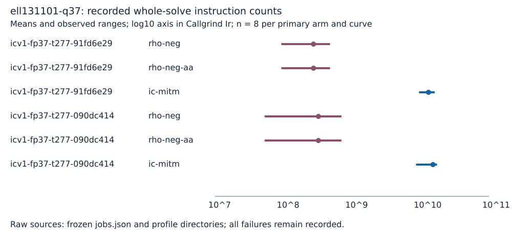

# Run report: ell131101-q37

Unit: Callgrind simulated user-space instructions over the entire methods::solve call. Profiles requested: 50; verified: 50. Each fixed curve retains its eight archived independent one-target workloads. No wall-clock value is interpreted.

Valgrind 3.24.0; v2 native ecbench SHA-256 ee7b82cf016f2433e99edd096f6a5dbfb3b3f9c4447f1583fae22864252a12e1. Source snapshot a92902a93; phase dump suppression is enabled while complete collection and outer markers remain active. CPU feature dispatch under Callgrind: unknown. Host and tool receipts: ../../host.txt and ../../tool-hashes.sha256. Exact commands and excluded costs: ../../COMMANDS.md, ../../PROTOCOL.md and ../../PROTOCOL-v2.md.

| ICV1 curve model | Arm | n | Mean Ir | Range |
|---|---|---:|---:|---|
| icv1-fp37-t277-91fd6e29 | rho-neg | 8 | 2.741009e+8 | 92812878 to 477452242 |
| icv1-fp37-t277-91fd6e29 | rho-neg-aa | 8 | 2.741009e+8 | 92812878 to 477452242 |
| icv1-fp37-t277-91fd6e29 | ic-mitm | 8 | 1.309420e+10 | 9526898259 to 16142432711 |
| icv1-fp37-t277-090dc414 | rho-neg | 8 | 3.233343e+8 | 52948331 to 701693062 |
| icv1-fp37-t277-090dc414 | rho-neg-aa | 8 | 3.233343e+8 | 52948331 to 701693062 |
| icv1-fp37-t277-090dc414 | ic-mitm | 8 | 1.522203e+10 | 8612452164 to 17440924750 |

The marks show native-analyzer means and observed ranges, not confidence intervals. All raw profile IDs, source run/record IDs, scalar and count validation errors are in ../../analysis.json. The four additional IC repeats are A/A diagnostics, excluded from primary means. Profile receipts and raw parts are retained losslessly in ../../raw-callgrind.tar.xz; all original sealed sessions remain unchanged.
