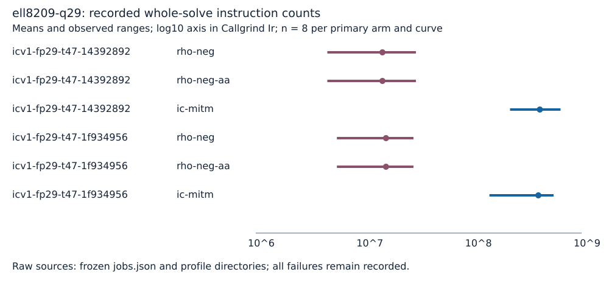

# Run report: ell8209-q29

Unit: Callgrind simulated user-space instructions over the entire methods::solve call. Profiles requested: 50; verified: 50. Each fixed curve retains its eight archived independent one-target workloads. No wall-clock value is interpreted.

Valgrind 3.24.0; v2 native ecbench SHA-256 ee7b82cf016f2433e99edd096f6a5dbfb3b3f9c4447f1583fae22864252a12e1. Source snapshot a92902a93; phase dump suppression is enabled while complete collection and outer markers remain active. CPU feature dispatch under Callgrind: unknown. Host and tool receipts: ../../host.txt and ../../tool-hashes.sha256. Exact commands and excluded costs: ../../COMMANDS.md, ../../PROTOCOL.md and ../../PROTOCOL-v2.md.

| ICV1 curve model | Arm | n | Mean Ir | Range |
|---|---|---:|---:|---|
| icv1-fp29-t47-14392892 | rho-neg | 8 | 1.465622e+7 | 4558199 to 29817057 |
| icv1-fp29-t47-14392892 | rho-neg-aa | 8 | 1.465622e+7 | 4558301 to 29817057 |
| icv1-fp29-t47-14392892 | ic-mitm | 8 | 4.126097e+8 | 219310496 to 639986192 |
| icv1-fp29-t47-1f934956 | rho-neg | 8 | 1.581476e+7 | 5582155 to 28297388 |
| icv1-fp29-t47-1f934956 | rho-neg-aa | 8 | 1.581475e+7 | 5582053 to 28297388 |
| icv1-fp29-t47-1f934956 | ic-mitm | 8 | 3.997390e+8 | 141671255 to 552318765 |

The marks show native-analyzer means and observed ranges, not confidence intervals. All raw profile IDs, source run/record IDs, scalar and count validation errors are in ../../analysis.json. The four additional IC repeats are A/A diagnostics, excluded from primary means. Profile receipts and raw parts are retained losslessly in ../../raw-callgrind.tar.xz; all original sealed sessions remain unchanged.
