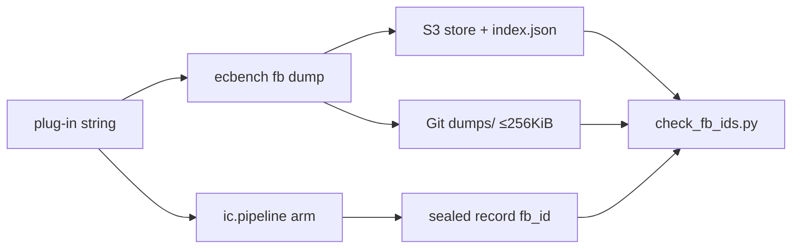

# Results — factor-base ecbench suite (2026-10-13)

Operation-count smokes (macOS L0). Not a performance claim. Protocol:
`docs/ecbench/FACTOR_BASE_PROTOCOL.md`. Catalog `fb_id` check: **48/48 IC
records matched**. Store: **10/10** remote-verified.

## Sessions

| Session | Records | Audit |
|:--|---:|:--|
| `sessions/koblitz17` | 30/30 verified | OK, 8 replays |
| `sessions/koblitz23` | 12/12 verified | OK, 8 replays |
| `sessions/koblitz23-cyc` | 12/12 verified | OK, 8 replays |
| `sessions/prime20` | 18/18 verified | OK, 8 replays |

## Mean S (from `table-*.md`)

### Koblitz n=17 vs `rho.signed_frobenius`

| arm | mean S | S / reference |
|:--|---:|---:|
| rho-frob | 0.913 | 1.000 |
| ic-k17-compact | 9.114 | 9.985 |
| ic-k17-orbit | 17.081 | 18.714 |
| ic-k17-subspace | 43.103 | 47.224 |
| ic-k17-std | 43.150 | 47.275 |

### Koblitz n=23 a=0 compact

| arm | mean S | S / reference |
|:--|---:|---:|
| rho-frob | 0.358 | 1.000 |
| ic-k23-compact | 2.996 | 8.360 |

### Koblitz n=23 a=1 cyclotomic:w=1

| arm | mean S | S / reference |
|:--|---:|---:|
| rho-frob | 0.345 | 1.000 |
| ic-k23-cyc-w1 | 3.427 | 9.933 |

### Prime 20-bit

| arm | mean S | S / reference |
|:--|---:|---:|
| rho-neg | 0.921 | 1.000 |
| ic-p20-abscissa | 11.329 | 12.300 |
| ic-p20-glv | 22.390 | 24.309 |

Classification: engineering / plumbing (protocol + inventory). No scoreboard
promotion; no vs_rho claim.
