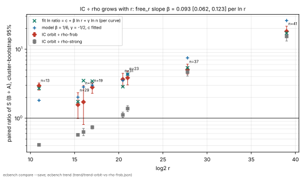
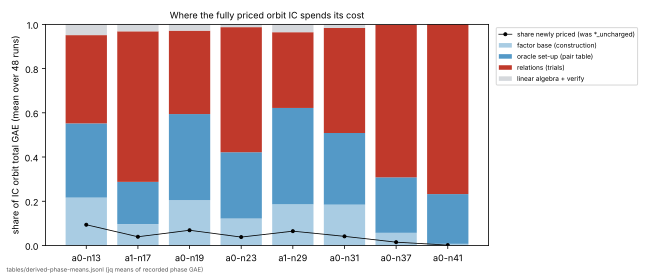

# Frobenius-orbit index calculus on Koblitz curves, fully priced, against the best rho (2026-10-14)

**Class: engineering. Verdict: constant-only.** With every native operation
priced, Frobenius-orbit index calculus is not below rho-frob on any of eight
Koblitz curves. On two curves the interval reaches 1, but there rho-frob's own
spread is wide. The paired ratio IC ÷ rho-frob grows with r, with slope
β = 0.165 [0.117, 0.213] per ln r once n is in the fit. The model value is
1/6. Frobenius orbits buy a constant, measured below (up to 15× against the
subspace base at n = 23), and leave the exponent gap to rho where it was. No
security claim; nothing here is about ECC2K-130 or deployed curves.

- Protocol, frozen before any claim data in commit `e1708eef8`: [`PROTOCOL.md`](PROTOCOL.md)
- Report PDF: [`REPORT.pdf`](REPORT.pdf); run report: [`reports/run-20261014T1925Z/`](reports/run-20261014T1925Z/)
- Graphs: [`figures/`](figures/) (SVG, plus a 150 dpi PNG each; source `figures/plot.py` plots recorded values only)
- Benchmarks copy: [`benchmarks/20261014-frobenius-orbit-ic-vs-rho/`](../../benchmarks/20261014-frobenius-orbit-ic-vs-rho/)
- Conductor T-1. Base: PR #1842 (`stride-renew`), not merged when this ran.

## What was built

1. **Full pricing** ([`src/cryptanalysis/ecbench/full_price.rs`](../../src/cryptanalysis/ecbench/full_price.rs)).
   - Three new opt-in method ids, `ic.pipeline_full`,
     `rho.signed_frobenius_full` and `rho.signed_frobenius_strong_full`, run
     the unchanged solvers and then price **every** native counter from
     [`src/cryptanalysis/ecbench/full_prices.json`](../../src/cryptanalysis/ecbench/full_prices.json).
   - Each counter has an explicit rule. It is either work already counted as
     an addition, or a sum of measured units: Artin–Schreier solve, hash
     probe, row operation, Frobenius map, canonicalisation, field
     multiplication, squaring and inversion, and word XOR.
   - A counter without a rule stays unpriced and keeps the record's
     lower-bound flag.
   - `ecbench price-units` measured the table on this host for all eight
     curves (median of 15 passes; raw passes in [`pricing/price-units.json`](pricing/price-units.json)).
   - `docs/ic/calibration.json` and every existing method are untouched, so
     committed sessions replay as before.
   - This also fixes `icv1-f2m19-t797-b6cf2467`, which has no row in the pinned table.
2. **`ecbench trend`** ([`src/cryptanalysis/ecbench/trend.rs`](../../src/cryptanalysis/ecbench/trend.rs)).
   It fits weighted least squares of ln(paired ratio) on ln r (and ln n) from
   `compare --save` files, plus the fixed-exponent model with only the
   constant fitted.

## Panel

Columns `c` and negfold dimensions `d` were chosen on exploratory seeds
(PROTOCOL.md §3, tables in [`exploration/`](exploration/)). Every claim
session used 16 fresh public targets × 3 rounds (+1 warm-up), L0.

| a | n | curve | log2 r | cofactor | session |
|---|---:|---|---:|---:|---|
| 0 | 13 | icv1-f2m13-t181-515ee569 | 10.97 | 4 | `ECBS1hb67a421a6fe2` |
| 1 | 17 | icv1-f2m17-tm101-00378d4e | 16.00 | 2 | `ECBS1h2627f1e2aee2` |
| 0 | 19 | icv1-f2m19-t797-b6cf2467 | 17.00 | 4 | `ECBS1h8baa27b989e6` |
| 0 | 23 | icv1-f2m23-t5197-69e76b73 | 21.00 | 4 | `ECBS1h5ace8f3e67d1` |
| 1 | 29 | icv1-f2m29-tm40309-30c52b96 | 15.37 | 12646 | `ECBS1h575c8bcdc35a` |
| 0 | 31 | icv1-f2m31-tm90707-c95f16f5 | 20.46 | 1492 | `ECBS1ha274653650f8` |
| 0 | 37 | icv1-f2m37-tm534059-32aad96b | 27.78 | 596 | `ECBS1h7aed5aa2d512` |
| 0 | 41 | icv1-f2m41-tm2308219-7f48b14a | 39.00 | 4 | `ECBS1h868a2da9acdc` |

**Verification.**
- 2,816 of 2,816 records verified.
- `ecbench verify --replay-all` replayed 2,112 of 2,112 measured records
  identically ([`audits/`](audits/)).
- Every A/A comparison (`rho-frob-aa ÷ rho-frob`) is exactly 1.000.
- No record of any arm is a lower bound (H1 passes).

## Results

Measured mean S (`GAE / √r`) from `ecbench table`. Ratios are paired B ÷ A
from `ecbench compare` with cluster-bootstrap 95 % intervals ([`tables/`](tables/)).

| curve | c | rho-frob S | rho-strong S | orbit-renew S | **orbit ÷ rho-frob** | orbit ÷ rho-strong | renew ÷ walk | orbit ÷ negfold |
|---|---:|---:|---:|---:|---|---|---|---|
| a0 n13 | 1 | 2.025 | 14.562 | 5.986 | **2.956 [2.552, 3.242]** | 0.411 [0.397, 0.423] | 0.403 [0.395, 0.412] | 0.511 [0.465, 0.562] |
| a1 n17 | 1 | 1.524 | 4.153 | 2.619 | **1.719 [0.810, 2.980]** | 0.631 [0.558, 0.711] | 0.503 [0.448, 0.562] | 0.234 [0.203, 0.270] |
| a0 n19 | 2 | 0.835 | 3.172 | 2.343 | **2.805 [2.295, 3.236]** | 0.739 [0.699, 0.782] | 0.556 [0.525, 0.591] | 0.148 [0.131, 0.170] |
| a0 n23 | 3 | 0.416 | 1.161 | 1.601 | **3.847 [3.035, 4.819]** | 1.379 [1.249, 1.521] | 0.753 [0.678, 0.834] | 0.065 [0.059, 0.071] |
| a1 n29 | 1 | 1.665 | 4.543 | 2.607 | **1.566 [0.992, 2.347]** | 0.574 [0.556, 0.593] | 0.480 [0.464, 0.499] | – |
| a0 n31 | 2 | 0.394 | 1.295 | 1.445 | **3.664 [2.907, 4.476]** | 1.116 [1.022, 1.226] | 0.668 [0.607, 0.733] | – |
| a0 n37 | 8 | 0.253 | 0.273 | 1.275 | **5.048 [4.335, 6.086]** | 4.676 [4.080, 5.310] | 1.029 [0.903, 1.176] | – |
| a0 n41 | 90 | 0.133 | 0.157 | 2.412 | **18.16 [15.67, 21.55]** | 15.34 [13.16, 18.28] | 1.009 [0.938, 1.082] | – |



### Hypotheses (PROTOCOL.md §5)

- **H1, full cost: pass.** `unpriced` is empty on all 2,816 records.
- **H2, stride-renew on the orbit base: pass on six curves, not at the two
  largest r.** Renew ÷ walk runs from 0.40 to 0.75 for log2 r ≤ 21. At
  n = 37 and n = 41 the interval contains 1, because the walk's fixed set-up
  is negligible there.
- **H3, against rho-frob: IC is below rho-frob on no curve.** The lower end is
  above 1 on six curves. On a1 n17 [0.810, 2.980] and a1 n29 [0.992, 2.347]
  the interval reaches 1. On those two curves rho-frob's own S is heavy-tailed
  (95 % intervals [0.92, 3.22] and [1.11, 2.64]), so they are undecided rather
  than a crossing.
- **H4, against rho-strong: below on four curves, above on four.** IC is below
  on n13, n17, n19 and n29, all with log2 r ≤ 17, and above from log2 r ≈ 20.5
  (n31, n23, n37, n41), as predicted.
  - rho-strong's fixed jump-table set-up dominates at small r:
    rho-strong ÷ rho-frob = 7.19 at n = 13.
  - That ratio falls with r: `free_r` slope −0.107 [−0.141, −0.073]
    ([`trend/trend-rho-strong-vs-rho-frob.json`](trend/trend-rho-strong-vs-rho-frob.json)).
  - At n = 37 and n = 41 the two rhos are within each other's intervals:
    1.08 [0.90, 1.33] and 1.18 [0.96, 1.47].
- **H5, orbits against the subspace base: pass.** Orbit ÷ negfold is 0.51,
  0.23, 0.15 and 0.065 at n = 13, 17, 19 and 23. This is the lever the
  Frobenius fold buys: a constant that grows with n (the base is about 1/(2n)
  as many columns, and the table is stored modulo Frobenius).
- **H6, the trend: constant-only.** `ecbench trend`, from
  [`trend/trend-orbit-vs-rho-frob.json`](trend/trend-orbit-vs-rho-frob.json),
  fits ln(orbit ÷ rho-frob) three ways:

  | fit | coefficients (95 %) | χ²/dof |
  |---|---|---:|
  | `free_r`: c + β ln r | β = **0.093 [0.062, 0.123]** | 9.9 |
  | `free_r_n`: c + β ln r + γ ln n | β = **0.165 [0.117, 0.213]**, γ = −1.18 [−1.90, −0.46] | 3.9 |
  | model: c + ln r / 6 − ln n / 2 | e^c = 1.84 [1.41, 2.40] | 15.7 |

  - β is above 0 in both free fits, so the ratio grows with r: constant-only
    by the frozen rule.
  - With n in the fit, β matches the model's 1/6.
  - The fixed-exponent model fails the χ²/dof ≤ 2 consistency rule: its
    γ = −1/2 is too shallow for this panel. The free γ is steeper,
    −1.18 [−1.90, −0.46].
  - γ rests on the two large-cofactor, small-r curves (a1 n29, a0 n31). On
    those the column count sits at its integer floor (c = 1, 2), and
    rho-frob is heavy-tailed. γ is descriptive, not a found lever.
  - Intervals are WLS ±1.96 SE, inflated by √(χ²/dof).

**What this means.**
- Read as an extrapolation of `free_r_n` to small-cofactor curves (r ≈ 2^n),
  ln ratio ≈ 2.77 + 0.114 n − 1.18 ln n. It is smallest near n ≈ 10, at about
  3.3, and grows from there.
- No n gives a ratio below 1 on that fitted line. This is derived from the
  fit and is not measured beyond log2 r = 39.
- The measured n = 41 point is 18.2× rho-frob.

### Pricing: what changed and what it costs

Means over 48 runs of recorded phase GAE, from
[`tables/derived-phase-means.jsonl`](tables/derived-phase-means.jsonl) (jq
arithmetic on the records):



**Newly priced construction work.**
- The orbit base's construction work that the old methods left `*_uncharged`
  now costs 25 GAE at n = 13, 58 at n = 19, 88 at n = 23 and 2,858 at
  n = 41. That is 9.4 %, 6.9 %, 3.8 % and 0.16 % of the totals.
- The earlier lower-bound figure (S ≈ 15.5, c = 2 with walk targets, in
  `research/ecbench_rootfind_vs_rho_20261014`) was not hiding a large cost.
- The fully priced c = 1 walk arm is 14.85 here, and stride-renew brings it
  to 5.99.

**All natives together.**
- Hash probes, Frobenius maps, canonicalisations and the rest are 36 % of the
  IC total at n = 13 and 16 % at n = 41.
- The largest native item is hash probes. They are priced on a `2^20`-entry
  map at 0.135 GAE each at n = 13, about 11× the pinned
  `docs/ic/calibration.json` ratio (0.012), so this pricing leans against IC.

**Robustness: natives priced at zero (derived, ratio of means, not paired).**
- Counting additions and doublings alone for both sides, IC ÷ rho-frob is
  1.98, 1.28, 1.84, 2.77, 0.96, 2.60, 4.09 and 16.3, in panel order.
- So the verdict does not hinge on the native prices.
- The one value below 1 (a1 n29, 0.96) is within rho-frob's spread on that
  curve.

### Exponents of the rho arms (descriptive)

`ecbench bound fit --tier toy` over the six toy-tier curves, in [`bounds/`](bounds/):

- rho-frob: α = 0.238 [0.135, 0.303].
- rho-strong: α = 0.135 [0.124, 0.150].

Both are far below 1/2, because fixed set-up still dominates at these sizes.
The panel is pre-asymptotic, so absolute exponents are not measurable here
and only the paired ratio's trend is read. The IC arm has no single-method
bound fit, because `c` differs per curve and therefore so does the method.

## Limits

- **Tiny curves.** These are toy and medium sizes (log2 r 11–39) on one
  shared 4-vCPU host at L0. Wall times are descriptive.
- **One host's prices.** The prices are one host's microbenchmark ratios.
  Operation counts survive hardware; the native share does not.
- **Choices made on exploratory seeds.** `c` and `d` were chosen on
  exploratory seeds; at n = 41 the optimum was flat across c = 60–130.
- **Restricted negfold arm.** The subspace (negfold) arm runs only at n ≤ 23
  with cofactor ≤ 4. It is not cofactor-projected, so on large-cofactor
  curves it is hopeless (exploration S ≈ 10³).
- **Dirty-tree flag on two sessions.** `git_dirty` is `true` on the a1
  sessions. `rustfmt` reformatted three source files (whitespace only) while
  the run was in progress. The binary (`f9cfb1a0…`) was built from
  `e1708eef8` and was not rebuilt during the run.
- **Reference costs.** rho-strong charges each batched addition as one GAE
  (an overcharge) and each scalar multiplication as 1.5·log2 r additions, by
  convention. rho-frob uses plain affine additions.

## Checks run

- `cargo clippy --release --lib --tests --bin ecbench -- -D warnings`: clean
  (the only diagnostic is the pre-existing unknown-lint warning from the
  command-line configuration).
- `rustfmt` on the changed files.
- `cargo test --release --lib -- full_price trend ecbench ic_framework`: 130
  passed, 1 ignored. The new tests are
  `every_full_id_has_a_base_and_the_table_parses`,
  `an_unknown_counter_stays_unpriced` and
  `exact_power_laws_are_recovered`.
- Existing sessions still replay under the new binary (`eb2657158fcf…`):
  - `research/ecbench_rootfind_speedup_20261014/sessions/claim-renew-n13`:
    672 of 672 replays reproduced.
  - `research/ecbench_rootfind_vs_rho_20261014/sessions/cycle5`: 24 of 24.
  - This study's a0-n13 session: 288 of 288
    (`audits/reaudit-a0-n13-formatted-binary.json`).
- `python3 scripts/site/test_build.py` passes all 48 tests.
- `build_lab_browser.py` regenerated `docs/browser/data.json`, and its
  `--check` passes.
- `build_ic_leaderboard.py --check` passes. The leaderboard is unchanged: it
  reads the ledger and tournament files, not this panel.
- Progress chart: one `ec-cold` point added to
  `docs/ic/progress-timeline.json` and re-embedded in the scoreboard, with
  its table row.

## Housekeeping after the run (2026-10-15)

- The price table moved, byte for byte, from `docs/ecbench/full_prices.json`
  to `src/cryptanalysis/ecbench/full_prices.json`, so that sparse CI checkouts
  can compile the library. Session records still name the old path in
  `detail.full_pricing.table`.
- The records' `table_sha256` matches the moved file. Replays do not compare
  `detail`, so every committed session replays unchanged.

## Reproduce

```sh
cargo build --release --bin ecbench
bash research/ecbench_frobenius_orbit_vs_rho_20261014/make_specs.sh   # specs (already committed)
bash research/ecbench_frobenius_orbit_vs_rho_20261014/run.sh          # sessions, audits, tables, comparisons
target/release/ecbench trend --compare research/ecbench_frobenius_orbit_vs_rho_20261014/sessions/*/comparisons/rho-frob__ic-orbit-*-renew.json
```
