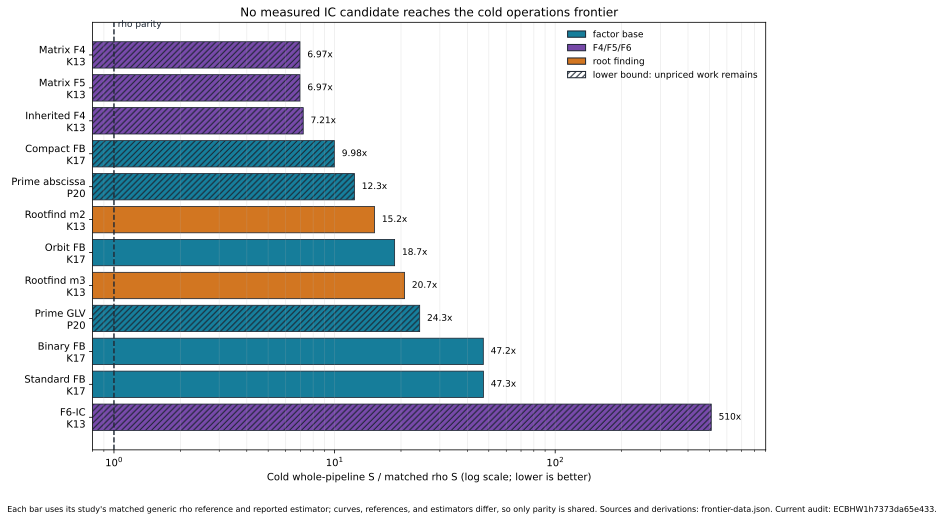
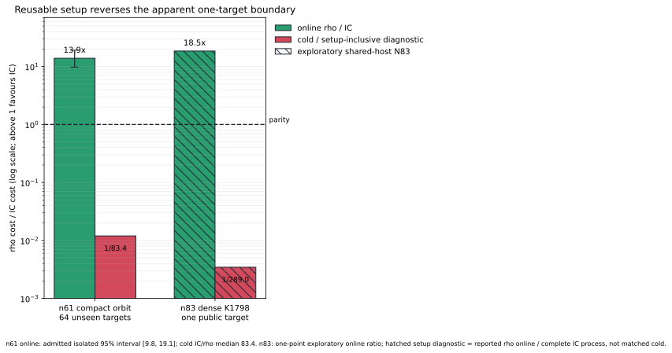

# ECBench ECDLP performance frontier, 2026-10-13

**Decision.** The cold, one-target, setup-inclusive frontier is still generic
rho. None of the measured index-calculus candidates beats its matched rho arm
in the repository's counted unit. The retained-preprocessing frontier is
different: compact-orbit index calculus has an admitted online win at `n=61`,
13.9x with a 95% interval of [9.8, 19.1] on the isolated x86_64 panel, while
the newer N83 dense-root result is a larger 18.528x one-point observation but
is exploratory because its host was shared. Solver-stage wins exist for F5,
F6-IC, root finding, and some symmetry reductions; none establishes a cold
end-to-end advance.

This report is a synthesis and current-binary replay audit of committed
measurements. It does not create a new cross-method session or promote a bound.
The authoritative machine-readable values and their classifications are in
[`frontier-data.json`](frontier-data.json). The run report and quantitative
graphs are under [`reports/run-20261013T2025Z/`](reports/run-20261013T2025Z/).

## The boundary, stated first

| Boundary | Incumbent | Measured position | Status |
|---|---|---|---|
| Cold one-target Koblitz operations, medium tier | `rho.signed_frobenius_strong`, bound `ECBND1h05a2ea918f3c` | 1.089x floor [0.927, 1.261], alpha 0.451 [0.399, 0.512], 144 runs at six sizes | canonical ECBench frontier |
| Cold one-target Koblitz memory | `rho.signed_frobenius`, bound `ECBND1h46fbc9140ac3` | 1.188x floor [0.954, 1.464], retained memory 0.000706 `sqrt(r)` [0.000130, 0.001369], 72 runs at three sizes | canonical ECBench Pareto point; constant bound only |
| Best measured Koblitz factor-base arm in the 2026-10-13 suite | `compact-orbit-scan` | at n=17, `S=9.114`, 9.985x matched signed-Frobenius rho; at n=23/a=0, `S=2.996`, 8.360x rho | operation smoke, L0; not a bound |
| Best Boolean algebraic whole-pipeline arm in the F4/F5/F6 cells | inherited F4 | 7.21x rho-negation / 1.136x setup-heavy strong rho at K13; 3.77x / 1.581x at K19 | `S` is a lower bound; still above rho on every target |
| Best admitted retained-preprocessing online result | compact-orbit IC, n=61, K=500 | rho/IC 13.9x [9.8, 19.1], 64 unseen targets, isolated x86_64; setup about 28 s excluded; cold IC/rho median 83.4 | admitted online constant-factor win only |
| Largest newer retained-preprocessing observation | dense five-byte root index, n=83, K=1798 | rho/IC 18.528377 on one public point; IC 63.324125 ms, rho 1,173.29325 ms; complete IC process 339.068 s | exploratory shared-host result; not an ECBench method |

The apparent conflict between the first and last two rows is only a boundary
change. Cold cost charges reusable preparation; online cost does not.

## Formal frontier definition

A performance point is keyed by

```text
D = (curve and subgroup identity,
     exact target law and target population,
     cold | online | stage boundary,
     counted unit and unpriced work,
     setup amortisation q,
     memory/resource envelope,
     correctness, replay, and isolation class).
```

Two points are ratio-comparable only when all components of `D`, other than the
method identity, match. A candidate is on the Pareto frontier of one such domain
when no admitted point is no worse on every declared axis and strictly better
on at least one. This prevents four invalid collapses:

1. setup-excluded online wall is not cold end-to-end cost;
2. word XORs, root-index probes, field operations, and group-addition
   equivalents are not interchangeable;
3. a lower bound with unpriced solver work is not a complete cost;
4. an L0/shared-host wall ratio is not an admitted CPU speedup.

For a retained-preprocessing method, the target-count boundary is

```text
T_IC(q) = B_IC + q O_IC,     T_rho(q) = B_rho + q O_rho,
q* = (B_IC - B_rho) / (O_rho - O_IC), when O_IC < O_rho.
```

At N83, using the reported reusable components
`B_IC = 319.165 + 19.825 + 0.014 = 339.004 s`,
`O_IC = 0.063324125 s`, and `O_rho = 1.17329325 s`, the arithmetic crossover is
`q*=305.418`, hence 306 targets. This is a **derived what-if**, not a measured
batch frontier: it assumes all setup is reusable, constant per-target online
cost, no capacity or cache change, and zero rho setup. The n=61 medians imply
roughly 90 targets only if two ratios-of-medians are algebraically combined;
that operation is not an admitted estimate, so no exact n=61 crossover is
claimed.

## Candidate census

### Factor bases

The native catalog contains ten sealed bases and 10/10 remote verification.
Seven IC arms were exercised in the performance smoke; the other catalog rows
are inventory coverage, not measured performance.

| Family / curve | Candidate | Points / columns | Mean `S` | `S / rho` | Reading |
|---|---|---:|---:|---:|---|
| Koblitz n=17 a=1 | compact orbit | 272 / 8 | 9.114 | **9.985** | best measured arm in the matched cell; lower bound |
| Koblitz n=17 a=1 | full orbit | 443 / 14 | 17.081 | 18.714 | complete counted arm |
| Koblitz n=17 a=1 | binary subspace dim 4 | 10 / 5 | 43.103 | 47.224 | complete counted arm |
| Koblitz n=17 a=1 | standard subspace dim 4 | 11 / 6 | 43.150 | 47.275 | complete counted arm |
| Koblitz n=23 a=0 | compact orbit | 460 / 10 | 2.996 | 8.360 | separate curve cell; lower bound |
| Koblitz n=23 a=1 | cyclotomic w=1 | 46 / 1 | 3.427 | 9.933 | separate curve cell; do not divide by a=0 |
| prime 20-bit | abscissa | 64 / 32 | 11.329 | **12.300** | better than the GLV arm in this cell; lower bound |
| prime 20-bit | GLV orbit | 32 / 16 | 22.390 | 24.309 | lower bound |

The conclusion is local but unambiguous: compact orbit is the best measured
Koblitz construction in this suite, while ordinary abscissa beats GLV orbit on
the measured prime cell. No row beats rho.

### Symmetry breaking

The torsion-symmetrised `u`-frame study predates ECBench and is retained as
legacy end-to-end evidence. Against its matched `x` frame, `S_sym/S_x` was 0.84
at n=17 and 0.77/0.76 on the two n=23 curves, but 4.01 at n=31. The paired
combinatorial-oracle controls were 0.89, 0.90, 1.09, and 1.28. Thus the local
small-size saving does not persist. Every complete arm remained far above rho.
The current `ecbench methods` registry has no torsion-symmetrised factor-base
plug-in, so this line cannot yet enter a native ECBench challenge.

Signed Frobenius is different: it is already the generic Koblitz rho symmetry
and owns the canonical medium-tier operations frontier. Factor-base orbit
folding is measured separately and must not be conflated with the walk's
automorphism discount.

### F4, F5, and F6-IC

| Question | Observation | Boundary verdict |
|---|---|---|
| Matrix F5 vs matrix F4, K13 / random-13 | word-XOR ratios 0.6465 / 0.6414 on the identical trees; wall ratios 0.79-0.86 | solver-stage engineering win |
| Matrix F4 vs inherited F4, K13 / random-13 | matrix work 198.6x / 222.1x inherited | inherited F4 is the practical algebraic baseline |
| F6-IC vs inherited F4 | word-XOR ratios about 0.82 at m=13 and 0.77-0.78 at m=19; relation wall 1.7-1.9x faster | solver-stage win |
| F6-IC charged `S` | 64.6-68.8x inherited at m=13 and 1,303-1,353x at m=19; closure is off above 256 base points | relabelling/accounting loss, not a frontier move |
| Matrix F4/F5 at m=19 | all four runs timed out at 1,800 s; inherited F4 finished in about 6 s | censored; no ratio for matrix arms |
| F6 ladder at m=31 | both inherited F4 and F6 hit 3,600 s on the first target; protocol stopped without a decision | open, not extrapolated |

Every IC arm was above matched rho on every target in the cross-family cells.
F5 and F6 improve a subroutine; neither changes the cold ECDLP frontier.

### Root finding: three distinct candidates

1. **Native ECBench pair/subtraction engines.** On K13, pair-table root finding
   has complete `S=28.383` (m=2) and `38.822` (m=3), 15.170x and 20.749x the
   matched signed-Frobenius rho arm. It has the same operation stream as MITM
   (`1.000` ratio). Its descriptive L0 wall is about 3.6x / 43x faster than
   inherited F4, but complete root-finder counts cannot be divided by F4 lower
   bounds to claim an operation speedup. Prime m=2 root finding likewise has
   the same counted stream as subtraction and is 239x rho at 18 bits.
2. **PDP root-finding study.** Table/enumeration root finders beat F4 by large
   subroutine factors and sit on their predicted pair-table/enumeration slopes.
   The classification is engineering: no slope falls below its generic floor.
3. **N83 dense five-byte root index.** K1798 reduces mean probes from
   300,021.90625 (K1500 dense) to 169,069.8125, a ratio of 0.563525; the paired
   reduction is 130,952.09375 [52,057.703125, 209,990.828125]. It produces the
   exploratory 18.528377x online point above, but it is not registered in
   `ecbench methods` and its 8 GiB table plus 339.004 s reusable preparation
   keep it off the cold one-target frontier.

## Cold candidate gaps



The bars use each study's matched rho and retain its reported estimator (mean
ratio, ratio of means, or paired median); they do not rank raw `S` across
curves. Hatched bars are lower bounds. Every candidate bar lies above parity. The
smallest ratio in this selected set is matrix F4/F5 at 6.97x rho-negation on
K13; compact orbit is 9.985x on the measured n=17 factor-base cell.

## Online boundary reversal



Both series use `rho cost / IC cost`, so values above one favour IC. The n=61
online bar is admitted and its cold bar is the reported `1/83.4`. The n=83
online bar is exploratory. Its hatched lower bar, `1/288.988`, is only a setup
diagnostic: reported rho *online* time divided by the complete IC process. It
is not a matched cold ratio because rho setup was not reported on that boundary.

## Current-binary replay audit

The native binary was built from commit
`759978250c1ce53d7b87bd8a1c2304781fcc4fc4` with Rust 1.94.1. Auditor binary
SHA-256: `53654ef1c0e93ed02025acd8188514d2674c4da2f57f25f61db40a510a422950`.
The captured native inventory is [`METHODS.txt`](METHODS.txt), and the auditor
capsule is [`HOST.txt`](HOST.txt).

| Evidence | Current audit | Receipt SHA-256 | Interpretation |
|---|---|---|---|
| factor-base n17 session `ECBS1hb09194fe1d2e` | 30/30 records valid; 8/8 replays identical | `9306d33e1d9d8cf8f5257f221941cfa88214752e3d0da2d70728e150f56b1c21` | current-binary pass |
| F4/F5/F6 K13 session `ECBS1h2b56c13eeaec` | 48/48 records valid; 7/7 selected replays identical, spanning strong rho, rho-negation, matrix F4, matrix F5, inherited F4, and F6-IC | `0304c4963454b4bbc46e6a37c5844ebe70e1ef2d08f808a4a4414ac97a8cf90e` | representative current-binary pass, not replay-all |
| root-finder K13 session `ECBS1hfd5bf1885227`, sampled | 224/224 records valid; 8/8 sampled rho replays identical | `4814136e3d51fb35849a4e2c490a12ce269bb50bd86fd052c8744fa695c1d88d` | pass, but sampler did not cover IC arms |
| same root-finder session, replay-all | 120/168 identical; all root-finder and rho rows pass; all 48 inherited-F4 rows differ in solver phase counts | `6110727aea2810587b08e88de5eb774d960ae29dd8b8d6aaab2b258bc1c8f5b9` | **failed audit preserved** |

The replay-all failure changes no recovered scalar, factor base, trial count,
charged GAE, or whole-pipeline `S`; for example seq 58 keeps
`total_gae=741.091311` but current x86_64 counts 301,961 solver word XORs where
the archived Apple record counts 300,531. The committed same-host audit made
with the measuring binary reports 168/168 identical. Until the cross-host
counter drift is explained or the method identity is versioned, the root-finder
study's F4 *stage-count* comparison is historical rather than current-binary
replay evidence. The root-finder rows themselves replay identically.

Receipts are preserved under [`audits/`](audits/), including the failed one.

## Completion against the request

| Requested item | Status | Evidence / gap |
|---|---|---|
| formal performance boundary | complete for the committed evidence | three explicit domains: cold, online, stage; comparability key and Pareto rule above |
| best factor bases | complete for the ten-base catalog; performance measured for seven arms | native catalog, four sessions, current n17 replay pass |
| symmetry-breaking techniques | partial | signed-Frobenius native bounds; torsion-symmetry remains legacy because no ECBench plug-in exists |
| F4/F5/F6 | complete for committed K13/R13/K19/R19 evidence; scaling decision open | all cells recorded; m19 matrix timeouts and m31 F6 stop retained |
| native root finder | complete for pair/subtraction ECBench engines | root-finder rows current-binary replay; F4 comparator counter drift disclosed |
| new N83 root finder in ECBench | blocked by implementation and resource gates | not registered in `ecbench methods`; existing native study needs 8 GiB table and used a 48 GiB host |
| single universal frontier number | deliberately not produced | cold, online, and stage results are different domains and units |

## What would move the frontier

1. Register torsion-symmetrised bases and the N83 dense-root engine under new,
   immutable ECBench method IDs; emit cold and five-phase online records.
2. Resolve the inherited-F4 word-XOR cross-host replay drift before using that
   counter in a bound or challenge verdict.
3. Run a four-size native challenge against the standing rho bound. Two sizes
   cannot establish an exponent change.
4. For N83, obtain a Tier 1/0 isolated same-point panel and a cold session with
   every setup phase and retained byte charged. The online one-point result does
   not replace this gate.
5. Price F6's batched geometry with a pinned conversion before interpreting
   wall/GAE disagreement.

## Scope and non-claims

- Public synthetic known-answer inputs only. No deployed-curve or key-recovery
  claim.
- No ECC2K-130 transfer: the N83 study uses a=1 and a different field model
  from the canonical m=83 transfer gate.
- No new exponent claim and no new canonical bound. `docs/bounds/FRONTIER.md`,
  `docs/index-calculus-scoreboard.html`, `docs/ic/progress-timeline.json`, and
  existing study graphs were checked and left unchanged because this synthesis
  adds no admitted measurement.
- The generated index-calculus leaderboard carries this synthesis as its latest
  accounting audit; its ranked curve rows remain unchanged.
- Conductor preflight could not run in this environment: the `conductor`
  executable and `.conductor/WORKFLOW.md` were absent. Work was restricted to
  this new report, its benchmark copies, and the benchmark index.

## Primary sources

- [`docs/bounds/FRONTIER.md`](../../docs/bounds/FRONTIER.md) and
  [`frontier.json`](../../docs/bounds/frontier.json)
- [`research/ecbench_factor_bases_20261013`](../ecbench_factor_bases_20261013/)
- [`research/f4_f5_f6_cross_family_20261011`](../f4_f5_f6_cross_family_20261011/)
- [`research/f6_ic_ecbench_ladder_20261005`](../f6_ic_ecbench_ladder_20261005/)
- [`research/ecbench_rootfind_engine_20261012`](../ecbench_rootfind_engine_20261012/)
- [`research/pdp_root_finder_20261012`](../pdp_root_finder_20261012/)
- [`research/koblitz_symmetrised_e2e_20260927`](../koblitz_symmetrised_e2e_20260927/)
- [`research/n83_dense_root_20261013`](../n83_dense_root_20261013/)
- [`docs/ic/BOUNDARY_TARGETS.md`](../../docs/ic/BOUNDARY_TARGETS.md)
