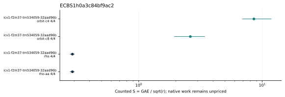

# orbit-heldout: ecbench follow-up

Session `"ECBS1h0a3c84bf9ac2"`; source `"0cbc86b2c828f1aa7fae62282913cce9ea6e099d"`; binary `"50a5739fadcb08ab8f170d4fe03ba3427fb0fd387c1a5918843fcda4d68ff1fb"`; host `"ECBENV2h96c931cc33fa"`.

16 attempts, 16 verified recoveries; 16 exact verified replays. [Spec](../../specs/orbit-heldout.json), [sealed records](../../sessions/orbit-heldout/records.jsonl), [audit](../../orbit-heldout.audit.json), [resource vector](../../orbit-heldout.resources.json), [supplemental failure replay](../../failed-replays-v2.json).

Fresh public targets, seed20261015, cold setup repeated, no planted log. L0; no admitted wall time. Figures are counted diagnostics. Successful-only means/ranges do not represent censored solve costs; incomplete count quotients do not bound full cost. The wide panel has no matched rho run.

