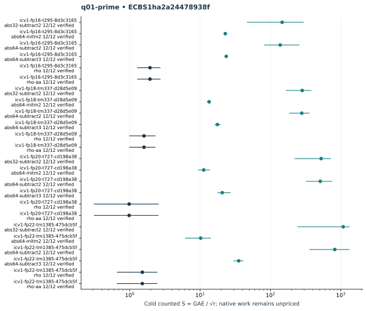

# q01-prime: native ecbench run

Session "ECBS1ha2a24478938f", spec"ECS1h84c29734a1a3", source"c716e462934128c75e99dd458748e08623a2708c", binary"cc5bba39d33465ddc1b1d31af8ac25c6680d41193fc76012d9a1019b6046f02d". Host "ECBENV2h687984d4e73d", L0; wall clocks inadmissible. Public single-target workloads, seeds20261014, no planted log, zero warmup and cold setup per attempt. [Frozen spec](../../specs/q01-prime.json), [raw session](../../sessions/q01-prime/session.json), [audit](../../q01-prime.audit.json), [resource vector](../../q01-prime.resources.json).

288 attempts, 288 verified; 288 standard exact replays. Failed deterministic outcomes have a separate [supplemental replay](../../failed-replays-v2.json). All failures are retained. The N83 applicability error is an implementation gap, not a mathematical obstruction.

Mean/min/max S use verified recoveries only. A partial count quotient does not bound full cost. No speed, wall, exponent or hardware claim.

| Curve | Arm | Verified / attempts | Mean cold S | Counted IC / rho | Status |
|---|---|---:|---:|---:|---|
| icv1-fp16-t295-8d3c3165 | abs32-subtract2 | 12 / 12 | 146.3892 | 75.5481 | {"verified":12} |
| icv1-fp16-t295-8d3c3165 | abs64-mitm2 | 12 / 12 | 22.7599 | 11.7458 | {"verified":12} |
| icv1-fp16-t295-8d3c3165 | abs64-subtract2 | 12 / 12 | 137.3309 | 70.8733 | {"verified":12} |
| icv1-fp16-t295-8d3c3165 | abs64-subtract3 | 12 / 12 | 23.4979 | 12.1267 | {"verified":12} |
| icv1-fp16-t295-8d3c3165 | rho | 12 / 12 | 1.9377 | 1.0000 | {"verified":12} |
| icv1-fp16-t295-8d3c3165 | rho-aa | 12 / 12 | 1.9377 | 1.0000 | {"verified":12} |
| icv1-fp18-tm337-d28d5e09 | abs32-subtract2 | 12 / 12 | 282.4994 | 177.1919 | {"verified":12} |
| icv1-fp18-tm337-d28d5e09 | abs64-mitm2 | 12 / 12 | 13.4152 | 8.4144 | {"verified":12} |
| icv1-fp18-tm337-d28d5e09 | abs64-subtract2 | 12 / 12 | 278.5684 | 174.7262 | {"verified":12} |
| icv1-fp18-tm337-d28d5e09 | abs64-subtract3 | 12 / 12 | 17.5888 | 11.0322 | {"verified":12} |
| icv1-fp18-tm337-d28d5e09 | rho | 12 / 12 | 1.5943 | 1.0000 | {"verified":12} |
| icv1-fp18-tm337-d28d5e09 | rho-aa | 12 / 12 | 1.5943 | 1.0000 | {"verified":12} |
| icv1-fp20-t727-cd198a38 | abs32-subtract2 | 12 / 12 | 524.8381 | 536.5484 | {"verified":12} |
| icv1-fp20-t727-cd198a38 | abs64-mitm2 | 12 / 12 | 11.2446 | 11.4955 | {"verified":12} |
| icv1-fp20-t727-cd198a38 | abs64-subtract2 | 12 / 12 | 510.0127 | 521.3923 | {"verified":12} |
| icv1-fp20-t727-cd198a38 | abs64-subtract3 | 12 / 12 | 20.6335 | 21.0938 | {"verified":12} |
| icv1-fp20-t727-cd198a38 | rho | 12 / 12 | 0.9782 | 1.0000 | {"verified":12} |
| icv1-fp20-t727-cd198a38 | rho-aa | 12 / 12 | 0.9782 | 1.0000 | {"verified":12} |
| icv1-fp22-tm1385-475dcb5f | abs32-subtract2 | 12 / 12 | 1081.0897 | 716.3848 | {"verified":12} |
| icv1-fp22-tm1385-475dcb5f | abs64-mitm2 | 12 / 12 | 10.1679 | 6.7377 | {"verified":12} |
| icv1-fp22-tm1385-475dcb5f | abs64-subtract2 | 12 / 12 | 819.1889 | 542.8360 | {"verified":12} |
| icv1-fp22-tm1385-475dcb5f | abs64-subtract3 | 12 / 12 | 35.3830 | 23.4466 | {"verified":12} |
| icv1-fp22-tm1385-475dcb5f | rho | 12 / 12 | 1.5091 | 1.0000 | {"verified":12} |
| icv1-fp22-tm1385-475dcb5f | rho-aa | 12 / 12 | 1.5091 | 1.0000 | {"verified":12} |

