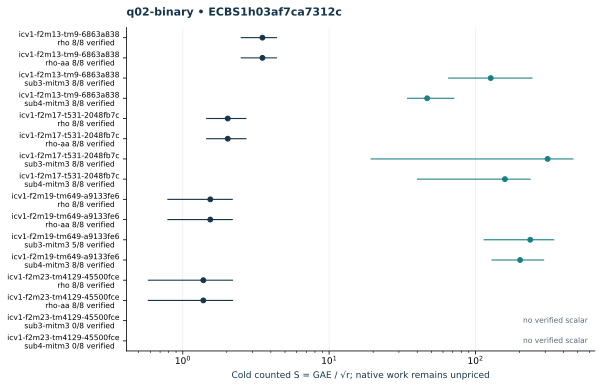

# q02-binary: native ecbench run

Session "ECBS1h03af7ca7312c", spec"ECS1h6fcf85017400", source"c716e462934128c75e99dd458748e08623a2708c", binary"cc5bba39d33465ddc1b1d31af8ac25c6680d41193fc76012d9a1019b6046f02d". Host "ECBENV2h687984d4e73d", L0; wall clocks inadmissible. Public single-target workloads, seeds20261014, no planted log, zero warmup and cold setup per attempt. [Frozen spec](../../specs/q02-binary.json), [raw session](../../sessions/q02-binary/session.json), [audit](../../q02-binary.audit.json), [resource vector](../../q02-binary.resources.json).

128 attempts, 109 verified; 109 standard exact replays. Failed deterministic outcomes have a separate [supplemental replay](../../failed-replays-v2.json). All failures are retained. The N83 applicability error is an implementation gap, not a mathematical obstruction.

Mean/min/max S use verified recoveries only. A partial count quotient does not bound full cost. No speed, wall, exponent or hardware claim.

| Curve | Arm | Verified / attempts | Mean cold S | Counted IC / rho | Status |
|---|---|---:|---:|---:|---|
| icv1-f2m13-tm9-6863a838 | rho | 8 / 8 | 3.5026 | 1.0000 | {"verified":8} |
| icv1-f2m13-tm9-6863a838 | rho-aa | 8 / 8 | 3.5026 | 1.0000 | {"verified":8} |
| icv1-f2m13-tm9-6863a838 | sub3-mitm3 | 8 / 8 | 127.2247 | 36.3234 | {"verified":8} |
| icv1-f2m13-tm9-6863a838 | sub4-mitm3 | 8 / 8 | 46.7808 | 13.3562 | {"verified":8} |
| icv1-f2m17-t531-2048fb7c | rho | 8 / 8 | 2.0296 | 1.0000 | {"verified":8} |
| icv1-f2m17-t531-2048fb7c | rho-aa | 8 / 8 | 2.0296 | 1.0000 | {"verified":8} |
| icv1-f2m17-t531-2048fb7c | sub3-mitm3 | 8 / 8 | 311.3590 | 153.4071 | {"verified":8} |
| icv1-f2m17-t531-2048fb7c | sub4-mitm3 | 8 / 8 | 159.0557 | 78.3670 | {"verified":8} |
| icv1-f2m19-tm649-a9133fe6 | rho | 8 / 8 | 1.5420 | 1.0000 | {"verified":8} |
| icv1-f2m19-tm649-a9133fe6 | rho-aa | 8 / 8 | 1.5420 | 1.0000 | {"verified":8} |
| icv1-f2m19-tm649-a9133fe6 | sub3-mitm3 | 5 / 8 | 236.8360 | — | {"exhausted":3,"verified":5} |
| icv1-f2m19-tm649-a9133fe6 | sub4-mitm3 | 8 / 8 | 201.9391 | 130.9581 | {"verified":8} |
| icv1-f2m23-tm4129-45500fce | rho | 8 / 8 | 1.3823 | 1.0000 | {"verified":8} |
| icv1-f2m23-tm4129-45500fce | rho-aa | 8 / 8 | 1.3823 | 1.0000 | {"verified":8} |
| icv1-f2m23-tm4129-45500fce | sub3-mitm3 | 0 / 8 | — | — | {"exhausted":8} |
| icv1-f2m23-tm4129-45500fce | sub4-mitm3 | 0 / 8 | — | — | {"exhausted":8} |

