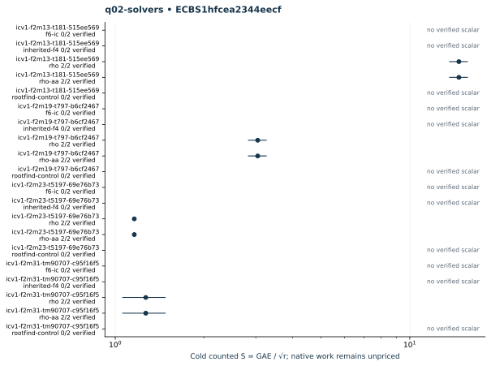

# q02-solvers: native ecbench run

Session "ECBS1hfcea2344eecf", spec"ECS1h1e7a3d7a0cb2", source"c716e462934128c75e99dd458748e08623a2708c", binary"cc5bba39d33465ddc1b1d31af8ac25c6680d41193fc76012d9a1019b6046f02d". Host "ECBENV2h687984d4e73d", L0; wall clocks inadmissible. Public single-target workloads, seeds20261014, no planted log, zero warmup and cold setup per attempt. [Frozen spec](../../specs/q02-solvers.json), [raw session](../../sessions/q02-solvers/session.json), [audit](../../q02-solvers.audit.json), [resource vector](../../q02-solvers.resources.json).

40 attempts, 16 verified; 16 standard exact replays. Failed deterministic outcomes have a separate [supplemental replay](../../failed-replays-v2.json). All failures are retained. The N83 applicability error is an implementation gap, not a mathematical obstruction.

Mean/min/max S use verified recoveries only. A partial count quotient does not bound full cost. No speed, wall, exponent or hardware claim.

| Curve | Arm | Verified / attempts | Mean cold S | Counted IC / rho | Status |
|---|---|---:|---:|---:|---|
| icv1-f2m13-t181-515ee569 | f6-ic | 0 / 2 | — | — | {"exhausted":2} |
| icv1-f2m13-t181-515ee569 | inherited-f4 | 0 / 2 | — | — | {"exhausted":2} |
| icv1-f2m13-t181-515ee569 | rho | 2 / 2 | 14.6759 | 1.0000 | {"verified":2} |
| icv1-f2m13-t181-515ee569 | rho-aa | 2 / 2 | 14.6759 | 1.0000 | {"verified":2} |
| icv1-f2m13-t181-515ee569 | rootfind-control | 0 / 2 | — | — | {"exhausted":2} |
| icv1-f2m19-t797-b6cf2467 | f6-ic | 0 / 2 | — | — | {"exhausted":2} |
| icv1-f2m19-t797-b6cf2467 | inherited-f4 | 0 / 2 | — | — | {"exhausted":2} |
| icv1-f2m19-t797-b6cf2467 | rho | 2 / 2 | 3.0459 | 1.0000 | {"verified":2} |
| icv1-f2m19-t797-b6cf2467 | rho-aa | 2 / 2 | 3.0459 | 1.0000 | {"verified":2} |
| icv1-f2m19-t797-b6cf2467 | rootfind-control | 0 / 2 | — | — | {"exhausted":2} |
| icv1-f2m23-t5197-69e76b73 | f6-ic | 0 / 2 | — | — | {"exhausted":2} |
| icv1-f2m23-t5197-69e76b73 | inherited-f4 | 0 / 2 | — | — | {"exhausted":2} |
| icv1-f2m23-t5197-69e76b73 | rho | 2 / 2 | 1.1604 | 1.0000 | {"verified":2} |
| icv1-f2m23-t5197-69e76b73 | rho-aa | 2 / 2 | 1.1604 | 1.0000 | {"verified":2} |
| icv1-f2m23-t5197-69e76b73 | rootfind-control | 0 / 2 | — | — | {"exhausted":2} |
| icv1-f2m31-tm90707-c95f16f5 | f6-ic | 0 / 2 | — | — | {"exhausted":2} |
| icv1-f2m31-tm90707-c95f16f5 | inherited-f4 | 0 / 2 | — | — | {"exhausted":2} |
| icv1-f2m31-tm90707-c95f16f5 | rho | 2 / 2 | 1.2694 | 1.0000 | {"verified":2} |
| icv1-f2m31-tm90707-c95f16f5 | rho-aa | 2 / 2 | 1.2694 | 1.0000 | {"verified":2} |
| icv1-f2m31-tm90707-c95f16f5 | rootfind-control | 0 / 2 | — | — | {"exhausted":2} |

