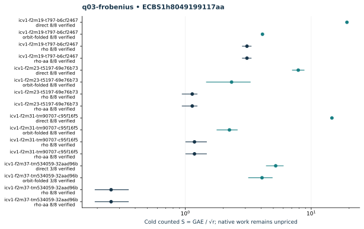

# q03-frobenius: native ecbench run

Session "ECBS1h8049199117aa", spec"ECS1he10073d5cf3d", source"c716e462934128c75e99dd458748e08623a2708c", binary"cc5bba39d33465ddc1b1d31af8ac25c6680d41193fc76012d9a1019b6046f02d". Host "ECBENV2h687984d4e73d", L0; wall clocks inadmissible. Public single-target workloads, seeds20261014, no planted log, zero warmup and cold setup per attempt. [Frozen spec](../../specs/q03-frobenius.json), [raw session](../../sessions/q03-frobenius/session.json), [audit](../../q03-frobenius.audit.json), [resource vector](../../q03-frobenius.resources.json).

128 attempts, 118 verified; 118 standard exact replays. Failed deterministic outcomes have a separate [supplemental replay](../../failed-replays-v2.json). All failures are retained. The N83 applicability error is an implementation gap, not a mathematical obstruction.

Mean/min/max S use verified recoveries only. A partial count quotient does not bound full cost. No speed, wall, exponent or hardware claim.

| Curve | Arm | Verified / attempts | Mean cold S | Counted IC / rho | Status |
|---|---|---:|---:|---:|---|
| icv1-f2m19-t797-b6cf2467 | direct | 8 / 8 | 19.2284 | 6.2226 | {"verified":8} |
| icv1-f2m19-t797-b6cf2467 | orbit-folded | 8 / 8 | 4.1025 | 1.3276 | {"verified":8} |
| icv1-f2m19-t797-b6cf2467 | rho | 8 / 8 | 3.0901 | 1.0000 | {"verified":8} |
| icv1-f2m19-t797-b6cf2467 | rho-aa | 8 / 8 | 3.0901 | 1.0000 | {"verified":8} |
| icv1-f2m23-t5197-69e76b73 | direct | 8 / 8 | 7.8934 | 6.9527 | {"verified":8} |
| icv1-f2m23-t5197-69e76b73 | orbit-folded | 8 / 8 | 2.3315 | 2.0536 | {"verified":8} |
| icv1-f2m23-t5197-69e76b73 | rho | 8 / 8 | 1.1353 | 1.0000 | {"verified":8} |
| icv1-f2m23-t5197-69e76b73 | rho-aa | 8 / 8 | 1.1353 | 1.0000 | {"verified":8} |
| icv1-f2m31-tm90707-c95f16f5 | direct | 8 / 8 | 14.6069 | 12.3489 | {"verified":8} |
| icv1-f2m31-tm90707-c95f16f5 | orbit-folded | 8 / 8 | 2.2417 | 1.8952 | {"verified":8} |
| icv1-f2m31-tm90707-c95f16f5 | rho | 8 / 8 | 1.1828 | 1.0000 | {"verified":8} |
| icv1-f2m31-tm90707-c95f16f5 | rho-aa | 8 / 8 | 1.1828 | 1.0000 | {"verified":8} |
| icv1-f2m37-tm534059-32aad96b | direct | 3 / 8 | 5.2241 | — | {"exhausted":5,"verified":3} |
| icv1-f2m37-tm534059-32aad96b | orbit-folded | 3 / 8 | 4.0678 | — | {"exhausted":5,"verified":3} |
| icv1-f2m37-tm534059-32aad96b | rho | 8 / 8 | 0.2574 | 1.0000 | {"verified":8} |
| icv1-f2m37-tm534059-32aad96b | rho-aa | 8 / 8 | 0.2574 | 1.0000 | {"verified":8} |

