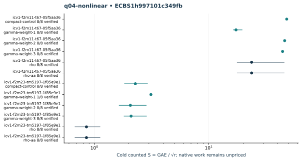

# q04-nonlinear: native ecbench run

Session "ECBS1h997101c349fb", spec"ECS1h0cc6d59bc8b7", source"c716e462934128c75e99dd458748e08623a2708c", binary"cc5bba39d33465ddc1b1d31af8ac25c6680d41193fc76012d9a1019b6046f02d". Host "ECBENV2h687984d4e73d", L0; wall clocks inadmissible. Public single-target workloads, seeds20261014, no planted log, zero warmup and cold setup per attempt. [Frozen spec](../../specs/q04-nonlinear.json), [raw session](../../sessions/q04-nonlinear/session.json), [audit](../../q04-nonlinear.audit.json), [resource vector](../../q04-nonlinear.resources.json).

96 attempts, 89 verified; 89 standard exact replays. Failed deterministic outcomes have a separate [supplemental replay](../../failed-replays-v2.json). All failures are retained. The N83 applicability error is an implementation gap, not a mathematical obstruction.

Mean/min/max S use verified recoveries only. A partial count quotient does not bound full cost. No speed, wall, exponent or hardware claim.

| Curve | Arm | Verified / attempts | Mean cold S | Counted IC / rho | Status |
|---|---|---:|---:|---:|---|
| icv1-f2m11-t67-05f5aa36 | compact-control | 8 / 8 | 48.0597 | 2.0277 | {"verified":8} |
| icv1-f2m11-t67-05f5aa36 | gamma-weight-1 | 8 / 8 | 17.3176 | 0.7306 | {"verified":8} |
| icv1-f2m11-t67-05f5aa36 | gamma-weight-2 | 8 / 8 | 46.1181 | 1.9457 | {"verified":8} |
| icv1-f2m11-t67-05f5aa36 | gamma-weight-3 | 8 / 8 | 44.2287 | 1.8660 | {"verified":8} |
| icv1-f2m11-t67-05f5aa36 | rho | 8 / 8 | 23.7020 | 1.0000 | {"verified":8} |
| icv1-f2m11-t67-05f5aa36 | rho-aa | 8 / 8 | 23.7020 | 1.0000 | {"verified":8} |
| icv1-f2m23-tm5197-1f85e9e1 | compact-control | 8 / 8 | 2.2833 | 2.6757 | {"verified":8} |
| icv1-f2m23-tm5197-1f85e9e1 | gamma-weight-1 | 1 / 8 | 3.1227 | — | {"exhausted":7,"verified":1} |
| icv1-f2m23-tm5197-1f85e9e1 | gamma-weight-2 | 8 / 8 | 2.0658 | 2.4209 | {"verified":8} |
| icv1-f2m23-tm5197-1f85e9e1 | gamma-weight-3 | 8 / 8 | 2.0951 | 2.4552 | {"verified":8} |
| icv1-f2m23-tm5197-1f85e9e1 | rho | 8 / 8 | 0.8533 | 1.0000 | {"verified":8} |
| icv1-f2m23-tm5197-1f85e9e1 | rho-aa | 8 / 8 | 0.8533 | 1.0000 | {"verified":8} |

