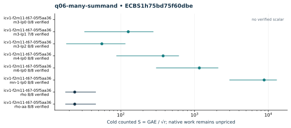

# q06-many-summand: native ecbench run

Session "ECBS1h75bd75f60dbe", spec"ECS1h8e0488d11238", source"c716e462934128c75e99dd458748e08623a2708c", binary"cc5bba39d33465ddc1b1d31af8ac25c6680d41193fc76012d9a1019b6046f02d". Host "ECBENV2h687984d4e73d", L0; wall clocks inadmissible. Public single-target workloads, seeds20261014, no planted log, zero warmup and cold setup per attempt. [Frozen spec](../../specs/q06-many-summand.json), [raw session](../../sessions/q06-many-summand/session.json), [audit](../../q06-many-summand.audit.json), [resource vector](../../q06-many-summand.resources.json).

64 attempts, 55 verified; 55 standard exact replays. Failed deterministic outcomes have a separate [supplemental replay](../../failed-replays-v2.json). All failures are retained. The N83 applicability error is an implementation gap, not a mathematical obstruction.

Mean/min/max S use verified recoveries only. A partial count quotient does not bound full cost. No speed, wall, exponent or hardware claim.

| Curve | Arm | Verified / attempts | Mean cold S | Counted IC / rho | Status |
|---|---|---:|---:|---:|---|
| icv1-f2m11-t67-05f5aa36 | m3-lp0 | 0 / 8 | — | — | {"exhausted":8} |
| icv1-f2m11-t67-05f5aa36 | m3-lp1 | 7 / 8 | 126.1067 | — | {"exhausted":1,"verified":7} |
| icv1-f2m11-t67-05f5aa36 | m3-lp2 | 8 / 8 | 55.3047 | 2.3333 | {"verified":8} |
| icv1-f2m11-t67-05f5aa36 | m4-lp0 | 8 / 8 | 374.7798 | 15.8121 | {"verified":8} |
| icv1-f2m11-t67-05f5aa36 | m6-lp0 | 8 / 8 | 1161.9226 | 49.0220 | {"verified":8} |
| icv1-f2m11-t67-05f5aa36 | mn-1-lp0 | 8 / 8 | 8797.0309 | 371.1508 | {"verified":8} |
| icv1-f2m11-t67-05f5aa36 | rho | 8 / 8 | 23.7020 | 1.0000 | {"verified":8} |
| icv1-f2m11-t67-05f5aa36 | rho-aa | 8 / 8 | 23.7020 | 1.0000 | {"verified":8} |

