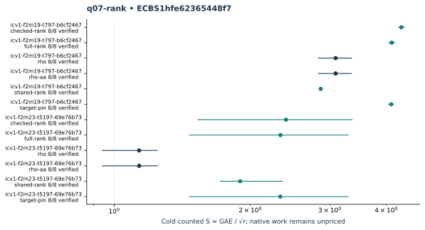

# q07-rank: native ecbench run

Session "ECBS1hfe62365448f7", spec"ECS1h2f216114f913", source"c716e462934128c75e99dd458748e08623a2708c", binary"cc5bba39d33465ddc1b1d31af8ac25c6680d41193fc76012d9a1019b6046f02d". Host "ECBENV2h687984d4e73d", L0; wall clocks inadmissible. Public single-target workloads, seeds20261014, no planted log, zero warmup and cold setup per attempt. [Frozen spec](../../specs/q07-rank.json), [raw session](../../sessions/q07-rank/session.json), [audit](../../q07-rank.audit.json), [resource vector](../../q07-rank.resources.json).

96 attempts, 96 verified; 96 standard exact replays. Failed deterministic outcomes have a separate [supplemental replay](../../failed-replays-v2.json). All failures are retained. The N83 applicability error is an implementation gap, not a mathematical obstruction.

Mean/min/max S use verified recoveries only. A partial count quotient does not bound full cost. No speed, wall, exponent or hardware claim.

| Curve | Arm | Verified / attempts | Mean cold S | Counted IC / rho | Status |
|---|---|---:|---:|---:|---|
| icv1-f2m19-t797-b6cf2467 | checked-rank | 8 / 8 | 4.3208 | 1.3983 | {"verified":8} |
| icv1-f2m19-t797-b6cf2467 | full-rank | 8 / 8 | 4.1135 | 1.3312 | {"verified":8} |
| icv1-f2m19-t797-b6cf2467 | rho | 8 / 8 | 3.0901 | 1.0000 | {"verified":8} |
| icv1-f2m19-t797-b6cf2467 | rho-aa | 8 / 8 | 3.0901 | 1.0000 | {"verified":8} |
| icv1-f2m19-t797-b6cf2467 | shared-rank | 8 / 8 | 2.8644 | 0.9270 | {"verified":8} |
| icv1-f2m19-t797-b6cf2467 | target-pin | 8 / 8 | 4.1025 | 1.3276 | {"verified":8} |
| icv1-f2m23-t5197-69e76b73 | checked-rank | 8 / 8 | 2.3994 | 2.1134 | {"verified":8} |
| icv1-f2m23-t5197-69e76b73 | full-rank | 8 / 8 | 2.3331 | 2.0550 | {"verified":8} |
| icv1-f2m23-t5197-69e76b73 | rho | 8 / 8 | 1.1353 | 1.0000 | {"verified":8} |
| icv1-f2m23-t5197-69e76b73 | rho-aa | 8 / 8 | 1.1353 | 1.0000 | {"verified":8} |
| icv1-f2m23-t5197-69e76b73 | shared-rank | 8 / 8 | 1.9003 | 1.6738 | {"verified":8} |
| icv1-f2m23-t5197-69e76b73 | target-pin | 8 / 8 | 2.3315 | 2.0536 | {"verified":8} |

