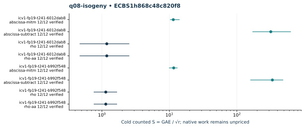

# q08-isogeny: native ecbench run

Session "ECBS1h868c48c820f8", spec"ECS1h587260feb306", source"c716e462934128c75e99dd458748e08623a2708c", binary"cc5bba39d33465ddc1b1d31af8ac25c6680d41193fc76012d9a1019b6046f02d". Host "ECBENV2h687984d4e73d", L0; wall clocks inadmissible. Public single-target workloads, seeds20261014, no planted log, zero warmup and cold setup per attempt. [Frozen spec](../../specs/q08-isogeny.json), [raw session](../../sessions/q08-isogeny/session.json), [audit](../../q08-isogeny.audit.json), [resource vector](../../q08-isogeny.resources.json).

96 attempts, 96 verified; 96 standard exact replays. Failed deterministic outcomes have a separate [supplemental replay](../../failed-replays-v2.json). All failures are retained. The N83 applicability error is an implementation gap, not a mathematical obstruction.

Mean/min/max S use verified recoveries only. A partial count quotient does not bound full cost. No speed, wall, exponent or hardware claim.

| Curve | Arm | Verified / attempts | Mean cold S | Counted IC / rho | Status |
|---|---|---:|---:|---:|---|
| icv1-fp19-t241-6012dab8 | abscissa-mitm | 12 / 12 | 11.4171 | 9.6626 | {"verified":12} |
| icv1-fp19-t241-6012dab8 | abscissa-subtract | 12 / 12 | 317.7792 | 268.9462 | {"verified":12} |
| icv1-fp19-t241-6012dab8 | rho | 12 / 12 | 1.1816 | 1.0000 | {"verified":12} |
| icv1-fp19-t241-6012dab8 | rho-aa | 12 / 12 | 1.1816 | 1.0000 | {"verified":12} |
| icv1-fp19-t241-b992f548 | abscissa-mitm | 12 / 12 | 11.5799 | 10.1450 | {"verified":12} |
| icv1-fp19-t241-b992f548 | abscissa-subtract | 12 / 12 | 335.5223 | 293.9474 | {"verified":12} |
| icv1-fp19-t241-b992f548 | rho | 12 / 12 | 1.1414 | 1.0000 | {"verified":12} |
| icv1-fp19-t241-b992f548 | rho-aa | 12 / 12 | 1.1414 | 1.0000 | {"verified":12} |

