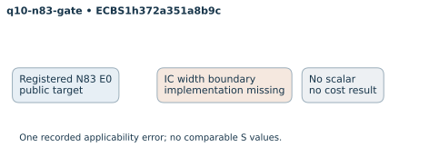

# q10-n83-gate: native ecbench run

Session "ECBS1h372a351a8b9c", spec"ECS1haae2d6bde831", source"c716e462934128c75e99dd458748e08623a2708c", binary"cc5bba39d33465ddc1b1d31af8ac25c6680d41193fc76012d9a1019b6046f02d". Host "ECBENV2h687984d4e73d", L0; wall clocks inadmissible. Public single-target workloads, seeds20261014, no planted log, zero warmup and cold setup per attempt. [Frozen spec](../../specs/q10-n83-gate.json), [raw session](../../sessions/q10-n83-gate/session.json), [audit](../../q10-n83-gate.audit.json), [resource vector](../../q10-n83-gate.resources.json).

1 attempts, 0 verified; 0 standard exact replays. Failed deterministic outcomes have a separate [supplemental replay](../../failed-replays-v2.json). All failures are retained. The N83 applicability error is an implementation gap, not a mathematical obstruction.

Mean/min/max S use verified recoveries only. A partial count quotient does not bound full cost. No speed, wall, exponent or hardware claim.

| Curve | Arm | Verified / attempts | Mean cold S | Counted IC / rho | Status |
|---|---|---:|---:|---:|---|
| icv1-f2m83-tm6151469093347-debefd74 | ic-n83 | 0 / 1 | — | — | {"error":1} |

