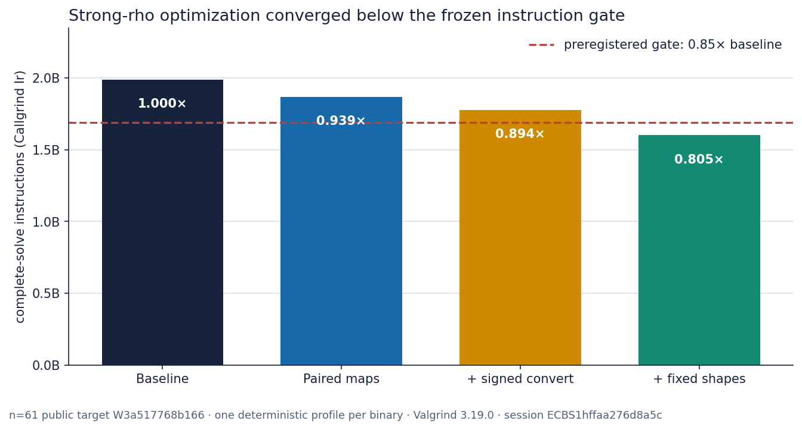

# Strong-rho implementation optimization, 2026-10-14

**Decision.** The standing `rho.signed_frobenius_strong` implementation now
uses 0.802155 times the complete-solve Callgrind instructions of its
trajectory-identical same-binary legacy path: 1,600,543,701 versus
1,995,304,985 `callgrind.Ir`, a 19.785% reduction. Against the separately
archived pre-change binary the ratio is 0.804582. This clears the
preregistered 0.85 deterministic gate.

This is an **implementation result**, not a new ECDLP algorithm or generic
boundary. Across 240 matched pairs on 48 public targets and six registered
Koblitz curves, optimized/legacy charged GAE is exactly 1.0000 with a cluster
interval of [1.0000, 1.0000]. All 864 executions verified, all 720 measured
runs replayed identically, and the recovered scalars, walk trajectories and
every counter stayed fixed.

The native wall gate remains **unknown**. This VM exposes no Linux PSI, so the
preregistered L2 run refused before creating a session. A retained L0
diagnostic session was then run with `--allow-busy`, contrary to the protocol's
no-fallback clause; its 0.9586 optimized/legacy median and 0.9997 optimized A/A
median have no admitted interval and are not performance claims.

## Frontier boundary

| Axis | Position | Evidence class |
|---|---|---|
| Cold operations | unchanged: strong rho, `ECBND1h05a2ea918f3c` | canonical |
| Rho instructions | 0.802155 legacy; 0.804582 pre-change | deterministic Callgrind |
| Native wall | unknown; zero L2 pairs | not admitted |
| Candidate gaps to rho | unchanged; identical GAE | frozen operations |
| Historical wall ratios | remain binary-specific | remeasure |

The full factor-base, symmetry, F4/F5/F6 and root-finder frontier remains the
[2026-10-13 synthesis](../ecbench_frontier_20261013/README.md). The generated
[index-calculus leaderboard](../../docs/ic/LEADERBOARD.md) now carries this
implementation result as its latest audit, while every ranked row remains
unchanged.

## What changed

Profile attribution put 1,070,864,152 instructions, 53.91% of the rho-solve
interval, under signed-Frobenius canonicalization. The accepted path:

1. applies each normal-basis linear map to both point coordinates in one table
   traversal;
2. spells out the six-, seven- and eight-byte shapes used by the registered
   one-word frontier curves;
3. updates both walk coefficients through one modular-reduction dispatch and
   one shared multiplier conversion; and
4. keeps the literal old path as
   `rho.signed_frobenius_strong_legacy`, solely for within-binary comparison.

The final canonicalization interval is 678,619,624 instructions, 42.48% of its
rho-solve interval. The scalar modular fast path is range-gated below 2^50,
falls back to exact `u128` reduction outside that range, and is checked against
the prior implementation on randomized residues.

## Evidence

| Check | Result |
|---|---|
| Frozen profile | n=61 `W3a517768b166`, public target seed 2026101401, algorithm seed 5480128907060238240 |
| Exact outcome | scalar 41931826107977; 1,591,865 walk steps; 1,698,247 canonicalizations; 1,700,726.570883 GAE |
| New session | `ECBS1hffaa276d8a5c`, 864/864 verified, 720/720 measured replays identical |
| Factor-base compatibility | session `ECBS1hb09194fe1d2e`, replay-all 20/20 identical |
| F4/F5/F6 compatibility | session `ECBS1h2b56c13eeaec`, replay-all 48/48 identical |
| Root-finder compatibility | session `ECBS1hfd5bf1885227`, eight sampled rho rows identical |
| Candidate binary | commit `2fd065a6c`; SHA-256 `8778c2a8…31b22` (full value in `BUILD.json`) |

Machine-readable values are in [`RESULT.json`](RESULT.json), the compiler and
binary capsule in [`BUILD.json`](BUILD.json), raw Callgrind parts and hashes in
[`callgrind/`](callgrind/), and the ECBench records, comparisons, resources and
replay receipt in [`sessions/run-20261014T012000Z/`](sessions/run-20261014T012000Z/).
The descriptive run report is
[`reports/run-20261014T0113Z/`](reports/run-20261014T0113Z/); the complete
validation ledger is [`TESTS.md`](TESTS.md).

## Retained attempts

| Candidate | Complete-solve Ir | Ratio to archived baseline | Gate |
|---|---:|---:|---|
| paired coordinate maps and coefficient reduction | 1,867,868,681 | 0.938962 | miss |
| range-proved signed conversion | 1,777,918,951 | 0.893759 | miss |
| fixed six-, seven- and eight-byte shapes | 1,600,543,701 | 0.804582 | pass |

The first two profiles are preserved rather than dropped.

## Scope and graph audit

- Public synthetic targets only; no deployed-key, asymptotic or ECC2K-130
  claim.
- `docs/bounds/FRONTIER.md` and `docs/bounds/frontier.json` were checked and
  remain unchanged because counted operations did not move.
- `docs/index-calculus-scoreboard.html` and
  `docs/ic/progress-timeline.json` were checked and remain unchanged because
  this is rho/rho implementation evidence, not a new IC/rho ratio.
- The leaderboard audit was regenerated because every performance handoff is
  required to appear there.
- Conductor preflight could not run: both `.conductor/WORKFLOW.md` and the
  `conductor` executable are absent in this checkout.
