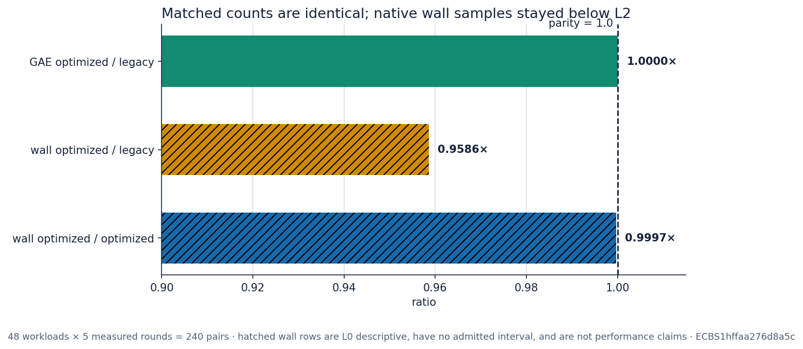

# Run report: strong-rho implementation controls

Run start: 2026-10-14 01:13:10 UTC. Session:
`ECBS1hffaa276d8a5c`; spec: `ECS1h87343a2f7167`; implementation commit:
`2fd065a6c`; binary SHA-256: `8778c2a8…31b22` (full value in
[`../../BUILD.json`](../../BUILD.json)).

The command requested ECBench's automatic whole-core placement on the frozen
three-arm spec. The initial preregistered command without `--allow-busy`
refused because `/proc/pressure/cpu` and `/proc/pressure/memory` were absent.
The retained fallback added `--allow-busy`; this is a disclosed protocol
deviation and caps every wall sample below L2.

```text
ecbench run --wait --allow-busy --spec spec.json \
  --out sessions/run-20261014T012000Z --cpus auto
```

Host class `ECBENV2h217559836c7c` is a five-core, no-SMT KVM guest reporting an
AMD EPYC 9V74 and Linux 6.18.44. The three arms were the literal legacy path,
the standing optimized path, and an identical optimized A/A control. Six
registered Koblitz curves, eight public targets per curve, one warm-up and five
measured rounds produced 864 records: 864 verified, no failures or timeouts.

## Recorded observations

| Quantity | Recorded value | Treatment |
|---|---:|---|
| opt / legacy GAE | 1.0000 [1.0000, 1.0000], 240 pairs | count |
| opt / legacy wall | 0.9586 median, 240 L0 pairs | L0 only |
| opt / opt wall | 0.9997 median, 240 L0 pairs | A/A L0 |
| measured replay | 720/720 identical | audit |
| opt / legacy Callgrind | 0.802155 | separate unit |




The Callgrind graph uses one deterministic complete-solve profile per binary
on n=61 public workload `W3a517768b166`, Valgrind 3.19.0. It shows
`callgrind.Ir`, not native wall time. The horizontal line is the preregistered
0.85 ratio threshold. The session-control graph hatches both wall rows to mark
their L0 status and lack of an admitted confidence interval.

Raw session evidence is in
[`../../sessions/run-20261014T012000Z/`](../../sessions/run-20261014T012000Z/),
raw instruction profiles in [`../../callgrind/`](../../callgrind/), and graph
values in [`figure-data.json`](figure-data.json). Interpretation and frontier
treatment are in the [result report](../../README.md).
