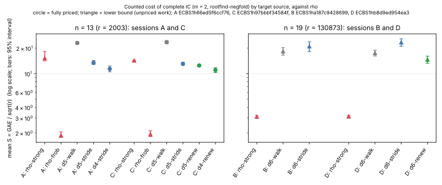
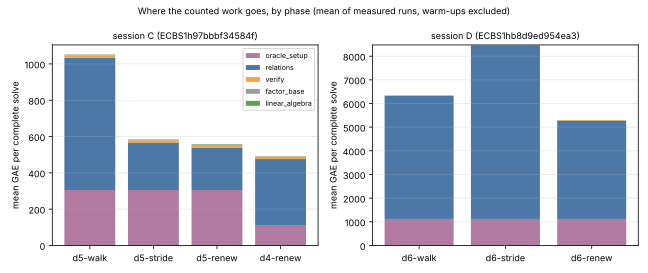

# Cheaper targets for the ecbench rootfind engine (2026-10-14)

**Decision: engineering.** About half of the counted cost of the best
complete rootfind arm (`pdp3-koblitz:m=2,engine=rootfind-negfold`) was the
relation loop's *target generator*, not the root-finding.  The r-adding walk
sets up 16 jumps and up to 16 restart offsets at two scalar multiplications
each.  Two new target sources replace it:

- `targets=stride` presents `R₀ + [k]S`;
- `targets=stride-renew` also moves the stride on (`S ← S + T`) after every
  relation, and steps past a repeat instead of restarting.

On the frozen n = 13 panel, `stride-renew` halves S:
`renew ÷ walk = 0.531 [0.506, 0.557]`.  It also brings complete index
calculus below `rho-strong` there: `0.770 [0.720, 0.824]` at d = 4.  At
n = 19 it still cuts the walk by `0.835 [0.741, 0.943]`, but index
calculus stays **4.7× above rho-strong**.  On the n = 13 panel, `rho-frob`
(S ≈ 1.9) is 6× below every index-calculus arm.  No exponent moved.  There is
no security claim and no ECC2K-130 inference.

| | |
|---|---|
| protocol | [`PROTOCOL.md`](PROTOCOL.md) (H1–H3) and [`AMENDMENT_1.md`](AMENDMENT_1.md) (H4–H6), each committed before its data |
| code | `TargetSource::{Stride, StrideRenew}` in `src/cryptanalysis/ic_boundary.rs`; `Targets` in `ic_framework/stages.rs`.  `walk` is unchanged, so every committed session replays |
| run reports | [`reports/run-20261014T1700Z/`](reports/run-20261014T1700Z/report.pdf) (A, B); [`reports/run-20261014T1728Z/`](reports/run-20261014T1728Z/report.pdf) (C, D) |
| digest | [`REPORT.pdf`](REPORT.pdf) |
| host | 4 vCPU Intel Xeon 2.10 GHz, shared cloud container, `--cpus none --allow-busy`: **L0** |
| Conductor | T-1 |

## Sessions

| id | session | curve | arms | records | audit |
|---|---|---|---|---:|---|
| A | `ECBS1h66ed5f6ccf76` | Koblitz a = 0, n = 13, r = 2003 | rho-strong, rho-frob, d5 walk, d5 stride, d4 stride, A/A | 768 | ok (also re-audited by the C/D binary) |
| B | `ECBS1ha187c9428699` | Koblitz a = 0, n = 19, r = 130873 | rho-strong, d6 walk, d6 stride | 144 | ok (also re-audited) |
| C | `ECBS1h97bbbf34584f` | n = 13 | rho-strong, rho-frob, d5 walk, d5 stride, d5 renew, d4 renew, A/A | 896 | ok |
| D | `ECBS1hb8d9ed954ea3` | n = 19 | rho-strong, d6 walk, d6 stride, d6 renew | 256 | ok |

Every record verified (`[k]G = Q` from the files), and every replay matched.
The A/A control is exactly 1.000 in A and C.

## Hypotheses

The ratios are paired candidate ÷ baseline, from `ecbench compare` with
cluster bootstrap 95 % intervals.

| | comparison | ratio | rule | verdict |
|---|---|---|---|---|
| H1 (A) | d5 stride ÷ d5 walk | 0.584 [0.548, 0.629] | upper < 1 | **pass** |
| H2 (A) | d4 stride ÷ rho-strong | 0.745 [0.618, 0.845] | upper < 1 | **pass**, against a lower-bound reference, see below |
| H3 (B) | d6 stride ÷ d6 walk | 1.146 [0.960, 1.363] | predicted 0.9–1.1, descriptive | interval contains 1; point estimate above the band |
| H4 (C) | d5 renew ÷ d5 walk | 0.531 [0.506, 0.557] | upper < 1 | **pass** |
| H5 (D) | d6 renew ÷ d6 walk | 0.835 [0.741, 0.943] | upper < 1 | **pass**; both arms are lower bounds on this uncalibrated curve |
| H6 (C) | d4 renew ÷ rho-strong | 0.770 [0.720, 0.824] | upper < 1 | **pass**, against a lower-bound reference |

Descriptive comparisons:

- **renew ÷ stride:** 0.957 [0.910, 1.004] at n = 13 (C) and
  0.626 [0.545, 0.713] at n = 19 (D).
- **index calculus ÷ rho-strong at n = 19:** d6 renew 4.68 [4.19, 5.20];
  d6 walk 5.61 [5.12, 6.08].





## What happened, in order

1. **Diagnosis.** In the inherited claim (`ecbench_rootfind_faster_20261014`,
   n = 13), the negfold d = 5 arm spent:
   - 305 GAE on the pair table;
   - 703 GAE on relations, of which about 500 went to the 46 scalar
     multiplications of the walk's jumps, offsets and restarts.

   It needs about 140 targets, each one addition.
2. **`stride`.** Set-up drops to four scalar multiplications, the claimed gain
   at n = 13 (H1).  But it needs about 1.7× the trials at the same hit rate
   (A: 201 vs 119; B: 6,348 vs 3,999), because the elimination meets
   dependencies that don't pin the logarithm:
   - A ends at rank 12.1 with 14.9 rows;
   - B ends at rank 23.4 with 29.6 rows;
   - the walk ends with rows = rank.

   Two pairs of relations the same number of steps apart, with coinciding
   factor-base differences, give `Σc = Σ c·k = 0`, which cancels the target.
   A diagnostic with fresh random targets also ends with rows = rank, which
   singles out the stride.  At n = 19 this cost exceeds the set-up saved
   (H3).
3. **`stride-renew`.** It renews the stride per relation (one addition each),
   which removes those dependencies (rows = rank in C and D).  A repeat is
   stepped past instead of costing a restart.  Trials return to the walk's
   level:

   - C: 128.5 against 123.6 (means);
   - D: 3,988 against 3,732.

   Scalar multiplications stay at about 6 a run, against the walk's 42.7 (C)
   and 63.4 (D).

## Scope and limits

- **rho-strong is not the best rho here.**  At n = 13, about 526 of
  rho-strong's roughly 640 GAE is its own fixed jump-table set-up.
  `rho.signed_frobenius` reaches S = 1.87–1.93 on the same targets.  H2 and
  H6 pass against the reference the inherited claim used.  They do not
  show index calculus below rho in general, and the n = 19 sessions show it
  is not.
- **Lower bounds.**  rho-strong and rho-frob leave canonicalisations (and
  rho-strong also table operations) unpriced.  On n = 19 the IC arms leave
  AS solves, lookups and row operations unpriced, because there is no
  calibration for that curve.  So ecbench marks those comparisons as
  diagnostic.  H5 compares two arms with the same unpriced kinds and similar
  trial counts.
- **Exponent.**  m = 2 decomposition costs about `|F|² + N/|F|`, at best
  `N^{2/3}`, against rho's `N^{1/2}`.  The target source changes a constant,
  and the widening gap from n = 13 to n = 19 is that exponent.
- **Selection.**  d = 4 was chosen on exploratory seeds (777001–777003) and
  `stride-renew` on 777010–777012; the claims use fresh seeds (`PROTOCOL.md`
  §2, `AMENDMENT_1.md`).
- **Wall time.**  L0, descriptive only.  C's admitted wall median for
  d5 renew ÷ d5 walk is 0.865; at n = 19, renew and walk run at about the
  same wall time (0.97).

## Reproduce

```bash
cargo build --release --bin ecbench
bash research/ecbench_rootfind_speedup_20261014/run.sh            # A, B
bash research/ecbench_rootfind_speedup_20261014/run_amendment1.sh # re-audit A, B; then C, D
python research/ecbench_rootfind_speedup_20261014/figures/plot.py # figures (matplotlib)
```
