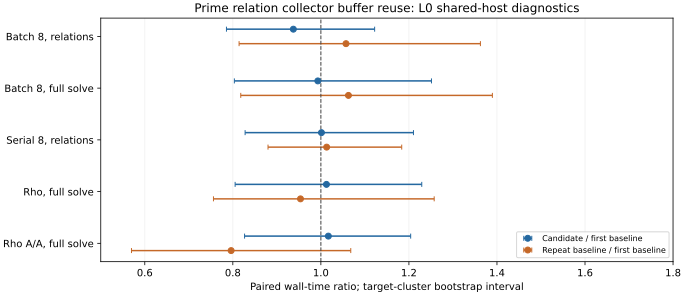

# Reusing prime lane collector buffers

The synchronized prime relation collector now reuses its request, native left/right point, and output vectors between rounds. At fixed width eight, these four buffers grow at most to the required width instead of being allocated afresh each round. The change is in `src/cryptanalysis/ic_boundary.rs`; the focused release test checked identical serial and batched point/coefficient streams at widths 4, 8, and 16, including restarts.

## Sealed evidence

The [frozen protocol](PROTOCOL.md), [spec](spec.json), and identical [baseline](baseline-plan.json) and [candidate](candidate-plan.json) plans bind eight public targets on registered curve `icv1-fp20-t727-cd198a38`, B48, 8 lanes, three measured rounds and one warmup. The candidate binary SHA-256 is `db9cf52602e8b3bc19a885c3eae99c899bd6acc541958246f3e540e58e8de743` (session source commit `316cc8386611d9b6ba7a57c86442b4d59ba9ee58`). The saved baseline binary SHA-256 is `ab5764921ad616ae8177ca57c125ec8cd7ba09896f1e0644a6999d1fb33b7159`, tied to source commit `431d0b3167027092443705e21d363489b2637a22` by the [earlier build receipt](../ecbench_rootfinding_lanes_20261013/postmerge-build-check.json).

| Order | Session | Records verified | Measured replays identical | PDF |
| --- | --- | ---: | ---: | --- |
| Baseline A0 | [ECBS1h79581b989883](sessions/baseline-a0/) | [128/128](baseline-a0-audit.json) | 96/96 | [Run report](reports/run-20261014T1529Z-ECBS1h79581b989883/REPORT.pdf) |
| Candidate B | [ECBS1hd3d1c462e777](sessions/candidate-b/) | [128/128](candidate-b-audit.json) | 96/96 | [Run report](reports/run-20261014T1529Z-ECBS1hd3d1c462e777/REPORT.pdf) |
| Baseline A1 | [ECBS1h7f416f0cedda](sessions/baseline-a1/) | [128/128](baseline-a1-audit.json) | 96/96 | [Run report](reports/run-20261014T1529Z-ECBS1h7f416f0cedda/REPORT.pdf) |

The [final candidate comparison](candidate-vs-baseline-a0-final.json) and [repeat-baseline comparison](baseline-drift-final.json) match all compared deterministic fields in all 128 paired records each: outcomes, counted cost, phase operation and native counters, ranks, and other details. All 384 executions verified their public target answer; all 288 measured replays were identical. The IC arms have the same mean cold counted cost, 7,952.58 GAE, in each session. The native [ecbench cross-session comparison](operations-compare.json) reports batch-8 counted-cost ratio 1.000 (interval 1.000–1.000) over 24 measured pairs and refuses a wall comparison because the arms are in different sessions. Counted cost is a lower bound because native field operations and other work remain unpriced in sealed records.

## Timing diagnostics

The custom ratios below are geometric means of matched measured rounds, clustered by the eight targets; parentheses give 95% target-cluster bootstrap intervals. They are descriptive diagnostics, outside ecbench's cross-session wall admission. All timings are L0 on a shared macOS arm64 host.

| Metric | Candidate B / baseline A0 | Repeat baseline A1 / A0 |
| --- | ---: | ---: |
| Batch-8 relation phase wall | 0.937 (0.786–1.122) | 1.057 (0.814–1.362) |
| Batch-8 whole solve wall | 0.993 (0.803–1.251) | 1.063 (0.818–1.390) |
| Serial-8 relation phase wall | 1.001 (0.828–1.210) | 1.013 (0.880–1.184) |
| Rho whole solve wall | 1.013 (0.805–1.229) | 0.954 (0.756–1.257) |
| Rho A/A whole solve wall | 1.017 (0.827–1.204) | 0.796 (0.570–1.068) |

The repeated baseline and A/A controls show substantial host variation, and every candidate interval includes parity. This run verifies the allocation change and exact solve behavior, but does not establish a wall-time improvement. It does not alter the earlier cold cost comparison against rho or support an extrapolation beyond the registered 20-bit subgroup.

The first candidate release build failed when Rust exhausted temporary space on `/Volumes/SSD990`; [that failure](BUILD_FAILURE.md) was retained and the successful retry used `target/tmp` on `/Volumes/SSD990-2`. The first comparison script incorrectly treated phase `wall_ns` as deterministic and exited with apparent mismatches. Its [raw outputs](candidate-vs-baseline-a0.json) [and](baseline-drift.json) remain; [the correction](CHECKER_CORRECTION.md) excludes only phase wall time from deterministic equality. The corrected results were written to new files.

## Next bottleneck

The vector allocations were a small part of relation collection at this size. The next useful measurement is an isolated profile that prices native field operations, table lookup, guard insertion, row reduction, and restart work in one cost model. The existing [complete-cost calibration problem](../../problems/rootfinding-complete-cost-calibration.md) tracks the sealed field-operation and L2 gates. Relation yield and useful rank per complete cold cost remain the optimization targets; a narrower wall profile can then decide whether further work belongs in the batched group law, table probing, or linear algebra.

Reproduction: `python3 compare_sessions.py sessions/baseline-a0 sessions/candidate-b --out /tmp/check.json`, then `python3 render_comparison.py`. The session logs, audit receipts, [comparison renderer](render_comparison.py), per-session graphs/PDFs, and this [PDF](REPORT.pdf) are committed together.
