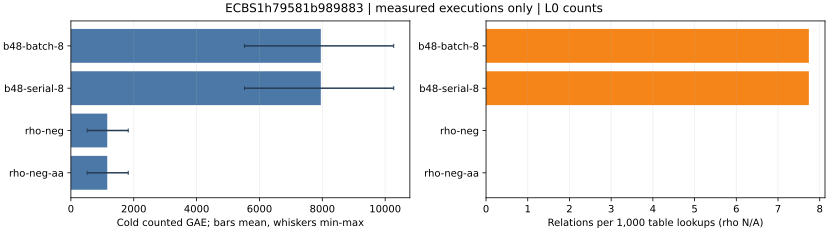

# Prime lane relation collector buffer reuse, baseline versus candidate

Session `ECBS1h79581b989883`, binary `ab5764921ad616ae8177ca57c125ec8cd7ba09896f1e0644a6999d1fb33b7159`; 128/128 records.

L0 counted operations and relation yield. Native field operation counts are absent from this record. All wall time is descriptive.

Raw records: [baseline-a0](../../sessions/baseline-a0/records.jsonl).
