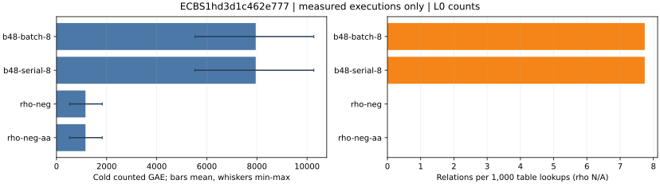

# Prime lane relation collector buffer reuse, baseline versus candidate

Session `ECBS1hd3d1c462e777`, binary `db9cf52602e8b3bc19a885c3eae99c899bd6acc541958246f3e540e58e8de743`; 128/128 records.

L0 counted operations and relation yield. Native field operation counts are absent from this record. All wall time is descriptive.

Raw records: [candidate-b](../../sessions/candidate-b/records.jsonl).
