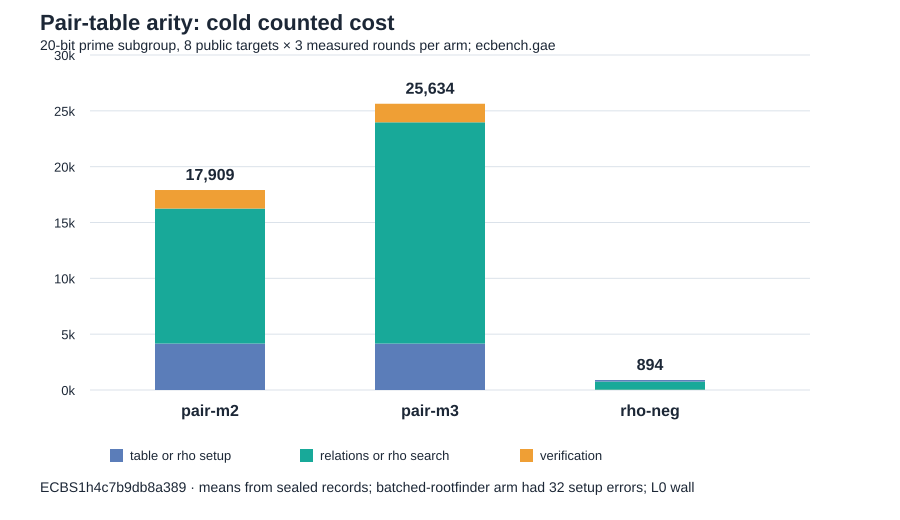

# Prime pair-table arity at 64 abscissae

Status: frozen trial completed, local full replay passed. This is a counted
single-target configuration comparison; no wall-time result is admitted.

The [protocol](PROTOCOL.md) and [spec](specs/prime20-b64-m2-vs-m3.json)
were committed at `fd85dff96d13494dfcd3592dba0ab2d5e590bbee` before
execution. The spec SHA-256 is
`384c9756d493ac17314c0c6a3d46f2a42470e8ed1575511fbd231232531ab23f`.
The [sealed session](sessions/prime20-b64-m2-vs-m3/) is
`ECBS1h4c7b9db8a389`, with binary SHA-256
`be956553a5a2cd1227e8f1add8dd24e11dffba5068c799234b55e44ffc3a1b61`.
It contains 160 executions on eight new public targets of registered
`icv1-fp20-t727-cd198a38` (prime subgroup order 562427): 128 verified,
32 setup errors in the extra `rootfind-subtract:m=3` arm. The retained
binary predates that oracle; each error says `oracle rootfind-subtract does
not run on a prime curve`. These errors are implementation incompatibility,
not evidence about its relation search.

| Arm | Measured verified | Mean cold GAE | Mean relation trials | Setup / relations / verification mean GAE |
| --- | ---: | ---: | ---: | ---: |
| `rho.negation` | 24/24 | 894.167 | — | 138.083 / 729.708 / 26.375 |
| Pair table, m=2 | 24/24 | 17,909.292 | 10,223 | 4,160 / 12,087.917 / 1,661.375 |
| Pair table, m=3 | 24/24 | 25,634.375 | 227.5 | 4,160 / 19,813 / 1,661.375 |
| Batched root finder, m=3 | 0/24 | — | — | setup error in every execution |

The [paired comparison](sessions/prime20-b64-m2-vs-m3/comparisons/pair-m2__pair-m3.json)
gives **m3/m2 = 1.431345** in counted GAE (95% target-cluster interval
1.224624–1.716117; 24 pairs, eight target clusters). The extra scan per
attempt outweighed the lower trial count. The [matched rho
comparison](sessions/prime20-b64-m2-vs-m3/comparisons/rho-neg__pair-m2.json)
puts m2/rho at 20.029 counted GAE on these targets; the [rho
A/A](sessions/prime20-b64-m2-vs-m3/comparisons/rho-neg__rho-neg-aa.json)
is 1.000. The [full replay](replay-all.json) found 0 integrity problems
and reproduced all 96 measured verified rows exactly. The 32 setup errors
remain in the sealed session; the audit accepts the complete record, not
the failed arm as a valid comparison.



The graph is generated from the [phase summary](summary.json) by
[`render_chart.mjs`](render_chart.mjs). The [run report](reports/run-20261013T1706Z/report.pdf)
and [results PDF](report.pdf) contain the same visual.

## Accounting and next step

Prime factor-base lifts, Legendre tests, square roots, hash probes and
matrix row operations are unpriced in ecbench.gae. The macOS runner used
`--cpus none --allow-busy`, so all wall observations are L0 and descriptive.
No cold full-cost speedup or result on a larger field follows. This result
does not change a canonical frontier graph; the checked counted-cost graph
for this local study is above. The next code path is a batch-inversion,
x-only construction of the **two-summand** table, measured under a new
frozen protocol in `../ecbench_rootfinding_batchtable_20261013/`.

## Reproduction

```sh
RAYON_NUM_THREADS=1 target/release/ecbench run --wait --allow-busy --cpus none --spec research/ecbench_rootfinding_arity_20261013/specs/prime20-b64-m2-vs-m3.json --out research/ecbench_rootfinding_arity_20261013/sessions/prime20-b64-m2-vs-m3
target/release/ecbench verify --dir research/ecbench_rootfinding_arity_20261013/sessions/prime20-b64-m2-vs-m3 --replay-all --out research/ecbench_rootfinding_arity_20261013/replay-all.json --exit-code
target/release/ecbench compare --dir research/ecbench_rootfinding_arity_20261013/sessions/prime20-b64-m2-vs-m3 --a pair-m2 --b pair-m3 --save --json
node research/ecbench_rootfinding_arity_20261013/render_chart.mjs
```
