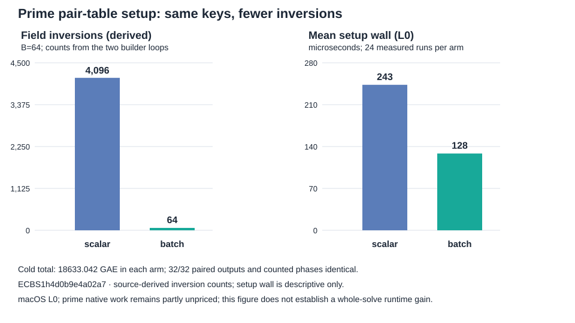

# Batched prime pair-table construction

Status: implemented, measured on one registered 20-bit prime subgroup, and
locally replayed. This is a native setup optimization with exact paired
output equality. The cold counted GAE did not change; L0 wall observations
do not establish a whole-solve runtime improvement.

## Frozen input and implementation

The [protocol](PROTOCOL.md) and [spec](specs/prime20-b64-batchtable.json)
were committed at `a45880095` before execution. Spec SHA-256:
`81a8e62856ff069ed68d1a6b9893b5366aadcdcced2f435a45249380b98a8091`.
The [session](sessions/prime20-b64-batchtable/) `ECBS1h4d0b9e4a02a7`
used source commit `3904a4f9d4ad0def62c0a4db9bf847543e770eaa` with a clean
tree and binary SHA-256
`4c55e01badbba18a43c7b096ff42c4e701996cc5311ce708a295b3235b4db391`.
The curve is registered `icv1-fp20-t727-cd198a38`, prime subgroup order
562427. Eight fresh public targets used target seed 20261015, one warmup
and three measured rounds per arm.

The new `mitm-prime-batch:m=2` oracle builds the same negation-folded
two-summand table as `mitm:m=2,negation_folded=1`. It uses the Montgomery
field's simultaneous inversion once per abscissa row and computes only
the pair sum's x coordinate, which is all the table key stores. The
existing exact group re-addition remains in the probe. The [focused
test](focused-test.log) compared every key and stored witness with the
scalar builder on a separate generated prime fixture and passed.

## Measurements

| Arm | Verified measured | Mean cold GAE | Mean relation trials | Mean table setup GAE | Mean setup wall (L0) |
| --- | ---: | ---: | ---: | ---: | ---: |
| rho.negation | 24/24 | 1,148.125 | — | — | — |
| Scalar pair table | 24/24 | 18,633.042 | 10,936.5 | 4,160 | 243.226 µs |
| Batched pair table | 24/24 | 18,633.042 | 10,936.5 | 4,160 | 128.380 µs |
| rho A/A | 24/24 | 1,148.125 | — | — | — |

The [paired checker](pair-check.json) found **32/32 identical**
baseline/candidate executions, including warmups: algorithm seed,
verified scalar and target check, factor-base digest, relation trials,
relations found, matrix rank, total GAE and every counted phase. The
[ecbench comparison](sessions/prime20-b64-batchtable/comparisons/pair-scalar__pair-batch.json)
reports batch/scalar **1.000** in counted GAE (24 measured pairs, exact
95% target-cluster interval 1.000–1.000). The
[matched rho comparison](sessions/prime20-b64-batchtable/comparisons/rho-neg__pair-batch.json)
is 16.229 batch/rho counted GAE (cluster interval 12.975–20.964), and
rho A/A is 1.000. The [full replay](replay-all.json) accepted all 128
verified records and reproduced all 96 measured executions with zero
integrity problems.

For `B=64` abscissae and 128 signed points, the scalar source loop makes
4,160 abstract additions, of which 64 are `P+(-P)` and need no inversion:
**4,096 field inversions**. The batched source loop performs **64
inversions**, one for each abscissa row, plus extra field multiplications.
These are *source-derived primitive counts*, not ecbench native counters;
the [phase metrics](phase-metrics.json) and [visual](setup.svg) label the
derivation. The mean observed setup wall quotient is 128.380/243.226 =
0.528 at L0. The sealed whole-solve wall comparison has batch/scalar
median 1.035 but admits zero pairs at L2; neither wall quotient is a
qualified runtime result.



The graph is generated by [`render_chart.mjs`](render_chart.mjs) from
the phase metrics. The [run report](reports/run-20261013T1738Z/report.pdf)
and [results PDF](report.pdf) contain the same labeled visual.

## Accounting and scope

The group-addition ledger is unchanged and still charges cold setup,
relations and verification to each target. Prime factor-base Legendre
tests and square roots, hash lookups, target guard probes, matrix row
operations, and rho canonicalization remain unpriced in ecbench.gae.
The host was macOS arm64 with `--cpus none --allow-busy`, so every wall
record is L0. The largest whole-process RSS in the batched arm was
31,600 KiB; this is not isolated table memory. There is no larger-field
or complete-cost claim. The open [calibration problem](../../problems/rootfinding-complete-cost-calibration.md)
retains the L2, native-pricing, and independent-host requirements. No
canonical frontier graph changes: the measured counted cost and relative
position to rho are unchanged.

## Reproduction

```sh
cargo test --release --lib prime_batch_table_matches_scalar_table_and_reduces_inversions -- --nocapture
RAYON_NUM_THREADS=1 target/release/ecbench run --wait --allow-busy --cpus none --spec research/ecbench_rootfinding_batchtable_20261013/specs/prime20-b64-batchtable.json --out research/ecbench_rootfinding_batchtable_20261013/sessions/prime20-b64-batchtable
jq -s -f research/ecbench_rootfinding_batchtable_20261013/check_pairs.jq research/ecbench_rootfinding_batchtable_20261013/sessions/prime20-b64-batchtable/records.jsonl
target/release/ecbench verify --dir research/ecbench_rootfinding_batchtable_20261013/sessions/prime20-b64-batchtable --replay-all --out research/ecbench_rootfinding_batchtable_20261013/replay-all.json --exit-code
target/release/ecbench compare --dir research/ecbench_rootfinding_batchtable_20261013/sessions/prime20-b64-batchtable --a pair-scalar --b pair-batch --save --json
node research/ecbench_rootfinding_batchtable_20261013/render_chart.mjs
```
