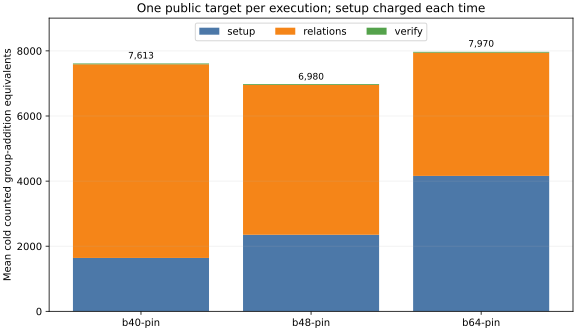

# Target-pinned factor-base holdout

Session `ECBS1hac7a406a30ba` used the [frozen holdout
spec](../../specs/prime20-pinned-holdout.json), eight new public targets on
the same registered curve, and the same current-source binary SHA-256
`c5d2539d4d50976741982f32bc444d4b4e625a3a239bd9910f30606c3ccddb57`.
All 160 executions verified and all 120 measured executions replayed
identically in the [full audit](../../replay-all-holdout.json) (receipt
SHA-256 `3fb8c4b82a9e114e6537ec1aa459228c4ef08d142b3cf05cbe151425e801a7e4`).

| arm | mean cold counted GAE | mean trials | paired ratio to B64 | 95% target-cluster interval |
|:--|--:|--:|--:|:--|
| B40 target pin | 7,613.333 | 4,380.708 | 0.9552 | not prespecified as primary |
| B48 target pin | 6,980.417 | 3,229.917 | 0.8758 | 0.8191–0.9370 |
| B64 target pin | 7,970.500 | 2,546.583 | 1.0000 | — |
| matched negation rho | 1,047.000 | — | — | — |

B48 retained lower paired counted GAE than B64 on unseen targets. B48/B40
was 0.9169 with interval 0.8225–1.0150, so their ordering remains
uncertain. B48 used 2,352 GAE in table setup, 4,603.167 in relation
collection and 25.25 in verification. The best IC arm was 6.6671 times
matched rho in this lower-bound count (interval 5.3684–8.3883).

These are L0 operation-count diagnostics on one 20-bit subgroup. The
factor-base construction's square roots and Legendre symbols, hash probes,
row work and some native work are unpriced. No wall-time comparison is
admitted, and no larger-field cost follows. The A/A rho count ratio is
exactly 1.0000.

The [session](../../sessions/prime20-pinned-holdout-20261013/), figure
[source](../../plot_counts.py), [plotted means](summary.json), SVG, 150-dpi
PNG and PDF are retained together.
