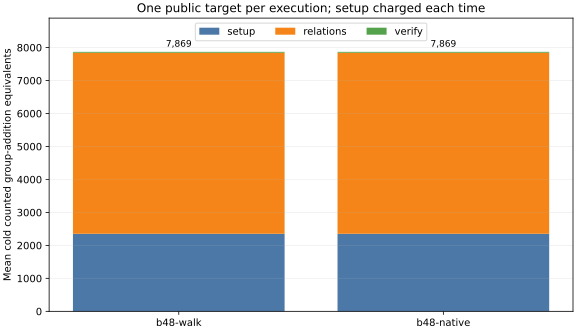

# Native one-lane relation walk at B48

The [frozen protocol](../../NATIVE-WALK.md) used the registered 20-bit prime subgroup,
eight fresh public targets (seed 20261018), a generic guarded walk, the same
walk with `Fp64` point additions, matched negation rho and an rho A/A arm.
The release ecbench binary had SHA-256
`1ff5b6d5f717f79cdfc557fde0017b0fac7e40502fe26a28bd7cdb2a99354904`.
The [session](../../sessions/prime20-native-walk-20261013/) completed with
128/128 verified executions. The [full audit](../../replay-all-native.json)
reported 96/96 identical measured replays and zero problems (receipt
SHA-256 `a7c51ea81a626270363857a125d9b4321e14c8a54c6bb24f8753a00d33c9a51e`).

The [paired checker](../../native-pair-check.json) passed on all 24 measured
native/generic pairs: target scalar, trial count, relation count, matrix
work and rank, walk steps and restarts, lookups, guard probes, and total
counted group-addition equivalents all matched. A separate
[4,096-step test](../../native-walk-correctness.txt) matched every
`(point, a, b)` through forced restarts and exceptional additions. The
[independent-lane test](../../native-batch-correctness.txt) matched widths
1, 2, 4, 8 and 16 through 1,024 steps each.

Both walks averaged 7,869.292 cold counted GAE: 2,352.000 table setup,
5,490.542 relations, and 26.750 verification. Both averaged 3,966.375
target trials and 32.125 relations. The saved
[ecbench comparison](../../sessions/prime20-native-walk-20261013/comparisons/b48-walk__b48-native.json)
has a counted ratio of 1.0000 across the 24 exact pairs. The native path
averaged 3,965.375 native walk additions per measured execution.
The [matched rho comparison](../../sessions/prime20-native-walk-20261013/comparisons/rho-neg__b48-native.json)
was 7.9501 native/rho in counted GAE (95% target-cluster interval
5.9335–10.8337). That lower-bound ratio leaves the native prime and rho
primitive costs unpriced.

Wall readings were L0 because the host was shared. The ecbench comparison
labels wall **descriptive**: median native/generic solve-wall ratio 1.3898,
with zero admitted L2 pairs. Mean relation-phase readings were 993.62 µs
generic and 2,200.59 µs native. These readings indicate that this particular
one-lane implementation should not be promoted as a speedup; host noise and
the native path's conversions, jump-cache search and inversion arithmetic
require isolated profiling to separate. The counters also leave lookups,
row operations, square-root/Legendre work and native conversion overhead
unpriced. The [rho A/A comparison](../../sessions/prime20-native-walk-20261013/comparisons/rho-neg__rho-neg-aa.json)
matched counted operations and had only L0 wall data.

The [lane kernel diagnostic](../../native-lane-profile.txt) used one
inversion per synchronized step at widths 4, 8 and 16, compared with up
to one per lane for separate additions, and preserved final points. Its
microsecond timings are L0 diagnostics and exclude lane scheduling,
relation probes, setup, matrix work and memory. The next implementation
test is an integrated multi-lane collector with exact per-lane replay and
complete cold-target accounting.

Figure source: [plot_counts.py](../../plot_counts.py); plotted means:
[summary.json](summary.json). A printable version is [REPORT.pdf](REPORT.pdf).
